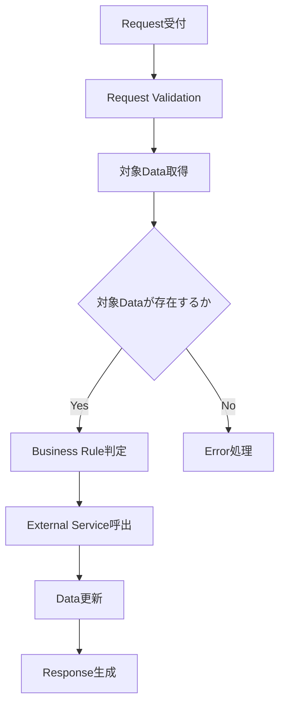
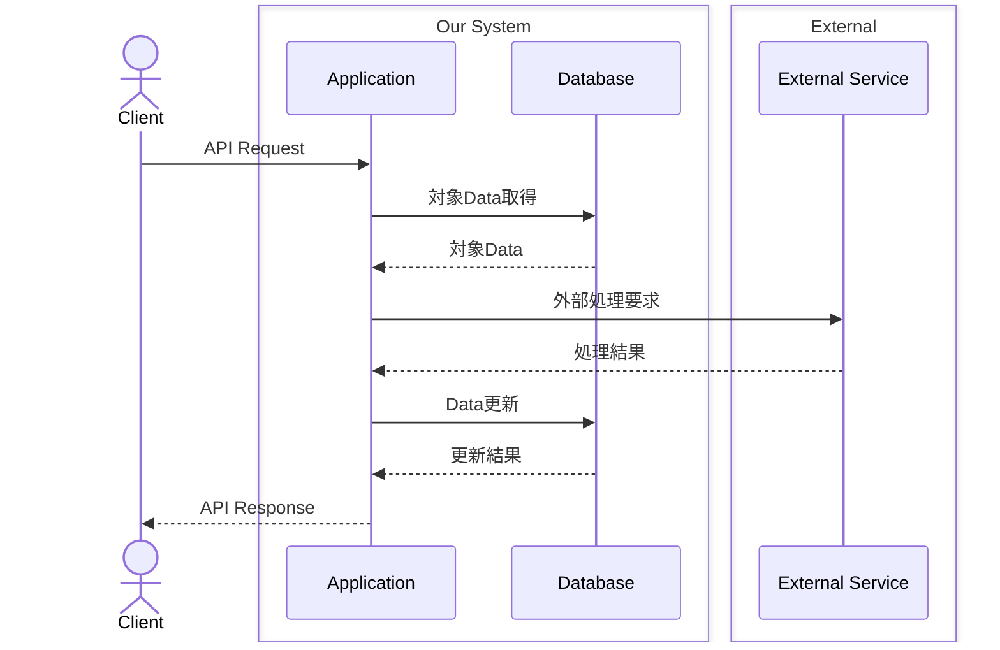
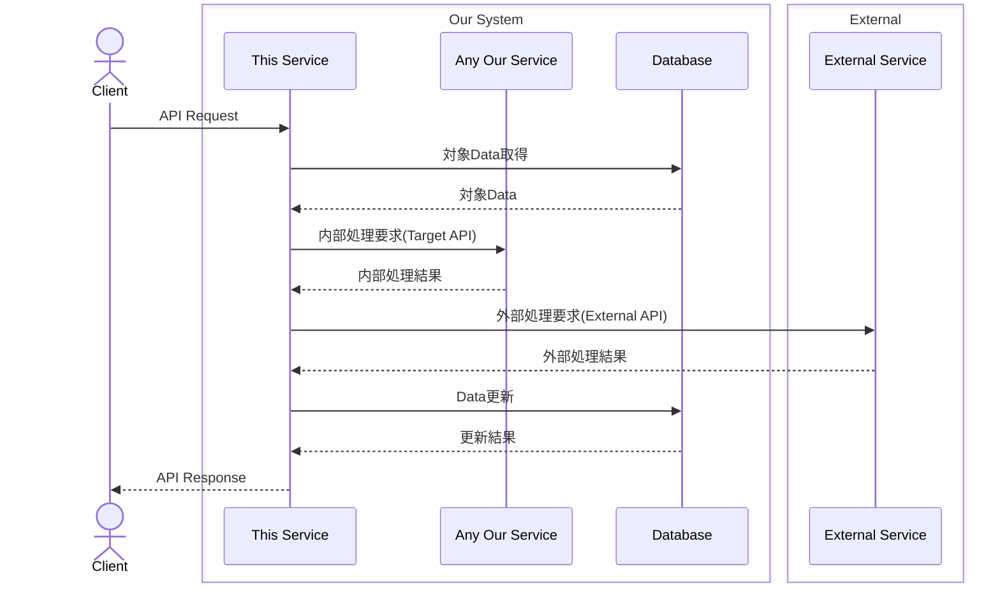

# Content Guide

## **Definition Policy**
- 本API Definitionは、1 APIにつき1 Artifactとして作成し、対象APIを実装可能な粒度まで具体化する。
- Function DesignおよびSystem Architecture等の上位設計で確定したAPIの目的、Service Boundary、Interface Relationship、Business RuleおよびArchitecture上のDecisionを前提とし、それらを本Definitionで再定義しない。
- 本APIを提供するServiceを基準として、Requestの受付からResponseの返却までに必要となるAPI内部の仕様を定義する。
- Request / ResponseのField、Type、Validation、Data Access、Transaction Boundary、処理Logic、Error Contract等、単一APIの内部で完結する仕様は本Definitionで実装可能な粒度まで確定する。
- Database、External Service、他のInternal Service等との連携については、本APIから見た利用方法およびInteractionを定義し、連携先自体の内部仕様は再定義しない。
- Environment固有のEndpoint、Secret、Credentialその他のConfigurationについては、可能な限り実値を固定的に記載せず、Applicationが利用するPropertyおよびConfiguration / Secret等のReferenceをContractとして定義する。
- Logic Flowは本APIの処理全体を縦方向に俯瞰するものとし、Sequenceは本APIを提供するServiceから見たDatabase、Internal Service、External Service等との横方向のInteractionを表現する。
- Processing DetailsはStep単位で構造化し、条件分岐、繰り返し、Step間遷移、Data Access、External Request / Response、Response Mapping等を、追加の設計判断を行わず実装へ移行できる粒度まで定義する。
- Processing Detailsの各Stepは一意に参照可能な番号を持ち、Transaction Overview、Error Definitionその他の関連仕様から同じStepを参照できる状態にする。
- Transactionを使用する場合は、個々の処理へTransaction属性を分散して記載するのではなく、Transaction OverviewでProcessing Stepとの対応およびTransaction Boundaryを明確にする。
- Errorについては、本APIがClientへ公開するError Code、HTTP Status、Error Message等のContractを定義し、個々の発生箇所におけるLoggingの具体的な実装は定義しない。
- Error Codeを使用する場合は、共通Error Code定義を参照し、用途および意味が一致する既存のError Codeが存在する場合はその定義を使用する。既存のError Codeを異なる意味へ流用せず、該当する定義が存在しない場合にのみ新たなError Codeを定義する。
- 新たなError Codeを定義した場合は、対象Specificationへの定義とあわせて共通Error Code定義にもその規定に従って都度追加し、以降の設計では追加されたError Codeを既存の共通定義として扱う。
- Logging等のApplication横断的な実装RuleはDevelopment Guideline等の対応する横断方針を前提とし、個々のLog内容は実装時に具体化する。
- Request / Response SamplesはDefinitionで確定した仕様の具体例として扱い、Sampleによって新たな仕様を追加・変更しない。
- 各Sectionは原則としてTableで構造化し、処理順序・条件分岐・Interaction・Payload等については、情報の性質に応じてMermaid、疑似Code、Code Block等を使用する。

## **Overview**
- Change History
- Summary
- Dependencies
- Request Definition
- Response Definition
- Data Access
- Logic Flow
- Sequence
- Transaction Overview
- Processing Details
- Error Definition
- Request / Response Samples

## **Section Guide**
### **0. Change History**
本項目では、本API仕様書の初回作成、および初回確定後に行われた正式なAPI仕様変更の履歴を記録する。

初回作成時は、レビューおよび再レビューを含む作成・確認が完了し、API仕様書が確定した時点で1件の履歴として記録する。
初回確定前に行われるレビュー指摘への対応、記載内容の修正、表現の改善、誤記修正などは、個別の変更履歴として記録しない。

初回確定後にAPI仕様の変更が必要となった場合、または後続のTrainにおいて機能追加・変更等に伴い本API仕様を変更した場合は、新しい履歴として記録する。

**example**:
| Change | Date | Train | Summary |
| --- | --- | --- | --- |
| Initial Design | [YYYY-MM-DD HH:mm] | [Train] | 初回設計 |
| Change 1 | [YYYY-MM-DD HH:mm] | [Train] | [変更概要] |
| Change 2 | [YYYY-MM-DD HH:mm] | [Train] | [変更概要] |

### **1. Summary**

#### **Format and Example**

※以下は記載形式で、内容はあくまで例

| Item | Value |
| --- | --- |
| Physical Name | `searchContents API` |
| Logical Name | コンテンツ検索API |
| Service | `search-service` |
| API Type | External |
| (HTTP Method) Endpoint | `(GET) /api/contents/search` |
| Description | 指定された検索条件に基づいてコンテンツを検索し、検索結果を返却する。 |

#### **API Summary Definition Notes**

- `Service`には、本APIを提供するApplication / MicroServiceの物理名を記載する。
- `API Type` は、APIの公開・利用範囲に応じて `Internal` / `External` を記載する。
- `(HTTP Method) Endpoint` は `(METHOD) /path` の形式で記載する。


### **2. Dependencies**

APIの実行時に必要となるConfiguration、接続先、Credential、File / Storage、Database、Messaging等の外部依存を定義する。

Environment固有の実値を直接保持するのではなく、可能な場合はApplicationから利用するPropertyと、その値の参照先をContractとして定義する。

#### **Format and Example**

※以下は記載形式で、内容はあくまで例

| No. | Property | Type | Required | Property Value / Reference | Purpose |
| ---: | --- | --- | :---: | --- | --- |
| 1 | `external.service.base-url` | Base URL | ● | `/project/{env}/external-service/base-url` | External ServiceのBase URL |
| 2 | `external.service.path` | Path | ● | `/api/v1/process` | Target APIの呼出Path |
| 3 | `database.url` | Database | ● | `/project/{env}/database/url` | Databaseへの接続先 |
| 4 | `storage.bucket.name` | Object Storage | ● | `/project/{env}/storage/bucket-name` | Objectの保存先 |
| 5 | `input.file.path` | File Path | - | `/data/input` | Input Fileの配置先 |
| 6 | `feature.option` | Configuration | ● | `/project/{env}/application/feature-option` | APIの動作設定を取得する |
| 7 | `external.service.api-key` | Secret | ● | `/project/{env}/external-service/api-key` | External Serviceの認証に使用する |

#### **Dependencies Definition Notes**

- `Property`には、ApplicationからDependencyを参照するためのProperty / Configuration Keyを記載する。
- `Type`には、値のデータ型ではなく、Dependencyの用途・性質を表す分類を記載する。
- `Type`は、同程度の抽象度となるよう以下を基準として使用する。
- `Base URL`は、External Service等への接続に使用するScheme、Host、および必要に応じてPortを含む基底URLを表す。
- `Path`は、Base URLに対して付加するTarget API等のPathを表す。

| Type | Definition | Example |
| --- | --- | --- |
| `Base URL` | API / External Service等への接続に使用する基底URL。Scheme、Host、および必要に応じてPortを含む | `https://api.example.com` |
| `Path` | Base URLに付加してTarget API / Resourceを特定するPath | `/api/v1/process` |
| `Configuration` | その他のApplication Configuration | Feature設定、動作設定 |
| `Database` | Database接続・利用に必要な情報 | Database URL / Name |
| `Messaging` | Queue / Topic / Broker等のMessaging Resource | Queue URL、Topic Name |
| `Object Storage` | Object StorageのResourceを特定する情報 | Bucket Name |
| `File Path` | Fileの入出力・授受先を特定するPath | Input / Output Directory |
| `Credential` | Authentication等に使用するCredentialへの参照 | Client Credential |
| `Secret` | Secretとして管理される値への参照 | API Key / Token |
| `Certificate` | Certificate / Trust Assetへの参照 | Client Certificate / CA |

- `Type`は特定製品やTechnologyを表す分類にはせず、Dependencyの役割を表す粒度とする。例えば `AWS S3` ではなく `Object Storage`、`Amazon SQS` ではなく `Messaging` とする。
- `Required`は、当該APIの実行に必須の場合は `●`、Optionalの場合は `-` とする。
- `Property Value / Reference`には、固定値を直接記載する必要がある場合はその値を、外部のConfiguration / Secret Store等を参照する場合はそのReferenceを記載する。
- Environmentによって変化するEndpoint、Resource Name、Credential等については、原則として特定Environmentの実値を固定的に記載せず、安定したReferenceを記載する。
- Secret、Credential、Token、Password等の機密値そのものは記載せず、そのReferenceのみを記載する。
- `Purpose`には、そのPropertyがAPIのどの依存を成立させるために必要なのかを簡潔に記載する。


### **3. Request Definition**

APIが受け付けるRequestについて、Fieldごとのデータ型、必須性、値の制約、Validationおよび意味を定義する。

Object / Array等の階層構造を持つ場合も、Fieldの階層関係が判断できる形式で記載する。

#### **Format and Example**

※以下は記載形式で、内容はあくまで例

| No. | Field | Type | Required | Size | Min / Max | Pattern | Validation | Description | Note |
| ---: | --- | --- | :---: | --- | --- | --- | --- | --- | --- |
| 1 | `userId` | String | ● | 36 | - | - | - | Userを識別するID | - |
| 2 | `condition` | Object | ● | - | - | - | - | 検索条件 | - |
| 3 | `condition.keyword` | String | - | 1-100 | - | - | - | 検索Keyword | - |
| 4 | `condition.category` | String | - | 1-20 | - | `^[A-Z_]+$` | 定義済みCategoryのみ指定可能 | 検索Category | - |
| 5 | `condition.score` | Integer | - | - | 0 / 100 | - | - | 検索に使用するScore | - |
| 6 | `condition.tags` | Array | - | 0-10 | - | - | - | 検索Tag一覧 | - |
| 7 | `condition.tags[]` | String | - | 1-30 | - | - | - | 検索Tag | - |

#### **Request Definition Notes**

- `Field`はRequest内のProperty名を記載し、Nested Objectは `parent.child`、Array要素は `field[]` の形式で表現する。
- `Type`には `String`、`Integer`、`Decimal`、`Boolean`、`Object`、`Array`、`Date`、`DateTime` 等、API Contract上のデータ型を記載する。
- `Required`は必須の場合 `●`、任意の場合 `-` とする。
- `Size`にはStringの文字数やArrayの要素数等のSize Constraintを記載する。範囲がある場合は `min-max` の形式とする。
- `Min / Max`には数値・日時等について許容する最小値 / 最大値を記載する。
- `Pattern`には文字形式を規定する正規表現等を記載する。
- `Validation`にはSize、Min / Max、Patternだけでは表現できないField固有のValidation Ruleを記載する。
- 複数FieldにまたがるBusiness Ruleそのものはここで再定義せず、上位設計を前提とする。


### **4. Response Definition**

APIが正常に処理された場合に返却するResponseについて、Fieldごとのデータ型、必須性および意味を定義する。

Object / Array等の階層構造を持つ場合も、Request Definitionと同様にFieldの階層関係が判断できる形式で記載する。

#### **Format and Example**

※以下は記載形式で、内容はあくまで例

| No. | Field | Type | Required | Description | Note |
| ---: | --- | --- | :---: | --- | --- |
| 1 | `result` | Object | ● | 処理結果 | - |
| 2 | `result.id` | String | ● | 対象を識別するID | - |
| 3 | `result.name` | String | ● | 対象名称 | - |
| 4 | `result.score` | Decimal | - | 算出されたScore | `null`となる場合あり |
| 5 | `result.tags` | Array | ● | 対象に設定されたTag一覧 | 0件の場合は空Array |
| 6 | `result.tags[]` | String | ● | Tag | - |

#### **Response Definition Notes**

- `Field`および`Type`の記載方法はRequest Definitionと同一とする。
- `Required`はResponseに常に含まれるFieldの場合 `●`、条件によって含まれない場合 `-` とする。
- `null`の許容、空Array、条件による値の変化等、Fieldの返却仕様について補足が必要な場合は`Note`に記載する。
- Error発生時のResponseは本Sectionでは定義せず、Error Definitionを正とする。


### **5. Data Access**

APIが処理中に利用するTableと、そのTableに対して行うCRUD操作および利用目的を定義する。

TableのColumnやConstraint等の内部仕様はTable Definitionを正とし、本SectionではAPIとTableの利用関係を記載する。

#### **Format and Example**

※以下は記載形式で、内容はあくまで例

| No. | Table | C | R | U | D | Purpose | Note |
| ---: | --- | :---: | :---: | :---: | :---: | --- | --- |
| 1 | `favorite` | ● | ● | - | - | お気に入り情報の登録および参照 | - |
| 2 | `content` | - | ● | - | - | 対象Contentの情報取得 | - |
| 3 | `user` | - | ● | ● | - | User情報の参照および状態更新 | 特定条件の場合のみUpdate |

#### **Data Access Definition Notes**

- `C` / `R` / `U` / `D`は、それぞれCreate / Read / Update / Deleteを表す。
- 対象Tableに対して実行する操作には `●`、実行しない操作には `-` を記載する。
- `Purpose`には、そのAPIが対象Tableを利用する機能上の目的を記載する。
- SQL、検索条件、更新Column、設定値等の具体的なData Access処理はここでは記載せず、該当するProcessing Detailsで定義する。
- Table自体のColumn、PK / FK、Index、Constraint等は再定義せず、対応するTable Definitionを正とする。


### **6. Logic Flow**

本APIがRequestを受け付けてからResponseを返却するまでの主要な処理を、APIを起点とした縦方向の処理フローとして定義する。

本SectionではAPI内部の処理全体を俯瞰し、各処理の具体的な実行内容はProcessing Detailsで定義する。

#### **Format and Example**

※以下は記載形式で、内容はあくまで例



#### **Logic Flow Definition Notes**

- 本APIを起点として、Request受付からResponse生成までの主要な処理を記載する。
- API内部で処理結果に影響する主要な条件分岐を記載する。
- 個々の処理Stepの具体的なLogic、SQL、Request / Response Mapping等は記載せず、Processing Detailsを正とする。
- 他APIやSystem全体のUse CaseまでFlowを広げず、本APIの処理範囲に限定する。


### **7. Sequence**

本APIの処理において関係するService / Component(Internalで通信が発生する他のmicroService等)、Database、External System / Service等とのInteractionを、本APIから見た処理順序として定義する。

本Sectionでは、System全体のComponent間関係ではなく、**本APIが処理を完了するために直接または間接的に利用する対象とのInteraction**に限定する。


#### **Format and Example**

※以下は記載形式で、内容はあくまで例

##### **Pattern A: Single Service**


##### **Pattern B: Internal Microservice Integration**



#### **Sequence Definition Notes**

- 本APIを起点として、API処理に関与する主要なService / Component(Internalで通信が発生する他のmicroService等)、Database、External System / Service等を記載する。
- Interactionには、具体的なFieldやPayloadではなく、処理要求・取得Data・処理結果等の意味的な概要を記載する。
- APIから見えないApplication内部のClass / Method間Call等まで展開せず、APIから見た主要なInteractionに限定する。
- System全体のUse Caseや、本APIの処理範囲外で継続するFlowは記載しない。
- 各Interactionの具体的な処理内容はProcessing Detailsを正とする。
- System Boundaryを明確にするため、自システム内のParticipantは`Our System`、外部のParticipantは`External`の`box`に分類する。


### **8. Transaction Overview**

本APIの処理でTransactionを使用する場合、Processing Detailsで定義する処理Stepとの対応およびTransaction Boundaryを定義する。

Transactionを使用しない場合は、その旨を明示する。

#### **Format and Example**

※以下は記載形式で、内容はあくまで例

##### **Pattern A: Single Transaction**

APIの更新処理を単一のTransactionで実行する場合。

| No. | Transaction | Processing Scope | Commit | Rollback | Description |
| ---: | --- | --- | --- | --- | --- |
| 1 | Transaction A | Step 2 - 4 | Step 4正常終了時 | Step 2 - 4でError発生時 | 対象Dataの更新と関連Dataの登録を同一Transactionで実行し、整合性を保証する |

##### **Pattern B: Multiple Transactions with External Processing**

Transaction間にExternal Service等への処理が存在し、Transaction Boundaryを分割する場合。

| No. | Transaction | Processing Scope | Commit | Rollback | Description |
| ---: | --- | --- | --- | --- | --- |
| 1 | Transaction A | Step 2 - 3 | Step 3正常終了時 | Step 2 - 3でError発生時 | External Service呼出し前に必要なData更新と履歴登録の整合性を保証する |
| 2 | Transaction B | Step 5 | Step 5正常終了時 | Step 5でError発生時 | External Serviceの処理結果をDataへ反映する |

##### **Pattern C: No Transaction**

Transactionによる更新整合性の制御を必要としない場合。

| No. | Transaction | Processing Scope | Commit | Rollback | Description |
| ---: | --- | --- | --- | --- | --- |
| - | - | - | - | - | Transactionを使用しない |

#### **Transaction Definition Notes**

- `Processing Scope`には、同一Transactionとして扱うProcessing DetailsのStep範囲を記載する。
- `Commit`にはTransactionを確定する条件または契機を記載する。
- `Rollback`にはRollbackが発生する条件および対象となるProcessing Scopeを記載する。
- `Description`には、Transaction Boundaryの目的や、その範囲で整合性を保証する対象を記載する。
- Transaction内部の個々の処理内容は再記載せず、Processing Detailsを正とする。
- Transaction外で実行すること自体が重要な処理については、Processing Detailsでその旨を明示する。


### **9. Processing Details**

#### **Format and Example**

※以下は記載形式で、内容はあくまで例

###### **Step 1. Request Validation**

**1.1.** Requestの入力内容を検証する。

**1.2.** `condition`が指定されている場合、以下を検証する。

- `category`が定義済みCategoryであること。
- `tags`の各要素が許可された形式であること。

**1.3.** Validation Errorが存在する場合は、Error:`E001`。Step 5へ進む。

**1.4.** Validationが正常に完了した場合は、**Step 2**へ進む。

**Error**: `E001` / `400 Bad Request`

**Transaction**: Outside

**Note**: [必要な場合のみ記載]


##### **Step 2. Target Data Acquisition**

**2.1.** Requestの`userId`を検索条件として対象Userを取得する。

**Query Conditions Pattern 1**

| Table | Column | Condition | Value |
| --- | --- | --- | --- |
| `user` | `user_id` | `=` | Request.`userId` |
| `user` | `status` | `=` | `'ACTIVE'` |
| `user_profile` | `profile_type` | `=` | Request.`profileType` |

**Query Conditions Pattern 2**
| Table | Column | Condition | Value |
| --- | --- | --- | --- |
| `favorite` | `user_id` | `=` | `user.id` |
| `favorite` | `content_id` | `=` | Request.`contentId` |

**2.2.** 取得結果に応じて以下の処理を行う。

```text
if 対象Userが存在する:
    Step 3へ進む
else:
    Error:E002。Step 5へ進む
```

**Error**: `E002` / `404 Not Found`

**Transaction**: Transaction A


###### **Step 3. External Service Request**

**3.1.** External Serviceへ送信するRequestを生成する。

**Request Target When REST**

| Item | Value |
| --- | --- |
| Base URL | Dependencies.`external.service.base-url` |
| Path | Dependencies.`external.service.path` |
| Method | `POST` |

**Request Target When gRPC**

| Item | Value |
| --- | --- |
| Host | Dependencies.`external.service.host` |
| Service | `UserService` |
| RPC Method | `GetUser` |

**Request Mapping**

| Target Field | Source |
| --- | --- |
| `userId` | Request.`userId` |
| `status` | Step 2で取得したUser.`status` |

**3.2.** External ServiceへRequestを送信する。

**External Response Information**

| Field | Type | Required | Description | Note |
| --- | --- | :---: | --- | --- |
| `result` | Object | ● | 処理結果 | - |
| `result.id` | String | ● | 処理対象ID | - |
| `result.status` | String | ● | 処理結果Status | - |
| `result.score` | Decimal | - | 算出されたScore | 条件によって返却されない |

**3.3.** Responseに応じて以下の処理を行う。

```text
if External Serviceの処理が正常終了:
    Step 4へ進む
else if External ServiceがRequest Errorを返却:
    Error: E003。Step 5へ進む
else if External Serviceが対象なしを返却:
    Error: E004。Step 5へ進む
else:
    Error: E999。Step 5へ進む
```

**Error**: 
- `E003` / `400 Bad Request`
- `E004` / `404 Not Found`
- `E999` / `500 Internal Server Error`

**Transaction**: Outside

**Note**: External ServiceへのRequestはTransaction AのCommit後に実行する。

##### **Step 4. Response Mapping**

**4.1.** 処理結果をAPI ResponseへMappingする。

**Response Mapping**

| Response Field | Source / Value |
| --- | --- |
| `result.id` | Step 2で取得したUser.`id` |
| `result.status` | Step 3で取得したExternal Response.`result.status` |
| `result.score` | Step 3で取得したExternal Response.`result.score` |

**4.2.** MappingしたResponseをClientへ返却し、処理を終了する。

**Note**: ResponseのField定義はResponse Definitionを正とする。


##### **Step 5. Error Response Mapping**

**5.1.** 発生したErrorに対応するError Responseを生成する。

**Error Response Mapping**

| Response Field | Source / Value | Required |
| --- | --- | :---: |
| `errorCode` | 発生したErrorに対応するError Code | ● |
| `errorMessage` | 発生したErrorに対応するError Message | ● |
| `validationMessage` | Validation Errorの詳細Message | - |

**5.2.** Error ResponseをClientへ返却し、処理を終了する。

**Note**: Error Code / Error Messageおよび各Errorの発生条件はError Definitionを正とする。

#### **Processing Details Definition Notes**
- 各処理は`Step N`を単位として分割し、`#### **Step N. [Title]**`の形式で記載する。
- Step内の処理には親Stepの番号を引き継ぎ、`N.1`、`N.2`、`N.3`...の形式で連番を付与する。
- 条件分岐や繰り返し処理は、必要に応じて疑似コードを使用して構造を明確にする。
- 他Stepへ処理を遷移する場合は、遷移先を`Step N`として明示する。
- SQL条件、Request / Response Mapping、更新値等、表形式に適した情報はStep内にTableとして記載する。
- Errorが発生し得る場合は、Step末尾に`**Error**:`として対応するErrorを記載する。
- `Error`に記載するHTTP Statusは、Error発生元から受け取ったStatusではなく、本APIがClientへ返却するHTTP Statusを記載する。※例えば外部Serviceが `404` を返しても、This APIの仕様上は `500` に変換する可能性もある。
- Transactionとの対応がある場合は、Step末尾に`**Transaction**:`としてTransaction Overviewで定義されたTransactionを記載する。
- 補足事項が必要な場合のみ、Step末尾に`**Note**:`を記載する。
- Error Codeを使用する場合は、共通Error Code定義を参照し、用途および意味が一致する既存のError Codeが存在する場合はその定義を使用する。既存のError Codeを異なる意味へ流用せず、該当する定義が存在しない場合にのみ新たなError Codeを定義する。
- 新たなError Codeを定義した場合は、対象Specificationへの定義とあわせて共通Error Code定義にもその規定に従って都度追加し、以降の設計では追加されたError Codeを既存の共通定義として扱う。

### **10. Error Definition**

本APIで発生するErrorについて、Error Code、HTTP Status、Clientへ返却するMessageを定義する。

Errorの発生条件およびError発生時の処理遷移はProcessing Detailsを正とし、本Sectionでは各Errorの返却・出力仕様を定義する。

#### **Format and Example**

※以下は記載形式で、内容はあくまで例

| No. | Error Code | HTTP Status | Error Message | Validation Message | Description | Note |
| ---: | --- | --- | --- | --- | --- | --- |
| 1 | `E001` | `400 Bad Request` | `[Error Message]` | `[Validation Message]` | Request Validation Error | - |
| 2 | `E002` | `404 Not Found` | `[Error Message]` | - | 対象Userが存在しない | - |
| 3 | `E003` | `400 Bad Request` | `[Error Message]` | - | External ServiceがRequest Errorを返却した | - |
| 4 | `E004` | `404 Not Found` | `[Error Message]` | - | External Serviceが対象なしを返却した | - |
| 5 | `E999` | `500 Internal Server Error` | `[Error Message]` | - | External Serviceの処理を正常に完了できない | - |

#### **Error Definition Notes**

- `Error Code`には、本APIでErrorを識別するためのCodeを記載する。
- `HTTP Status`には、Error発生元から受け取ったStatusではなく、本APIがClientへ返却するHTTP Statusを記載する。
- `Error Message`には、Error Responseの`errorMessage`へ設定するMessageを記載する。
- `Validation Message`には、Validation Error時に`validationMessage`へ設定する内容を記載し、該当しないErrorでは`-`とする。
- `Description`には、Errorが表す意味を簡潔に記載する。
- Errorの発生条件、判定Logicおよび遷移先は再定義せず、Processing Detailsを正とする。
- Error Codeを使用する場合は、共通Error Code定義を参照し、用途および意味が一致する既存のError Codeが存在する場合はその定義を使用する。既存のError Codeを異なる意味へ流用せず、該当する定義が存在しない場合にのみ新たなError Codeを定義する。
- 新たなError Codeを定義した場合は、対象Specificationへの定義とあわせて共通Error Code定義にもその規定に従って都度追加し、以降の設計では追加されたError Codeを既存の共通定義として扱う。


### **11. Request / Response Samples**

本APIのRequest / Responseについて、各Definitionで定義した仕様に基づく具体的なPayload例を記載する。

本Sectionでは新たな仕様を定義せず、Request Definition、Response DefinitionおよびError Definitionで定義された内容を具体的な形式で表現する。

#### **Format and Example**

※以下は記載形式で、内容はあくまで例

##### **Request Sample**

```json
{
  "userId": "user-001",
  "condition": {
    "keyword": "example",
    "category": "BOOK",
    "score": 80,
    "tags": [
      "technology",
      "cloud"
    ]
  }
}
```

##### **Success Response Sample**

```json
{
  "result": {
    "id": "content-001",
    "name": "Example Content",
    "score": 85.5,
    "tags": [
      "technology",
      "cloud"
    ]
  }
}
```

##### **Error Response Sample**

```json
{
  "errorCode": "E001",
  "errorMessage": "Invalid request.",
  "validationMessage": "category is invalid."
}
```

#### **Request / Response Samples Definition Notes**

- Sampleは、Request Definition、Response DefinitionおよびError Definitionで定義されたField、Type、Required等の仕様と一致させる。
- Sample内で新たなFieldや仕様を定義しない。
- Optional Fieldについて、仕様理解のために有用な場合はSampleへ含める。
- Secret、Credential、個人情報その他の実データは使用せず、Sample用の値を使用する。
- Error Responseは代表的なError Patternを記載し、すべてのError Codeについて個別Sampleを作成する必要はない。
