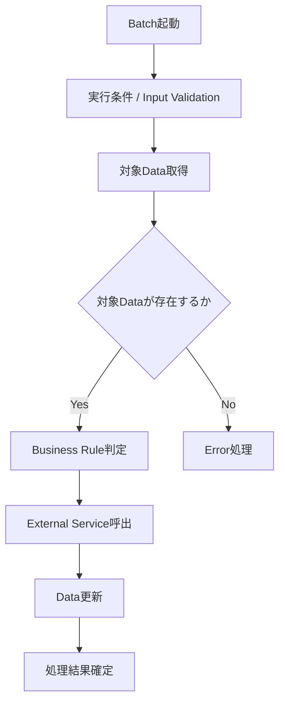
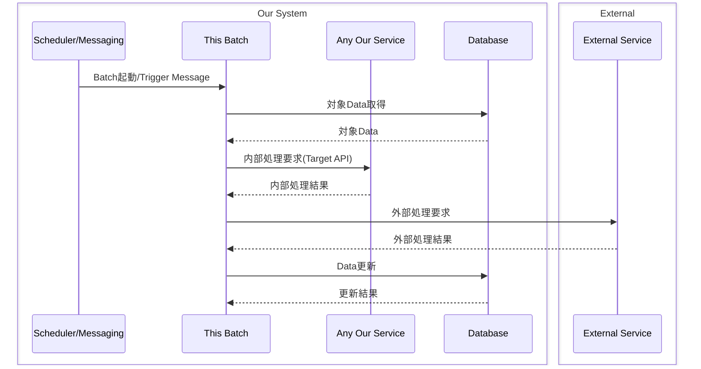

# Content Guide

## **Definition Policy**
- 本Batch Definitionは、1 Batchにつき1 Artifactとして作成し、対象Batchを実装可能な粒度まで具体化する。
- Function DesignおよびSystem Architecture等の上位設計で確定したBatchの目的、Service Boundary、Interface Relationship、Business RuleおよびArchitecture上のDecisionを前提とし、それらを本Definitionで再定義しない。
- 本Batchが所属するServiceを基準として、Batchの起動から正常終了または異常終了までに必要となるInput / Output、Data Access、Execution Control、Transaction、処理Logic、Error等のBatch固有仕様を定義する。
- Database、Internal Service、External Service等の他の設計対象を利用する場合、そのContractや内部仕様を再定義せず、対応するSpecificationを正とする。本Definitionでは、本Batchからの利用方法およびInteractionを定義する。
- Environment固有のEndpoint、Secret、Credentialその他のConfigurationについては、可能な限り実値を固定的に記載せず、Applicationが利用するPropertyおよびConfiguration / Secret等のReferenceをContractとして定義する。
- Batch Execution全体に適用される実行条件、多重起動、再実行、Retry、Job / Step Structure等の制御と、各Step内部の具体的なProcessingを分離して定義する。
- 各仕様は、追加の設計判断を行わず実装へ移行できる粒度まで具体化するとともに、同一仕様を複数Sectionで重複して定義せず、その仕様を担当するSectionを正とする。
- Error Codeを使用する場合は、共通Error Code定義を参照し、用途および意味が一致する既存のError Codeが存在する場合はその定義を使用する。既存のError Codeを異なる意味へ流用せず、該当する定義が存在しない場合にのみ新たなError Codeを定義する。
- 新たなError Codeを定義した場合は、対象Specificationへの定義とあわせて共通Error Code定義にもその規定に従って都度追加し、以降の設計では追加されたError Codeを既存の共通定義として扱う。
- Logging等のApplication横断的な実装RuleはDevelopment Guideline等の対応する横断方針を前提とし、本DefinitionではBatch固有の仕様のみを定義する。
- 各Sectionは原則としてTableで構造化し、処理順序、条件分岐、Interaction、Input / Output等については、情報の性質に応じてMermaid、疑似Code、Code Block等を使用する。
- Format and Exampleは記載粒度および構造の基準として扱い、実際のBatchの特性に応じて不要な要素の省略および必要な構造の追加・調整を行う。

## **Overview**
- Change History
- Summary
- Dependencies
- Input Definition
- Output Definition
- Data Access
- Logic Flow
- Sequence
- Execution Control
- Transaction Overview
- Processing Details
- Error Definition

## **Section Guide**
### **0. Change History**
本項目では、本Batch仕様書の初回作成、および初回確定後に行われた正式なBatch仕様変更の履歴を記録する。

初回作成時は、レビューおよび再レビューを含む作成・確認が完了し、Batch仕様書が確定した時点で1件の履歴として記録する。
初回確定前に行われるレビュー指摘への対応、記載内容の修正、表現の改善、誤記修正などは、個別の変更履歴として記録しない。

初回確定後にBatch仕様の変更が必要となった場合、または後続のTrainにおいて機能追加・変更等に伴い本Batch仕様を変更した場合は、新しい履歴として記録する。

**example**:
| Change | Date | Train | Summary |
| --- | --- | --- | --- |
| Initial Design | [YYYY-MM-DD HH:mm] | [Train] | 初回設計 |
| Change 1 | [YYYY-MM-DD HH:mm] | [Train] | [変更概要] |
| Change 2 | [YYYY-MM-DD HH:mm] | [Train] | [変更概要] |

### **1. Summary**

#### **Format and Example**

※以下は記載形式で、内容はあくまで例

| Item | Value |
| --- | --- |
| Physical Name | `contentSearchBatch` |
| Logical Name | コンテンツ検索Batch |
| Service | `batch-service` |
| Trigger Type | `Schedule` |
| Execution Schedule | `Daily 02:00` |
| Description | 対象コンテンツを定期的に検索し、処理結果を反映する。 |

#### **Batch Summary Definition Notes**

- `Service`には、本Batchが所属するApplication / MicroServiceの物理名を記載する。
- `Trigger Type`には、Batchを起動する契機を記載する。`Schedule`、`Manual`、`Event`等、起動方式を識別できる値とする。
- `Execution Schedule`には、定期実行の場合の実行周期・時刻を記載する。定期実行でない場合は`-`とする。


### **2. Dependencies**

Batchの実行時に必要となるConfiguration、接続先、Credential、File / Storage、Database、Messaging等の外部依存を定義する。

Environment固有の実値を直接保持するのではなく、可能な場合はApplicationから利用するPropertyと、その値の参照先をContractとして定義する。

#### **Format and Example**

※以下は記載形式で、内容はあくまで例

| No. | Property | Type | Required | Property Value / Reference | Purpose |
| ---: | --- | --- | :---: | --- | --- |
| 1 | `external.service.base-url` | Base URL | ● | `/project/{env}/external-service/base-url` | External ServiceのBase URL |
| 2 | `external.service.path` | Path | ● | `/api/v1/process` | Target APIの呼出Path |
| 3 | `database.url` | Database | ● | `/project/{env}/database/url` | Databaseへの接続先 |
| 4 | `storage.bucket.name` | Object Storage | ● | `/project/{env}/storage/bucket-name` | Objectの保存先 |
| 5 | `input.file.path` | File Path | - | `/data/input` | Input Fileの配置先 |
| 6 | `feature.option` | Configuration | ● | `/project/{env}/application/feature-option` | APIの動作設定を取得する |
| 7 | `external.service.api-key` | Secret | ● | `/project/{env}/external-service/api-key` | External Serviceの認証に使用する |

#### **Dependencies Definition Notes**

- `Property`には、ApplicationからDependencyを参照するためのProperty / Configuration Keyを記載する。
- `Type`には、値のデータ型ではなく、Dependencyの用途・性質を表す分類を記載する。
- `Type`は、同程度の抽象度となるよう以下を基準として使用する。
- `Base URL`は、External Service等への接続に使用するScheme、Host、および必要に応じてPortを含む基底URLを表す。
- `Path`は、Base URLに対して付加するTarget API等のPathを表す。

| Type | Definition | Example |
| --- | --- | --- |
| `Base URL` | API / External Service等への接続に使用する基底URL。Scheme、Host、および必要に応じてPortを含む | `https://api.example.com` |
| `Path` | Base URLに付加してTarget API / Resourceを特定するPath | `/api/v1/process` |
| `Configuration` | その他のApplication Configuration | Feature設定、動作設定 |
| `Database` | Database接続・利用に必要な情報 | Database URL / Name |
| `Messaging` | Queue / Topic / Broker等のMessaging Resource | Queue URL、Topic Name |
| `Object Storage` | Object StorageのResourceを特定する情報 | Bucket Name |
| `File Path` | Fileの入出力・授受先を特定するPath | Input / Output Directory |
| `Credential` | Authentication等に使用するCredentialへの参照 | Client Credential |
| `Secret` | Secretとして管理される値への参照 | API Key / Token |
| `Certificate` | Certificate / Trust Assetへの参照 | Client Certificate / CA |

- `Type`は特定製品やTechnologyを表す分類にはせず、Dependencyの役割を表す粒度とする。例えば `AWS S3` ではなく `Object Storage`、`Amazon SQS` ではなく `Messaging` とする。
- `Required`は、当該Batchの実行に必須の場合は `●`、Optionalの場合は `-` とする。
- `Property Value / Reference`には、固定値を直接記載する必要がある場合はその値を、外部のConfiguration / Secret Store等を参照する場合はそのReferenceを記載する。
- Environmentによって変化するEndpoint、Resource Name、Credential等については、原則として特定Environmentの実値を固定的に記載せず、安定したReferenceを記載する。
- Secret、Credential、Token、Password等の機密値そのものは記載せず、そのReferenceのみを記載する。
- `Purpose`には、そのPropertyがBatchのどの依存を成立させるために必要なのかを簡潔に記載する。


### **3. Input Definition**

Batchが外部から受け取るInputについて、その種類、取得元および形式を定義する。

Database TableへのRead / Writeは本Sectionでは扱わず、Data Accessで定義する。

Input が存在しない場合、該当するSubsectionは省略する。

#### **Format and Example**

※以下は記載形式で、内容はあくまで例

| No. | Input | Type | Source | Required | Format / Definition | Description | Note |
| ---: | --- | --- | --- | :---: | --- | --- | --- |
| 1 | `targetDate` | Parameter | Batch Execution | ● | `yyyy-MM-dd` | 処理対象日 | - |
| 2 | `inputFile` | File | Object Storage | ● | CSV / `input-file-definition` | 処理対象File | File Definitionを参照 |
| 3 | `processingEvent` | Message | Messaging | - | `processing-event-definition` | 処理開始に使用するMessage | Event起動時のみ |

#### **Input Definition Notes**

- `Input`にはBatchが処理開始時または処理中に外部から受け取るInputの論理的な識別名を記載する。
- `Type`にはInputの受渡方式・性質を表す分類を記載する。`Parameter`、`File`、`Object`、`Message`等を基本とする。
- `Source`にはInputの提供元を記載する。具体的な接続情報やResource Referenceが必要な場合はDependenciesを参照する。
- `Required`はBatch実行に必須の場合`●`、条件によって使用する場合`-`とする。
- `Format / Definition`には単純な値であればFormatを、構造を持つInputであれば対応するDefinitionへの参照を記載する。
- Databaseから取得するDataはInputとして重複して記載せず、Data AccessおよびProcessing Detailsで定義する。


### **4. Output Definition**

Batchが処理結果として外部へ生成・出力するOutputについて、その種類、出力先および形式を定義する。

Database TableへのRead / Writeは本Sectionでは扱わず、Data Accessで定義する。

Output が存在しない場合、該当するSubsectionは省略する。

#### **Format and Example**

※以下は記載形式で、内容はあくまで例

| No. | Output | Type | Destination | Format / Definition | Description | Note |
| ---: | --- | --- | --- | --- | --- | --- |
| 1 | `resultFile` | File | Object Storage | CSV / `result-file-definition` | Batch処理結果を出力するFile | - |
| 2 | `completionEvent` | Message | Messaging | `completion-event-definition` | Batch完了を通知するMessage | 正常終了時のみ |

#### **Output Definition Notes**

- `Output`にはBatchが外部へ生成・送信するOutputの論理的な識別名を記載する。
- `Type`にはOutputの受渡方式・性質を表す分類を記載する。`File`、`Object`、`Message`等を基本とする。
- `Destination`にはOutputの提供先を記載する。具体的な接続情報やResource Referenceが必要な場合はDependenciesを参照する。
- `Format / Definition`には単純なOutputであればFormatを、構造を持つOutputであれば対応するDefinitionへの参照を記載する。
- DatabaseへのInsert / Update / DeleteはOutputとして重複して記載せず、Data AccessおよびProcessing Detailsで定義する。


### **5. Data Access**

Batchが処理中に利用するTableと、そのTableに対して行うCRUD操作および利用目的を定義する。

TableのColumnやConstraint等の内部仕様はTable Definitionを正とし、本SectionではBatchとTableの利用関係を記載する。

#### **Format and Example**

※以下は記載形式で、内容はあくまで例

| No. | Table | C | R | U | D | Purpose | Note |
| ---: | --- | :---: | :---: | :---: | :---: | --- | --- |
| 1 | `favorite` | ● | ● | - | - | お気に入り情報の登録および参照 | - |
| 2 | `content` | - | ● | - | - | 対象Contentの情報取得 | - |
| 3 | `user` | - | ● | ● | - | User情報の参照および状態更新 | 特定条件の場合のみUpdate |

#### **Data Access Definition Notes**

- `C` / `R` / `U` / `D`は、それぞれCreate / Read / Update / Deleteを表す。
- 対象Tableに対して実行する操作には `●`、実行しない操作には `-` を記載する。
- `Purpose`には、そのBatchが対象Tableを利用する機能上の目的を記載する。
- SQL、検索条件、更新Column、設定値等の具体的なData Access処理はここでは記載せず、該当するProcessing Detailsで定義する。
- Table自体のColumn、PK / FK、Index、Constraint等は再定義せず、対応するTable Definitionを正とする。


### **6. Logic Flow**

本Batchが起動してから処理結果が確定するまでの主要な処理を、Batchを起点とした縦方向の処理フローとして定義する。

本SectionではBatch内部の処理全体を俯瞰し、各処理の具体的な実行内容はProcessing Detailsで定義する。

#### **Format and Example**

※以下は記載形式で、内容はあくまで例



#### **Logic Flow Definition Notes**

- 本Batchが起動してから処理結果が確定するまで主要な処理を記載する。
- Batch内部で処理結果に影響する主要な条件分岐を記載する。
- 個々の処理Stepの具体的なLogic、SQL、Request / Response Mapping等は記載せず、Processing Detailsを正とする。
- 他BatchやSystem全体のUse CaseまでFlowを広げず、本Batchの処理範囲に限定する。


### **7. Sequence**

本Batchの処理において関係するService / Component(Internalで通信が発生する他のmicroService等)、Database、External System / Service等とのInteractionを、本Batchから見た処理順序として定義する。

本Sectionでは、System全体のComponent間関係ではなく、**本Batchが処理を完了するために直接または間接的に利用する対象とのInteraction**に限定する。


#### **Format and Example**

※以下は記載形式で、内容はあくまで例




#### **Sequence Definition Notes**

- 本Batchを起点として、Batch処理に関与する主要なService / Component(Internalで通信が発生する他のmicroService等)、Database、External System / Service等を記載する。
- Interactionには、具体的なFieldやPayloadではなく、処理要求・取得Data・処理結果等の意味的な概要を記載する。
- Batchから見えないApplication内部のClass / Method間Call等まで展開せず、Batchから見た主要なInteractionに限定する。
- System全体のUse Caseや、本Batchの処理範囲外で継続するFlowは記載しない。
- 各Interactionの具体的な処理内容はProcessing Detailsを正とする。
- System Boundaryを明確にするため、自システム内のParticipantは`Our System`、外部のParticipantは`External`の`box`に分類する。

### **8. Execution Control**

#### **Execution Properties**

Batchの実行単位、実行条件、前後関係、多重起動、再実行、および異常終了時の実行制御を定義する。

Batch内部の個々の処理Logicではなく、Batch Execution全体に適用される制御仕様を対象とする。

##### **Format and Example**

※以下は記載形式で、内容はあくまで例

| Item | Value | Description |
| --- | --- | --- |
| Execution Mode | `Synchronous` | Batch起動元はBatchの完了まで実行結果を待機する |
| Execution Condition | [Condition] | Batchを実行可能とする条件 |
| Expected Execution Time | 30 min以内 | 想定対象件数における実行時間 |
| Expected Volume | 100,000 records | 1回の実行で処理する想定最大件数 |
| Concurrent Execution | Not Allowed | 同一Batchの多重起動を許可しない |
| Restart | Allowed | 異常終了後の再実行を許可する |
| Restart Point | From Failed Step | 失敗したStepから再開する |
| Predecessor Batch | `dataImportBatch` | 正常終了後に本Batchを実行する |
| Successor Batch | `resultExportBatch` | 本Batch正常終了後に実行する |

#### **Job / Step Structure**

Batchを構成するJob / Stepと、その実行順序および実行制御上の関係を定義する。

##### **Format and Example**

※以下は記載形式で、内容はあくまで例

| No. | Job / Step | Type | Execution Condition | On Success | On Failure |
| ---: | --- | --- | --- | --- | --- |
| 1 | `TargetExtractionStep` | Step | Batch起動時 | Step 2 | Abort |
| 2 | `ProcessingStep` | Step | Step 1正常終了 | Step 3 | Restartable |
| 3 | `ResultUpdateStep` | Step | Step 2正常終了 | Complete | Abort |

#### **Execution Control Definition Notes**

- `Execution Mode`には、Batch実行を起動元から見た`Synchronous` / `Asynchronous`等の実行方式を記載する。
- `Execution Condition`には、Scheduleとは別に、Batchを実際に実行可能とする前提条件がある場合に記載する。起動Schedule自体はSummaryを正とする。
- `Expected Execution Time`には、想定する処理量を前提としたBatch全体の実行時間を記載する。
- `Expected Volume`には、通常時または最大時など、Batch固有のPerformance設計で前提とする処理件数を記載する。前提条件が必要な場合は併記する。
- `Concurrent Execution`には、同一Batchの同時実行を許可するかを記載する。
- `Restart`には、異常終了したBatchを再実行可能かを記載する。
- `Restart Point`には、再実行時にBatch全体を最初から実行するか、特定のJob / Step等から再開可能かを記載する。
- `Predecessor Batch` / `Successor Batch`には、実行順序上の依存関係を持つBatchを記載する。存在しない場合は`-`とする。

### **9. Transaction Overview**

本Batchの処理でTransactionを使用する場合、Processing Detailsで定義する処理Stepとの対応およびTransaction Boundaryを定義する。

Transactionを使用しない場合は、その旨を明示する。

#### **Format and Example**

※以下は記載形式で、内容はあくまで例

##### **Pattern A: Single Transaction**

Batchの更新処理を単一のTransactionで実行する場合。

| No. | Transaction | Processing Scope | Commit | Rollback | Description |
| ---: | --- | --- | --- | --- | --- |
| 1 | Transaction A | Step 2 - 4 | Step 4正常終了時 | Step 2 - 4でError発生時 | 対象Dataの更新と関連Dataの登録を同一Transactionで実行し、整合性を保証する |

##### **Pattern B: Multiple Transactions with External Processing**

Transaction間にExternal Service等への処理が存在し、Transaction Boundaryを分割する場合。

| No. | Transaction | Processing Scope | Commit | Rollback | Description |
| ---: | --- | --- | --- | --- | --- |
| 1 | Transaction A | Step 2 - 3 | Step 3正常終了時 | Step 2 - 3でError発生時 | External Service呼出し前に必要なData更新と履歴登録の整合性を保証する |
| 2 | Transaction B | Step 5 | Step 5正常終了時 | Step 5でError発生時 | External Serviceの処理結果をDataへ反映する |

##### **Pattern C: No Transaction**

Transactionによる更新整合性の制御を必要としない場合。

| No. | Transaction | Processing Scope | Commit | Rollback | Description |
| ---: | --- | --- | --- | --- | --- |
| - | - | - | - | - | Transactionを使用しない |

#### **Transaction Definition Notes**

- `Processing Scope`には、同一Transactionとして扱うProcessing DetailsのStep範囲を記載する。
- `Commit`にはTransactionを確定する条件または契機を記載する。
- `Rollback`にはRollbackが発生する条件および対象となるProcessing Scopeを記載する。
- `Description`には、Transaction Boundaryの目的や、その範囲で整合性を保証する対象を記載する。
- Transaction内部の個々の処理内容は再記載せず、Processing Detailsを正とする。
- Transaction外で実行すること自体が重要な処理については、Processing Detailsでその旨を明示する。


### **10. Processing Details**

#### **Format and Example**

※以下は記載形式で、内容はあくまで例

###### **Step 1. Execution Condition / Input Validation**

**1.1.** Batchの実行条件を確認する。

**1.2.** Inputが存在する場合、Input Definitionに基づいて入力内容を検証する。

**1.3.** 実行条件を満たさない場合は、Error:`E001`としてStep 6へ進む。

**1.4.** Input Validation Errorが存在する場合は、Error:`E002`としてStep 6へ進む。

**1.5.** 実行条件およびInput Validationに問題がない場合は、**Step 2**へ進む。

**Error**:
- `E001`
- `E002`

**Transaction**: Outside

**Note**: [必要な場合のみ記載]


##### **Step 2. Target Data Acquisition**

**2.1.** Requestの`userId`を検索条件として対象Userを取得する。

**Query Conditions Pattern 1**

| Table | Column | Condition | Value |
| --- | --- | --- | --- |
| `user` | `user_id` | `=` | Request.`userId` |
| `user` | `status` | `=` | `'ACTIVE'` |
| `user_profile` | `profile_type` | `=` | Request.`profileType` |

**Query Conditions Pattern 2**
| Table | Column | Condition | Value |
| --- | --- | --- | --- |
| `favorite` | `user_id` | `=` | `user.id` |
| `favorite` | `content_id` | `=` | Request.`contentId` |

**2.2.** 取得結果に応じて以下の処理を行う。

```text
if 処理対象Dataが存在する:
    Step 3へ進む
else:
    正常終了する
```

**Transaction**: Transaction A


###### **Step 3. External Service Request**

**3.1.** External Serviceへ送信するRequestを生成する。

**Request Target When REST**

| Item | Value |
| --- | --- |
| Base URL | Dependencies.`external.service.base-url` |
| Path | Dependencies.`external.service.path` |
| Method | `POST` |

**Request Target When gRPC**

| Item | Value |
| --- | --- |
| Host | Dependencies.`external.service.host` |
| Service | `UserService` |
| RPC Method | `GetUser` |

**Request Mapping**

| Target Field | Source |
| --- | --- |
| `userId` | Request.`userId` |
| `status` | Step 2で取得したUser.`status` |

**3.2.** External ServiceへRequestを送信する。

**External Response Information**

| Field | Type | Required | Description | Note |
| --- | --- | :---: | --- | --- |
| `result` | Object | ● | 処理結果 | - |
| `result.id` | String | ● | 処理対象ID | - |
| `result.status` | String | ● | 処理結果Status | - |
| `result.score` | Decimal | - | 算出されたScore | 条件によって返却されない |

**3.3.** Responseに応じて以下の処理を行う。

```text
if External Serviceの処理が正常終了:
    Step 4へ進む
else if External Serviceが対象なしを返却:
    Error: E003。Step 6へ進む
else:
    Error: E999。Step 6へ進む
```

**Error**: 
- `E003`
- `E999`

**Transaction**: Outside

**Note**: External ServiceへのRequestはTransaction AのCommit後に実行する。

###### **Step 4. Target Processing**

**4.1.** 取得した処理対象Dataを順に処理する。

```text
for each Target Data:
    対象Dataに対する処理を実行する。

    if 処理が正常終了:
        次のTarget Dataへ進む。
    else if 対象Dataが処理不能:
        Error: E004。Step 6へ進む。
    else:
        Error: E999。Step 6へ進む。
```

**Error**: 
- `E004`
- `E999`

**Transaction**: Transaction A

**Note**: [必要な場合のみ記載]


###### **Step 5. Result Finalization**

**5.1.** Batch処理結果を確定する。

**5.2.** Outputが存在する場合、Output Definitionに基づいてOutputを生成する。

**5.3.** 後続Batchが存在する場合、Execution Controlで定義されたSuccessor Batchへ処理を引き渡す。

**Transaction**: Transaction B

**Note**: [必要な場合のみ記載]


###### **Step 6. Error Handling**

**6.1.** 発生元Stepで設定されたErrorを引き継ぐ。

**6.2.** Error DefinitionおよびExecution Controlに基づき、対象ErrorがRetry対象であるかを判定する。

```text
if Retryが必要:
    Execution Controlで定義されたRetry条件に従って対象処理を再実行する。
else:
    6.3へ進む。
```

**6.3.** Retryを行わない場合、またはRetry上限に達しても処理が正常終了しない場合は、必要な異常時終了処理を実行する。

**6.4.** Batchの実行結果を異常終了として確定し、処理を終了する。

**Error**: 発生元Stepで設定されたErrorを引き継ぐ。

**Transaction**: Outside

**Note**: [必要な場合のみ記載]


#### **Processing Details Definition Notes**
- 各処理は`Step N`を単位として分割し、`###### **Step N. [Title]**`の形式で記載する。
- Step内の処理には親Stepの番号を引き継ぎ、`N.1`、`N.2`、`N.3`...の形式で連番を付与する。
- 各Stepは、追加の設計判断を行わず実装へ移行できる粒度まで具体化する。
- 条件分岐や繰り返し処理は、必要に応じて疑似コードを使用して構造を明確にする。
- 他Stepへ処理を遷移する場合は、遷移先を`Step N`として明示する。
- SQL条件、Input / Output Mapping、External InterfaceのRequest / Response Mapping、更新値等、表形式に適した情報はStep内にTableとして記載する。
- Errorが発生し得る場合は、発生条件と後続処理をStep内で明示し、Step末尾に`**Error**:`として対応するErrorを記載する。
- Retry、Skip、Continue、Abort等の実行制御が必要な場合は、Execution Controlで定義された方針を前提として、Processing Detailsではその制御が適用される箇所および処理遷移を明示する。
- Transactionとの対応がある場合は、Step末尾に`**Transaction**:`としてTransaction Overviewで定義されたTransactionを記載する。Transaction外の場合は`Outside`と記載する。
- 補足事項が必要な場合のみ、Step末尾に`**Note**:`を記載する。
- Error Codeを使用する場合は、共通Error Code定義を参照し、用途および意味が一致する既存のError Codeが存在する場合はその定義を使用する。既存のError Codeを異なる意味へ流用せず、該当する定義が存在しない場合にのみ新たなError Codeを定義する。
- 新たなError Codeを定義した場合は、対象Specificationへの定義とあわせて共通Error Code定義にもその規定に従って都度追加し、以降の設計では追加されたError Codeを既存の共通定義として扱う。

### **11. Error Definition**

本Batchで発生するErrorについて、Error Code、Error MessageおよびErrorの意味を定義する。

Errorの発生条件、判定Logic、Retryを含む異常時制御および処理遷移は本Sectionで再定義せず、Processing DetailsおよびExecution Controlを正とする。

#### **Format and Example**

※以下は記載形式で、内容はあくまで例

| No. | Error Code | Error Message | Description | Note |
| ---: | --- | --- | --- | --- |
| 1 | `E001` | `[Error Message]` | Batchの実行条件を満たしていない | - |
| 2 | `E002` | `[Error Message]` | Input Validation Errorが発生した | - |
| 3 | `E003` | `[Error Message]` | External Serviceから対象なしが返却された | - |
| 4 | `E004` | `[Error Message]` | 対象Dataを正常に処理できない | - |
| 5 | `E999` | `[Error Message]` | 処理を正常に完了できない予期しないErrorが発生した | - |

#### **Error Definition Notes**

- `Error Code`には、本BatchでErrorを識別するためのCodeを記載する。
- `Error Message`には、Error発生時に使用するMessageを記載する。
- `Description`には、Errorが表す意味を簡潔に記載する。
- Errorの発生条件および判定Logicは再定義せず、Processing Detailsを正とする。
- Retry、Skip、Continue、Abort等の異常時制御は再定義せず、Execution Controlを正とする。
- 同一のError Codeが複数のProcessing Stepから発生することを許容する。
- Error Codeを使用する場合は、共通Error Code定義を参照し、用途および意味が一致する既存のError Codeが存在する場合はその定義を使用する。既存のError Codeを異なる意味へ流用せず、該当する定義が存在しない場合にのみ新たなError Codeを定義する。
- 新たなError Codeを定義した場合は、対象Specificationへの定義とあわせて共通Error Code定義にもその規定に従って都度追加し、以降の設計では追加されたError Codeを既存の共通定義として扱う。
