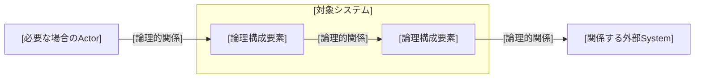
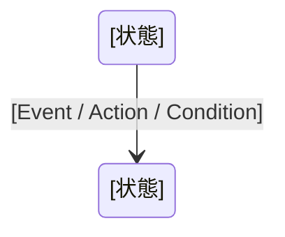
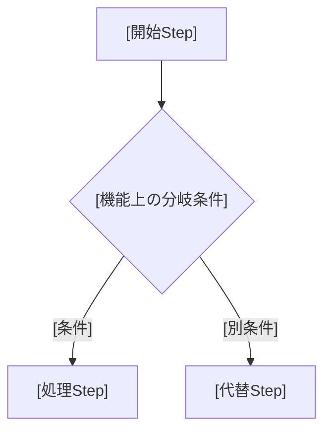
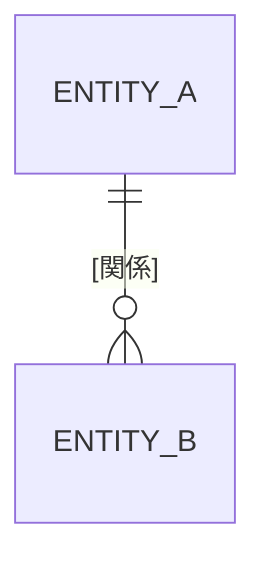
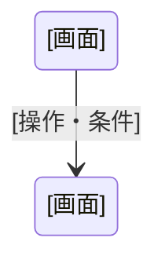

# 機能設計書（Functional Design Document）

<!--
要求定義とSystem Architectureの基本方針を前提とし、ここで再定義しない。
各Section / Subsectionは、要求・先行設計・本設計で確定した内容から該当事項を確認して記入する。
該当事項がない項目は省略し、一般論や推測で埋めない。条件付き項目は各コメントを参照する。
複数の設計対象の関係を成立させる仕様は、必要な詳細度まで本書で確定する。
単一対象の内部仕様、技術方式、内部レイヤー、Infrastructure、Deployment、個別Test Caseは扱わない。
同一仕様は主担当Sectionで定義し、他Sectionでは参照する。表の行・図の要素は対象に応じて増減する。
一通り設計した後、後段で判明した内容を前段にも反映して全体の整合性を確認する。
-->

## 0. Change History

<!-- 初回はレビュー・再レビューを終えて設計書が確定した時点で1件記録する。
確定前の修正は個別に記録しない。確定後の正式変更・後続Trainでの変更は新しい行へ記録する。 -->

| Change | Date | Train | Summary |
| --- | --- | --- | --- |
| [初回設計／正式変更の識別子] | [YYYY-MM-DD HH:mm] | [Train] | [初回設計／変更概要] |

## 1. Functional Overview and Scope

### 1.1 Purpose / Functional Overview

- 実現すること：[対象システム・機能群の概要]
- 提供する価値・役割：[ユーザーや他システムに提供する価値・役割]
- 対象機能領域：[今回扱う機能領域の概要]

<!-- 個々の機能一覧への分解は2章で行う。 -->

### 1.2 In Scope

- 業務・機能領域：[対象領域]
- ユーザー操作：[対象となる操作の範囲]
- システム処理：[対象となる処理の範囲]
- 外部連携領域：[対象となる連携の範囲]

<!-- API・Screen等の具体的な設計対象までは定義しない。 -->

### 1.3 Deferred Scope

- [今回含めず、将来のTrain等で対応予定・候補となる機能や領域]

### 1.4 Excluded Scope

- [本システムの責務として扱わない領域、別システムの責務、対応しないと決定した領域]

### 1.5 Actors / Users

| Actor / User | Role |
| --- | --- |
| [利用・起動・関与する主体] | [概要レベルの役割] |

<!-- 具体的な操作・権限・Interface・処理フローはここで定義しない。 -->

### 1.6 Preconditions / Assumptions

- [機能設計全体に影響する前提・仮定]

<!-- 個別機能の事前条件、要求・仕様、Architecture上の決定、個別設計の前提、未解決事項の暫定仮定は含めない。 -->

## 2. Functional Decomposition

<!-- 機能の構造・意味・要求との対応を記す。設計対象への割当、処理順序、入出力、Business Rule、技術構造は後続Sectionで扱う。 -->

### 2.1 Functional Hierarchy

<!-- 独立した責務として扱える粒度で分解する。サブ機能は必要な場合のみ追加する。 -->

```text
[機能領域]
├── [機能]
│   └── [必要な場合のサブ機能]
└── [機能]
```

### 2.2 Functional Description

| Function | Functional Area | Description |
| --- | --- | --- |
| [2.1の機能] | [所属する機能領域] | [目的・責務と実現すること] |

### 2.3 Requirement Traceability

<!-- 一対多・多対一の対応も明示する。要求・機能本文は再定義せず、正本を参照する。 -->

| Requirement | Function |
| --- | --- |
| [要求の識別子・参照先] | [2.1の対応機能] |

## 3. Logical System Structure

### 3.1 Logical Structure Overview

<!-- 先行Architectureで決定済みの境界を使用する。技術選定・内部構造・配置は扱わない。 -->

| Logical Element | Role in Functional Design |
| --- | --- |
| [Application / Service / Module / 外部System等] | [機能設計上の役割] |

### 3.2 Functional Allocation Overview

| Functional Area | Primary Logical Element | Related Elements |
| --- | --- | --- |
| [2章の機能領域] | [主担当の論理構成要素] | [関係する論理構成要素] |

<!-- 領域レベルの配置を示す。個々のAPI・Batch等の責務や処理順序は定義しない。 -->

### 3.3 Logical System Diagram

<!-- Mermaid flowchartで内部・外部の構成要素と論理的関係を示す。
下記は記入枠。要素・境界・接続は決定済み構成に合わせて置き換える。
Edgeは「利用する」「機能的に連携する」までとし、通信方式・Request / Response・データ内容は記さない。 -->



## 4. Use Cases

### 4.1 Use Cases

| Use Case | Actor | Purpose | Preconditions | Expected Outcome |
| --- | --- | --- | --- | --- |
| [Use Case] | [Actor] | [達成する目的] | [開始条件] | [正常終了時の結果] |

<!-- 処理手順、Component間連携、具体的な画面操作・入出力は記載しない。 -->

## 5. Components and Responsibilities

### 5.1 Component Overview

| Component | Type | Parent | Responsibility |
| --- | --- | --- | --- |
| [主要な機能構成要素] | [Componentの種類] | [所属Application / Service] | [機能上の責務] |

<!-- Batch等の独立処理単位も対象。API・Screen・Table等は専用Sectionで特定する。
Class・Method・Package・Layerなどの実装構造は記載しない。 -->

### 5.2 Component Responsibilities and Relationships

| Component | Responsibility | Related Component | Relationship |
| --- | --- | --- | --- |
| [Component] | [責務・Ownershipの境界] | [関係するComponent] | [機能上の関係] |

<!-- 処理順序・受渡し内容・技術的な連携方式はここで定義しない。 -->

### 5.3 Batch Overview

<!-- 任意：Batchが存在する場合に記載する。Job / Step、Algorithm、Schema、Cron式、Retry回数・Restart方式・排他制御等はBatch Detail Designへ委ねる。 -->

| Batch | Purpose / Responsibility | Trigger Overview | Input Overview | Output Overview | Main Processing Overview | Related Online Processing / Data / Batch |
| --- | --- | --- | --- | --- | --- | --- |
| [5.1のBatch] | [目的・責務] | [起動契機の概要] | [入力の概要] | [出力の概要] | [主要処理の概要] | [関係する対象と関係] |

## 6. Business Rules

<!-- 複数の設計対象で共有する判断・計算・制約・状態変化の正本。単一対象の内部Validationや実装方式は扱わない。 -->

### 6.1 Decision and Validation Rules

| Rule | Condition | Result / Behavior |
| --- | --- | --- |
| [Rule識別子・名称] | [判定条件] | [許可・禁止・判断結果] |

<!-- 複数条件の組合せで結果が決まる場合は、必要に応じてDecision Tableを使用する。条件列は増減する。 -->

| Condition A | Condition B | Result |
| --- | --- | --- |
| [条件Aの成立状況] | [条件Bの成立状況] | [対応するRule・結果] |

### 6.2 Calculation and Derivation Rules

<!-- 関係するRuleごとに繰り返す。内部Algorithm・Code・Library・最適化は記載しない。 -->

#### [計算・導出Rule]

- 適用条件：[計算・分類・集約・導出を行う条件]
- 使用する情報：[入力となる情報の意味]
- 計算・導出方法：[業務上の式・分類条件等]
- 結果の意味：[結果が表すこと]

### 6.3 Business Constraints

| Constraint | Description |
| --- | --- |
| [制約識別子・名称] | [システム全体または複数対象にまたがって成立させる制約] |

### 6.4 State and Transition Rules

<!-- 状態を持つEntity・機能がある場合に対象ごとに記載する。UI内部の表示状態・技術的Lifecycleは対象外。 -->

- 対象：[Entity / 機能]
- 状態一覧：[取り得る状態と意味]

| Current State | Event / Action | Condition | Next State | Allowed |
| --- | --- | --- | --- | --- |
| [現在状態] | [契機] | [遷移条件・禁止条件] | [次状態／遷移なし] | [許可／禁止] |

<!-- 複数の状態・遷移がある場合、Mermaid stateDiagram-v2を使用する。図は主要遷移を示し、条件・禁止事項は上表で補う。 -->



## 7. Functional Flows

### 7.1 Main Functional Flows

<!-- Use Caseごとに繰り返す。単一Component内部の詳細StepやAlgorithm、Endpoint・Schema・画面内部制御は記載しない。 -->

#### [Functional Flow名]

- 対応Use Case：[4.1の参照]

1. [Actor / Componentが行う機能的なStep]
2. [別のComponentが担うStep]
3. [結果に至るStep]

<!-- 主要な条件分岐を表現する必要がある場合、Mermaid flowchartを使用する。条件の定義は6章を参照する。 -->



### 7.2 Interaction Sequences

<!-- 対象FlowごとにMermaid sequenceDiagramを記載する。
Actor / Component、相互作用の順序、意味的なRequest / Response・主要Data、必要な分岐や代替Flowを示す。
以下の参加者・矢印・分岐は実際のFlowに合わせる。具体的な通信方式・Schema・Method呼出しは記さない。 -->

- 対応Flow：[7.1の参照]

```mermaid
sequenceDiagram
    actor Actor as [Actor]
    participant A as [Component]
    participant B as [Component / Data Store / 外部System等]
    Actor->>A: [機能的な要求]
    A->>B: [要求・受け渡す情報の意味]
    B-->>A: [結果・主要Dataの意味]
    A-->>Actor: [機能上の結果]
```

### 7.3 Alternative and Exception Flows

<!-- 複数Component・後続処理に影響する代替・例外Flowがある場合に記載する。共通の異常時振る舞いは11章を参照する。 -->

| Related Flow | Condition | Alternative / Exception Flow | Outcome |
| --- | --- | --- | --- |
| [7.1 / 7.2の参照] | [条件・Rule参照] | [代替・例外Flow] | [機能上の結果・11章参照] |

## 8. Data Overview

### 8.1 Domain and Data Model Overview

| Data / Entity | Purpose | Description |
| --- | --- | --- |
| [Domain Object / Entity / 永続データ] | [機能上の目的] | [表す情報・役割] |

<!-- Column・型・Default値・ORM等の内部仕様は記載しない。 -->

### 8.2 Data Relationships

| Source | Relationship | Target | Cardinality | Constraint / Meaning |
| --- | --- | --- | --- | --- |
| [データ] | [関係] | [関連先データ] | [多重度] | [必須・任意、所有関係、関係を成立させる制約] |

<!-- 関係成立に必要な仕様は詳細度にかかわらず確定する。個別Table内部のPK / FK等の実装仕様はData Detail Designへ委ねる。 -->

### 8.3 Conceptual ER Diagram

<!-- Mermaid erDiagramで主要EntityとCardinalityを示す。Entity名・関係・多重度を8.2に合わせて置換する。
以下の多重度は記入例であり決定事項ではない。Column・物理型・PK / FK Column・Indexは含めない。 -->



### 8.4 Master Data Overview

<!-- 必要なMaster Dataが存在する場合に記載する。個別のCode・値・表示名・並び順はData Detail Designへ委ねる。 -->

| Master | Purpose | Used By | Relationship |
| --- | --- | --- | --- |
| [Master] | [目的] | [利用する機能領域] | [他Data・機能との関係] |

## 9. Interface Overview

<!-- 境界を越える契約の存在と意味を定義する。Endpoint・Method・Protocol・Schema・Header・Status・Topic / Queue等は扱わない。 -->

### 9.1 Interface Landscape

| Interface | Type | Provider / Producer | Consumer | Purpose |
| --- | --- | --- | --- | --- |
| [Interface] | [API / Event / Message / External IF等] | [提供元] | [利用元] | [機能上の目的] |

### 9.2 API Overview

<!-- 任意：APIが必要な場合に記載する。目的・提供元・利用元は9.1と対応させ、意味的なInput / Outputを補う。 -->

| API | Provider | Consumer | Purpose | Input Overview | Output Overview |
| --- | --- | --- | --- | --- | --- |
| [API] | [提供元] | [利用元] | [9.1の参照] | [入力情報の意味] | [出力情報の意味] |

### 9.3 Event and Message Overview

<!-- 任意：Event / Messageが必要な場合に記載する。複数Consumerはそれぞれと利用目的を明示する。
Payload・配信方式・Ordering・Retry・DLQ・Versioning・Broker選定は扱わない。 -->

| Event / Message | Producer | Consumer | Purpose | Information Overview |
| --- | --- | --- | --- | --- |
| [Event / Message] | [発生・送信元] | [受信先] | [9.1の参照・当該Consumerの利用目的] | [受け渡す情報の意味] |

### 9.4 External Interface Overview

<!-- 任意：外部連携がある場合に記載する。具体的な通信契約やInfrastructure上の接続方式は扱わない。 -->

| External System | Interface | Direction | Internal Component | Purpose | Information Overview |
| --- | --- | --- | --- | --- | --- |
| [外部System] | [External IF] | [連携方向] | [担当Component] | [9.1の参照] | [受け渡す情報の意味] |

- 責務境界：[外部Systemと内部Componentの責務の区切り・関連Sectionの参照]

## 10. UI and User Interaction Overview

<!-- 画面を持つ場合に該当項目を記載する。単一画面内のレイアウト・項目詳細・UI Component・表示制御はUI Detail Designへ委ねる。 -->

### 10.1 Screen Overview

| Screen | Actor | Purpose | Main Functions |
| --- | --- | --- | --- |
| [画面] | [Actor] | [目的] | [利用可能にする機能の参照] |

### 10.2 Screen Relationships and Navigation

| Source Screen | Trigger / Condition | Destination Screen | Relationship |
| --- | --- | --- | --- |
| [遷移元] | [操作・条件] | [遷移先] | [関係・遷移結果] |

<!-- 画面数や遷移が複数ある場合、Mermaid stateDiagram-v2を使用する。
画面内のTab・Modal等の状態やRouting方式・URL設計は含めない。 -->



### 10.3 Cross-Screen Information Flow

<!-- 複数画面間で引き継ぐ情報がある場合に記載する。保持・引渡しの技術方式や個別の型・Formatは扱わない。 -->

| Source Screen | Destination Screen | Information | Purpose |
| --- | --- | --- | --- |
| [引渡し元] | [引渡し先] | [引き継ぐ情報の意味] | [引継ぎが必要な理由] |

### 10.4 Cross-Screen Interaction Rules

<!-- 複数画面へ影響する操作・制約がある場合に記載する。Business Rule自体は6章を参照する。 -->

| Interaction / Condition | Affected Screens | Behavior |
| --- | --- | --- |
| [操作・条件・Rule参照] | [影響する画面] | [画面間で成立させる振る舞い] |

## 11. Error and Exception Behavior

### 11.1 Error and Exception Classification

| Classification | Description | Example |
| --- | --- | --- |
| [意味的なError分類] | [後続処理・ユーザー結果から区別する意味] | [該当状況] |

<!-- 技術的なException Class・Error Code・HTTP Status・Log Levelや、単一対象内部だけの分類は扱わない。 -->

### 11.2 Error Handling Behavior

| Classification / Condition | Processing Behavior | Result | Component / Data State |
| --- | --- | --- | --- |
| [11.1の分類・発生条件] | [継続・中断・代替処理等] | [機能上の結果] | [複数Componentにまたがる場合の各Component・Dataの状態] |

<!-- Retry回数・Timeout値・Transaction実装・Rollback処理等の実現方式は記載しない。 -->

### 11.3 Error Propagation and Responsibility

<!-- ComponentをまたぐErrorがある場合に記載する。伝達方式ではなく伝わる意味と結果の決定責任を示す。 -->

| Error Source | Detection / Handling Responsibility | Propagation Target | Functional Result |
| --- | --- | --- | --- |
| [発生元] | [検知・対処するComponent] | [伝達先] | [最終結果を決めるComponentと結果・11.2参照] |

### 11.4 User-Visible Error Behavior

<!-- ユーザー操作へ影響するErrorがある場合に記載する。Message文言・表示位置・Dialog等はUI Detail Designへ委ねる。 -->

| Condition | User-visible Result | Available Action |
| --- | --- | --- |
| [発生条件] | [ユーザーに認識させる結果・複数画面等への影響] | [可能にする操作] |

## 12. Non-Functional Requirements per Function

<!-- 要求定義との対応を保ち、対象機能に必要な要求を記す。技術的な実現方式やProject全体だけに適用する方針は扱わない。 -->

### 12.1 Performance and Capacity Requirements

| Target | Requirement | Condition / Scope |
| --- | --- | --- |
| [機能・処理] | [要求・要求元参照。可能な場合は測定可能な基準] | [成立条件・対象範囲] |

### 12.2 Security and Access Requirements

| Target | Requirement |
| --- | --- |
| [機能・Data・Component間関係] | [利用・Access・保護に関する要求・要求元参照] |

### 12.3 Availability and Continuity Requirements

| Target | Requirement | Condition |
| --- | --- | --- |
| [機能・機能群] | [利用可能性・継続に必要な要求・要求元参照] | [通常時・障害時等の適用条件] |

<!-- 必要に応じてRecovery・Data Loss許容等も要求として記す。障害時の具体的なFlowは11章を参照する。 -->

### 12.4 Other Functional Quality Requirements

<!-- 上記以外の品質要求が必要な場合のみ記載する。監査・追跡、Accessibility、Usability、保持期間、Compliance等から実際に該当するものを選ぶ。 -->

| Category | Target | Requirement |
| --- | --- | --- |
| [品質要求の分類] | [対象機能・設計対象] | [要求・要求元参照] |

## 13. Functional Verification Strategy

<!-- 本書の仕様から検証観点・保証範囲を導く。Test Case、入力値、Test Data、具体的な期待値・操作手順、Framework・Mock・環境・測定Toolは定義しない。 -->

### 13.1 Verification Scope

| Verification Target | Verification Objective |
| --- | --- |
| [機能・Use Case・Rule・Flow・状態遷移等の参照] | [何を確認できれば正しいと言えるか] |

### 13.2 Cross-Component Verification

| Related Elements | Verification Objective |
| --- | --- |
| [関係するComponent・Data・Interface・UI等と設計参照] | [対象間の関係として保証すること] |

### 13.3 Alternative and Failure Verification

| Condition / Behavior | Verification Objective |
| --- | --- |
| [6・7・11章の正常系以外の条件・振る舞いの参照] | [機能として保証すること] |

### 13.4 Non-Functional Verification Scope

| Requirement | Verification Objective |
| --- | --- |
| [12章の機能検証対象とする要求の参照] | [確認すべき要求の充足] |

## 14. Detailed Design Handoff

### 14.1 Detailed Design Targets

<!-- 特定済みのData・API・Batch・Screen・Event / Message・External IF等のうち個別Detail Designが必要な対象を漏れなく対応付ける。 -->

| Design Target | Design Type | Functional Role | Source Section |
| --- | --- | --- | --- |
| [設計対象] | [具体化するDetail Design] | [機能上の役割の要約・参照] | [本書の定義元] |

### 14.2 Handoff Requirements

| Design Target / Type | Handoff Requirements |
| --- | --- |
| [14.1の対象・設計種別] | [引き継ぐ確定済みの関係・責務・Rule・制約・振る舞いと定義元の参照] |

<!-- 仕様は再定義しない。Schema・Field・Column・UI Component・Job / Step・Payload等の内部仕様は対応するDetail Designへ委ねる。 -->

### 14.3 Unresolved Design Items

<!-- 条件付き：Function Designでは意図的に決定しないことが適切で、後続の判断を要する事項がある場合のみ記載する。なければ本項目を省略する。
要求の不明点、本書で決定すべき仕様、設計矛盾を先送りしない。それらは本設計完了前に解消する。 -->

| Item | Reason | Resolution Target |
| --- | --- | --- |
| [後続で判断する事項] | [Function Designで決定しない理由] | [判断するArchitecture / Detail Design] |
