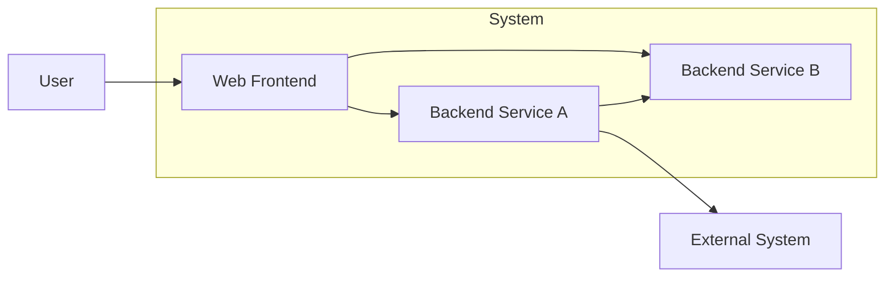
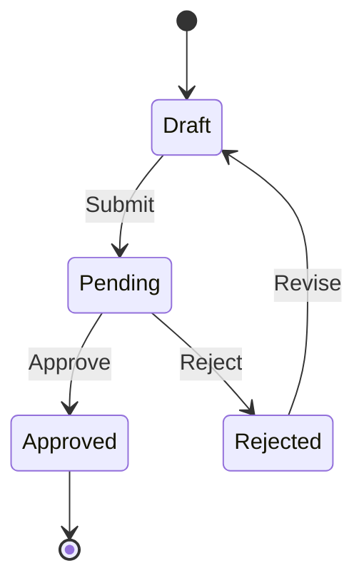
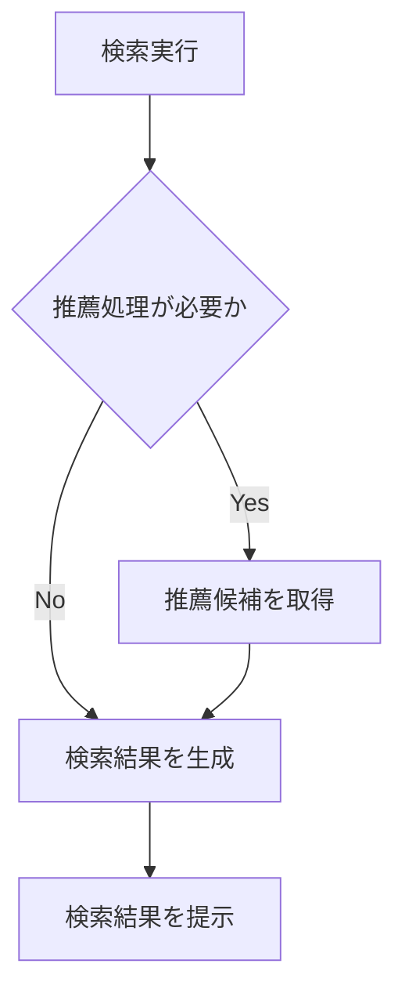
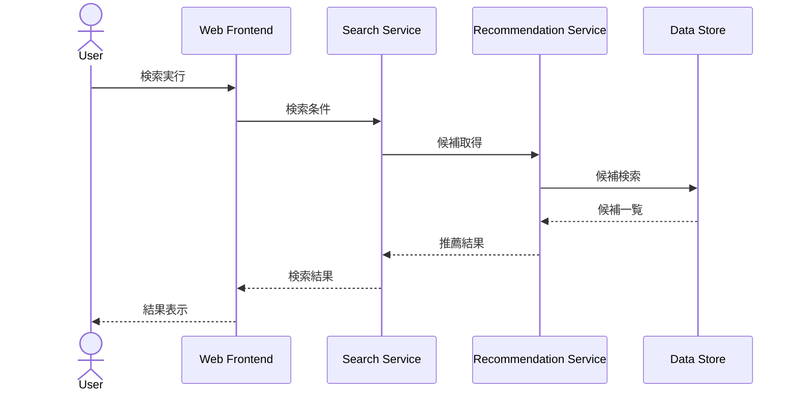
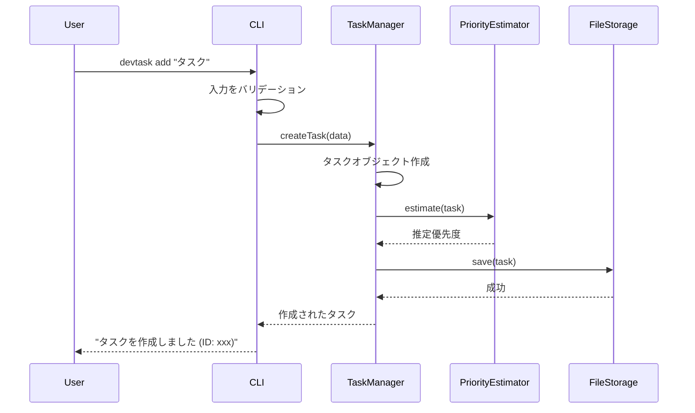
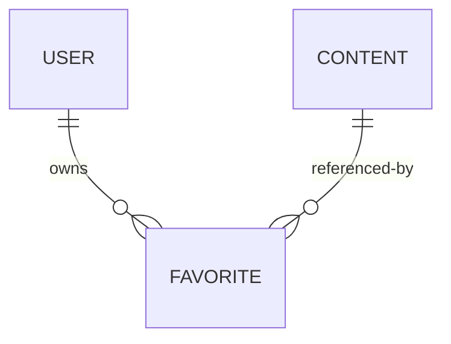
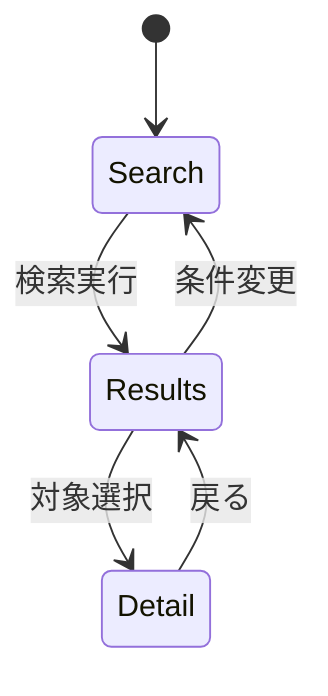

# **Content Guide**

## **Purpose for Design**
要求定義で定められた要求を、システム全体として実現可能な機能構造および機能仕様へ具体化する。

システムが提供する機能を分解し、各機能を成立させる構成要素、ユースケース、ビジネスルール、処理フロー、データ、インターフェース、UIその他の設計対象と、それらの関係を明確にする。

後続のSystem Architectureの具体化、各Detail Design、Dependency PlanningおよびTest Designに必要な機能上の前提を確定し、個別設計へ引き渡せる状態にする。


## **Out of Scope**
本設計では、個々の設計対象の内部で完結する詳細仕様、および機能仕様を実現するための具体的な技術方式・実装方式を決定しない。

また、Application内部の技術Architecture、Infrastructure、Deployment / Delivery、個別のTest Caseなど、後続の専門設計・詳細設計で決定すべき事項は本設計の対象外とする。


## **Design Policy**
- 要求定義で確定した要求およびSystem Architectureの基本方針を前提として設計し、それらを本設計で再定義しない。
- 複数の設計対象の関係を成立させるために必要な仕様は、全体設計として、詳細度にかかわらず本設計で決定する。
- 単一の設計対象の内部だけで完結する仕様は本設計では決定せず、対応する個別Detail Designで具体化する。
- 同一の仕様を複数のSectionで重複して定義せず、その仕様を主として扱うSectionを正とし、他のSectionでは必要に応じて参照する。
- 技術的な実現方法ではなく、システムが機能として何を実現し、各設計対象がどのような関係を持つ必要があるかを中心に設計する。
- 後続のDetail Designでは、本設計で確定した設計対象間の関係、責務、制約および振る舞いを前提として、各設計対象の内部仕様を具体化できる状態にする。


## **Key Points for Design**

- 要求から必要な機能を漏れなく導出し、要求と機能のTraceabilityを維持する。
- 機能、Component、Data、Interface、UI等について、単体の存在だけでなく、それらを横断する責務・依存・関係を明確にする。
- Use Case、Business Rule、Functional Flowを分離して整理し、「何を達成するか」「どのRuleに従うか」「結果としてどう処理が進むか」を混同しない。
- API、Batch、Event、Screen、Data等について、後続のDetail Designが必要となる設計対象を特定し、その機能上の役割と関係を明確にする。
- Error / ExceptionおよびPer-Function Non-Functional Requirementsについても、個別の実現方式ではなく、システム全体として成立させるべき振る舞い・要求を定義する。
- Function Designで定義した仕様から検証すべき事項を導出し、後続のTest Designで具体的なTest Caseへ展開できる状態にする。
- 一度の設計で確定させることを前提とせず、各Sectionを一通り設計した後に全体を再確認し、後続Sectionで判明した内容を前段へ反映して整合性を収束させる。


## **Overview**
- Change History
- Functional Overview and Scope
- Functional Decomposition
- Logical System Structure
- Use Cases
- Components and Responsibilities
- Business Rules
- Functional Flows
- Data Overview
- Interface Overview
- UI and User Interaction Overview
- Error and Exception Behavior
- Non-Functional Requirements per Function
- Functional Verification Strategy
- Detailed Design Handoff

## **Section Guide**
### **0. Change History**
本項目では、本機能設計書の初回作成、および機能設計完了後に行われた正式な機能設計変更の履歴を記録する。

初回作成時は、レビューおよび再レビューを含む機能設計工程が完了し、機能設計書が確定した時点で1件の履歴として記録する。
同一設計工程内におけるレビュー指摘への対応、記載内容の修正、表現の改善、誤記修正など、機能設計書を確定するまでの変更は個別の履歴として記録しない。

機能設計完了後の工程で機能設計変更が必要となった場合、または後続のTrainにおいて機能追加・変更等に伴い本機能設計を変更した場合は、新しい履歴として記録する。


**example**:
| Change | Date | Train | Summary |
| --- | --- | --- | --- |
| Initial Design | [YYYY-MM-DD HH:mm] | [Train] | 初回設計 |
| Change 1 | [YYYY-MM-DD HH:mm] | [Train] | [変更概要] |
| Change 2 | [YYYY-MM-DD HH:mm] | [Train] | [変更概要] |


### **1. Functional Overview and Scope**
このFunction Designが「何について設計する文書なのか」を定義
#### **1.1 Purpose / Functional Overview**
- 対象システム・機能群が実現することの概要
- ユーザーや他システムに提供する価値・役割
- 今回のFunction Designで扱う機能領域の概要
- ※ 個々の機能一覧にはまだ分解しない。

**example**:
>- ユーザーが○○を登録・参照・更新できる機能を提供する。
>- また、登録された情報を利用して○○を実行する。

#### **1.2 In Scope**
今回のFunction Designで設計対象とする機能領域。
- 対象となる業務・機能領域
- 対象となるユーザー操作
- 対象となるシステム処理
- 対象となる外部連携領域
- ※ 「○○登録APIを作る」などの設計対象までは踏み込まない。

#### **1.3 Deferred Scope**
今回の設計・開発対象には含めず、将来のTrain等で対応する予定・候補となっているもの。
- 将来追加予定の機能
- 今回は優先度等の理由で対象外となった機能
- 段階導入の後続フェーズに位置付けられている機能

#### **1.4 Excluded Scope**
本システムまたは当該機能領域の責務として扱わないもの。
- 外部システム側の内部処理
- 明示的に別システムの責務となっている機能
- 要求上、対応しないことが決定されている領域

#### **1.5 Actors / Users**
誰・何がこの機能群を利用または起動するのか、関与する主体とその大まかな役割(概要レベル)

※詳細な権限や操作など、「そのActorが具体的に何をどう行うか」は扱わない。具体的な操作、機能、権限、Interface、処理フローは定義しない。

**example**:
> - End User
> - Administrator
> - External System
> - Scheduled/System Actor

#### **1.6 Preconditions / Assumptions**
機能設計全体に影響する前提・仮定

※個別機能の事前条件、要求・仕様、Architecture上の決定、個別設計上の前提、未解決事項の暫定的な仮定は定義しない。また、Architecture Decisionの内容をここで再定義しない

**example**:
> - ユーザーは認証済みであることを前提とする。
> - ○○に必要な情報は外部システムから取得可能であることを前提とする。
> - Web Applicationからの利用を対象とする。

### **2. Functional Decomposition**
要求定義で定められた要求を、設計・実装・検証の対象として扱える機能単位へ分解し、システム全体の機能構造を明確にする。

#### **※Not to Include in This Section**
- **設計対象への割当**: Application / Service / Componentへの機能割当
- **処理の流れ**: 実行順序、条件分岐、Sequence、Request / Response、Data Flow
- **具体的な設計対象**: API、Batch、Screen、Table、Event / Message
- **機能内部のルール**: 判定条件、計算ルール、状態遷移
- **具体的な入出力・内部仕様**: Request / Response Schema、項目・型、内部処理等
- **技術的な分割**: Class、Package、Layer、技術的なModule構造

#### **2.1 Functional Hierarchy**

要求定義で定められた要求を、システムが提供する機能として整理し、機能領域、機能、必要に応じてサブ機能の階層に分解する。
機能の粒度は、後続の設計において独立した責務として扱える単位を基準とする。

機能間の親子関係が把握できるよう、階層リストを基本として記載する。

<br>

**example**:
```text 
ユーザー管理
├── ユーザー登録
├── ユーザー情報参照
├── ユーザー情報更新
└── ユーザー削除

コンテンツ管理
├── コンテンツ登録
├── コンテンツ検索
├── コンテンツ参照
└── コンテンツ更新
```

<br>

**記載しない内容**:

Application、Service、Componentなどへの機能の割り当ては行わない。また、API、Batch、Screen、Table、Event / Messageなどの具体的な設計対象への分解、機能間の実行順序やデータフロー、判定・計算等の内部ルール、ClassやPackageなどの技術的な構造は記載しない。


#### **2.2 Functional Description**

Functional Hierarchyで特定した各機能について、その機能が何を目的とし、システムとして何を実現する責務を持つのかを簡潔に記載する。
機能名だけでは責務や境界を判断できない場合でも、後続設計で各機能の意味を一意に理解できる粒度とする。

各機能について最低限、
- 機能名
- 所属する機能領域
- 機能の目的・責務
- 何を実現する機能なのか
を短く定義する。

<br>

**example**:

| Function | Description |
| --- | --- |
| ユーザー登録 | 新しいユーザー情報をシステムへ登録する |
| ユーザー情報参照 | 登録済みユーザーの情報を取得し、利用者へ提供する |
| ユーザー情報更新 | 登録済みユーザーの変更可能な情報を更新する |

<br>

**記載しない内容**:

機能を実現する具体的な処理手順、条件分岐、入出力項目、Business Rule、Error処理は記載しない。また、その機能を担当するApplication / Service / Component、利用するAPI / Table / Screen等や、実装方式・技術方式についてもここでは決定しない。


#### **2.3 Requirement Traceability**

要求定義で特定された要求と、Functional Hierarchyで定義した機能との対応関係を記載する。
各要求がどの機能によって実現されるかを追跡可能にし、要求の設計漏れおよび要求に基づかない機能の追加を確認できる状態にする。
一つの要求が複数機能に対応する場合、および複数の要求が一つの機能に対応する場合も、それぞれの対応を明示する。

<br>

**example**:

| Requirement | Function |
| --- | --- |
| FR-001 | ユーザー登録 |
| FR-002 | ユーザー情報参照 |
| FR-003 | ユーザー情報更新 |

<br>


**記載しない内容**:

要求や機能の内容そのものをここで再定義・再記述しない。また、要求とAPI / Screen / Table等の詳細設計対象との対応、Test Caseとの対応、設計・実装の進捗管理など、機能より後続の成果物とのTraceabilityはここでは扱わない。


### **3. Logical System Structure**
System Architectureで定められたApplication / Service等の論理境界を前提として、Functional Decompositionで特定した機能領域がシステム全体のどこに位置し、主要な構成要素が機能上どう関係するかを俯瞰する。

#### **3.1 Logical Structure Overview**
System Architecture Preで決定済みのApplication / Service等を前提として、Function Designの対象となる論理構成要素を整理する。

ここでは新しくArchitectureを決めるのではなく、
- 対象となるApplication
- Service / Module
- 外部System
- 必要に応じてUser / Actor

など、今回の機能設計を理解するために必要な構成要素だけを取り上げる。

<br>


**example**:
| Logical Element | Role in Functional Design |
| --- | --- |
| Web Frontend | ユーザーとのインタラクションを担当する |
| Backend Service A | 機能領域Aに関する処理を担当する |
| Backend Service B | 機能領域Bに関する処理を担当する |
| External System | 本システムから利用する外部機能を提供する |

<br>


**記載しない内容**:

Application / Service / Moduleの境界や責務をここで新たに決定・変更しない。また、使用するFramework、Layer構造、通信Protocol、Infrastructure上の配置など、構成要素を技術的にどのように実現するかは記載しない。

#### **3.2 Functional Allocation Overview**
Functional Decompositionで定義した機能領域を、どの論理構成要素が担うかを俯瞰できるようにする。
ここでは個々のAPIやBatch等ではなく、まず機能領域レベルの配置を見る。

これによって、
>「機能領域AはService Aに属するが、Frontendから利用される」
>「機能領域BにはService Aも関係する」

といった横断関係が見える。

<br>


**example**:
| Functional Area | Primary Logical Element | Related Elements |
| --- | --- | --- |
| 機能領域A | Backend Service A | Web Frontend |
| 機能領域B | Backend Service B | Web Frontend, Backend Service A |
| 外部連携領域 | Backend Service A | External System |

<br>


**記載しない内容**:

各機能を実現するAPI、Batch、Screen、Table等の具体的な設計対象や、それら個々の責務はここでは定義しない。また、構成要素間で実際にどの順序で処理するか、何をRequest / Responseとして受け渡すかも記載しない。

#### **3.3 Logical System Diagram**
機能視点から見たシステム全体の論理構成を下記のような記法で可視化する。

ただしEdgeの意味は、ここでは、
> 「利用する」  
> 「機能的に連携する」

という**論理的な関係**までに留める。

**example**:


**記載しない内容**:

- REST / Event / gRPC等の具体的な連携方式は描かない。
- Request / Responseやデータ内容もここでは扱わない。

### **4. Use Cases**
Actorがそれらを使って何を達成するのか
#### **4.1 Use Cases**
Functional Decompositionで定義した機能について、Actorがシステムを利用して達成する目的をUse Caseとして整理する。
各Use Caseについて、対象となるActor、目的、開始条件、正常終了時に達成される結果を明確にする。

<br>


**example**:
| Use Case | Actor | Purpose | Preconditions | Expected Outcome |
| --- | --- | --- | --- | --- |
| コンテンツ検索 | User | 条件に合致するコンテンツを検索する | 検索機能を利用可能である | 条件に合致するコンテンツが提示される |
| コンテンツ登録 | User | 新しいコンテンツを登録する | 登録機能を利用可能である | コンテンツが登録される |

<br>


**記載しない内容**:

Use Caseを実現する具体的な処理順序、Component間連携、Request / Response、画面操作の詳細は記載しない。また、個々のAPI、Screen、Batch等の内部仕様や技術的な実現方式も定義しない。

### **5. Components and Responsibilities**
処理主体としてのComponentを扱う。ここでの、`Components` は、Application / ServiceのようなArchitecture上の箱だけではなく、Function Designで「作る必要がある」と特定された主要な機能構成要素を指す
#### **5.1 Component Overview**
Functional DecompositionおよびLogical System Structureをもとに、各機能を成立させるために必要となる主要なComponentを特定し、その種類、所属するApplication / Service、機能上の責務を整理する。
- ここでいうComponentには、常駐するApplication Componentだけでなく、Batchなど独立した処理単位も含める。
- これによって、「何を作る必要があるか」の全体一覧として機能する。

<br>


**example**:
| Component | Type | Parent | Responsibility |
| --- | --- | --- | --- |
| Component A | Application Component | Service A | 機能領域Aの主要処理を担当する |
| Batch A | Batch | Service A | 対象データを定期的に処理する |
| Batch B | Batch | Service B | 外部から取得した情報を反映する |

<br>


**記載しない内容**:

Component内部のClass、Method、Package、Layer等の実装構造や、具体的な技術方式は定義しない。また、API、Screen、Table等については、それぞれ専用の後続Sectionで特定するため、ここで重複して一覧化・詳細化しない。

#### **5.2 Component Responsibilities and Relationships**
各Componentについて、単体の責務だけでなく、他のComponentとの関係を成立させるために必要な責務境界を定義する。
> ここでは、責務の重複や曖昧なOwnershipが残らないことを重視する。

<br>


**example**:
| Component | Responsibility | Related Component | Relationship |
| --- | --- | --- | --- |
| Component A | 対象情報の管理を担当する | Batch A | Batch Aが処理対象とする情報を管理する |
| Batch A | 対象情報の定期処理を担当する | Component B | 処理結果をComponent Bが利用する |

<br>


**記載しない内容**:

Component間で具体的にどの順序で処理を行うか、どのRequest / ResponseやDataを受け渡すかは定義しない。また、REST、Messaging等の技術的な連携方式や、Component内部の具体的な処理仕様も記載しない。

#### **5.3 Batch Overview(Optional Section)**
必要なBatchを特定し、Batchとして何を作る必要があるのかを全体設計として確定する。

記載対象は、
- Batch名
- 目的・責務
- 起動契機の概要
- 入力の概要
- 出力の概要
- 主要処理の概要
- Online処理 / Data / 他Batchとの関係

など

**記載しない内容**:

具体的なJob / Step構成、処理アルゴリズム、入出力Schema、Chunk単位、起動時刻・Cron式、Retry回数、Restart方式、排他制御、具体的なError処理など、単一Batch内部で完結する仕様は定義しない。これらは Batch Detail Design で具体化する。

### **6. Business Rules**
システムが機能として守らなければならない判断・計算・制約・状態変化」 を集約する
#### **6.1 Decision and Validation Rules**
機能上の判断、判定および許可・禁止を決定するBusiness Ruleを定義する。
複数の機能、Component、画面、API等から共通して参照されるRuleについては、各設計対象で個別に定義せず、ここを正とする。

<br>


**example**:
| Rule | Condition | Result / Behavior |
| --- | --- | --- |
| Rule A | 条件Aを満たす | 処理を許可する |
| Rule B | 条件Bを満たさない | 処理を許可しない |
| Rule C | 条件Cに該当する | 処理方式Bを選択する |

<br>


複数条件の組み合わせによって結果が決まる場合は、必要に応じてDecision Tableを使用する。

**example**:
| Condition A | Condition B | Result |
| --- | --- | --- |
| Yes | Yes | Result A |
| Yes | No | Result B |
| No | - | Result C |

<br>


**記載しない内容**:

入力Field単体の形式・桁数等、その設計対象内部だけで完結するValidationは記載しない。また、Ruleをif文等でどのように実装するか、どのClass / Componentで判定するかといった実装方式も定義しない。


#### **6.2 Calculation and Derivation Rules**
機能上必要となる計算、分類、集約、導出等について、その結果を決定するBusiness Ruleを定義する。

計算結果が複数の設計対象から利用される場合や、システムとして一貫した結果を保証する必要がある場合は、その計算条件、使用する情報、計算方法および結果の意味を明確にする。

**example**:
```text
総合値 = 評価値A × 重みA + 評価値B × 重みB

総合値 >= 閾値A : Classification A
総合値 >= 閾値B : Classification B
その他          : Classification C
```

<br>


**記載しない内容**:

計算を実現する具体的なAlgorithm、Code、Library、Class / Method構造、Performance Optimization等は記載しない。また、単一の設計対象内部だけで使用され、他の設計対象との関係に影響しない内部計算は対応するDetail Designで定義する。


#### **6.3 Business Constraints**
システム全体または複数の設計対象にまたがって成立させる必要がある業務上・機能上の制約を定義する。

**example**:
| Constraint | Description |
| --- | --- |
| Constraint A | 一つの対象に対して同時に有効な登録は一つだけとする |
| Constraint B | 条件Aを満たす対象のみ操作Bを実行できる |
| Constraint C | 関連する対象が存在する場合は対象Aを削除できない |

<br>


Data、UI、API等の複数箇所で同じ制約を成立させる必要がある場合、その制約自体はここで定義し、各Detail DesignではこのRuleを前提として具体的な実現仕様を定義する。

**記載しない内容**:

制約をDatabase Constraint、UI制御、API Validation等のどの方式で実現するかは定義しない。また、特定のTable、API、Screen等の内部だけで完結する制約は、それぞれのDetail Designで定義する。


#### **6.4 State and Transition Rules**
状態を持つEntityや機能について、取り得る状態、状態間の遷移、遷移を発生させるEvent / Action / Condition、および許可・禁止される遷移を定義する。

**example**:
| Current State | Event / Action | Condition | Next State | Allowed |
| --- | --- | --- | --- | --- |
| Draft | Submit | 必須条件を満たす | Pending | Yes |
| Pending | Approve | 承認可能である | Approved | Yes |
| Pending | Reject | 却下条件に該当する | Rejected | Yes |
| Approved | Submit | - | - | No |

<br>


複数の状態および遷移が存在する場合は、Mermaidの`stateDiagram-v2`を使用して状態遷移図を記載する。

**example**:


状態遷移図では状態と主要な遷移を俯瞰し、遷移条件や禁止条件など図だけでは十分に表現できない仕様は状態遷移表で補完する。

**記載しない内容**:

状態をDatabase上でどのCode / Valueとして保持するか、Enumをどのように定義するか、状態更新をどのAPI / Methodで実装するか等の個別実装仕様は記載しない。また、UI Component内部だけの表示状態や技術的なLifecycle Stateは対象としない。

### **7. Functional Flows**
**「複数のComponent・設計対象が協調して、Use Caseをどう成立させるか」**を定義する
#### **7.1 Main Functional Flows**

各Use Caseを成立させる主要な処理の流れを、Actorおよび複数のComponentを横断する機能的なStepとして記載する。
正常系を基本とし、機能の結果を左右する主要な条件分岐や代替Flowが存在する場合は、それらも明示する。

**example**:
```text
1. Userが検索条件を指定して検索を実行する。
2. Web Frontendが検索要求をBackendへ渡す。
3. Search Serviceが検索条件に基づいて候補を取得する。
4. 必要に応じてRecommendation Serviceから推薦情報を取得する。
5. Search Serviceが検索結果を生成する。
6. Web Frontendが検索結果をUserへ提示する。
```

<br>


主要な条件分岐を表現する必要がある場合は、Mermaidの`flowchart`を使用する。

<br>


**example**:


<br>
<br>


**記載しない内容**:

単一Component内部で完結する詳細な処理StepやAlgorithm、実装上の条件分岐は記載しない。また、具体的なEndpoint、Schema、HTTP Status等のInterface仕様や、UI内部の操作・表示制御についても定義しない。


#### **7.2 Interaction Sequences**
Use Caseを成立させるために、Actor、Application、Service、Batch、Data Store、External System等がどの順序で相互作用するかをSequence Diagramで記載する。

Component間のRequest / ResponseおよびDataの流れは、具体的なInterface仕様ではなく、**機能上何を要求し、何を受け渡すかが理解できる意味的な粒度**で表現する。

**example1**:


**example2**:


Sequence Diagramでは、少なくとも以下を把握できるようにする。

- 処理に関与するActor / Component
- Component間の処理順序
- Request / Responseの意味的な概要
- Component間を流れる主要なData
- 必要な場合は主要な条件分岐や代替Flow

**記載しない内容**:

具体的なAPI Endpoint、HTTP Method、Request / Response Schema、Header、Status Code等のInterface Contractは記載しない。また、Class / Method呼び出し等のComponent内部処理、REST / gRPC / Messaging等の技術的な通信方式、Infrastructure上の通信経路も定義しない。


#### **7.3 Alternative and Exception Flows**
正常系とは異なる結果となる主要な代替Flowおよび例外Flowのうち、複数のComponentや後続処理の振る舞いに影響するものを整理する。

**example**:
| Condition | Alternative / Exception Flow | Outcome |
| --- | --- | --- |
| 対象データが存在しない | 検索処理を終了し、対象なしとして結果を返す | 対象なしとしてUserへ提示される |
| 外部処理を利用できない | 代替処理を実行する | 制限された結果が返される |

<br>


**記載しない内容**:

個々のComponent内部で処理される例外、具体的なException Class、Error Code、HTTP Status、Retry回数等の詳細仕様は記載しない。また、システム横断的なError分類や共通的な異常時の振る舞いそのものは **Error and Exception Behavior** で定義する。


### **8. Data Overview**
システム全体として、どんなデータが存在してどう関係するか
#### **8.1 Domain and Data Model Overview**
システムが機能を実現するために扱う主要なDomain Object、Entityおよび永続データを特定し、それぞれが表す情報と機能上の役割を整理する。

ここでは、Functional DecompositionやUse Casesで登場する情報を、システム全体で共有可能なデータ概念として整理する。

**example**:
| Data / Entity | Purpose | Description |
| --- | --- | --- |
| User | 利用者情報の管理 | システムを利用するユーザーを表す |
| Content | コンテンツ情報の管理 | ユーザーが操作対象とするコンテンツを表す |
| Favorite | お気に入り関係の管理 | UserとContentのお気に入り関係を表す |

<br>


**記載しない内容**:

各Entity / TableのColumn、データ型、Default値、内部的なデータ表現など、単一のデータ設計対象の内部だけで完結する仕様は記載しない。また、ORM EntityやClass等の実装上のデータ構造も定義しない。

#### **8.2 Data Relationships**
主要なEntity / Table間の関係を定義し、システム全体としてどのデータがどのデータに依存・関連するかを明確にする。

関係を成立させるために必要なCardinality、必須・任意の関係、所有関係等については、詳細度にかかわらずここで定義する。

**example**:
| Source | Relationship | Target | Cardinality | Constraint / Meaning |
| --- | --- | --- | --- | --- |
| User | owns | Favorite | 1:N | Favoriteは必ず一つのUserに属する |
| Content | referenced by | Favorite | 1:N | Favoriteは一つのContentを参照する |

<br>


**記載しない内容**:

関係性に影響しないColumn、データ型、Index、Default値等のTable内部仕様は記載しない。PK / FK、NULL、Unique等についても、個々のTable内部の実装仕様としてのみ必要なものはここでは決定せず、Data Detail Designで定義する。


#### **8.3 Conceptual ER Diagram**
Data Relationshipsで定義した主要なEntity / Table間の関係を、システム全体として俯瞰できる概念ER図として記載する。

Mermaidの`erDiagram`を使用し、主要なEntityとCardinalityを中心に表現する。

**example**:


概念ER図では、複数のデータ設計対象間の関係を理解するために必要な情報のみを表現する。

<br>


**記載しない内容**:

Column一覧、物理データ型、PK / FK Column、Index等を含む物理ER図は記載しない。これらはData Detail Designで定義する。


#### **8.4 Master Data Overview**
システム全体で必要となるMaster Dataを特定し、その目的、利用領域および他のデータや機能との関係を整理する。

**example**:
| Master | Purpose | Used By | Relationship |
| --- | --- | --- | --- |
| Category Master | 分類情報を管理する | Content管理、検索 | ContentがCategoryを参照する |
| Status Master | 共通状態を管理する | 複数機能 | 対象Entityの状態判定に利用する |

<br>


Masterの存在や参照関係など、複数の設計対象を成立させるために必要な仕様はここで定義する。

<br>


**記載しない内容**:

Masterに登録する具体的なCode、Value、表示名、並び順等、個々のMaster内部で完結する値定義は記載しない。これらはData Detail Designで定義する。

### **9. Interface Overview**
Component間・System間の境界を越える契約の存在と意味的な関係を全体設計として確定する
#### **9.1 Interface Landscape**

システム内および外部システムとの間に必要となる主要なInterfaceを特定し、Interfaceの種類、提供元、利用元、および機能上の目的を一覧化する。

API、Event / Message、External Interfaceなど、ComponentまたはSystemの境界を越えて機能を連携させるInterfaceを対象とする。

**example**:
| Interface | Type | Provider / Producer | Consumer | Purpose |
| --- | --- | --- | --- | --- |
| Interface A | API | Service A | Web Frontend | 機能AをFrontendへ提供する |
| Interface B | Event | Service A | Service B | Aで発生した状態変化をBへ通知する |
| Interface C | External IF | External System | Service A | 外部情報を本システムで利用する |


<br>


**記載しない内容**:

各InterfaceのEndpoint、Method、Protocol、Schema、Header、Status Code、Topic / Queue等の具体的な契約・技術仕様は記載しない。また、Interfaceを利用した処理の実行順序や詳細なFlowはここで再定義せず、Use Cases and Functional Flowsを参照する。


#### **9.2 API Overview(Optional Section)**

システム内で必要となるAPIを特定し、それぞれのAPIについて、提供する機能、提供元、利用元、および受け渡す情報の意味的な概要を整理する。

**example**:
| API | Provider | Consumer | Purpose | Input Overview | Output Overview |
| --- | --- | --- | --- | --- | --- |
| Search API | Search Service | Web Frontend | 条件に基づいて対象を検索する | 検索に必要な条件 | 検索結果 |
| Registration API | Service A | Web Frontend | 対象情報を登録する | 登録対象となる情報 | 登録結果 |

<br>


Input / Outputは、Component間の関係を理解するために必要な**意味的な情報**として記載する。

<br>


**記載しない内容**:

具体的なEndpoint、HTTP Method、Request / Response Schema、Field、型、Header、HTTP Status、Validation、Error Response等は定義しない。また、REST / gRPC等の具体的な通信方式もここでは決定せず、System ArchitectureおよびAPI Detail Designへ委ねる。


#### **9.3 Event and Message Overview(Optional Section)**
Component間の連携に必要となるEvent / Messageを特定し、それぞれについてProducer、Consumer、発生・送信の目的、および受け渡す情報の意味的な概要を整理する。

Event / Messageを介して複数のComponentがどのような関係を持つかが理解できる状態にする。

**example**:
| Event / Message | Producer | Consumer | Purpose | Information Overview |
| --- | --- | --- | --- | --- |
| Entity Created Event | Service A | Service B | Entityの作成をService Bへ通知する | 作成されたEntityを識別・処理するための情報 |
| Processing Request | Service A | Service C | 非同期処理をService Cへ依頼する | 処理対象を特定するための情報 |


<br>


複数Consumerが存在する場合は、それぞれのConsumerと利用目的を明示する。

<br>


**記載しない内容**:

Payload Schema、Field、型、Metadata、Topic / Queue、Partition、Ordering、Delivery Semantics、Retry、DLQ、Versioning等のEvent / Message内部および配信方式の詳細仕様は記載しない。また、Broker等の具体的な技術選定はSystem / Infrastructure Architectureへ委ねる。


#### **9.4 External Interface Overview(Optional Section)**
本システムと外部システムとの間に必要となるInterfaceを特定し、外部システム、連携方向、連携目的、および受け渡す情報の意味的な概要を整理する。

**example**:
| External System | Interface | Direction | Internal Component | Purpose | Information Overview |
| --- | --- | --- | --- | --- | --- |
| External System A | External IF A | Outbound | Service A | 外部機能を利用する | 処理要求および処理結果 |
| External System B | External IF B | Inbound | Service B | 外部から情報を受信する | 本システムへ反映する情報 |

<br>


外部システムと内部Componentの責務境界、およびどの内部Componentが外部連携を担うかを明確にする。

<br>


**記載しない内容**:

外部Interfaceの具体的なEndpoint、Protocol、認証情報、Request / Response Schema、File Format、Header、Error Code、Timeout、Retry等の通信契約は記載しない。また、Network経路、Firewall、Private接続等のInfrastructure上の接続方式も定義しない。

### **10. UI and User Interaction Overview**
「どんな画面が必要で、それらがどう組み合わさってユーザーの機能利用を成立させるか」を設計する
#### **10.1 Screen Overview**
機能をユーザーへ提供するために必要となる画面を特定し、それぞれの画面の目的、対象Actor、および主要な機能を整理する。

**example**:
| Screen | Actor | Purpose | Main Functions |
| --- | --- | --- | --- |
| 検索画面 | User | 条件を指定して対象を検索する | 検索条件指定、検索実行 |
| 検索結果画面 | User | 検索結果を確認する | 結果一覧表示、対象選択 |
| 詳細画面 | User | 選択した対象の詳細を確認する | 詳細表示、関連操作 |

<br>


ここでは、Function Designで定義された機能のうち、どの機能をどの画面から利用可能にする必要があるかが把握できる粒度まで記載する。

<br>

**記載しない内容**:

各画面の具体的なレイアウト、表示項目・入力項目の詳細、UI Component、色・Typography、項目単位のValidation、Enable / Disable等、単一画面内部で完結するUI仕様は記載しない。これらはUI Detail Designで定義する。


#### **10.2 Screen Relationships and Navigation**
画面間の遷移および関係を定義し、ユーザーが複数の画面を通じて機能を利用する全体的なNavigation構造を明確にする。

画面間の遷移を成立させるために必要な操作、条件および遷移結果については、詳細度にかかわらずここで定義する。

**example**:
| Source Screen | Trigger / Condition | Destination Screen | Relationship |
| --- | --- | --- | --- |
| 検索画面 | 検索を実行する | 検索結果画面 | 指定された条件による検索結果を表示する |
| 検索結果画面 | 対象を選択する | 詳細画面 | 選択された対象の詳細を表示する |
| 詳細画面 | 戻る操作を行う | 検索結果画面 | 直前の検索結果へ戻る |

<br>
<br>


画面数や遷移が複数存在する場合は、Mermaidの`stateDiagram-v2`を使用して画面遷移図を記載する。

**example**:


<br>


**記載しない内容**:

画面内部のTab切替、Modal開閉、Accordion展開等、その画面内部だけで完結するUI状態遷移は原則として記載しない。また、Routing Library、URL設計、画面遷移の技術的な実装方式は定義しない。


#### **10.3 Cross-Screen Information Flow**
複数の画面間で引き継ぐ必要がある情報について、その情報の意味と、どの画面からどの画面へ引き継がれる必要があるかを整理する。

画面間の関係を成立させるために必要な情報は、具体的なUI実装仕様であってもここで明確にする。

**example**:
| Source Screen | Destination Screen | Information | Purpose |
| --- | --- | --- | --- |
| 検索画面 | 検索結果画面 | 検索条件 | 実行した検索条件と結果を対応付ける |
| 検索結果画面 | 詳細画面 | 選択対象 | 表示対象を特定する |
| 詳細画面 | 検索結果画面 | 検索状態 | 元の検索結果へ復帰する |


<br>


**記載しない内容**:

情報をURL Parameter、Session、State Store等のどの技術方式で保持・引き渡すかは定義しない。また、個々の情報項目の型、Format、UI上の表示方法等はUI Detail Designで定義する。


#### **10.4 Cross-Screen Interaction Rules**
複数の画面にまたがるUser Interactionについて、画面間の関係を成立させるために必要となる共通的な振る舞いや制約を整理する。

例えば、ある画面で行った操作が別の画面の状態やNavigationに影響する場合、その関係を明示する。


**example**:
| Interaction / Condition | Affected Screens | Behavior |
| --- | --- | --- |
| 編集完了 | 編集画面、詳細画面 | 編集後の内容を詳細画面へ反映する |
| 対象削除 | 詳細画面、一覧画面 | 削除後は一覧画面へ戻り、削除対象を表示しない |

<br>


**記載しない内容**:

Button押下時のLoading表示、Field単位の入力制御、Focus、Hover、Animation等、単一画面内部で完結するInteractionは記載しない。また、システム全体のBusiness Ruleそのものはここで再定義せず、Business Rulesで定義された内容を前提とする。

### **11. Error and Exception Behavior**
正常に処理できない状況において、システム全体または複数の設計対象がどのように振る舞うべきかを定義する。
#### **11.1 Error and Exception Classification**
機能の実行中に発生し得る主要なError / Exceptionを、システムとして区別する必要がある意味的な分類に整理する。

分類は技術的なException Classではなく、後続の処理やユーザーへの結果が異なる単位を基準とする。


**example**:
| Classification | Description | Example |
| --- | --- | --- |
| Validation Error | 処理の前提となる入力・条件を満たさない | 必須情報不足、許可されない値 |
| Business Rule Violation | Business Rule上、要求された処理を実行できない | 許可されない状態からの操作 |
| Resource Not Found | 処理対象が存在しない | 指定された対象が存在しない |
| External Dependency Failure | 外部System等との連携を正常に完了できない | 外部サービスから応答を得られない |
| System Failure | 通常の機能処理として継続できない内部障害 | 必要な内部処理を完了できない |

<br>


**記載しない内容**:

Exception Class、Error Code、HTTP Status、Log Level等の技術的なError表現は定義しない。また、単一のAPI、Batch、Screen等の内部だけで使用されるError分類は、それぞれのDetail Designで定義する。


#### **11.2 Error Handling Behavior**
各Error / Exceptionについて、発生した処理を継続するか、中断するか、代替処理へ移行するかなど、システムとして必要となる振る舞いを定義する。


**example**:
| Classification / Condition | Processing Behavior | Result |
| --- | --- | --- |
| Validation Error | 対象処理を開始しない | 修正可能な状態として処理を終了する |
| Business Rule Violation | 要求された処理を実行しない | 現在の状態を維持する |
| External Dependency Failure | 対象機能の処理を中断する | 外部連携失敗として終了する |
| Optional Dependency Failure | 対象処理を省略して継続する | 制限された結果を返す |

<br>


複数のComponentにまたがる処理では、Error発生時に各ComponentやDataがどの状態になる必要があるかも明示する。

<br>


**記載しない内容**:

具体的なRetry回数、Timeout値、Transaction実装、Rollback処理、Exception Handling Code等、個別の技術的実現方式は定義しない。これらはSystem Architectureまたは各Detail Designで具体化する。


#### **11.3 Error Propagation and Responsibility**

複数のComponentをまたぐErrorについて、どこでErrorを検知し、どのComponentへ伝達し、最終的にどのComponentが機能上の結果を決定するかを整理する。

**example**:
| Error Source | Detection / Handling Responsibility | Propagation Target | Functional Result |
| --- | --- | --- | --- |
| Service B | Service B | Service A | Service Aが処理失敗として扱う |
| External System | External IF担当Component | 呼出元Component | 外部連携失敗として扱う |
| Batch A | Batch A | 後続処理 | 後続処理を開始しない |

<br>


ここでは、Component間でErrorがどのような**意味として伝播する必要があるか**を定義する。

<br>


**記載しない内容**:

Exception Mappingの実装、HTTP Status変換、Error Response Schema、Message Format、Messaging基盤上のDLQ等の具体的な伝達方式は定義しない。

#### **11.4 User-Visible Error Behavior**
Error / Exceptionがユーザー操作に影響する場合、ユーザーにどのような結果を認識させ、どの操作を可能にする必要があるかを定義する。

**example**:
| Condition | User-visible Result | Available Action |
| --- | --- | --- |
| 入力条件を満たさない | 入力内容を修正する必要があることを通知する | 入力を修正して再実行できる |
| 処理対象が存在しない | 対象を利用できないことを通知する | 前の操作へ戻れる |
| 一時的に処理できない | 現在処理できないことを通知する | 必要に応じて再実行できる |

<br>


複数画面や処理結果に影響する場合は、その関係を成立させるために必要な振る舞いまで定義する。

<br>


**記載しない内容**:

具体的なError Message文言、表示位置、Dialog / Toast等のUI Component、色やIcon等の表現方法は定義しない。これらはUI Detail Designで定義する。

### **12. Non-Functional Requirements per Function**
機能ごと、または複数の機能・設計対象を横断して満たす必要がある非機能上の要求・制約を、後続のArchitecture / Detail Designが設計判断に利用できる形で定義する。
#### **12.1 Performance and Capacity Requirements**
機能の利用において満たす必要があるPerformanceおよびCapacity上の要求を定義する。
対象となる機能または処理と、その要求条件が対応付けられるように記載する。

**example**:
| Target | Requirement | Condition / Scope |
| --- | --- | --- |
| 検索機能 | 通常の検索要求を所定時間内に完了する | 通常利用時 |
| 登録機能 | 想定される同時利用下でも登録処理を継続できる | 通常ピーク時 |
| Batch A | 次回処理開始までに対象データの処理を完了する | 想定最大件数 |

<br>


可能な場合は、Response Time、Throughput、同時利用数、処理件数等について測定可能な基準を記載する。

<br>


**記載しない内容**:

Cache、非同期化、Connection Pool、並列処理、Scaling等、要求を満たすための具体的な実現方式は記載しない。また、CPU / Memory等のInfrastructure Resource値や個別処理内部のPerformance Optimizationについても定義しない。

#### **12.2 Security and Access Requirements**

機能の利用、DataへのAccess、およびComponent間の機能的な関係において満たす必要があるSecurity上の要求・制約を定義する。

**example**:
| Target | Requirement |
| --- | --- |
| 管理機能 | 管理権限を持つUserのみ利用できる |
| User Data | Userは自身が利用を許可されたDataのみ参照・更新できる |
| 機密情報 | 権限を持たないActorへ提供してはならない |


<br>


複数のScreen、API、Data等で共通して成立させる必要があるAccess ControlやData Protection上の要求は、ここで一貫した要求として定義する。

<br>


**記載しない内容**:

OAuth / OIDC / JWT等の認証・認可方式、暗号化Algorithm、Secret管理方式、具体的なSecurity Header等の技術的実現方式は記載しない。また、個々のAPIやScreen内部だけで完結するValidation等は各Detail Designで定義する。

#### **12.3 Availability and Continuity Requirements**
機能または機能群について、障害や依存先の利用不能時を含め、どの程度利用可能である必要があるか、また機能継続のために求められる条件を定義する。

**example**:
| Target | Requirement | Condition |
| --- | --- | --- |
| Core Function A | Service提供時間中は利用可能であること | 通常運用時 |
| Function B | Optionalな依存先が利用不能でも主要機能を継続できること | 外部依存先障害時 |
| Batch A | 一時的な失敗後も未処理対象を処理可能であること | 処理失敗時 |

<br>


必要に応じて、機能単位のAvailability、Recovery、Data Loss許容等の要求を記載する。

<br>


**記載しない内容**:

Multi-AZ、Replica、Failover、Backup方式、Retry機構等、Availability / Recoveryを実現する具体的なArchitectureやInfrastructure方式は記載しない。また、障害発生時の具体的なError FlowはError and Exception Behaviorで定義する。

#### **12.4 Other Functional Quality Requirements**
Performance、Security、Availability以外に、特定の機能または複数の機能を成立させるために必要となる非機能要求を整理する。

対象には、必要に応じて以下を含める。

- Auditability / Traceability
- Accessibility
- Usability
- Data Retention
- Compliance
- Localization
- Operability
- Compatibility

**example**:
| Category | Target | Requirement |
| --- | --- | --- |
| Auditability | 更新機能 | 重要な変更について実行者と変更内容を追跡可能であること |
| Accessibility | User-facing UI | 対象となるAccessibility要件を満たすこと |
| Retention | Operation Data | 定められた期間、必要な情報を保持できること |

<br>


**記載しない内容**:

要求を実現するための具体的なApplication / Infrastructure構成、Library、Service、Monitoring Tool、Logging Format等は定義しない。また、Project全体にのみ適用され、個々の機能設計との対応を必要としない非機能方針は、対応するArchitectureまたは横断設計で扱う。

### **13. Functional Verification Strategy**
Function Designで定義した機能仕様について、「何を確認できれば機能として正しいと言えるか」という検証観点・保証範囲を定義する。

テストケースを設計そのものではなく、後続のTest Designが何を検証しなければならないかを定義する

#### **13.1 Verification Scope**
Function Designで定義した機能、Use Case、Business Rule、Functional Flow等について、機能として正しいことを確認する必要がある検証対象を整理する。

**example**:
| Verification Target | Verification Objective |
| --- | --- |
| Use Case A | Actorが目的とする結果まで正常に到達できること |
| Business Rule A | 定義された条件に応じて正しい判断結果となること |
| Functional Flow A | 関係するComponentが定義されたFlowに従って協調すること |
| State Transition A | 許可された状態遷移のみ実行できること |

<br>


**記載しない内容**:

具体的なTest Case、入力値、Test Data、操作手順、期待値は定義しない。また、JUnit等のTest Framework、Mock / Stub、Test Environment等の技術的なテスト方式もここでは決定しない。

#### **13.2 Cross-Component Verification**
複数のComponent、Data、Interface、UI等の関係によって成立する機能について、その関係が正しく成立していることを確認するための検証観点を定義する。

**example**:
| Related Elements | Verification Objective |
| --- | --- |
| Web Frontend → API → Service | User操作からBackend処理まで一連の機能が成立すること |
| Service A → Service B | Component間で必要な情報が引き継がれ、期待する処理結果となること |
| Batch A → Data A → Online処理 | Batchによる更新結果が後続のOnline処理から正しく利用できること |
| Producer → Event → Consumer | Event発生によってConsumer側の期待する機能が成立すること |

<br>


複数の設計対象間の関係そのものを保証する必要がある場合、その検証観点は詳細度にかかわらずここで定義する。

<br>


**記載しない内容**:

具体的なIntegration Testの実行方法、Test Environment、Mock対象、Test Doubleの構成、検証Query等は定義しない。


#### **13.3 Alternative and Failure Verification**
Business Rules、Functional Flows、Error and Exception Behaviorで定義された正常系以外の振る舞いについて、機能として保証する必要がある検証観点を整理する。

**example**:
| Condition / Behavior | Verification Objective |
| --- | --- |
| Business Rule違反 | 許可されない処理が実行されないこと |
| Alternative Flow | 条件に応じて定義された代替Flowへ遷移すること |
| External Dependency Failure | 定義されたError Behaviorに従って処理されること |
| Invalid State Transition | 禁止された状態遷移が発生しないこと |

<br>


**記載しない内容**:

異常入力の具体値、Error Code、期待するMessage文言、障害注入方法、Test Data等の具体的なTest Case仕様は定義しない。

#### **13.4 Non-Functional Verification Scope**
Per-Function Non-Functional Requirementsで定義された要求のうち、機能検証において確認対象とする必要がある事項を整理する。

**example**:
| Requirement | Verification Objective |
| --- | --- |
| Performance Requirement A | 対象機能が定義されたPerformance条件を満たすこと |
| Access Requirement A | 許可されたActorのみ対象機能を利用できること |
| Availability Requirement A | 定義された条件下で必要な機能を継続できること |

<br>


**記載しない内容**:

具体的な負荷条件、測定Tool、Security Test手法、Test Environment、合否判定に使用する具体的な実行手順は定義しない。これらは後続のTest Design / Test Caseで具体化する。

### **14. Detailed Design Handoff**
「後続で何を詳細設計しなければならないか」を漏れなく引き渡す
#### **14.1 Detailed Design Targets**
Function Designで特定された設計対象のうち、後続工程で個別のDetail Designを必要とする対象を整理する。

各対象について、どのDetail Designで具体化するか、およびFunction Design上どのような役割を持つ設計対象なのかを明示する。

**example**:
| Design Target | Design Type | Functional Role | Source Section |
| --- | --- | --- | --- |
| Data A | Data Design | 機能Aで使用する永続データを管理する | Data Overview |
| API A | API Design | Component Aから機能Aを利用可能にする | Interface Overview |
| Batch A | Batch Design | 対象データを定期的に処理する | Components and Responsibilities |
| Screen A | UI Design | Userへ機能Aを提供する | UI and User Interaction Overview |
| Event A | Event / Message Design | Component AからBへ状態変化を通知する | Interface Overview |
| External IF A | External Interface Design | External System Aとの機能連携を提供する | Interface Overview |

<br>


Function Design内で特定された設計対象とDetail Design対象が対応し、後続工程で設計漏れが発生しない状態にする。

<br>


**記載しない内容**:

各設計対象の具体的な仕様をここで再記載・詳細化しない。また、Function Designの各Sectionですでに定義された責務、関係、Business Rule等を再定義しない。

#### **14.2 Handoff Requirements**
各Detail Designに対して、Function Designで確定済みのどの仕様・制約を前提として引き継ぐ必要があるかを整理する。

**example**:
| Design Target / Type | Handoff Requirements |
| --- | --- |
| Data Design | Data間の関係、関係制約、Business Rules等を維持して詳細化する |
| API Design | Provider / Consumer、Interfaceの目的、意味的なInput / Output、関連するBusiness Rulesを維持して詳細化する |
| Batch Design | Batchの目的、起動契機、主要処理、他Component / Dataとの関係を維持して詳細化する |
| UI Design | 画面の目的、画面間遷移、Cross-Screen Information Flow、Business Rulesを維持して詳細化する |
| Event / Message Design | Producer / Consumer、Eventの目的、Component間関係を維持して詳細化する |
| External Interface Design | External Systemとの責務境界、連携目的、意味的な入出力を維持して詳細化する |

<br>


後続のDetail Designでは、ここで引き継がれた全体設計上の仕様を前提とし、単一の設計対象内部で完結する仕様を具体化する。

<br>


**記載しない内容**:

Detail Designで決定すべきSchema、Field、型、Column、UI Component、Job / Step、Payload等の個別仕様は記載しない。また、それらをどの技術方式で実現するかについても、対応するArchitectureまたはDetail Designへ委ねる。

#### **14.3 Unresolved Design Items**
Function Designの責務範囲では確定できず、後続のArchitectureまたはDetail Designにおいて判断する必要がある事項が存在する場合、その事項と判断先を明示する。

**example**:
| Item | Reason | Resolution Target |
| --- | --- | --- |
| Item A | Function Designでは具体的な通信方式を決定しないため | System Architecture |
| Item B | 個別Data内部の仕様に該当するため | Data Design |
| Item C | Infrastructure構成に依存するため | Infrastructure Architecture |

<br>


本項目は、要求やFunction Design上の未解決事項を後続工程へ先送りするために使用せず、**Function Designでは意図的に決定しないことが適切な事項のみ**を対象とする。

未解決事項が存在しない場合は、本項目を省略する。

<br>


**記載しない内容**:

要求の不明点、Function Design内で本来決定すべき仕様、設計上の矛盾などを未解決事項として残さない。これらはFunction Designの完了前に解消する。
