# Content Guide

## **Purpose for Design**

System ArchitectureおよびFunction Designで確定したApplication / Service、Integration、Data Persistence、Security、Performance、Deployment等の要求を、実行・接続・保護・監視・運用可能なInfrastructureとして具体化する。

Environment、Network、Compute / Container Platform、Data / Messaging、Traffic、Security、Configuration、Resource / Scaling、Availability / Recovery、Observability、Provisioning / Delivery等について、論理構造から実際に構築可能なInfrastructure仕様までを一貫して確定する。

また、Environmentの構築だけでなく、利用しない期間の停止・縮退・削除、必要なStateの保持、および再生成・復元までをLifecycleとして設計し、Infrastructureを再現可能な状態にする。

完成したInfrastructureからApplication / Deploymentが必要とするConfiguration、Secret Reference、Deployment Target等のContractを明確にし、後続のApplication Detail Design、Infrastructure構築およびApplication Deploymentが共通して参照できるInfrastructure上の前提を確立する。


## **Out of Scope**

本設計では、Application / Serviceの機能仕様、内部Architecture、Business Ruleおよび個別のAPI / Batch / Data / UI等の詳細仕様を再設計しない。

ApplicationのBuild / Test / Release等のApplication Delivery StrategyそのものはSystem Architectureを正とし、本設計ではそれをInfrastructure上で成立させる構成および接続を扱う。

また、Data Migration、Schema Evolution、Business DataのRetention / Archiving等、Infrastructure構成だけでは完結しないData Lifecycle上の戦略は、必要に応じて別途Data Strategy等で定義する。

Infrastructure Code、Kubernetes Manifest、Pipeline Configuration等の実装そのものを設計書へ複製することは目的とせず、本設計で確定した仕様を実体へ反映した後は、それらのCode / Configurationを具体設定の正本とする。

## **Design Policy**

- Function DesignおよびSystem Architectureで確定したApplication / Service構造、RequirementおよびArchitecture Decisionを前提としてInfrastructureを設計し、それらを本設計で再定義しない。
- Infrastructure Architectureについて基本設計と詳細設計を別Artifactに分割せず、Infrastructureとして判断可能な事項は、詳細度を理由に後続工程へ先送りせず、本設計で実装可能な仕様まで決定する。
- Infrastructure全体を通して、Environment、Resource、Network、Compute、Data、Traffic、Security、Configuration、Management、Observability、Delivery等のBoundaryおよびDecisionを相互に整合させ、特定SectionのDecisionが他Sectionと矛盾しないようにする。
- Infrastructure上の構造・制約によって、System Architectureで定義されたApplication / Service / Data / Deployment等のBoundaryを崩さない。
- Infrastructureは構築可能であるだけでなく、Code、State、Configuration、Artifact、Backup等の必要なSourceから再現可能な状態として設計する。
- InfrastructureとApplication / Deployment間の境界は明示的なContractとして定義し、Infrastructure内部の実体変更による影響を可能な限りその境界内に閉じ込める。
- Application Detail Design等の後続工程で、本設計の前提ではRequirementを満たせないことが判明した場合は、Infrastructure ArchitectureへのFeedbackとして関連Sectionを再設計する。
- 各Section / Subsectionは対象Projectに該当するInfrastructure Concernが存在する場合のみ記載し、該当事項がない内容を一般論や推測によって補完しない。


## **Key Points for Design**

- 各Infrastructure Concernを独立して設計するのではなく、上流SectionのDecisionを後続Sectionへ一貫して反映し、Infrastructure全体として成立する構成にする。
- System Architecture上のApplication / Service / Workload / Data / Integration等とInfrastructure Resourceの対応を追跡可能にし、Infrastructure Resourceの存在理由を明確にする。
- Environment間およびInfrastructure Resource間について、共有・分離・接続・AccessのBoundaryを一貫させ、異なるSectionでBoundaryが崩れていないことを確認する。
- Infrastructureの論理構造、具体Resource、Security、Capacity、Availability、Management、DeliveryおよびLifecycleを相互に整合させ、構築・利用・運用・再生成までを一つのArchitectureとして成立させる。
- InfrastructureとApplication / Deploymentの境界では、Environment固有の実体へ不要に密結合させず、安定したContractを維持できる構造を優先する。
- 設計時点で確定できない値や実測を必要とする値は、推測によって確定値とせず、初期値・Constraint・後続の確認対象を区別する。
- 全Sectionを設計した後に横断的な整合性を再確認し、後続Sectionで判明したConstraintやDependencyを関連Sectionへ反映してInfrastructure Architecture全体を収束させる。

## **Overview**
 - Change History
 - Infrastructure Overview
 - Environment Separation Architecture
 - Infrastructure Technology Stack and Tooling
 - Cloud and Infrastructure Resource Architecture
 - Network Architecture
 - Compute and Container Platform Architecture
 - Application and Workload Placement
 - Data and Messaging Infrastructure
 - Traffic Management and External Connectivity
 - Infrastructure Security and Identity
 - Configuration, Secrets and Certificates
 - Resource, Performance and Scaling Architecture
 - Availability, Recovery and Infrastructure Health
 - Environment Access and Management Architecture
 - Observability Architecture
 - Infrastructure Provisioning and Delivery
 - Environment Lifecycle and Dormancy Strategy
 - Application and Deployment Handoff
 - Infrastructure Architecture Diagrams

## **Section Guide**

### **0. Change History**
本項目では、本インフラアーキテクチャ設計書の初回作成、およびインフラアーキテクチャ設計完了後に行われた正式なインフラアーキテクチャ設計変更の履歴を記録する。

初回作成時は、レビューおよび再レビューを含むインフラアーキテクチャ設計工程が完了し、インフラアーキテクチャ設計書が確定した時点で1件の履歴として記録する。
同一設計工程内におけるレビュー指摘への対応、記載内容の修正、表現の改善、誤記修正など、インフラアーキテクチャ設計書を確定するまでの変更は個別の履歴として記録しない。

インフラアーキテクチャ設計完了後の工程でインフラアーキテクチャ設計変更が必要となった場合、または後続のTrainにおいて機能追加・変更等に伴い本設計を変更した場合は、新しい履歴として記録する。


**example**:
| Change | Date | Train | Summary |
| --- | --- | --- | --- |
| Initial Design | [YYYY-MM-DD HH:mm] | [Train] | 初回設計 |
| Change 1 | [YYYY-MM-DD HH:mm] | [Train] | [変更概要] |
| Change 2 | [YYYY-MM-DD HH:mm] | [Train] | [変更概要] |


### **1. Infrastructure Overview**

#### **1.1 Infrastructure Purpose and Scope**

System Architectureで定義されたApplication / ServiceおよびそのArchitecture Requirementを、実行・接続・保護・運用可能なInfrastructureとして成立させるため、本Infrastructure Architectureが対象とする基盤の範囲を記載する。

Cloud / On-premise等のInfrastructure形態、および本設計が対象とする主要なInfrastructure領域を明確にする。

必要に応じて以下を記載する。

- Cloud / On-premise / Hybrid等の基本形態
- 利用するCloud Provider
- Infrastructure Architectureが対象とするEnvironment
- Infrastructureとして提供する主要な基盤領域
- System Architectureとの責務境界

<br>

**記載しない内容**:

個々のInfrastructure Resource、Network、Cluster、Security、Scaling等の具体構成はここでは定義しない。また、Application / Service自体のArchitectureや機能仕様を再定義しない。


#### **1.2 Infrastructure Architecture Summary**

本システムがどのようなInfrastructureによって実行されるかを、後続Sectionを読まずとも大枠を理解できる粒度で要約する。

該当するものについて、以下のような主要Architectureを記載する。

- Environmentの大まかな分離構造
- Networkの基本構造
- Applicationの主要な実行基盤
- Container / Orchestrationの基本構造
- Data / Messaging等の主要なInfrastructure
- External Connectivityの基本構造
- Infrastructure Securityの主要な境界
- Availability / Scalingの基本構造
- Infrastructure Provisioningの基本方式
- Environment Lifecycle上の主要な特徴

各事項の詳細は後続Sectionを正とし、本項目ではInfrastructure全体の特徴を理解するために必要な要約のみを記載する。

<br>

**記載しない内容**:

後続Sectionで定義するResource名、CIDR、Instance Type、Cluster / Namespace構成、IAM、Scaling値等の具体仕様を網羅的に再掲しない。


#### **1.3 Application and Infrastructure Mapping Overview**

System Architectureで定義された主要なApplication / Service / Workloadについて、Infrastructure上でどの種類の実行基盤・基盤機能を必要とするかを俯瞰的に整理する。

ここでは詳細な配置先ではなく、System ArchitectureとInfrastructure Architectureを接続するための大まかな対応関係を示す。

**example**:

| Application / Service / Workload | Infrastructure Role / Requirement | High-Level Placement |
| --- | --- | --- |
| Web Frontend | Web Applicationを配信・実行する基盤 | Frontend Hosting |
| Backend Service A | Containerized Applicationの実行基盤 | Container Platform |
| Batch A | Scheduled / On-demand Jobの実行基盤 | Batch Execution Platform |
| Service B | Persistent Data Storeを利用する | Data Infrastructure |

<br>

具体的なCluster / Namespace / Resource等への配置は **Application and Workload Placement** で定義する。

<br>

**記載しない内容**:

Application / Serviceの機能責務、内部Architecture、Deployment Unit等を再定義しない。また、具体的なCluster / Namespace / Node等への配置もここでは決定しない。


#### **1.4 Infrastructure Architecture Diagram**

本Infrastructure Architectureの主要なEnvironment、Network Boundary、Compute / Container Platform、Application / Service、Data Store、Messaging、Traffic Entry Point、External Connectivity等を統合し、Infrastructure全体を俯瞰できる論理構成図を記載する。

Mermaidの`flowchart`等を使用し、少なくとも以下の関係を把握できる構造とする。

- System外部とInfrastructureの境界
- Environmentの大まかな境界
- Networkの主要な境界
- Application / Serviceの論理的な配置
- Compute / Container Platformとの関係
- Data / Messaging Infrastructureとの関係
- External System / Serviceへの接続関係

<br>

**example**:

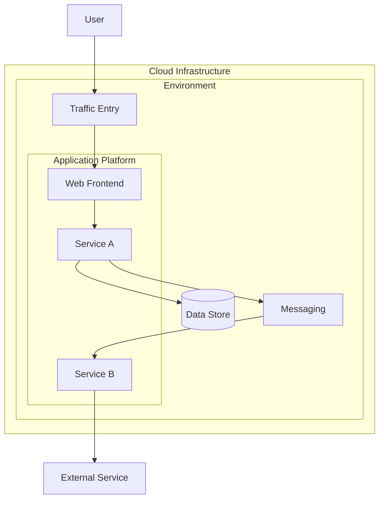

<br>

本図はInfrastructure全体の論理構成を示すOverviewとし、Network、Kubernetes、Security等の詳細構成図は対応する後続Sectionで定義する。

正式なInfrastructure構成図をMermaid以外の形式で別途管理する場合は、本項目からその構成図を参照できるようにする。

<br>

**記載しない内容**:

Subnet / Route、Security Group、Node、Pod、Listener、IAM Role等の個別Resourceを網羅的に表現しない。また、個々のInfrastructure Resourceの設定値やApplication内部の処理Flowも記載しない。

### **2. Environment Separation Architecture**

本章では、Systemを構成するEnvironmentを定義し、それぞれの目的、Isolation Level、およびInfrastructure ResourceをEnvironment間で分離・共有する方針を定義する。

Account、Network、Compute / Cluster、Namespace、Data、Identity / Security、External Connectivity等についてEnvironment Boundaryを確定し、後続のInfrastructure Designが前提とする **Environment Isolation Modelの正本**とする。

本章ではEnvironment間の論理的・Infrastructure上の分離方針を定義し、個々のResourceの具体的な構成・設定値は対応する後続Sectionで定義する。


#### **2.1 Environment Definition and Purpose**

Systemで使用するEnvironmentを特定し、それぞれの目的、利用範囲および位置づけを定義する。

**example**:

| Environment | Purpose | Usage | Production Data |
| --- | --- | --- | --- |
| dev | Applicationの開発・動作確認 | Development | Not Allowed |
| stg | Production相当条件でのIntegration / Release検証 | Verification | [Policy] |
| prod | Production Serviceの提供 | Production | Allowed |

<br>

Environmentを必要以上に増やさず、各Environmentが担う役割を明確にする。

<br>

**記載しない内容**:

各Environmentの具体的なResource構成、Resource Size、Deployment方法、休眠方法等はここでは定義しない。


#### **2.2 Environment Isolation Model**

Environment間をどのInfrastructure Boundaryによって分離するか、System全体のIsolation Modelを定義する。

Account、VPC、Cluster、Namespace等について、どのEnvironment間で共有し、どこから独立させるかを明確にする。

**example**:

| Boundary | dev | stg | prod | Separation Policy |
| --- | --- | --- | --- | --- |
| Cloud Account | Non-prod Account | Non-prod Account | Prod Account | prodを独立する |
| VPC | Non-prod VPC | Non-prod VPC | Prod VPC | prodを独立する |
| Cluster | Non-prod Cluster | Non-prod Cluster | Prod Cluster | prodを独立する |
| Namespace | dev | stg | prod | Environment単位で分離する |

<br>

必要に応じてMermaidの`flowchart`を使用してEnvironment Isolation Modelを可視化する。

<br>

**example**:

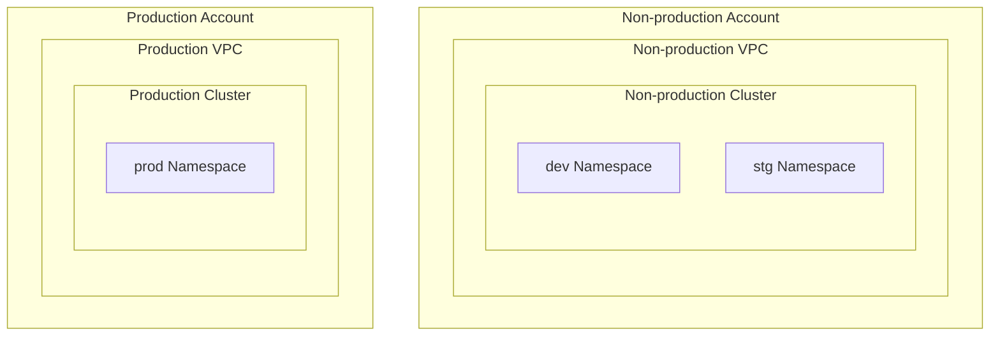

<br>

**記載しない内容**:

Account ID、VPC CIDR、Cluster名、Namespace名等の具体値や、各Boundary内部のResource構成はここでは定義しない。


#### **2.3 Infrastructure Sharing and Separation**

Environment間で共有するInfrastructure Resourceと、Environmentごとに独立させるResourceを定義する。

共有する場合は、Environment間の干渉、Security、Capacity、障害影響等を考慮し、共有可能とするBoundaryを明確にする。

**example**:

| Infrastructure | Sharing Policy | Shared Between | Reason / Constraint |
| --- | --- | --- | --- |
| VPC | Shared | dev / stg | [理由] |
| Cluster | Shared | dev / stg | Namespaceで論理分離する |
| Data Store | Separated | All Environments | DataをEnvironment単位で分離する |
| Registry | [Policy] | [Environment] | [理由] |

<br>

**記載しない内容**:

共有Resource自体の具体的なInfrastructure構成やCapacityは対応する後続Sectionで定義する。


#### **2.4 Network Isolation and Cross-Environment Connectivity**

Environment間のNetwork Isolation方針と、Environmentをまたぐ通信を許可する範囲を定義する。

必要に応じて以下を決定する。

- Environment間通信を原則禁止するか
- dev / stg等のNon-production間通信を許可する範囲
- prodとNon-production間のNetwork接続可否
- Shared Networkを利用する場合のIsolation Requirement
- Environmentを越えたResource Accessの制約

<br>

**example**:

| Source Environment | Target Environment | Connectivity | Purpose / Constraint |
| --- | --- | --- | --- |
| dev | stg | [Allowed / Denied] | [方針] |
| non-prod | prod | Denied | Environment間のIsolationを維持する |

<br>

**記載しない内容**:

Route Table、Security Group、Network Policy、Firewall Rule、PrivateLink等の具体的なNetwork実現方式は **Network Architecture** で定義する。


#### **2.5 Data Isolation and Cross-Environment Data Policy**

EnvironmentごとのData Isolation方針、およびEnvironment間でDataを移動・利用する際の制約を定義する。

必要に応じて以下を決定する。

- Data StoreをEnvironment単位で分離するか
- Production DataをNon-productionへ持ち込めるか
- Test Data / Synthetic Dataの利用方針
- Environment間でDataを共有可能な範囲
- Production Dataを利用する場合に必要なProtection / Anonymization

<br>

**example**:

| Data Flow | Policy | Constraint |
| --- | --- | --- |
| prod → stg | [Allowed / Denied / Restricted] | [必要なProtection等] |
| prod → dev | [Allowed / Denied / Restricted] | [制約] |
| dev → prod | [Policy] | [制約] |

<br>

**記載しない内容**:

具体的なData Migration / Replication方式、Backup / Restore方式、Anonymization処理等はここでは定義しない。Data Lifecycleに関する戦略はData Strategyを正とする。


#### **2.6 Identity and Security Separation**

Environment間でIdentity、PermissionおよびSecurity Boundaryをどのように分離するかを定義する。

必要に応じて以下を決定する。

- EnvironmentごとのIAM Boundary
- prod / non-prodの管理権限分離
- Application IdentityのEnvironment分離
- Credential / SecretのEnvironment分離
- EnvironmentをまたぐIdentity利用の可否
- Shared Infrastructure利用時のAccess Isolation

<br>

**記載しない内容**:

IAM Role / Policy、ServiceAccount、Kubernetes RBAC、Secret Store等の具体的なSecurity Resourceおよび設定は **Infrastructure Security and Identity** で定義する。


#### **2.7 External Service Environment Separation**

External Serviceとの接続について、Environmentごとに利用する接続先およびIsolation方針を定義する。

System ArchitectureのExternal Service Integrationで定義されたEnvironment別利用方針を前提として、それをInfrastructure Boundaryへ反映する。

**example**:

| External Service | dev | stg | prod | Separation Policy |
| --- | --- | --- | --- | --- |
| External Service A | Stub | Test Endpoint | Production Endpoint | prod接続先を分離する |
| External Service B | Development Endpoint | Staging Endpoint | Production Endpoint | Environmentごとに分離する |

<br>

必要に応じて、Environment間で同一External Resourceを共有可能かについても明示する。

<br>

**記載しない内容**:

External Serviceへの具体的なNetwork経路、VPC Endpoint、PrivateLink、DNS、Credential等は後続のNetwork / External Connectivity / Security関連Sectionで定義する。

### **3. Infrastructure Technology Stack and Tooling**

本章では、Infrastructureを構築・実行・構成管理・運用するために採用する主要なTechnologyおよびToolを定義する。

System ArchitectureのTechnology Stackで定義されたApplication側のTechnologyは再定義せず、本章ではCloud Provider、OS、Compute / Container Platform、Infrastructure as Code、Infrastructure Configuration / Deployment Tool等のInfrastructure Technologyを対象とする。

各Technologyについて、採用対象、用途、適用範囲およびArchitecture上重要なVersion / Compatibilityを明確にする。


#### **3.1 Cloud Platform**

Infrastructureを構築するCloud Provider / Platformを定義し、必要に応じて利用範囲を明確にする。

**example**:

| Scope | Platform | Purpose |
| --- | --- | --- |
| Primary Infrastructure | AWS | System Infrastructureを提供する |
| [Scope] | [Platform] | [Purpose] |

<br>

Multi-cloud / Hybrid構成の場合は、各Platformが担うInfrastructure上の責務を明示する。

<br>

**記載しない内容**:

VPC、EKS、RDS等の個々のCloud Resourceや具体的なResource構成は定義しない。それらは対応する後続Sectionで定義する。


#### **3.2 Compute and Container Platform**

Application / Workloadを実行するInfrastructure Platformとして採用するCompute / Container Technologyを定義する。

必要に応じて以下を扱う。

- Virtual Machine / Container / Serverless等の実行形態
- Kubernetes / ECS等のContainer Orchestration Platform
- EC2 / Fargate等のCompute方式
- Container Runtime
- Workload種別ごとのPlatform使い分け

<br>

**example**:

| Workload Type | Orchestration / Platform | Compute | Container Runtime |
| --- | --- | --- | --- |
| Backend Service | Kubernetes | EC2 | [Runtime] |
| Batch | Kubernetes | Fargate | [Runtime] |

<br>

**記載しない内容**:

Cluster、Node Group、Namespace、Pod、Instance Type等の具体的なInfrastructure構成は定義しない。これらはCompute and Container Platform Architectureで扱う。


#### **3.3 Operating System and Infrastructure Runtime**

Infrastructure Resourceを構成・実行するOSおよびInfrastructure Runtimeについて、Architecture上選定が必要なTechnologyを定義する。

**example**:

| Target | OS / Runtime | Purpose |
| --- | --- | --- |
| Compute A | [OS] | Workload実行基盤 |
| Management Environment | [OS] | Infrastructure Tool実行環境 |

<br>

Architecture上OSを直接管理しないManaged Service等については、該当する内容がなければ記載しない。

<br>

**記載しない内容**:

Application RuntimeはSystem ArchitectureのTechnology Stackを正とする。また、OS Image IDやNodeごとの具体的な設定は後続の対応するInfrastructure設計で扱う。


#### **3.4 Infrastructure as Code**

Infrastructure Resourceを定義・Provisioningするために採用するIaC Technologyと、その適用範囲を定義する。

**example**:

| Technology | Scope | Purpose |
| --- | --- | --- |
| Terraform | Cloud Infrastructure | Infrastructure ResourceをCodeとして管理する |
| [Technology] | [Scope] | [Purpose] |

<br>

Terraform / CloudFormation等を複数利用する場合は、それぞれの責務範囲を明確にする。

<br>

**記載しない内容**:

Module構造、State構成、Environment別Directory、Plan / Apply方式等の具体的なIaC ArchitectureはInfrastructure Provisioning and Deliveryで定義する。


#### **3.5 Infrastructure Configuration and Deployment Tooling**

ProvisioningされたInfrastructureおよびContainer Platform等の構成・Deploymentを管理するToolを定義する。

必要に応じて以下を対象とする。

- Helm
- Kustomize
- Kubernetes Manifest管理Tool
- Terragrunt
- Cloud / Kubernetes CLI
- Infrastructure Configuration Tool
- その他Infrastructure管理Tool

<br>

**example**:

| Tool | Scope | Purpose |
| --- | --- | --- |
| Terragrunt | Terraform | Environment間のTerraform構成を管理する |
| Helm | Kubernetes | Kubernetes ResourceをPackageとして管理する |
| Kustomize | Kubernetes | Environment差分を管理する |

<br>

**記載しない内容**:

各ToolのDirectory構成、Manifest構成、具体的なCommandやPipeline上の実行方法はInfrastructure Provisioning and Deliveryで定義する。


#### **3.6 Infrastructure Tool and Component Dependencies**

採用したInfrastructure Technology / Tool間に存在する依存関係および利用順序上の制約を定義する。

**example**:

| Source | Dependency | Relationship / Constraint |
| --- | --- | --- |
| Terragrunt | Terraform | Terraform実行を補助・構成管理する |
| Helm / Kustomize | Kubernetes | Kubernetes Clusterの存在を前提とする |
| Kubernetes Workload | Container Platform | Workload配置先として利用する |

<br>

Infrastructure Component間についても、Technology選定上重要な依存関係がある場合は明示する。

必要に応じてMermaidで主要な依存関係を可視化する。

<br>

**example**:

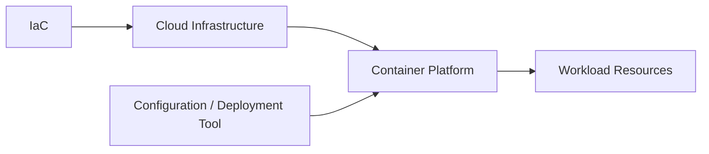

<br>

**記載しない内容**:

具体的なResource間DependencyやProvisioningの実行順序を網羅的に定義しない。それらはInfrastructure Provisioning and Deliveryで扱う。


#### **3.7 Version and Compatibility Policy**

Infrastructure Technology / Toolについて、採用Version、Version Range、およびCompatibilityを維持する方針を定義する。

**example**:

| Technology / Tool | Version / Range | Compatibility / Constraint |
| --- | --- | --- |
| Terraform | [Version] | [Provider / Module等とのCompatibility] |
| Kubernetes | [Version] | [Tool / WorkloadとのCompatibility] |
| Helm | [Version] | [KubernetesとのCompatibility] |

<br>

必要に応じて以下を考慮する。

- Cloud Provider側のSupport Lifecycle
- Kubernetes等のSupport Version
- Tool間Compatibility
- Provider / PluginとのCompatibility
- Upgrade方針
- EOL / Deprecated Versionへの対応

<br>

**記載しない内容**:

Application Language、Framework、Library等のVersionはSystem Architecture / Dependency Managementを正とする。また、個々のInfrastructure Resource固有のVersion設定は、対応するResource設計で定義する。


#### **3.8 Infrastructure Development and Delivery Technologies**

Infrastructure CodeのVersion管理、Repository管理およびInfrastructure Deliveryを実現するために採用する主要Technology / Platformを定義する。

Application側で採用されたSCM / Repository / CI/CD Platformと同一であることを前提とせず、Infrastructureの管理・Delivery Requirementに基づいて独立して決定する。

必要に応じて以下を対象とする。

- SCM
- Repository Platform
- CI/CD Platform
- その他Infrastructure CodeのDevelopment / Deliveryを支える主要Technology

<br>

**example**:

| Category | Technology / Platform | Scope | Purpose |
| --- | --- | --- | --- |
| SCM | Git | Infrastructure Code | Infrastructure CodeをVersion管理する |
| Repository Platform | GitHub | Infrastructure Repository | Repositoryを管理する |
| CI/CD Platform | GitHub Actions | Infrastructure Delivery | Infrastructure Pipelineを実行する |

<br>

**記載しない内容**:

Repository構造、Branch / Trigger、Pipeline Stage、Terraform / Kubernetes Pipelineの分離・実行方式等はInfrastructure Provisioning and Deliveryで定義する。また、Application側のSCM / Repository / CI/CD PlatformはSystem Architectureを正とする。


### **4. Cloud and Infrastructure Resource Architecture**

本章では、System ArchitectureおよびEnvironment Separation Architectureをもとに、Systemを成立させるために必要な主要Infrastructure Resourceを特定し、それぞれの役割、Environmentごとの配置有無、およびResource間の論理的な関係を定義する。

本章をInfrastructure Resource Inventoryおよび論理Resource構成の正本とし、Network、Compute、Data、Traffic、Security等の各Resourceの具体的な構成・設定は対応する後続Sectionで定義する。


#### **4.1 Infrastructure Resource Inventory**

Systemを構成する主要なInfrastructure Resourceを特定し、その種類、役割、および利用主体を整理する。

必要に応じて以下のようなResource Categoryを対象とする。

- Compute
- Container / Orchestration Platform
- Database
- Cache
- Object Storage
- Queue / Broker
- Container / Artifact Registry
- Load Balancer / API Gateway
- CDN
- DNS
- Bastion / Management Access
- External Connectivity Resource
- Observability Resource
- その他Managed Service

<br>

**example**:

| Resource | Category | Role | Used By |
| --- | --- | --- | --- |
| Resource A | Container Platform | Backend Workloadを実行する | Backend Services |
| Resource B | Database | 永続データを保持する | Service A |
| Resource C | Queue | 非同期Messageを保持・配送する | Service A / B |
| Resource D | Registry | Container Imageを保持する | Application Delivery |

<br>

ResourceはTechnology名だけでなく、Infrastructure上で果たす役割が判断できる単位で整理する。

<br>

**記載しない内容**:

Subnet、Security Group、IAM Role等、他Resourceを構成・制御する詳細ResourceをすべてInventoryとして列挙しない。また、Instance Type、Capacity、設定値等のResource内部仕様は対応する後続Sectionで定義する。


#### **4.2 Environment Resource Matrix**

Infrastructure Resourceについて、どのEnvironmentに存在し、Environment間で共有・分離されるかを整理する。

Environment Separation Architectureで定義されたIsolation / Sharing Policyを、具体的なInfrastructure Resourceへ対応付ける。

**example**:

| Resource | dev | stg | prod | Sharing / Separation |
| --- | --- | --- | --- | --- |
| Container Platform | Yes | Yes | Yes | dev / stg共有、prod分離 |
| Database | Yes | Yes | Yes | Environmentごとに分離 |
| Registry | Yes | Yes | Yes | [Policy] |
| Bastion | Yes | Yes | Yes | [Policy] |

<br>

Environmentによって不要なResourceがある場合は、そのResourceを配置しないことを明示する。

<br>

**記載しない内容**:

Environmentごとの具体的なResource Name、Endpoint、Capacity、Network配置等は記載しない。また、Environment分離方針そのものをここで再判断せず、Environment Separation Architectureを正とする。


#### **4.3 Resource Responsibilities and Ownership**

各Infrastructure Resourceが担う責務と、どのApplication / Service / Infrastructure Concernのために提供されるResourceであるかを明確にする。

**example**:

| Resource | Responsibility | Primary Consumer / Concern | Excluded Responsibility |
| --- | --- | --- | --- |
| Database A | Service Aの永続データを保持する | Service A | 他Service所有Dataを管理しない |
| Queue A | AからBへの非同期Messageを配送する | Service A / B | Business Logicを保持しない |
| Registry A | Deploy対象Imageを保持する | Deployment | Source Codeを管理しない |

<br>

共有Resourceについては、複数の利用主体に対してどの責務を提供するかを明確にする。

<br>

**記載しない内容**:

Application / Service側の機能責務やData Ownershipを再定義しない。また、ResourceへのAccess Control等のSecurity仕様はInfrastructure Security and Identityで定義する。


#### **4.4 Logical Resource Relationships**

主要Infrastructure Resource間の論理的な関係を定義し、SystemがInfrastructure上でどのようなResourceの組合せによって成立するかを明確にする。

必要に応じて以下の関係を表現する。

- Traffic Entry → Application Platform
- Application Platform → Data Store
- Application Platform → Cache
- Producer / Consumer → Queue / Broker
- Delivery Pipeline → Registry → Application Platform
- DNS / CDN / Load Balancer間の関係
- Bastion / Management Accessと管理対象Resourceの関係

<br>

**example**:

| Source Resource | Relationship | Target Resource |
| --- | --- | --- |
| Load Balancer | Trafficを転送する | Container Platform |
| Container Platform | Dataを永続化する | Database |
| Service Workload | Messageを送受信する | Queue |
| Delivery Pipeline | Artifactを格納する | Registry |

<br>

**記載しない内容**:

Protocol、Port、Route、Security Rule等の具体的な接続仕様は定義しない。また、Application内部のFunctional FlowやService間Interfaceを再定義しない。


#### **4.5 Logical Cloud Infrastructure Diagram**

主要Infrastructure Resourceとその論理的な関係を、Cloud Infrastructure全体として俯瞰できる構成図にまとめる。

Environment Boundaryおよび主要Resource Categoryが識別できる構造とし、必要に応じてMermaidの`flowchart`を使用する。

**example**:

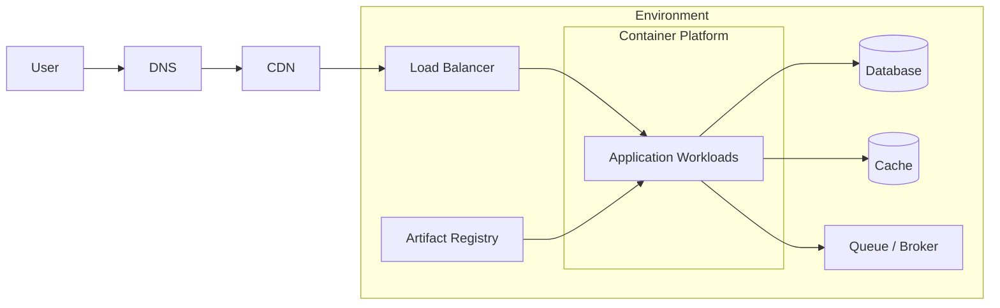

<br>

本図ではResourceの存在と主要な論理関係を表現し、後続SectionでNetwork構成図、Container Platform構成図、Traffic構成図等へ具体化する。

正式なCloud Infrastructure構成図を別Artifact / Diagramとして管理する場合は、本項目から参照できるようにする。

<br>

**記載しない内容**:

CIDR、Subnet、Route、Security Group、Listener、Node、Pod、IAM Role等の詳細Resourceおよび具体設定を網羅的に表現しない。


### **5. Network Architecture**

本章では、Environment Separation ArchitectureおよびCloud and Infrastructure Resource Architectureを前提として、各Infrastructure Resourceを接続するNetwork構造、Address Space、Subnet、Routing、Ingress / Egress、DNS、Private ConnectivityおよびExternal Connectivityを実装可能な仕様まで定義する。

Environment間およびResource間で必要となるNetwork Isolationと通信経路を確定し、後続のCompute、Data、Traffic、Security等のInfrastructure設計が前提とするNetwork Architectureの正本とする。

Security Group、Network Policy、Firewall等による具体的なAccess Control Ruleは **Infrastructure Security and Identity** で定義し、本章ではそれらが実現すべきNetwork Connectivityを定義する。


#### **5.1 Network Topology**

Environmentごとに使用するVPC / Networkと、その相互関係を定義する。

Environment Separation Architectureで決定されたVPC共有・分離方針を具体的なNetwork Topologyへ反映する。

**example**:

| Environment | Network / VPC | Region | Isolation / Relationship |
| --- | --- | --- | --- |
| dev | Non-prod VPC | [Region] | stgと共有 |
| stg | Non-prod VPC | [Region] | devと共有 |
| prod | Prod VPC | [Region] | non-prodから分離 |

<br>

VPC Peering、Transit Gateway等によって複数Networkを接続する場合は、その関係も定義する。

<br>

**記載しない内容**:

Application / Workloadの具体的な配置や、Security Group等による通信許可Ruleはここでは定義しない。


#### **5.2 Address Space and Subnet Design**

各VPC / Networkについて、CIDRおよびSubnet構成を実装可能な値まで定義する。

Public / Private等のSubnet種別、Availability Zoneへの配置、および各Subnetの用途を明確にする。

Environment Separation Architecture等で定義されたVPC / Network Boundaryごとに、必要なSubnetを定義する。

**example**:

| VPC / Network | Subnet | Type | Availability Zone | CIDR | Purpose |
| --- | --- | --- | --- | --- | --- |
| Non-prod VPC | Public A | Public | AZ-A | [CIDR] | Public Entry / NAT等 |
| Non-prod VPC | Private A | Private | AZ-A | [CIDR] | Application Workload |
| Non-prod VPC | Private B | Private | AZ-B | [CIDR] | Application Workload |
| prod VPC | Public A | Public | AZ-A | [CIDR] | Public Entry / NAT等 |
| prod VPC | Private A | Private | AZ-A | [CIDR] | Application Workload |
| prod VPC | Private B | Private | AZ-B | [CIDR] | Application Workload |

<br>

将来必要となるAddress Spaceおよび他Networkとの重複を考慮し、CIDR Allocationを確定する。

<br>

**記載しない内容**:

Subnet上へ配置する個々のPod / Workload等は定義しない。Application / Workload PlacementおよびCompute and Container Platform Architectureを正とする。


#### **5.3 Routing Architecture**

SubnetおよびNetwork間のTrafficを成立させるRoutingを定義する。

Route Table、Internet Gateway、NAT Gateway、Peering等について、必要なRouteとそのDestination / Targetを実装可能な仕様まで明確にする。

**example**:

| Route Table | Associated Subnet | Destination | Target | Purpose |
| --- | --- | --- | --- | --- |
| Public Route Table | Public Subnet | 0.0.0.0/0 | Internet Gateway | Internet Access |
| Private Route Table | Private Subnet | 0.0.0.0/0 | NAT Gateway | Outbound Internet Access |

<br>

**記載しない内容**:

Trafficを許可・拒否するSecurity Ruleは定義しない。また、Application LayerでのRoutingやLoad Balancingは本項目では扱わない。


#### **5.4 Ingress and Egress Architecture**

InfrastructureへのInbound TrafficおよびInfrastructureから外部へのOutbound Trafficについて、主要なEntry / Exit Pointと経路を定義する。

必要に応じて以下を扱う。

- InternetからのIngress
- Internal SystemからのIngress
- InternetへのEgress
- External System / ServiceへのEgress
- Management Access
- EnvironmentごとのIngress / Egress制約
- Public / Private Connectivityの使い分け

<br>

**example**:

| Traffic | Source | Destination | Entry / Exit | Network Path |
| --- | --- | --- | --- | --- |
| User Traffic | Internet | Application | [Entry] | [Path] |
| External API | Application | External Service | [Exit] | [Path] |

<br>

**記載しない内容**:

Load BalancerのListener / Target等のApplication Traffic制御はTraffic Management and External Connectivityで定義する。また、通信許可のSecurity RuleはInfrastructure Security and Identityで定義する。


#### **5.5 Private Connectivity and Endpoints**

Internetを経由せず接続するInfrastructure / External Serviceについて、Private Connectivity方式を定義する。

必要に応じて以下を扱う。

- VPC Endpoint
- PrivateLink
- Private API Endpoint
- Service Endpoint
- VPN
- Private Network間接続
- Cloud Provider ServiceへのPrivate Access

<br>

**example**:

| Source | Target | Connectivity | Endpoint / Connection | Purpose |
| --- | --- | --- | --- | --- |
| Backend | External Service A | Private | VPC Endpoint | Public Internetを経由せず利用する |
| VPC A | External Network | Private | VPN | Private Network間を接続する |

<br>

Amazon Bedrock等についてPrivate Connectivityを採用する場合、そのVPC Endpoint等もここで具体化する。

<br>

**記載しない内容**:

External Serviceを利用するApplication側のClient / Adapter ArchitectureはSystem Architectureを正とする。また、EndpointへのAccess Permission / IAMはInfrastructure Security and Identityで定義する。


#### **5.6 DNS and Name Resolution**

Infrastructure ResourceおよびApplication / Service間の接続に必要なDNS / Name Resolution構成を定義する。

必要に応じて以下を決定する。

- Public / Private DNS
- Hosted Zone
- EnvironmentごとのDomain / Subdomain
- Internal Service Name Resolution
- External ResourceのName Resolution
- Private EndpointのDNS
- Environment間で共有・分離するDNS Boundary

<br>

**example**:

| Zone / Domain | Type | Environment | Purpose |
| --- | --- | --- | --- |
| [Domain] | Public | prod | Public Serviceの名前解決 |
| [Domain] | Private | non-prod | Internal Resourceの名前解決 |

<br>

**記載しない内容**:

CDN / Load Balancerへの具体的なTraffic Routing RuleはTraffic Management and External Connectivityで扱う。


#### **5.7 Network Segmentation**

System内のNetworkをSecurity、Environment、Workload特性等に基づいてどのようにSegmentするかを定義する。

必要に応じて以下を扱う。

- Public / Private Segment
- Application / Data等のNetwork Boundary
- Management Access Boundary
- Environment Boundary
- External Connectivity Boundary
- Segment間で必要となる通信関係

ここでは、**どのNetwork Segment間に通信が必要または不要であるか**を正本として定義する。

<br>

**記載しない内容**:

Security Group、Network Policy、Firewall Rule等によってSegmentationをどのようにEnforceするかはInfrastructure Security and Identityで定義する。


#### **5.8 Network Connectivity Matrix**

主要なInfrastructure Resource / Network Segment間について、必要なNetwork Connectivityを一覧化する。

**example**:

| Source | Destination | Protocol / Port | Direction | Purpose |
| --- | --- | --- | --- | --- |
| Application | Database | [Protocol / Port] | Outbound | Database Access |
| Load Balancer | Application | [Protocol / Port] | Inbound | Application Traffic |
| Application | External Service | HTTPS / 443 | Outbound | External Service Access |

<br>

このMatrixを、Infrastructure Security and IdentityでSecurity Group / Firewall等を設計する際のInputとする。

<br>

**記載しない内容**:

具体的なSecurity Group IDやRule Resourceは定義しない。


#### **5.9 Network Availability and Failure Considerations**

Network ComponentまたはNetwork Pathの障害によってSystem全体が不要に停止しないよう、Network Architecture上必要となる可用性・障害対策を定義する。

必要に応じて以下を扱う。

- Availability Zone障害を考慮したSubnet配置
- NAT / Gateway等の障害影響範囲
- Network ComponentのSingle Point of Failure
- External Connectivity障害時のNetwork側考慮
- DNS / Endpoint障害時の影響
- Environmentごとの可用性要求との整合

<br>

**記載しない内容**:

Application側のRetry / Circuit Breaker / Fallback等はSystem Architectureを正とする。また、Infrastructure Resource全体のRecovery StrategyはAvailability, Recovery and Infrastructure Healthで扱う。


### **6. Compute and Container Platform Architecture**

本章では、Infrastructure Technology Stack and Toolingで選定したCompute / Container Platformについて、Application / Workloadを実行可能にするためのCluster、Node / Compute、Namespace、Container RuntimeおよびKubernetes等のPlatform Resourceを実装可能な仕様まで定義する。

Environment Separation Architectureで定義されたEnvironment Boundaryを前提として、EnvironmentごとのCompute / Cluster構成を確定する。

各Application / Service / Batchを具体的にどのCluster / Namespace等へ配置するかは **Application and Workload Placement** で定義する。


#### **6.1 Compute and Container Platform Structure**

Environmentごとに採用するCompute / Container Platformと、その全体構造を定義する。

**example**:

| Environment | Platform | Compute Model | Cluster / Execution Unit |
| --- | --- | --- | --- |
| dev | EKS | EC2 | Non-prod Cluster |
| stg | EKS | EC2 | Non-prod Cluster |
| prod | EKS | EC2 | Prod Cluster |

<br>

EKS / ECS / EC2 / Fargate等を複数使い分ける場合は、Workload種別ごとの適用範囲も明確にする。

<br>

**記載しない内容**:

Application / Serviceごとの具体的な配置先は定義しない。また、Platform Technologyそのものの選定理由はInfrastructure Technology Stack and Toolingを正とする。


#### **6.2 Cluster Architecture**

Container Orchestration PlatformでClusterを使用する場合、EnvironmentごとのCluster構成を定義する。

必要に応じて以下を決定する。

- Cluster数
- EnvironmentとClusterの対応
- Cluster共有 / 分離
- Cluster Version
- Control Planeに関する必要な構成
- Cluster EndpointのAccess方針
- Cluster Add-onの基本構成
- Upgradeを考慮したCluster構成

<br>

**example**:

| Cluster | Environment | Platform Version | Access | Purpose |
| --- | --- | --- | --- | --- |
| Non-prod Cluster | dev / stg | [Version] | [Policy] | Non-production Workload |
| Prod Cluster | prod | [Version] | [Policy] | Production Workload |

<br>

**記載しない内容**:

Cluster間のEnvironment分離方針自体を再定義しない。また、ClusterへのNetwork RouteやSecurity Controlの詳細はNetwork / Security関連Sectionを正とする。


#### **6.3 Node and Compute Architecture**

Workloadを実行するNode / Compute Resourceの構成を定義する。

必要に応じて以下を扱う。

- Managed Node Group / Self-managed Node等
- EC2 / Fargate等のCompute方式
- Node Group構成
- Instance Family / Type
- OS / Machine Image
- Architecture（arm64 / amd64等）
- Node Groupの用途分離
- Capacity Type
- Node Scaling範囲
- Taint / Label等によるWorkload配置制御の前提

<br>

**example**:

| Node / Compute Group | Compute | OS | Architecture | Capacity | Purpose |
| --- | --- | --- | --- | --- | --- |
| General Node Group | EC2 | [OS] | arm64 | [Type] | General Workloads |
| Batch Node Group | [Compute] | [OS] | [Arch] | [Type] | Batch Workloads |

<br>

**記載しない内容**:

個々のApplication / BatchをどのNode Groupへ配置するかはApplication and Workload Placementで定義する。また、Pod単位のCPU / Memory値はResource, Performance and Scaling Architectureを正とする。


#### **6.4 Infrastructure Runtime**

Compute / Container Platformを成立させるInfrastructure Runtimeを定義する。

必要に応じて以下を扱う。

- Operating System
- Container Runtime
- Kubernetes Runtimeに関連する主要Component
- Architecture上固定する必要があるRuntime Version
- Runtime間のCompatibility

<br>

**example**:

| Target | Runtime | Version | Constraint |
| --- | --- | --- | --- |
| Container Node | containerd | [Version] | [Compatibility] |
| Node OS | [OS] | [Version] | [Constraint] |

<br>

**記載しない内容**:

Java / Node.js等のApplication RuntimeはSystem Architectureを正とする。また、Runtime TechnologyのVersion PolicyそのものはInfrastructure Technology Stack and Toolingと整合させる。


#### **6.5 Namespace Architecture**

Kubernetes等でNamespaceを使用する場合、Namespaceの構成および責務を定義する。

Environment Separation Architectureで定義されたEnvironment Boundary、およびApplication and Infrastructure Mapping Overviewで整理されたApplication / Workloadの構成を前提として、Namespaceによって維持すべきIsolation Boundaryを決定する。

Environment単位での分離に加え、必要に応じてApplication種別、Frontend / Backend、Web / Mobile向けBackend、Workload種別、System Component等のBoundaryによる追加分離を検討する。

Namespaceの分割単位はEnvironmentだけに固定せず、Security、Resource Isolation、Ownership、Deployment、Operation等の要件から必要なBoundaryを決定する。

**example**:

| Cluster | Namespace | Purpose | Isolation Boundary |
| --- | --- | --- | --- |
| Non-prod Cluster | dev-web | dev Web Workload | Environment / Application |
| Non-prod Cluster | dev-backend | dev Backend Workload | Environment / Application |
| Non-prod Cluster | stg-web | stg Web Workload | Environment / Application |
| Non-prod Cluster | stg-backend | stg Backend Workload | Environment / Application |
| Prod Cluster | prod-web | prod Web Workload | Environment / Application |
| Prod Cluster | prod-backend | prod Backend Workload | Environment / Application |

<br>

Application / Workload間で追加の分離を必要としない場合は、下記のようにEnvironment単位のNamespaceとしてもよい。

<br>

**example**:

| Cluster | Namespace | Purpose | Isolation Boundary |
| --- | --- | --- | --- |
| Non-prod Cluster | dev | dev Workload | Environment |
| Non-prod Cluster | stg | stg Workload | Environment |
| Prod Cluster | prod | prod Workload | Environment |

<br>

必要に応じて、Platform / Observability等のSystem Namespaceについても定義する。

<br>

**記載しない内容**:

Namespace内に配置する具体的なApplication / ServiceはApplication and Workload Placementで定義する。また、NamespaceごとのRBAC / Network Policy等はInfrastructure Security and Identityで定義する。


#### **6.6 Kubernetes Resource Architecture**

Kubernetesを利用する場合、WorkloadおよびPlatformを構成するResource Typeとその基本構造を定義する。

必要に応じて以下を扱う。

- Deployment
- StatefulSet
- Job
- CronJob
- Service
- Ingress
- ConfigMap
- Secret
- ServiceAccount
- HorizontalPodAutoscaler
- PodDisruptionBudget
- その他必要なKubernetes Resource

<br>

**example**:

| Resource Type | Usage | Architectural Role |
| --- | --- | --- |
| Deployment | Online Service | 継続稼働するStateless Workloadを管理する |
| CronJob | Scheduled Batch | 定期Batchを起動する |
| Service | Internal Connectivity | Workloadへの安定した接続点を提供する |

<br>

ここでは、Projectで利用するResource TypeとそのArchitecture上の役割を確定する。

<br>

**記載しない内容**:

個々のApplicationのDeployment名、Image、Replica数、Environment Variable等の具体設定を一括してここで定義しない。それぞれのConcernに応じてApplication and Workload Placement、Resource / Scaling、Configuration等のSectionで定義する。


#### **6.7 Workload Execution Models**

System Architectureで特定されたWorkload種別について、Infrastructure上でどのような実行Modelを提供するかを定義する。

**example**:

| Workload Type | Execution Model | Platform Resource | Lifecycle |
| --- | --- | --- | --- |
| Online Service | Long-running | Deployment | Continuous |
| Scheduled Batch | Scheduled Job | CronJob | Scheduled |
| On-demand Batch | Job | Job | On-demand |
| Stateful Workload | [Model] | StatefulSet | [Lifecycle] |

<br>

Frontend / Backend / Batch等で異なる実行方式を必要とする場合、その方式を明確にする。

<br>

**記載しない内容**:

「Batch AをCronJobとして配置する」等の個別Workloadとの具体的な対応付けはApplication and Workload Placementで定義する。


#### **6.8 Pod and Workload Baseline**

Container Workloadについて、個別Applicationに共通して適用するPod / Task等の基本構成を定義する。

必要に応じて以下を扱う。

- Container構成
- Sidecar利用方針
- Init Container利用方針
- Restart Policy
- Graceful Shutdownに必要なInfrastructure側条件
- Health Probeを持つ基本方針
- Temporary Storageの基本方針
- Workload Identityを付与する基本単位

<br>

**記載しない内容**:

Application固有のContainer設定、具体的なCPU / Memory、Probe値、Secret / Config値等は本項目では定義しない。それぞれ対応する後続Sectionで具体化する。


#### **6.9 Compute and Container Platform Diagram**

Cluster、Node / Compute、Namespaceおよび主要なPlatform Resourceの構造を可視化する。

EnvironmentとCluster、Namespace、Computeの対応関係が読み取れる構造とする。

**example**:

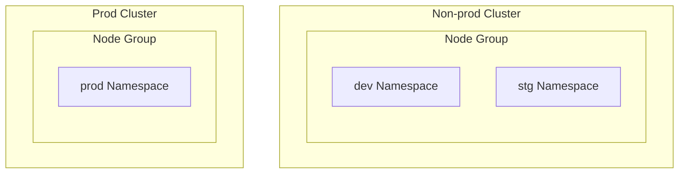

<br>

Application / Serviceを含める場合でも、本図ではPlatform構造を理解するために必要な範囲に留め、Application配置の正本はApplication and Workload Placementとする。

<br>

**記載しない内容**:

VPC / Subnet / Route等のNetwork全体構成や、Application間のFunctional Flowは表現しない。


### **7. Application and Workload Placement**

本章では、System Architectureで定義されたApplication / Service / Batch等の実行対象を、Compute and Container Platform Architectureで定義されたInfrastructure上の実行基盤へ対応付ける。

各Environmentについて、Application / Workloadの配置先、実行方式、Namespace、必要に応じたCompute Group等を確定し、System Architecture上の論理構造とInfrastructure Architecture上の物理・実行構造を接続する正本とする。

本章ではApplication / Workloadの「配置」を扱い、Cluster、Namespace、Node Group等の配置先そのものの構造は **Compute and Container Platform Architecture** を正とする。


#### **7.1 Application and Workload Inventory**

Infrastructure上への配置が必要となるApplication / Service / Workloadを、System Architectureから特定する。

対象には必要に応じて以下を含める。

- Web Frontend
- Backend Application / Service
- Online Workload
- Scheduled Batch
- On-demand Batch
- Consumer / Worker
- Stateful Workload
- その他独立した実行単位

<br>

**example**:

| Application / Workload | Type | Deployment Unit | Execution Requirement |
| --- | --- | --- | --- |
| Web Frontend | Frontend | Web Frontend | Web Hosting |
| Service A | Online Service | Service A | Continuous |
| Batch A | Scheduled Batch | Batch A | Scheduled |
| Worker A | Consumer | Worker A | Continuous |

<br>

System ArchitectureのApplication / Service Structure、Components and Responsibilities、Deployment Architecture等を前提とし、Infrastructure上に配置すべき対象を漏れなく抽出する。

<br>

**記載しない内容**:

Application / Serviceの機能責務、内部Architecture、Deployment Unit等をここで新たに決定しない。また、Infrastructure上に独立して配置されないClass / Module等のApplication内部要素は対象としない。


#### **7.2 Environment Placement Matrix**

各Application / Workloadについて、Environmentごとの配置先と実行基盤を定義する。

**example**:

| Application / Workload | dev | stg | prod |
| --- | --- | --- | --- |
| Web Frontend | [Placement] | [Placement] | [Placement] |
| Service A | dev Namespace | stg Namespace | prod Namespace |
| Service B | dev Namespace | stg Namespace | prod Namespace |
| Batch A | dev Namespace | stg Namespace | prod Namespace |

<br>

EnvironmentによってApplication / Workloadを配置しない場合や、異なる実行基盤を利用する場合も明示する。

Environment Separation Architectureで定義されたIsolation Modelと整合させる。

<br>

**記載しない内容**:

Environment自体のCluster / Namespace共有・分離方針を再定義しない。また、EnvironmentごとのDeployment方法はSystem ArchitectureのDeployment Architecture and Strategyを前提とする。


#### **7.3 Workload-to-Platform Mapping**

各Application / Workloadを、どのCompute / Container PlatformおよびWorkload Resourceによって実行するかを定義する。

**example**:

| Application / Workload | Platform | Execution Model | Platform Resource |
| --- | --- | --- | --- |
| Service A | EKS | Long-running | Deployment |
| Batch A | EKS | Scheduled | CronJob |
| Batch B | EKS | On-demand | Job |
| Web Frontend | [Platform] | Web Hosting | [Resource] |

<br>

6章で定義したWorkload Execution Modelを、具体的なApplication / Workloadへ適用する。

<br>

**記載しない内容**:

Deployment / CronJob等のResource Type自体のArchitecture上の役割を再定義しない。また、Application内部の処理方式も扱わない。


#### **7.4 Cluster and Namespace Placement**

Container Platform上で実行する各Application / Workloadについて、配置するClusterおよびNamespaceをEnvironmentごとに確定する。

**example**:

| Environment | Application / Workload | Cluster | Namespace |
| --- | --- | --- | --- |
| dev | Service A | Non-prod Cluster | dev |
| stg | Service A | Non-prod Cluster | stg |
| prod | Service A | Prod Cluster | prod |
| prod | Batch A | Prod Cluster | prod |

<br>

Application / Workload間でCluster / Namespaceを分離する必要がある場合は、その配置境界も明示する。

<br>

**記載しない内容**:

Cluster / Namespaceそのものの作成仕様やVersion等はCompute and Container Platform Architectureを正とする。Namespace間のSecurity RuleはInfrastructure Security and Identityで定義する。


#### **7.5 Compute and Node Placement**

Application / Workloadごとに特定のNode Group、Fargate等のCompute配置が必要な場合、その対応関係を定義する。

**example**:

| Application / Workload | Compute Group | Placement Constraint | Reason |
| --- | --- | --- | --- |
| Service A | General Node Group | [Constraint] | General Online Workload |
| Batch A | Batch Node Group | Batch用Computeへ配置 | Online WorkloadとのResource競合を避ける |
| Workload B | Fargate | [Constraint] | [Reason] |

<br>

必要に応じて、Node Label / Taint / Toleration / Affinity等によって実現すべきPlacement Requirementも定義する。

<br>

**記載しない内容**:

Node GroupのInstance Type、Capacity、Scaling Range等はCompute and Container Platform ArchitectureおよびResource, Performance and Scaling Architectureを正とする。


#### **7.6 Workload Isolation and Co-location**

Online Service、Batch、Worker等について、同一Infrastructure上で共存可能なWorkloadと、Resource競合、Security、Availability等の理由から分離すべきWorkloadを定義する。

**example**:

| Workload A | Workload B | Placement Policy | Reason |
| --- | --- | --- | --- |
| Online Service | Batch | Separated | Batch負荷によるOnline処理への影響を防止する |
| Service A | Service B | Co-located / Allowed | [理由] |

<br>

必要に応じて以下を考慮する。

- Online / Batch間のResource競合
- Stateful / Stateless Workloadの分離
- Security Boundary
- Availability Requirement
- Failure Domain
- 特殊Resourceを必要とするWorkload
- Environment内でのWorkload Isolation

<br>

**記載しない内容**:

具体的なCPU / Memory Requests / Limits等によるResource IsolationはResource, Performance and Scaling Architectureで定義する。また、Network Policy等による通信分離はInfrastructure Security and Identityで扱う。


#### **7.7 Application and Workload Placement Diagram**

System Architecture上のApplication / Service / Batch等と、Infrastructure上のEnvironment、Cluster、Namespace、Compute Groupとの対応関係を可視化する。

必要に応じてEnvironmentごとに図を分け、配置関係が過度に複雑にならないようにする。

**example**:

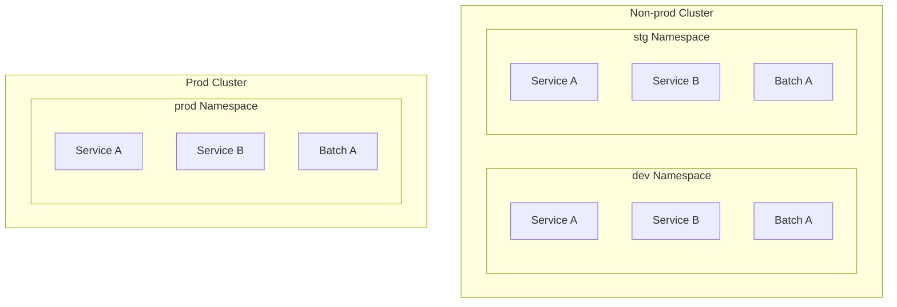

<br>

Node Group等のCompute PlacementがArchitecture上重要な場合は、その境界も図に含める。

<br>

**記載しない内容**:

Application間のFunctional Flow、API / Event等の連携関係や、VPC / Subnet / Route等のNetwork構造を本図の主目的として表現しない。


### **8. Data and Messaging Infrastructure**

本章では、System Architectureで定義されたData Persistence ArchitectureおよびIntegration Architectureを、Database、Cache、Object Storage、Queue / Broker等の具体的なInfrastructure Resourceとして実現する構成を定義する。

各Environmentについて、Resourceの種類、Managed Service、Instance / Cluster、Storage、配置、Environment分離およびApplication / Workloadとの接続関係を実装可能な仕様まで確定する。

Backup / Restore、Replication、Migration、Schema Evolution、Retention / Archiving等の方針そのものは **Data Strategy** を正とし、本章ではData Strategyで決定された方針をInfrastructureとして実現するために必要なResourceおよび構成を定義する。


#### **8.1 Persistence Infrastructure Mapping**

System Architectureで定義されたPersistence領域について、それぞれをどのInfrastructure Resourceによって実現するかを定義する。

**example**:

| Data / Persistence Domain | Owner | Persistence Model | Infrastructure Resource | Managed Service |
| --- | --- | --- | --- | --- |
| Data Domain A | Service A | Relational | Database A | [Service] |
| Cache A | Service A | Key-Value | Cache A | [Service] |
| Object Data A | Service B | Object | Object Storage A | [Service] |

<br>

System Architecture上のData OwnershipおよびPersistence BoundaryとInfrastructure Resourceの対応を維持する。

<br>

**記載しない内容**:

Table / Column / Index等のData Structureや、Data Ownershipそのものを再定義しない。また、ApplicationからPersistenceを利用するLibrary / Repository等のApplication実装も扱わない。


#### **8.2 Database Infrastructure**

Relational Database等のDatabase Resourceについて、実行・運用可能なInfrastructure構成を定義する。

必要に応じて以下を決定する。

- Managed Service / Database Platform
- Database Engine / Version
- Instance / Cluster構成
- EnvironmentごとのDatabase分離
- Instance Class / Compute
- Storage Type / Capacity
- Storage拡張方針
- Database Endpoint
- Parameter / Option等のInfrastructure Configuration
- Availability Zone配置
- Connection上のInfrastructure Constraint

<br>

**example**:

| Environment | Database | Engine / Version | Instance / Cluster | Storage | Placement |
| --- | --- | --- | --- | --- | --- |
| dev | Database A | [Engine] | [Configuration] | [Storage] | [Placement] |
| stg | Database A | [Engine] | [Configuration] | [Storage] | [Placement] |
| prod | Database A | [Engine] | [Configuration] | [Storage] | [Placement] |

<br>

**記載しない内容**:

Schema、Table、Column、PK / FK、Index等はData Detail Designを正とする。Backup / Retention等の要求・戦略そのものはData Strategyで定義する。


#### **8.3 Cache Infrastructure**

System ArchitectureでCache利用が定義されている場合、Cacheを提供するInfrastructure Resourceおよび構成を定義する。

必要に応じて以下を扱う。

- Managed Cache Service / Engine
- Cluster / Node構成
- Environment分離
- Capacity
- Availability
- Endpoint
- Network Placement
- Scaling
- Persistence有無

<br>

**example**:

| Cache | Environment | Engine | Cluster / Node | Capacity | Used By |
| --- | --- | --- | --- | --- | --- |
| Cache A | prod | [Engine] | [Configuration] | [Capacity] | Service A |

<br>

**記載しない内容**:

Cache対象、Source of Truth、Cache Invalidation等のApplication Architecture上の方針はSystem Architectureを正とする。また、具体的なCache Key設計等は扱わない。


#### **8.4 Object Storage Infrastructure**

Application / Serviceが利用するObject / File Storageについて、Infrastructure Resourceおよび構成を定義する。

必要に応じて以下を決定する。

- Object Storage Service
- Bucket / Storage Unit
- Environment分離
- Application / Serviceとの対応
- Access Boundary
- Storage Class
- Encryption RequirementのInfrastructure反映
- Public / Private Access
- Endpoint / Connectivity

<br>

**example**:

| Storage | Environment | Used By | Purpose | Access |
| --- | --- | --- | --- | --- |
| Object Storage A | prod | Service A | [Purpose] | Private |

<br>

**記載しない内容**:

Retention / Archiving / Lifecycleの方針そのものはData Strategyを正とする。本章では、その方針を実現するLifecycle Configuration等が必要な場合にInfrastructure構成として反映する。


#### **8.5 Messaging Infrastructure**

System ArchitectureのIntegration Architectureで定義されたQueue / Broker / Messaging方式について、具体的なInfrastructure Resourceとしての構成を定義する。

必要に応じて以下を扱う。

- Queue / Broker / Messaging Service
- Queue / Topic等のInfrastructure Unit
- Producer / Consumerとの対応
- Environment分離
- Cluster / Broker構成
- Capacity / Throughput
- Ordering等を支えるInfrastructure Configuration
- Delivery / Retention Configuration
- Dead Letter Resource
- Endpoint / Connectivity

<br>

**example**:

| Messaging Resource | Type | Environment | Producer | Consumer | Infrastructure Configuration |
| --- | --- | --- | --- | --- | --- |
| Queue A | Queue | prod | Service A | Service B | [Configuration] |
| Topic A | Topic | prod | Service C | Service D / E | [Configuration] |

<br>

**記載しない内容**:

Event / Messageの意味、Payload Schema、Producer / Consumerの機能責務、同期 / 非同期の使い分け等はSystem Architectureを正とする。


#### **8.6 Environment Separation and Placement**

Database、Cache、Object Storage、Queue / Broker等について、Environment Separation Architectureで定義されたIsolation Modelを具体的なData / Messaging Resourceへ適用する。

**example**:

| Resource | dev | stg | prod | Separation / Sharing |
| --- | --- | --- | --- | --- |
| Database A | dev DB | stg DB | prod DB | Environmentごとに分離 |
| Queue A | dev Queue | stg Queue | prod Queue | Environmentごとに分離 |
| Object Storage A | [Resource] | [Resource] | [Resource] | [Policy] |

<br>

Environment間でResourceを共有する場合は、Data Isolation、Security、Capacityおよび障害影響を考慮して共有範囲を明確にする。

<br>

**記載しない内容**:

Environment Separation Policyそのものを再定義しない。また、Environment間でProduction Dataを移動可能とするか等のData PolicyはEnvironment Separation Architecture / Data Strategyを正とする。


#### **8.7 Backup, Replication and Recovery Implementation**

Data StrategyでBackup / Restore、Replication、Recovery等の方針が定義されている場合、その方針をInfrastructureとして実現する構成を定義する。

必要に応じて以下を扱う。

- Backup Resource / Mechanism
- Snapshot Configuration
- Backup Scheduleを実現するInfrastructure
- Backup Storage
- Replica Resource
- Multi-AZ / Cross-Region等のInfrastructure構成
- Restoreに必要となるInfrastructure
- Recovery時のResource再生成方法

<br>

**example**:

| Strategy Requirement | Infrastructure Implementation | Target Resource |
| --- | --- | --- |
| [Backup Requirement] | [Snapshot / Backup Configuration] | Database A |
| [Replication Requirement] | [Replica Configuration] | Database A |

<br>

**記載しない内容**:

RPO / RTO、Retention期間、Replicationの必要性、Recovery Policy等を本章で新たに決定しない。これらはData Strategyを正とする。


#### **8.8 Data and Messaging Infrastructure Diagram**

Database、Cache、Object Storage、Queue / Broker等とApplication / WorkloadのInfrastructure上の関係を可視化する。

**example**:

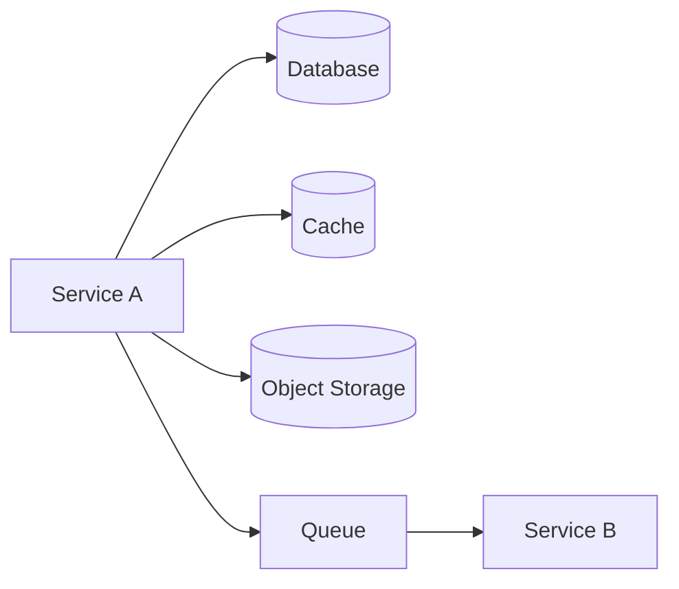

<br>

Environment間で構成が大きく異なる場合は、Environmentごとに図を分ける。

<br>

**記載しない内容**:

Application内部のFunctional FlowやData Modelを表現しない。また、VPC / Subnet / Route等のNetwork構造はNetwork Architectureを正とする。


### **9. Traffic Management and External Connectivity**

本章では、Network Architectureで定義されたNetwork Connectivityを前提として、Application Trafficの入口、Routing、Distribution、およびExternal System / External Serviceとの接続を実現するInfrastructure構成を定義する。

Load Balancer、Ingress、API Gateway、CDN、DNS Routing等について、TrafficのSource / Destination、Routing Rule、TargetおよびEnvironmentごとの構成を実装可能な仕様まで確定する。

また、System Architectureで定義されたIntegration Architecture、External Service IntegrationおよびDeployment Architecture and StrategyをInfrastructureへ反映し、Application間・外部とのTrafficおよびDeployment時のTraffic切替を成立させる。

VPC、Subnet、Route Table、Internet Gateway、NAT Gateway等のNetwork Reachabilityそのものは **Network Architecture** を正とする。


#### **9.1 Traffic Entry and Exposure Architecture**

System / Applicationへ流入するTrafficについて、Public / Private等の公開範囲と主要なTraffic Entry Pointを定義する。

必要に応じて以下を決定する。

- Internet-facing / Internalの区別
- Public Application / Internal Applicationの公開境界
- Frontend / Backend / API等のEntry Point
- Environmentごとの公開範囲
- External SystemからのInbound Traffic
- Management用途等の限定的なEntry Point

<br>

**example**:

| Traffic / Application | Source | Exposure | Entry Point | Environment |
| --- | --- | --- | --- | --- |
| Web Frontend | Internet | Public | CDN / Load Balancer | prod |
| Backend API | Web Frontend | Internal / Public | Load Balancer | prod |
| Internal API | Internal Service | Internal | Internal Load Balancer | prod |

<br>

**記載しない内容**:

Public / Private SubnetやInternet Gateway等、Entry Pointへ到達するためのNetwork PathはNetwork Architectureを正とする。また、ApplicationとしてAPIを公開するかどうか等のInterface設計はSystem Architectureを正とする。


#### **9.2 Load Balancing Architecture**

Application Trafficを複数のWorkloadへDistributionするLoad Balancer構成を定義する。

必要に応じて以下を決定する。

- Load Balancerの種類
- Internet-facing / Internal
- EnvironmentごとのLoad Balancer
- Load Balancer共有 / 分離
- Listener
- Protocol / Port
- Target / Target Group
- Application / Serviceとの対応
- Health Checkとの関係
- Cross-zone等の必要なLoad Balancing方針

<br>

**example**:

| Load Balancer | Exposure | Listener | Target | Environment |
| --- | --- | --- | --- | --- |
| Public LB | Internet-facing | HTTPS / 443 | Web / API Target | prod |
| Internal LB | Internal | HTTPS / 443 | Internal Service | prod |

<br>

**記載しない内容**:

Load Balancerが配置されるSubnetやRoute等はNetwork Architectureを正とする。また、TargetとなるApplication / Workloadの配置そのものはApplication and Workload Placementを正とする。


#### **9.3 Application Traffic Routing**

Traffic Entry Pointへ到達したApplication Trafficを、Host、Path、Protocol等に基づいてどのApplication / ServiceへRoutingするかを定義する。

必要に応じて以下を扱う。

- Host-based Routing
- Path-based Routing
- API Routing
- Frontend / BackendへのTraffic分離
- Internal Service Routing
- EnvironmentごとのRouting
- Default Route / Fallback Route

<br>

**example**:

| Entry Point | Condition | Destination | Purpose |
| --- | --- | --- | --- |
| Public LB | `/api/*` | Backend Service | Backend APIへRoutingする |
| Public LB | `/` | Web Frontend | Web TrafficをFrontendへRoutingする |

<br>

Kubernetes Ingress等を利用する場合は、IngressとLoad Balancer / Service / Workloadの対応も定義する。

<br>

**記載しない内容**:

Application内部のEndpoint / Controller Routing等は扱わない。また、API Contract自体はApplication側の対応する設計を正とする。


#### **9.4 API Gateway and Edge Architecture**

API Gateway、CDNその他Edge Serviceを利用する場合、その役割、配置およびApplication Trafficとの関係を定義する。

必要に応じて以下を扱う。

- API Gatewayの利用有無・対象
- CDNの利用対象
- Origin
- Cache対象のInfrastructure上の扱い
- EdgeからLoad Balancer / ApplicationへのRouting
- EnvironmentごとのEdge Resource
- Public Endpointとの対応

<br>

**example**:

| Edge Resource | Traffic | Origin / Target | Purpose |
| --- | --- | --- | --- |
| CDN A | Web Traffic | Web Origin | Static / Web Contentを配信する |
| API Gateway A | API Traffic | Backend Entry | API Trafficを受け付ける |

<br>

**記載しない内容**:

Application Cache StrategyそのものはSystem Architectureを正とする。また、CDN等の具体的なCache Policyについて、Application仕様に依存する判断を本章で新たに行わない。


#### **9.5 DNS Traffic Routing**

Network Architectureで定義されたDNS / Hosted Zoneを利用し、Application TrafficをどのEntry PointへRoutingするかを定義する。

**example**:

| Domain / Record | Environment | Destination | Routing Purpose |
| --- | --- | --- | --- |
| `example.com` | prod | CDN / Load Balancer | Public Web Traffic |
| `api.example.com` | prod | API Entry Point | Public API Traffic |

<br>

必要に応じて以下を扱う。

- Domain / SubdomainとApplicationの対応
- Alias / RecordのTarget
- Environment別Domain
- Internal / External DNS Routing
- Failover等のDNS Routing Policy

<br>

**記載しない内容**:

Hosted ZoneそのもののNetwork / Name Resolution ArchitectureはNetwork Architectureを正とする。


#### **9.6 External System Connectivity**

System Architectureで定義されたExternal System Integrationについて、Infrastructure上の接続EndpointおよびTraffic Pathを定義する。

必要に応じて以下を決定する。

- Inbound / Outbound
- Public / Private Connectivity
- External System Endpoint
- Traffic Entry / Exit Point
- VPN / PrivateLink等との対応
- Environmentごとの接続先
- Trafficを仲介するInfrastructure Resource

<br>

**example**:

| External System | Direction | Environment | Connectivity | Traffic Path |
| --- | --- | --- | --- | --- |
| External System A | Outbound | prod | Private | Application → Private Connection → External System |
| External System B | Inbound | prod | Public | External System → Public Entry → Application |

<br>

**記載しない内容**:

External Systemとの機能上の責務、Request / Response、Interface Contract等はSystem Architecture / Interface Designを正とする。VPN等のNetwork Connection自体の詳細構成はNetwork Architectureを正とする。


#### **9.7 External Service Connectivity**

System ArchitectureのExternal Service Integrationで定義されたExternal Serviceについて、Infrastructure上の接続方式、EndpointおよびEnvironment別接続構成を定義する。

必要に応じて以下を扱う。

- Public Endpoint / Private Endpoint
- VPC Endpoint / PrivateLink
- Environmentごとの接続先
- External ServiceへのEgress経路
- External Service固有Endpoint
- Application / WorkloadとEndpointの対応
- External Service接続に必要なInfrastructure Resource

<br>

**example**:

| External Service | Environment | Connectivity | Endpoint / Resource | Used By |
| --- | --- | --- | --- | --- |
| Amazon Bedrock | stg | Private | VPC Endpoint | AI Client Workload |
| Amazon Bedrock | prod | Private | VPC Endpoint | AI Client Workload |

<br>

System ArchitectureでdevにStub利用が定義されている場合など、実External Serviceへ接続しないEnvironmentについても明示する。

<br>

**記載しない内容**:

External Service Client / Adapter、Stub切替等のApplication ArchitectureはSystem Architectureを正とする。また、Credential / IAM Permission等はInfrastructure Security and Identityで定義する。


#### **9.8 Deployment Traffic Switching**

System ArchitectureのDeployment Architecture and Strategyで定義されたRolling、Blue / Green、Canary等のDeployment Strategyについて、それを成立させるInfrastructure上のTraffic切替方式を定義する。

必要に応じて以下を決定する。

- 新旧WorkloadへのTraffic Distribution
- Load Balancer / Target Group等による切替
- Blue / GreenのTraffic Boundary
- Canary Traffic Ratio
- Cutover方式
- Rollback時のTraffic復帰
- Deployment中の新旧Version共存
- Frontend / Backend等で異なる切替方式

<br>

**example**:

| Application / Service | Deployment Strategy | Traffic Switching | Rollback |
| --- | --- | --- | --- |
| Service A | Blue / Green | Target切替 | Previous Targetへ復帰 |
| Service B | Canary | Trafficを段階的に移行 | Stable Versionへ戻す |

<br>

**記載しない内容**:

Rolling / Blue / Green等のApplication側Deployment Strategyを本章で新たに決定しない。本章ではSystem Architectureで決定されたStrategyをInfrastructureとしてどう実現するかを定義する。


#### **9.9 Traffic Management Diagram**

Application Traffic、External System / Service Connectivity、および主要なTraffic Management Resourceの関係を可視化する。

必要に応じてPublic / Internal TrafficまたはEnvironmentごとに図を分ける。

**example**:

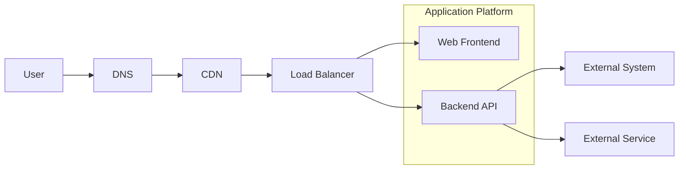

<br>

**記載しない内容**:

Subnet / Route等のNetwork TopologyやApplication内部のFunctional Flowを本図の主目的として表現しない。

### **10. Infrastructure Security and Identity**

本章では、System Architectureで定義されたSecurity ArchitectureおよびInfrastructure上のTrust Boundaryを、IAM、Kubernetes RBAC、Security Group、Network Policy、WAF、Encryption等の具体的なInfrastructure Security Controlとして実現する構成を定義する。

User、Application / Service、Infrastructure Operator、Infrastructure Resource等のIdentityとAccess Boundaryを明確にし、必要なResource Accessのみを許可するInfrastructure Architectureを実装可能な仕様まで確定する。

Application内部のAuthentication / Authorization ModelやBusiness Ruleは **System Architecture** を正とする。Network上で必要となるConnectivity自体は **Network Architecture** を正とし、本章ではそれらをInfrastructure Security ControlとしてどのようにEnforceするかを定義する。


#### **10.1 Infrastructure Trust Boundaries**

System ArchitectureおよびEnvironment Separation Architectureをもとに、Infrastructure上でSecurity Controlを適用するTrust Boundaryを定義する。

必要に応じて以下を対象とする。

- Internet / Infrastructure Boundary
- Public / Private Network Boundary
- Environment Boundary
- Application / Workload Boundary
- Data Infrastructure Boundary
- Management / Operator Boundary
- External System / Service Boundary
- Cloud Account / Cluster / Namespace Boundary

<br>

**example**:

| Trust Boundary | Source | Target | Required Control |
| --- | --- | --- | --- |
| Internet Boundary | Internet | Public Entry | WAF / Network Access Control |
| Application / Data Boundary | Application | Database | Network / Identity Access Control |
| Environment Boundary | non-prod | prod | Cross-environment Accessを制限する |

<br>

**記載しない内容**:

System Architecture上のTrust BoundaryやApplication Security Requirementそのものを再定義しない。また、VPC / Subnet等のNetwork Segmentation自体はNetwork Architectureを正とする。


#### **10.2 Infrastructure Identity Model**

InfrastructureへAccessする主体を特定し、それぞれをInfrastructure上でどのIdentityとして表現するかを定義する。

対象には必要に応じて以下を含める。

- Application / Service
- Batch / Worker
- CI/CD Pipeline
- Infrastructure Provisioning
- Administrator / Operator
- External System
- Kubernetes Workload

<br>

**example**:

| Principal | Infrastructure Identity | Scope | Purpose |
| --- | --- | --- | --- |
| Service A | [Identity] | prod | Resource AへAccessする |
| CI/CD Pipeline | [Identity] | Environment | ApplicationをDeployする |
| Terraform | [Identity] | Infrastructure | InfrastructureをProvisioningする |

<br>

EnvironmentごとにIdentityを分離する場合は、その対応も明示する。

<br>

**記載しない内容**:

Application内部のUser Identity / Role Modelを再定義しない。また、Application Credentialの利用方法そのものはSystem Architectureを正とする。


#### **10.3 IAM Architecture**

Cloud ResourceへのAccessを制御するIAM Role / Policy等を定義する。

必要に応じて以下を決定する。

- IAM Role
- IAM Policy
- PrincipalとRoleの対応
- Resource Access Scope
- EnvironmentごとのRole分離
- Human / Application / CI/CD Identityの分離
- Least Privilegeの適用
- Cross-account Access
- Assume Role等の必要な信頼関係

<br>

**example**:

| Role | Principal | Allowed Resources | Permission Scope | Environment |
| --- | --- | --- | --- | --- |
| Service A Role | Service A | Resource A | Required Actions Only | prod |
| Deployment Role | CI/CD | Deployment Resources | Deployment Operations | prod |

<br>

**記載しない内容**:

Application上のAuthorization RuleをIAM Policyへ置き換えて再定義しない。IAMはInfrastructure Resource Accessを制御するために使用する。


#### **10.4 Workload Identity and Cloud Access**

Application / Workload IdentityをCloud Infrastructure IdentityへどのようにMappingし、Cloud ResourceへAccessさせるかを定義する。

Kubernetesを利用する場合は、必要に応じて以下を扱う。

- Kubernetes ServiceAccount
- Workload Identity
- IRSA等のServiceAccount / IAM連携
- Application / ServiceごとのIdentity分離
- NamespaceとIdentityの関係
- Shared Identityの許可・禁止
- External Service利用時のCloud Identity

<br>

**example**:

| Workload | Namespace | ServiceAccount | Cloud Identity | Accessible Resource |
| --- | --- | --- | --- | --- |
| Service A | prod | service-a | Role A | Resource A |
| Batch A | prod | batch-a | Role B | Resource B |

<br>

System Architectureで定義されたApplication / Service BoundaryをInfrastructure Identity上でも維持する。

<br>

**記載しない内容**:

Application内部でIdentityをどのように利用してBusiness Authorizationを行うかはSystem Architectureを正とする。


#### **10.5 Kubernetes Authorization and Isolation**

Kubernetesを利用する場合、Cluster / Namespace / Kubernetes ResourceへのAccess ControlおよびWorkload間Isolationを定義する。

必要に応じて以下を扱う。

- Kubernetes RBAC
- Role / ClusterRole
- RoleBinding / ClusterRoleBinding
- ServiceAccount
- Namespace Access
- Operator / CI/CD Access
- Workload間の権限制御
- Network Policyとの組合せ

<br>

**example**:

| Subject | Scope | Permission | Kubernetes Control |
| --- | --- | --- | --- |
| Deployment Pipeline | Namespace A | Deployment更新 | Role / RoleBinding |
| Operator A | Cluster | [Permission] | [Control] |

<br>

**記載しない内容**:

Application AuthorizationにおけるRBAC / ABAC等はSystem Architectureを正とする。ここでいうRBACはKubernetes Infrastructure ResourceへのAuthorizationを指す。


#### **10.6 Network Security Controls**

Network Architectureで定義されたConnectivity MatrixおよびNetwork Segmentationを、Security Group、Network Policy、Firewall等によってEnforceする構成を定義する。

必要に応じて以下を扱う。

- Security Group
- Inbound / Outbound Rule
- Network Policy
- Firewall
- Resource間通信制御
- Environment間通信制御
- Management Access
- External Connectivityに対するAccess Control

<br>

**example**:

| Source | Destination | Protocol / Port | Security Control | Policy |
| --- | --- | --- | --- | --- |
| Load Balancer | Service A | HTTPS / [Port] | Security Group | Allow |
| Service A | Database A | [Protocol / Port] | Security Group | Allow |
| non-prod | prod | Any | Security Control | Deny |

<br>

Network Architectureで必要とされた通信を許可し、それ以外の不要な通信を制限する。

<br>

**記載しない内容**:

通信経路、Subnet、Route等はNetwork Architectureを正とする。


#### **10.7 Edge and Application Protection**

Internet等の外部TrafficからApplicationを保護するInfrastructure Security Controlを定義する。

必要に応じて以下を扱う。

- WAF
- DDoS Protection
- Rate-based Infrastructure Control
- Public Endpoint Protection
- CDN / API Gateway / Load BalancerとのSecurity連携
- Allow / Deny Rule
- External SystemからのInbound制限

<br>

**example**:

| Entry Point | Protection | Applied Control | Purpose |
| --- | --- | --- | --- |
| Public Web | WAF | [Rule Set] | Malicious Trafficを制御する |
| Public API | [Control] | [Rule] | Public APIを保護する |

<br>

**記載しない内容**:

Application内部のInput ValidationやBusiness Rate Limit等はSystem / Application Architectureを正とする。


#### **10.8 Infrastructure Encryption and Key Management**

Infrastructure上で保持・通信されるDataについて、EncryptionおよびKey Managementの具体構成を定義する。

必要に応じて以下を扱う。

- Encryption at Rest
- Encryption in Transit
- KMS / Key Management
- Key分離
- EnvironmentごとのKey
- ResourceとKeyの対応
- Certificateとの責務境界
- Key Rotationに必要なInfrastructure構成

<br>

**example**:

| Resource / Traffic | Encryption | Key / Mechanism | Environment |
| --- | --- | --- | --- |
| Database A | At Rest | KMS Key A | prod |
| Object Storage A | At Rest | KMS Key B | prod |
| Application Traffic | In Transit | TLS | prod |

<br>

**記載しない内容**:

Data Classificationや「何を暗号化すべきか」というApplication / Data側のRequirementを本章で再定義しない。本章では要求をInfrastructureとしてどう実現するかを定義する。


#### **10.9 Resource Access Control Matrix**

主要なPrincipalとInfrastructure Resourceについて、必要なAccess関係を横断的に整理する。

**example**:

| Principal | Resource | Access | Control | Environment |
| --- | --- | --- | --- | --- |
| Service A | Database A | Connect / Use | IAM / Network Control | prod |
| Service B | Queue A | Consume | IAM Policy | prod |
| CI/CD | Cluster A | Deploy | IAM + Kubernetes RBAC | prod |

<br>

IAM、Kubernetes RBAC、Network Security等の個別Controlを統合し、Infrastructure上のAccess関係を確認できる状態にする。

<br>

**記載しない内容**:

各Policy Document等の記述を重複して掲載しない。本MatrixはAccess関係の正本として使用し、具体的なControl設定は対応するSubsectionを正とする。


### **11. Configuration, Secrets and Certificates**

本章では、Application / WorkloadおよびInfrastructure Resourceが必要とするConfiguration、Secret、CredentialおよびCertificateについて、管理場所、Environment分離、供給方式、Injection方式、更新・Rotationおよび利用Boundaryを実装可能な仕様まで定義する。

Secret / Non-secretを明確に区別し、Application CodeやContainer Image等へEnvironment固有値や機密情報を埋め込まず、Environmentごとに適切なConfigurationを供給できるInfrastructure Architectureを確立する。

Principalが各Configuration / Secret ResourceへAccess可能かというAccess Controlは **Infrastructure Security and Identity** を正とし、本章では許可された情報をどこで管理し、どのようにConsumerへ供給するかを定義する。

本章で確定したApplication向けConfigurationのうち、Application / Deployment担当へ引き渡す必要がある項目は **Application and Deployment Handoff** で整理する。


#### **11.1 Configuration Classification**

SystemおよびApplicationが利用するConfigurationを分類し、それぞれに適用する管理・供給方式を定義する。

少なくとも、Secret / Non-secretおよびEnvironment固有 / 共通Configurationを区別する。

**example**:

| Classification | Sensitive | Environment-specific | Management Policy |
| --- | --- | --- | --- |
| Application Configuration | No | Yes / No | Configuration Store等で管理する |
| Secret | Yes | Yes | Secret Storeで管理する |
| Credential | Yes | Yes | Secret / Identity Mechanismで管理する |
| Certificate | Yes / No | Yes / No | Certificate Managementで管理する |

<br>

**記載しない内容**:

ApplicationのBusiness Configurationや個々の機能仕様そのものを本章で新たに定義しない。本章ではInfrastructureから管理・供給するConfigurationを対象とする。


#### **11.2 Configuration Inventory and Source**

Application / WorkloadおよびInfrastructure Componentが必要とする主要Configurationを特定し、そのSource of TruthとConsumerを定義する。

**example**:

| Configuration | Classification | Consumer | Source | Environment-specific |
| --- | --- | --- | --- | --- |
| `DB_HOST` | Non-secret | Service A | Infrastructure Output / Configuration Store | Yes |
| `QUEUE_URL` | Non-secret | Service B | Infrastructure Output / Configuration Store | Yes |
| External API Endpoint | Non-secret | Service A | Configuration Store | Yes |
| Database Credential | Secret | Service A | Secret Store | Yes |

<br>

Infrastructure構築後に値が確定するConfigurationについても、その生成元と供給先を明確にする。

<br>

**記載しない内容**:

Secretの実値を設計書へ記載しない。また、Infrastructure Resourceから自動的に生成されるEnvironment固有値をpersistentな設計書の固定値として管理しない。


#### **11.3 Configuration Management and Distribution**

Non-secret Configurationについて、管理場所およびApplication / Workloadへの供給方式を定義する。

必要に応じて以下を扱う。

- Parameter Store等のConfiguration Store
- Kubernetes ConfigMap
- Environment Variable
- Configuration File
- Deployment時Injection
- Runtime取得
- Environment共通値 / Environment固有値
- Configuration変更時の反映方式

<br>

**example**:

| Configuration Type | Management | Distribution | Consumer |
| --- | --- | --- | --- |
| Environment Configuration | Parameter Store | Deployment時Injection | Application |
| Kubernetes Configuration | ConfigMap | PodへInjection | Workload |

<br>

**記載しない内容**:

Application内部でConfigurationをどのClass / Framework APIから読み込むか等の実装詳細は定義しない。


#### **11.4 Secret and Credential Management**

Secret / Credentialについて、保存先、Environment分離、Application / Workloadへの供給方式および利用Boundaryを定義する。

必要に応じて以下を扱う。

- Secrets Manager / Vault等のSecret Store
- Kubernetes Secret
- Database Credential
- External Service Credential
- CI/CD Credential
- SecretのEnvironment分離
- SecretのRuntime取得 / Deployment時Injection
- SecretをFile / Environment Variable等として供給する場合の方針
- SecretをApplication Code / Repository / Imageへ含めないRule

<br>

**example**:

| Secret / Credential | Store | Consumer | Supply Method | Environment |
| --- | --- | --- | --- | --- |
| Database Credential | Secret Store | Service A | [Method] | prod |
| External Service Credential | Secret Store | Service B | [Method] | prod |

<br>

Workload Identity等によって長期Credential自体を不要にできる場合は、Secretを保持する方式よりIdentityベースのAccessを優先するか等の方針も明確にする。

<br>

**記載しない内容**:

SecretへのAccess PermissionはInfrastructure Security and Identityを正とする。また、Secretの実値は記載しない。


#### **11.5 Secret Injection and Workload Integration**

Secret / ConfigurationをContainer / Pod / ApplicationへどのようにInjectionするかを具体化する。

必要に応じて以下を決定する。

- Environment Variable
- Volume / File Mount
- Kubernetes Secret / ConfigMap
- External Secret連携
- Sidecar / CSI等
- Runtime取得
- Startup時取得
- SecretをMemory上で保持する範囲
- Secret更新時にWorkload Restartが必要か

<br>

**example**:

| Source | Injection / Retrieval | Target | Refresh Behavior |
| --- | --- | --- | --- |
| Secret Store | [Method] | Service A | [Behavior] |
| ConfigMap | Environment Variable | Service B | Restart Required |

<br>

**記載しない内容**:

Application固有のConfiguration Binding Code等は定義しない。


#### **11.6 Rotation and Configuration Update Strategy**

Secret、Credential、Certificateおよび変更可能なConfigurationについて、更新・Rotation時にApplication / Infrastructureを継続利用できるための方式を定義する。

必要に応じて以下を扱う。

- Secret Rotation
- Credential Rotation
- Certificate Renewal
- Configuration Update
- 更新された値をWorkloadへ反映する方式
- Restart / Redeployの必要性
- 新旧Credentialの一時共存
- Rotation失敗時の扱い
- Environmentごとの更新方式

<br>

**記載しない内容**:

Application ReleaseそのもののPromotion / Deployment StrategyはSystem Architectureを正とする。また、具体的なRotation ScheduleはSecurity / Operational Requirementに基づいて必要な場合のみ定義する。


#### **11.7 Certificate and TLS Asset Management**

Systemで利用するCertificateおよびTLS関連Assetについて、発行・管理・配置・更新方式を定義する。

必要に応じて以下を扱う。

- Public Certificate
- Internal Certificate
- Certificate Authority
- Certificate Management Service
- CertificateとDomain / Endpointの対応
- Load Balancer / CDN / Ingress等へのCertificate配置
- ApplicationへCertificateを供給する必要がある場合の方式
- Certificate Renewal
- Private Keyの管理

<br>

**example**:

| Certificate | Used By | Managed By | Placement | Renewal |
| --- | --- | --- | --- | --- |
| Public TLS Certificate | Public Entry | Certificate Service | Load Balancer / CDN | Automatic |
| Internal Certificate | Internal Service | [Service] | [Placement] | [Policy] |

<br>

**記載しない内容**:

TLSを必要とする通信BoundaryそのものはSystem Architecture / Infrastructure Security and Identityを正とする。本項目ではそのRequirementを実現するCertificate Infrastructureを定義する。


#### **11.8 Environment-specific Configuration**

Environmentごとに異なるConfiguration / Secret / Credential / Certificateについて、その分離および対応関係を定義する。

**example**:

| Configuration / Secret | dev | stg | prod | Separation Policy |
| --- | --- | --- | --- | --- |
| DB Endpoint | dev DB | stg DB | prod DB | Environmentごとに分離 |
| External Service Endpoint | Stub / dev | stg Endpoint | prod Endpoint | Environmentごとに切替 |
| Credential | dev Credential | stg Credential | prod Credential | Environmentごとに分離 |

<br>

Environment Separation ArchitectureおよびSystem ArchitectureのEnvironment-specific External Service Usage等と整合させる。

<br>

**記載しない内容**:

Environment固有の実値を設計書へ固定的に転記することを目的としない。実値のSource of TruthとEnvironment間の分離関係を定義する。


#### **11.9 Configuration and Secret Flow**

Infrastructure ResourceからApplication / WorkloadへConfiguration / Secretがどのように生成・管理・供給されるかを可視化する。

**example**:

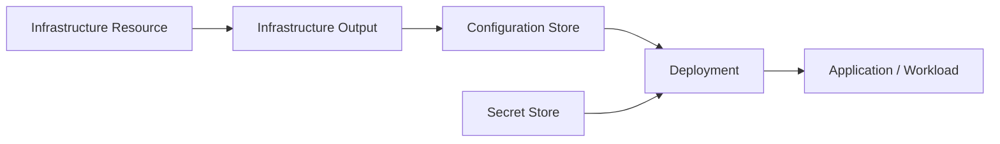

<br>

Runtime取得を採用する場合は、その経路も表現する。

<br>

**記載しない内容**:

Application内部でConfigurationを利用する処理Flowや、Secret値そのものを図示しない。


### **12. Resource, Performance and Scaling Architecture**

本章では、System Architectureで定義されたPerformance / Capacity RequirementおよびPerformance and Scalability Architectureを、具体的なInfrastructure Resource、CapacityおよびScaling構成として実現する。

Application / Workload、Compute Platform、Database、Cache、Messaging等について、CPU / Memory、Instance / Node、Replica、CapacityおよびScaling条件を実装可能な仕様まで定義する。

Application側のCache、並列化、非同期化、Stateless性等のPerformance / Scalability方式は **System Architecture** を正とし、本章ではそれらを成立させるInfrastructure ResourceとScalingを定義する。


#### **12.1 Resource Requirements and Sizing**

Application / Workloadおよび主要Infrastructure Resourceについて、Performance / Capacity Requirementを満たすために必要なResource量を定義する。

**example**:

| Target | Resource | Baseline | Maximum / Limit | Basis |
| --- | --- | --- | --- | --- |
| Service A | CPU | [Value] | [Value] | [Sizing根拠] |
| Service A | Memory | [Value] | [Value] | [Sizing根拠] |
| Batch A | CPU | [Value] | [Value] | [Sizing根拠] |
| Batch A | Memory | [Value] | [Value] | [Sizing根拠] |

<br>

Sizingには、Function / System Architectureで定義された処理量、同時実行数、Performance Requirement等を利用する。

初期段階で正確なResource量を確定できない場合は、初期値と、実測後に調整する対象であることを明示する。

<br>

**記載しない内容**:

Performance Requirementそのものを本章で新たに定義しない。また、Application内部のAlgorithmやResource効率化方式はSystem / Application側の設計を正とする。


#### **12.2 Workload Resource Allocation**

Container / Pod等のWorkloadについて、実行時に割り当てるCPU / Memory等のResource設定を定義する。

Kubernetesを利用する場合は、必要に応じて以下を決定する。

- CPU Requests
- CPU Limits
- Memory Requests
- Memory Limits
- Ephemeral Storage
- その他必要なResource
- Workload種別ごとの差異

<br>

**example**:

| Workload | CPU Request | CPU Limit | Memory Request | Memory Limit |
| --- | --- | --- | --- | --- |
| Service A | [Value] | [Value] | [Value] | [Value] |
| Batch A | [Value] | [Value] | [Value] | [Value] |

<br>

Requests / LimitsはCluster CapacityおよびScalingと整合させる。

<br>

**記載しない内容**:

WorkloadをどのNamespace / Node Groupへ配置するかはApplication and Workload Placementを正とする。


#### **12.3 Workload Replica and Concurrency**

Online Service、Worker、Batch等について、通常時および負荷増加時のReplica / Parallelism / Concurrencyに関するInfrastructure構成を定義する。

**example**:

| Workload | Minimum | Normal | Maximum | Scaling / Concurrency Basis |
| --- | --- | --- | --- | --- |
| Service A | [Value] | [Value] | [Value] | [Metric / Requirement] |
| Worker A | [Value] | [Value] | [Value] | Queue Backlog等 |
| Batch A | [Value] | [Value] | [Value] | Batch Processing Requirement |

<br>

Application側で並列処理可能な単位やConcurrency Constraintが存在する場合は、System Architectureと整合させる。

<br>

**記載しない内容**:

Application内部のThread数や並列処理Algorithm等は本章では定義しない。


#### **12.4 Workload Auto Scaling**

Application / Workloadを負荷に応じて自動Scaleする場合、そのScaling Mechanism、Metric、ThresholdおよびScaling Rangeを定義する。

必要に応じて以下を扱う。

- Horizontal Pod Autoscaler
- Queue Length等によるWorker Scaling
- Custom Metric
- Minimum / Maximum Replica
- Scale-out / Scale-in条件
- Stabilization
- EnvironmentごとのScaling有無

<br>

**example**:

| Workload | Scaling Mechanism | Metric | Scale-out | Scale-in | Range |
| --- | --- | --- | --- | --- | --- |
| Service A | HPA | CPU / Custom Metric | [Condition] | [Condition] | [Min-Max] |
| Worker A | [Mechanism] | Queue Depth | [Condition] | [Condition] | [Min-Max] |

<br>

**記載しない内容**:

Application側でScaling可能にするためのStateless化等はSystem Architectureを正とする。


#### **12.5 Node and Compute Capacity**

Cluster / Compute Platformについて、Workload Resource Requirementを収容できるNode / Compute Capacityを定義する。

必要に応じて以下を決定する。

- Instance Type / Family
- Node数
- Minimum / Desired / Maximum Capacity
- Node GroupごとのCapacity
- EC2 / Fargate等のCapacity
- On-demand / Spot等のCapacity Type
- Workload Resource要求との整合
- System Workload分のCapacity

<br>

**example**:

| Compute Group | Instance Type / Capacity | Minimum | Desired | Maximum | Workloads |
| --- | --- | --- | --- | --- | --- |
| General Node Group | [Type] | [Value] | [Value] | [Value] | Online Services |
| Batch Node Group | [Type] | [Value] | [Value] | [Value] | Batch |

<br>

**記載しない内容**:

Node Group自体の構造・用途はCompute and Container Platform Architectureを正とする。本項目ではCapacity / Sizingを具体化する。


#### **12.6 Infrastructure Auto Scaling**

Node / Compute等のInfrastructure Resourceを負荷に応じて増減させる場合、そのScaling構成を定義する。

必要に応じて以下を扱う。

- Cluster Autoscaler / Node Auto Provisioning等
- Auto Scaling Group
- Minimum / Maximum Node数
- Scaling Trigger
- Workload Auto Scalingとの関係
- Scale-out時のResource確保
- Scale-in時のWorkload影響
- EnvironmentごとのScaling Policy

Workload ScalingとCompute Scalingが相互に成立するよう、12.4との整合を確認する。

<br>

**記載しない内容**:

Environmentを長期間利用しない場合のScale-to-zero / Destroy等は **Environment Lifecycle and Dormancy Strategy** を正とする。


#### **12.7 Data and Messaging Capacity**

Database、Cache、Object Storage、Queue / Broker等について、想定されるData量・Traffic・Throughputを満たすCapacityを定義する。

**example**:

| Resource | Capacity Dimension | Initial Capacity | Scaling / Limit |
| --- | --- | --- | --- |
| Database A | Compute / Storage | [Value] | [Policy] |
| Cache A | Memory | [Value] | [Policy] |
| Queue A | Throughput | [Value] | [Constraint] |
| Object Storage A | Storage | [Value] | [Policy] |

<br>

必要に応じて以下を考慮する。

- Database Compute / Storage
- Connection Capacity
- Cache Memory
- Queue / Broker Throughput
- Storage Capacity
- Managed Service上のQuota / Limit
- ResourceごとのScaling方式

<br>

**記載しない内容**:

Data Retention / Archiving等によってData量を管理する方針は、必要になった場合のData Strategyを正とする。また、Data Model / Query Optimization等はApplication / Data側の設計を正とする。


#### **12.8 Environment-specific Capacity**

dev / stg / prod等について、それぞれの目的に応じたResource CapacityとScaling Policyの差異を定義する。

**example**:

| Resource / Workload | dev | stg | prod | Reason |
| --- | --- | --- | --- | --- |
| Service A Replica | [Value] | [Value] | [Value] | Environment用途に応じて調整 |
| Node Capacity | [Value] | [Value] | [Value] | [Reason] |
| Auto Scaling | [Policy] | [Policy] | [Policy] | [Reason] |

<br>

Non-production EnvironmentではCostを考慮してProductionより小さいCapacityを採用する場合、その差異を明示する。

<br>

**記載しない内容**:

Environmentを使用しない期間のResource削除 / 停止等はEnvironment Lifecycle and Dormancy Strategyで定義する。


#### **12.9 Capacity Constraints and Bottlenecks**

Infrastructure上でCapacity / Performance上の制約となるResource、Quota、共有Resource等を特定し、System Architectureで要求されるPerformance / Scalabilityを阻害しないための対応を定義する。

**example**:

| Constraint / Bottleneck | Affected Scope | Limit / Risk | Infrastructure Strategy |
| --- | --- | --- | --- |
| Shared Node Group | Service A / B | Resource Competition | [Strategy] |
| Database Connection | Services | Connection Limit | [Strategy] |
| External Service Quota | Function A | Request Limit | [Strategy] |

<br>

Cloud Provider / Managed ServiceのQuota等、Infrastructure固有の上限についても必要に応じて記載する。

<br>

**記載しない内容**:

External Service側のApplication-level Fallback等はSystem Architectureを正とする。


### **13. Availability, Recovery and Infrastructure Health**

本章では、System Architectureで定義されたAvailability / Continuity Requirementを満たすため、Infrastructure Resourceの冗長化、Failure Isolation、Failover、Health Detectionおよび障害発生後のRecovery Architectureを定義する。

EnvironmentごとのAvailability Requirementを踏まえ、Infrastructure Resourceの障害による影響範囲を限定し、必要なServiceを継続または復旧できるInfrastructure構成を実装可能な仕様まで確定する。

Backup / Restore等について別途Data Strategyが存在する場合は、そのRecovery Requirementを本章のInfrastructure構成へ反映する。Data Strategyを設けない場合は、Infrastructureとして必要となるBackup / Recoveryについて本章およびData and Messaging Infrastructureで必要な範囲を定義する。

Environmentを意図的に停止・削除し、後から再生成する運用は障害Recoveryとは区別し、**Environment Lifecycle and Dormancy Strategy** で定義する。


#### **13.1 Availability Requirements Mapping**

System Architectureで定義されたAvailability / Continuity Requirementを、Infrastructure ResourceおよびEnvironmentへ対応付ける。

**example**:

| Target | Environment | Availability Requirement | Infrastructure Implication |
| --- | --- | --- | --- |
| Service A | prod | [Requirement] | Multi-AZ構成を必要とする |
| Service A | dev | [Requirement] | Single-AZを許容する |
| Database A | prod | [Requirement] | Failover可能な構成とする |

<br>

EnvironmentによってAvailability Levelが異なる場合は、その差異とInfrastructure上の扱いを明示する。

<br>

**記載しない内容**:

Application側のAvailability RequirementやFallback / Retry等のApplication Architectureを再定義しない。


#### **13.2 Resource Redundancy and Failure Domains**

Infrastructure Resourceについて、どのFailure Domainに対して冗長化するかを定義する。

必要に応じて以下を扱う。

- Availability Zone
- Node / Compute
- Load Balancer
- Application Workload
- Database / Cache / Messaging
- Network Component
- その他Single Point of Failureとなり得るResource

<br>

**example**:

| Resource | Failure Domain | Redundancy | Environment |
| --- | --- | --- | --- |
| Application Workload | Node / AZ | Multiple Replicas | prod |
| Database A | AZ | Multi-AZ | prod |
| Node Group A | Node | Multiple Nodes | prod |

<br>

単にResource数を増やすのではなく、どの障害に耐えるための冗長化なのかを明確にする。

<br>

**記載しない内容**:

Replica数やNode数等のCapacity値そのものはResource, Performance and Scaling Architectureを正とする。


#### **13.3 Failover Architecture**

Primary Resource / Pathが利用不能となった場合に、代替Resourceへどのように切り替えるかを定義する。

必要に応じて以下を扱う。

- Automatic / Manual Failover
- Database Failover
- Workload Failover
- AZ障害時の切替
- Traffic Failover
- External Connectivity Failure
- Failoverに必要なHealth判定
- Failover後のService継続条件

<br>

**example**:

| Failure | Failover Target | Trigger | Method |
| --- | --- | --- | --- |
| DB Primary Failure | Standby | Health Failure | Automatic |
| Workload Failure | Healthy Replica | Health Failure | Automatic |

<br>

**記載しない内容**:

Application内部のFallback LogicやCircuit Breaker等はSystem Architectureを正とする。また、Traffic Routingの具体構成はTraffic Management and External Connectivityと整合させる。


#### **13.4 Infrastructure Health Model**

Infrastructure ResourceおよびWorkloadについて、Infrastructureが正常・異常を判断するためのHealth Modelを定義する。

必要に応じて以下を扱う。

- Resource Health
- Application Process Health
- Dependency Health
- Readiness
- Liveness
- Startup Health
- Load Balancer Health
- Container / Pod Health
- Managed Service Health

<br>

**example**:

| Target | Health Type | Purpose | Failure Effect |
| --- | --- | --- | --- |
| Service A | Readiness | Traffic受付可能性を判定する | Traffic Targetから除外 |
| Service A | Liveness | Process継続可否を判定する | Workloadを再起動 |
| Target Group A | Health Check | Routing可能性を判定する | Unhealthy Targetを除外 |

<br>

**記載しない内容**:

Metrics、Logs、Traces等による一般的なSystem MonitoringはObservability Architectureで定義する。本項目ではInfrastructureの制御・復旧判断に直接使用するHealthを対象とする。


#### **13.5 Readiness, Liveness and Health Check Configuration**

Health ModelをInfrastructure上で実現するHealth Check / Probe構成を定義する。

必要に応じて以下を決定する。

- Probe / Health Check方式
- Target
- Endpoint / Command
- Interval
- Timeout
- Failure Threshold
- Initial Delay / Startup Consideration
- Health Failure時のInfrastructure Behavior

<br>

**example**:

| Target | Check | Configuration | Failure Action |
| --- | --- | --- | --- |
| Service A | Readiness Probe | [Configuration] | Trafficから除外 |
| Service A | Liveness Probe | [Configuration] | Container Restart |
| Load Balancer | Target Health | [Configuration] | Targetから除外 |

<br>

Application側にHealth Endpoint等が必要な場合は、そのRequirementをApplication and Deployment Handoffへ引き渡す。

<br>

**記載しない内容**:

Application内部でHealth Endpointがどの依存先を確認するか等のApplication実装仕様はここでは定義しない。


#### **13.6 Infrastructure Recovery Strategy**

Infrastructure Resourceが障害によって失われた場合に、どの方法で復旧するかを定義する。

必要に応じて以下を扱う。

- Automatic Recovery
- Resource Recreation
- Terraform等による再Provisioning
- Kubernetes Resourceの再適用
- Replacement Resourceへの切替
- Stateful ResourceのRestore
- Environment単位のRecovery
- Recovery時のResource Dependency / Order

<br>

**example**:

| Failure Target | Recovery Method | Recovery Source | Dependency |
| --- | --- | --- | --- |
| Compute Resource | Recreate | IaC | Network |
| Kubernetes Resource | Reapply | Manifest / Helm / Kustomize | Cluster |
| Database | Restore / Failover | Backup / Replica | Data Recovery Configuration |

<br>

**記載しない内容**:

意図的なEnvironment削除後の再生成はDormancy Strategyを正とする。また、Provisioning Pipeline自体の構成はInfrastructure Provisioning and Deliveryで定義する。


#### **13.7 Infrastructure Rollback Strategy**

Infrastructure変更によって障害が発生した場合に、変更前の状態へ戻す、または安全な状態へ進めるための方針を定義する。

必要に応じて以下を扱う。

- Infrastructure ChangeのRollback可能性
- Immutable ResourceのRecreation
- Terraform等の変更取消し方針
- Kubernetes ConfigurationのRollback
- Rollback困難なStateful Resourceの扱い
- Rollback / Roll-forwardの判断
- Application Deploymentとの整合

<br>

**記載しない内容**:

Application ArtifactのRollbackはSystem ArchitectureのDeployment Architecture and Strategyを正とする。


#### **13.8 Data Recovery Infrastructure**

Database、Object Storage等のStateful Resourceについて、必要なRecoveryを実現するInfrastructure構成を定義する。

Data Strategyが存在する場合は、そのBackup / Recovery RequirementをInfrastructureへ反映する。

Data Strategyが存在しない場合でも、System / Infrastructure Requirement上必要な範囲について以下を定義する。

- Backup / Snapshot
- Restore可能なResource
- Backup Storage
- EnvironmentごとのBackup有無
- Recoveryに必要なInfrastructure Dependency

<br>

**記載しない内容**:

Data Migration、Schema Evolution、Retention / Archiving等のData Lifecycle Strategyを本項目で広げて定義しない。


#### **13.9 Failure and Recovery Matrix**

主要なInfrastructure Failureについて、影響範囲、検知、Failover / RecoveryおよびServiceへの影響を横断的に整理する。

**example**:

| Failure | Impact | Detection | Failover / Recovery | Service Impact |
| --- | --- | --- | --- | --- |
| Pod Failure | Single Workload | Liveness | Restart / Replica | Minimal |
| Node Failure | Node上のWorkloads | Platform Health | Reschedule | Temporary |
| AZ Failure | AZ内Resources | Infrastructure Health | Multi-AZ Failover | [Impact] |
| Database Failure | Data Access | DB Health | Failover / Restore | [Impact] |

<br>

各Failureへの対策が13.2〜13.8のどこで定義されているか追跡できる状態にする。

<br>

**記載しない内容**:

障害対応手順書やOperator向けRunbookそのものは作成しない。必要な場合はOperational Documentationとして別途定義する。

### **14. Environment Access and Management Architecture**

本章では、構築済みのEnvironmentおよびInfrastructure Resourceに対して、Administrator / Operator / Developer等が管理、調査、保守および検証を行うためのAccess Architectureを定義する。

Management Accessの入口、Access可能なEnvironment / Resource、Bastion / Management Host等の管理Resource、Private Resourceへの到達方式、管理・検証Toolの実行場所、およびEnvironmentごとの管理方式を実装可能な仕様まで確定する。

Applicationの通常TrafficとはManagement Trafficを明確に区別し、Public Accessを必要以上に設けず、Infrastructure Security and Identityで定義されたIdentity / Access Controlのもとで管理可能な構成とする。

本章ではManagement Accessの目的・経路・実行環境を定義し、IAM Policy、Security Group、Network Policy等の具体的なSecurity Controlは **Infrastructure Security and Identity**、Subnet / Route / Endpoint等のNetwork Connectivityは **Network Architecture** を正とする。


#### **14.1 Management Access Model**

各Environmentについて、InfrastructureおよびPrivate Resourceへどのような方式でManagement Accessを行うか、その基本Modelを定義する。

必要に応じて以下を決定する。

- Management Accessを必要とする主体
- Management Accessを許可するEnvironment
- Public / Private Accessの使い分け
- Direct Access / Management Service経由の使い分け
- Management AccessのEntry Point
- Management TrafficとApplication Trafficの分離
- Environment間でManagement Resourceを共有 / 分離する方針

<br>

**example**:

| Environment | Access Model | Entry Point | Public Access | Primary Purpose |
| --- | --- | --- | --- | --- |
| dev | [Model] | [Entry Point] | [Allowed / Denied] | Development / Verification |
| stg | [Model] | [Entry Point] | [Allowed / Denied] | Verification / Investigation |
| prod | [Model] | [Entry Point] | [Allowed / Denied] | Operation / Incident Investigation |

<br>

Environment名だけを理由としてAccess Modelを決定せず、Security Requirement、管理目的、利用頻度および対象Resource等に基づいて決定する。

<br>

**記載しない内容**:

IAM Role / Policy、Security Group Rule等の具体的なAccess Permissionは定義しない。また、Management Accessに必要なSubnet / Route等のNetwork構造はNetwork Architectureを正とする。


#### **14.2 Bastion and Administrative Access**

Bastion / Management Host等を利用する場合、その配置、利用目的、Access方式および管理対象Resourceを定義する。

Bastionを必須とはせず、Management Service等によって要件を満たせる場合は、Bastionを配置しない構成も選択可能とする。

必要に応じて以下を扱う。

- Bastion / Management Hostの利用有無
- EC2等のManagement Host
- AWS Systems Manager Session Manager等によるAccess
- BastionのEnvironment分離 / 共有
- Public IPの必要性
- SSH等の直接Accessを許可するか
- BastionからAccess可能なResource
- Bastion上で許可する管理・検証用途
- Bastionの常時稼働 / 必要時起動

<br>

**example**:

| Management Resource | Environment | Access Method | Managed Target | Purpose |
| --- | --- | --- | --- | --- |
| SSM Bastion | prod | Session Manager | Private Resources | Investigation / Verification |
| SSM Bastion | non-prod | Session Manager | Private Resources | Development / Verification |

<br>

SSM Bastion等をPrivate Subnetへ配置し、Public Inbound Accessを不要とする場合は、その構成を明示する。

<br>

**記載しない内容**:

BastionのInstance Type、CPU / Memory等のResource SizingはResource, Performance and Scaling Architectureを正とする。また、Session Manager利用に必要なIAM / Endpoint / Security Group等の具体構成は対応するSecurity / Network Sectionで定義する。


#### **14.3 Management and Verification Targets**

Management Accessによって確認・操作するInfrastructure Resourceと、その目的を定義する。

必要に応じて以下を対象とする。

- Kubernetes / Container Platform
- Private API / Application Endpoint
- Database
- Cache
- Queue / Broker
- Object Storage
- External Service Connectivity
- DNS / Network Connectivity
- Observability Resource
- その他Private Infrastructure Resource

<br>

**example**:

| Target | Environment | Access Purpose | Access From | Required Capability |
| --- | --- | --- | --- | --- |
| Kubernetes Cluster | prod | Resource確認 / Operation | Management Environment | Kubernetes Management |
| Database | stg / prod | Connectivity / Data Verification | Bastion | Database Client Access |
| Private API | dev / stg | Connectivity / Behavior Verification | Management Environment | HTTP Access |
| External Service Endpoint | stg / prod | Connectivity Verification | Management Environment | Network Access |

<br>

Management Accessは必要な管理・検証目的に限定し、Applicationの通常利用経路の代替として使用しない。

<br>

**記載しない内容**:

Application機能のTest Scenario / Test CaseやDatabase上の具体的な確認Query等は定義しない。また、対象Resource自体のArchitectureを再定義しない。


#### **14.4 Management Tooling and Execution Environment**

Infrastructureの管理・調査・検証に利用するToolと、それらをどのExecution Environmentから実行するかを定義する。

必要に応じて以下を扱う。

- AWS CLI等のCloud CLI
- kubectl
- Helm
- Database Client
- HTTP Client / curl等
- DNS / Network確認Tool
- Infrastructure Inspection Tool
- その他Environment管理Tool

<br>

**example**:

| Tool / Capability | Execution Environment | Target | Purpose |
| --- | --- | --- | --- |
| AWS CLI | [Environment] | AWS Resources | Infrastructure Management |
| kubectl | [Environment] | Kubernetes Cluster | Cluster / Workload Management |
| Database Client | SSM Bastion | Database | Connectivity / Data Verification |
| HTTP Client | SSM Bastion | Private API | Connectivity / Behavior Verification |

<br>

Tool Version等がInfrastructure Architecture上固定される必要がある場合は、Infrastructure Technology Stack and Toolingと整合させる。

<br>

**記載しない内容**:

個々のCommand、SQL、kubectl操作等の具体的なOperation Procedureは記載しない。継続的に必要となる操作手順は、必要に応じてRunbook等のOperational Documentationで管理する。


#### **14.5 Management Access Flow**

Operator / DeveloperからManagement Resourceを経由し、Private Infrastructure Resourceへ到達する主要なManagement Access Flowを定義する。

必要に応じてMermaidの`flowchart`を使用する。

**example**:

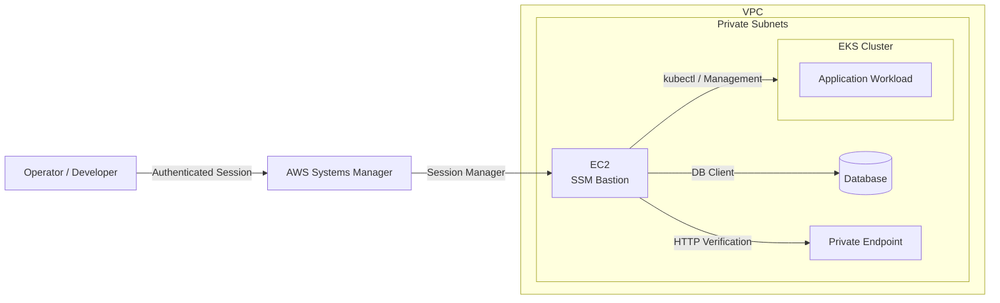

<br>

複数のManagement Access方式が存在する場合は、主要なFlowごとに表現する。

<br>

**記載しない内容**:

Applicationの通常Traffic FlowやSystem間Integration Flowを本図へ混在させない。また、Security Group RuleやIAM Policy等の具体設定を図へ展開しない。


#### **14.6 Environment-specific Management Access**

Environmentごとの管理目的、Access方式、Management Resourceおよび制約の差異を定義する。

**example**:

| Concern | dev | stg | prod |
| --- | --- | --- | --- |
| Management Access | [Policy] | [Policy] | [Policy] |
| Bastion | [Policy] | [Policy] | [Policy] |
| Private API Verification | [Policy] | [Policy] | [Policy] |
| Database Access | [Policy] | [Policy] | [Policy] |
| Kubernetes Access | [Policy] | [Policy] | [Policy] |
| Access Restriction | [Policy] | [Policy] | [Policy] |

<br>

prod / non-prod等でAccess方式を変える場合は、そのEnvironment種別自体ではなく、Security、Operation、Verification等のRequirementを根拠として差異を定義する。

<br>

**記載しない内容**:

Environment Isolation Modelそのものを再定義しない。Account / VPC / Cluster / Namespace等のEnvironment BoundaryはEnvironment Separation Architectureを正とする。


#### **14.7 Management Identity and Access Requirements**

Management Accessを行う主体と、必要となるInfrastructure上のIdentity / Permission Requirementを整理する。

**example**:

| Principal | Environment | Management Target | Required Access | Security Control |
| --- | --- | --- | --- | --- |
| Developer | dev | Kubernetes / Private API | Development / Verification | [Control] |
| Operator | prod | Infrastructure Resources | Operation / Investigation | [Control] |
| DB Operator | prod | Database | Restricted Management | [Control] |

<br>

本項目ではManagement Accessとして必要となる権限Boundaryを定義し、具体的なIAM Role / Policy、Kubernetes RBAC等はInfrastructure Security and Identityへ反映する。

必要に応じて以下を考慮する。

- Least Privilege
- EnvironmentごとのIdentity分離
- Temporary / Session-based Access
- Long-lived Credentialを不要とする方式
- Privileged Accessの限定
- Management Sessionの追跡可能性

<br>

**記載しない内容**:

具体的なIAM Policy Document、RoleBinding等のSecurity Resourceは本項目で重複して定義しない。


#### **14.8 Management Access Audit and Traceability**

Environmentへの管理Accessについて、誰が・いつ・どのEnvironmentへAccessしたかを追跡可能にするためのAudit RequirementとInfrastructure上の連携を定義する。

必要に応じて以下を扱う。

- Management Session Log
- Cloud API Audit
- Kubernetes Audit
- Privileged Accessの記録
- EnvironmentごとのAudit Requirement
- Audit LogのObservability基盤への連携

<br>

**example**:

| Access / Activity | Audit Source | Destination | Purpose |
| --- | --- | --- | --- |
| SSM Session | Systems Manager | [Audit Destination] | Management Session Traceability |
| Cloud Resource Operation | Cloud Audit Log | [Destination] | Infrastructure Change Tracking |
| Kubernetes Operation | Kubernetes Audit | [Destination] | Cluster Operation Tracking |

<br>

Audit Logの収集・保存・検索等のObservability Infrastructureは **Observability Architecture** で定義する。

<br>

**記載しない内容**:

Observability Backend、Retention、Dashboard、Alert等の具体構成は本項目で再定義しない。


#### **14.9 Management Resource Lifecycle**

Bastion / Management Host等、Environment管理のためだけに存在するInfrastructure Resourceについて、その稼働・停止・再生成上のRequirementを定義する。

必要に応じて以下を扱う。

- 常時稼働 / 必要時起動
- Stop / Start
- Destroy / Recreate
- Management Tool / Configurationの再現性
- Environment休眠時の扱い
- Management Resource自体がEnvironment Lifecycleを妨げないための方針

<br>

**example**:

| Management Resource | Active Usage | Inactive Strategy | Recreate From |
| --- | --- | --- | --- |
| SSM Bastion | Management / Verification時 | Stop / Destroy | IaC + Configuration |

<br>

具体的なLifecycle Strategyは **Environment Lifecycle and Dormancy Strategy** と整合させる。

<br>

**記載しない内容**:

Environment全体のLifecycle Strategyを本項目で再定義しない。また、ResourceのDestroy / Restore PipelineそのものはInfrastructure Provisioning and Deliveryを正とする。

### **15. Observability Architecture**

本章では、ApplicationおよびInfrastructureの状態・挙動を継続的に観測・分析できるよう、Metrics、Logs、Traces等のTelemetryを生成・収集・転送・保存・可視化・通知するObservability Infrastructureを定義する。

Application ObservabilityとInfrastructure Monitoringを統合し、Environmentごとの収集範囲、Telemetry Flow、Collector / Backend、Retention、DashboardおよびAlertingを実装可能な仕様まで確定する。

Readiness / Liveness、Load Balancer Health等、InfrastructureがTraffic制御・Failover・Recovery判断に直接利用するHealth Checkは **Availability, Recovery and Infrastructure Health** を正とする。


#### **15.1 Observability Scope and Signals**

Systemで収集・管理するObservability Signalと、その対象範囲を定義する。

必要に応じて以下を対象とする。

- Metrics
- Logs
- Traces
- Infrastructure Events
- Application Telemetry
- Platform / Kubernetes Telemetry
- Managed Service Telemetry

<br>

**example**:

| Signal | Source | Purpose | Environment |
| --- | --- | --- | --- |
| Metrics | Application / Infrastructure | 状態・Performanceを観測する | dev / stg / prod |
| Logs | Application / Platform | Event・Errorを分析する | dev / stg / prod |
| Traces | Application | Request経路を追跡する | [Environment] |

<br>

Environmentによって収集範囲が異なる場合は、その差異を明示する。

<br>

**記載しない内容**:

個々のApplicationが出力する具体的なLog MessageやBusiness Metricの定義を本章で新たに決定しない。本章では、それらを収集・管理可能にするInfrastructureを対象とする。


#### **15.2 Metrics Architecture**

Application / Infrastructure Metricsについて、収集元、収集方式、Metrics Backendおよび保存構成を定義する。

必要に応じて以下を扱う。

- Application Metrics
- Kubernetes / Container Metrics
- Node / Compute Metrics
- Database / Cache / Queue等のManaged Service Metrics
- Cloud Provider Metrics
- Metrics Scraping / Push方式
- Metrics Backend
- Environment分離

<br>

**example**:

| Metrics Source | Collection | Backend | Environment |
| --- | --- | --- | --- |
| Application | [Method] | [Backend] | prod |
| Kubernetes | [Method] | [Backend] | prod |
| Database | [Method] | [Backend] | prod |

<br>

**記載しない内容**:

HPA等のScaling条件そのものはResource, Performance and Scaling Architectureを正とする。ただし、Scalingに利用するMetricsを提供するために必要なObservability Infrastructureは本項目で定義する。


#### **15.3 Logging Architecture**

Application / Infrastructure Logsについて、収集、転送、保存および検索可能にするInfrastructure構成を定義する。

必要に応じて以下を扱う。

- Application Log
- Container / Pod Log
- Kubernetes / Platform Log
- Infrastructure Resource Log
- Access Log
- Audit Log
- Log Collector / Agent
- Log Aggregation
- Log Storage / Search Backend
- Environment分離

<br>

**example**:

| Log Source | Collector | Destination | Purpose |
| --- | --- | --- | --- |
| Application | [Collector] | [Log Backend] | Application Analysis |
| Load Balancer | [Method] | [Destination] | Access Analysis |
| Infrastructure | [Method] | [Destination] | Infrastructure Analysis |

<br>

**記載しない内容**:

Application Logの具体的なMessage FormatやLogging CodeはApplication側の設計を正とする。ただし、Infrastructureへ連携するために必要なFormat / Output Requirementは定義してよい。


#### **15.4 Distributed Tracing Architecture**

複数のApplication / Service / External Dependencyをまたぐ処理を追跡できるよう、Traceの収集・転送・保存構成を定義する。

必要に応じて以下を扱う。

- Trace生成対象
- Trace Context伝播に必要なInfrastructure上の前提
- OpenTelemetry等のTelemetry Standard
- Collector
- Trace Backend
- Samplingに必要なInfrastructure構成
- External ServiceとのTrace Boundary

<br>

**example**:

| Trace Source | Collection / Export | Collector | Backend |
| --- | --- | --- | --- |
| Service A | OpenTelemetry | OTel Collector | Trace Backend |
| Service B | OpenTelemetry | OTel Collector | Trace Backend |

<br>

**記載しない内容**:

Application Code上の具体的なInstrumentationやSpan設計を本章で詳細化しない。ただし、Infrastructureとの接続に必要なExporter / Endpoint等は定義する。


#### **15.5 Telemetry Collection and Processing**

Metrics / Logs / TracesをSourceからObservability Backendへ届けるCollector / Agent / Gateway等の構成を定義する。

必要に応じて以下を決定する。

- Collector / Agentの種類
- Daemon / Sidecar / Gateway等の配置方式
- CollectorのEnvironment分離
- Telemetryの集約
- Filtering / Enrichment
- Buffering
- BackendへのExport
- Collector障害時の影響

<br>

**example**:

| Collector | Signals | Placement | Source | Destination |
| --- | --- | --- | --- | --- |
| Collector A | Metrics / Traces | [Placement] | Application | Observability Backend |
| Agent A | Logs | [Placement] | Workloads | Log Backend |

<br>

**記載しない内容**:

Collectorを配置するCluster / Namespace自体の構造はCompute and Container Platform Architectureを正とする。本項目ではObservability Componentとしての配置・役割を具体化する。


#### **15.6 Telemetry Flow**

TelemetryがApplication / InfrastructureからCollectorを経由し、各Observability Backendへ到達する経路を定義する。

必要に応じてMermaidの`flowchart`を使用する。

**example**:

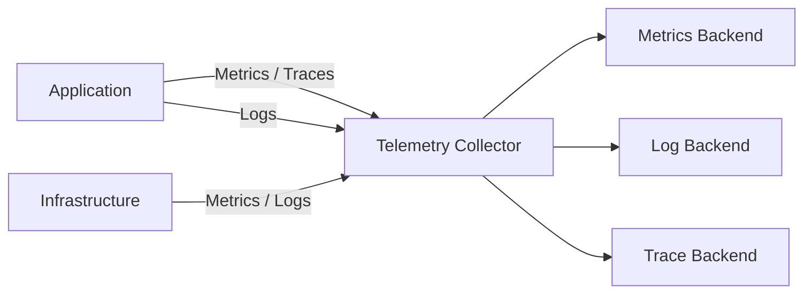

<br>

Environment間でObservability Backendを共有する場合は、その境界とEnvironment識別方式を明確にする。

<br>

**記載しない内容**:

一般的なApplication Request FlowやInfrastructure Traffic Flowを表現しない。本図はTelemetry Flowを正本とする。


#### **15.7 Alerting Architecture**

Metrics / Logs等から異常や運用上重要な状態を検知し、通知するAlerting Infrastructureを定義する。

必要に応じて以下を扱う。

- Alert Source
- Alert Ruleの管理場所
- Alert Manager / Notification Service
- Severity
- EnvironmentごとのAlerting
- Notification Destination
- Alert Grouping / Suppression
- Infrastructure / Application Alertの責務分離

<br>

**example**:

| Alert Target | Signal | Condition / Rule Source | Notification |
| --- | --- | --- | --- |
| Infrastructure Resource | Metrics | [Rule] | [Destination] |
| Application Error | Logs / Metrics | [Rule] | [Destination] |

<br>

**記載しない内容**:

障害時の具体的なOperator対応手順やRunbookそのものは定義しない。また、Infrastructureが自動的にFailoverするためのHealth判定は13章を正とする。


#### **15.8 Dashboard and Visualization**

System / Infrastructureの状態を確認するために必要なDashboardおよびVisualization構成を定義する。

必要に応じて以下を扱う。

- Infrastructure Dashboard
- Application Dashboard
- Environment別Dashboard
- Service / Workload別Dashboard
- Capacity / Performance Dashboard
- Availability / Error Dashboard
- Dashboard Tool
- Dashboard定義の管理方法

<br>

**example**:

| Dashboard | Scope | Signals | Purpose |
| --- | --- | --- | --- |
| Infrastructure Overview | Environment | Metrics | Infrastructure全体を把握する |
| Service A | Application | Metrics / Logs | Service状態を確認する |

<br>

**記載しない内容**:

すべてのPanel / Query等を設計書へ網羅的に転記しない。Dashboard定義をCode等で管理する場合は、その定義を正本とする。


#### **15.9 Telemetry Storage and Retention**

Metrics / Logs / Traces等について、保存先、Retention、CapacityおよびEnvironmentごとの保持方針を定義する。

**example**:

| Signal | Storage | Environment | Retention | Capacity / Constraint |
| --- | --- | --- | --- | --- |
| Metrics | [Backend] | prod | [Period] | [Constraint] |
| Logs | [Backend] | prod | [Period] | [Constraint] |
| Traces | [Backend] | prod | [Period] | [Constraint] |

<br>

RetentionについてData Strategy等の上位方針が存在する場合は、その要求をInfrastructureとして実現する。

<br>

**記載しない内容**:

Business DataのRetention / Archivingは扱わない。本項目はObservability Dataに限定する。


#### **15.10 Environment-specific Observability**

dev / stg / prod等について、Observability Infrastructureの配置、収集範囲、Retention、Alerting等の差異を定義する。

**example**:

| Concern | dev | stg | prod |
| --- | --- | --- | --- |
| Metrics | [Policy] | [Policy] | [Policy] |
| Logs | [Policy] | [Policy] | [Policy] |
| Traces | [Policy] | [Policy] | [Policy] |
| Alerting | [Policy] | [Policy] | [Policy] |
| Retention | [Policy] | [Policy] | [Policy] |

<br>

Non-productionではCostを抑えるため収集範囲やRetentionを縮小する場合、その差異を明示する。

<br>

**記載しない内容**:

Environment自体の休眠・削除時にObservability Resourceを維持するかどうかはEnvironment Lifecycle and Dormancy Strategyで定義する。


### **16. Infrastructure Provisioning and Delivery**

本章では、本Infrastructure Architectureで定義されたInfrastructure ResourceをCodeとして管理し、依存関係に従ってProvisioning / Configurationし、各Environmentへ安全かつ再現可能に適用するためのInfrastructure Delivery Architectureを定義する。

Terraform等によるCloud ResourceのProvisioning、Kubernetes ResourceのConfiguration / Deployment、State管理、Environment差分、Infrastructure CI/CD、Validation / Test、およびApplication Delivery Pipelineとの接続を実装可能な仕様まで確定する。

System Architectureで定義されたApplication Delivery Strategyを前提とし、本章ではApplicationを受け入れるInfrastructureをどのように構築・更新し、Application Deploymentへ接続可能な状態を提供するかを定義する。


#### **16.1 Infrastructure Code Structure**

Infrastructureを管理するCodeの全体構造と、Technologyごとの責務範囲を定義する。

必要に応じて以下を扱う。

- Terraform
- Terragrunt
- Kubernetes Manifest
- Helm
- Kustomize
- Environment Configuration
- Infrastructure Script / Supporting Tool
- Technology間の責務境界

<br>

**example**:

```text
infra/
├── terraform/
├── kubernetes/
└── ...
```

<br>

具体的なDirectory構成がInfrastructureの管理・適用単位に影響する場合は、本項目で確定する。

<br>

**記載しない内容**:

個々のResource DefinitionやManifest本文を設計書へ転記しない。実際のInfrastructure Codeを具体設定の正本とする。


#### **16.2 Terraform and IaC Architecture**

Terraform等のIaCについて、Module構造、Root Module、Environment構成およびResource管理単位を定義する。

必要に応じて以下を決定する。

- Root Module構成
- Shared Module
- Environment Module
- Resource Grouping
- Module Boundary
- Module間Dependency
- Variable / Output
- Provider Configuration
- Environment差分の表現方式

<br>

**example**:

| IaC Unit | Responsibility | Dependency | Environment |
| --- | --- | --- | --- |
| Network | Network Resource | - | All |
| Compute | Cluster / Compute | Network | All |
| Data | Database / Cache | Network | All |

<br>

Terragrunt等を利用する場合は、Terraformとの責務分担およびEnvironment / Dependency管理方式も定義する。

<br>

**記載しない内容**:

Terraform Resourceの全Parameterを設計書へ複製しない。Resource固有仕様は対応するInfrastructure SectionおよびInfrastructure Codeを正とする。

#### **16.3 IaC Module Dependencies**

Terraform等のIaCについて、Infrastructure Resourceを構成する際に、外部提供されるReusable / Public Moduleを採用するかどうかを検討・決定する。

採用判断にあたっては、Project内部でModuleを実装・管理する方式と、外部Moduleを利用する方式を比較し、再利用性、保守性、実装負荷、柔軟性、Version / Compatibility、外部Dependencyによる制約等を考慮する。

外部Moduleを採用する場合は、そのModule、利用目的、Source、Versionおよび利用範囲を定義する。

Project内部で定義するModuleとExternal Moduleを区別し、Infrastructure Architectureが外部Moduleへ持つ主要なDependencyを明確にする。

**example**:

| Module | Source | Scope / Used For | Version | Purpose |
| --- | --- | --- | --- | --- |
| [Module] | [Registry / Repository] | Network | [Version] | VPC / Network Resourceを構成する |
| [Module] | [Registry / Repository] | Container Platform | [Version] | Kubernetes Clusterを構成する |
| terraform-aws-modules/eks | `terraform-aws-modules/eks/aws` | Container Platform | v21.26.0 | EKS Clusterおよび関連Resourceを構成する |

必要に応じて以下を扱う。

- External Moduleの採用要否
- External ModuleとProject内部Moduleの使い分け
- Module Name
- Source / Provider
- Version
- 利用するInfrastructure Scope / Resource
- Moduleを利用する理由
- Module間の主要なDependency
- Project固有Moduleとの使い分け
- Upgrade / Compatibility上のConstraint

ModuleのVersionは再現可能な形で固定または制約し、Infrastructure Technology / Provider等とのCompatibilityを維持する。

**記載しない内容**:

External Module内部のResource Definitionや実装を設計書へ複製しない。また、Moduleへ渡す個々のVariable / Parameterや具体的なResource設定値を網羅的に記載せず、それらはInfrastructure Codeを正とする。

#### **16.4 Infrastructure State Management**

IaC Stateについて、保存、Environment分離、Access、LockingおよびRecovery方針を定義する。

必要に応じて以下を扱う。

- Remote State
- Backend
- EnvironmentごとのState分離
- State単位
- State Lock
- State Access Control
- Sensitive Information
- State Backup / Recovery
- State間Dependency / Output参照

<br>

**example**:

| State | Scope | Environment | Backend | Access |
| --- | --- | --- | --- | --- |
| Network State | Network | prod | [Backend] | [Policy] |
| Platform State | Compute | prod | [Backend] | [Policy] |

<br>

**記載しない内容**:

StateへのIAM PermissionそのものはInfrastructure Security and Identityと整合させる。


#### **16.5 Kubernetes Configuration Architecture**

Kubernetes Resourceをどの形式・単位でCodeとして管理し、Environment差分をどのように表現するかを定義する。

必要に応じて以下を扱う。

- Raw Manifest / Helm / Kustomize等の使い分け
- Base / Overlay
- Chart
- Values
- Environment差分
- Namespaceとの対応
- Application / Platform Resourceの管理単位
- Common Resourceの管理方式

<br>

**example**:

| Resource Scope | Management | Environment Variation |
| --- | --- | --- |
| Application Workload | [Helm / Kustomize等] | [方式] |
| Platform Resource | [方式] | [方式] |

<br>

**記載しない内容**:

個々のManifest Parameterを設計書へ網羅的に転記しない。また、Application / Workloadの配置そのものはApplication and Workload Placementを正とする。


#### **16.6 Infrastructure Dependencies and Provisioning Order**

Infrastructure Resource間のDependencyを整理し、Provisioning / Configurationに必要な適用順序を定義する。

例えば以下のようなDependencyを扱う。

**example**:

```text
Network
  ↓
Compute / Data Infrastructure
  ↓
Container Platform
  ↓
Namespace / Platform Resources
  ↓
Configuration / Secrets
  ↓
Application-ready Infrastructure
```

<br>

必要に応じてMermaidで依存関係を表現する。

<br>

**example**:

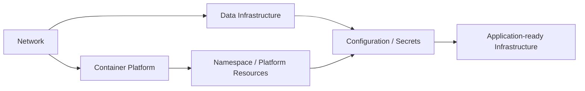

<br>

Terraform、Kubernetes等のTechnology境界をまたぐDependencyについても明示する。

<br>

**記載しない内容**:

Application機能間のDependencyやApplication Detail Designの設計順序は扱わない。


#### **16.7 Environment Provisioning Strategy**

dev / stg / prod等について、Infrastructureをどの方式でProvision / Updateするかを定義する。

ここでは特に、EnvironmentごとにManual OperationとCI/CD Pipelineのどちらを利用するかを明確にする。

**example**:

| Environment | Provisioning Method | Execution | Purpose / Rationale |
| --- | --- | --- | --- |
| dev | Manual | Developer / Operator | 開発中の迅速な構築・変更を優先する |
| stg | CI/CD Pipeline | Manual Trigger | 再現可能なInfrastructure適用を行う |
| prod | CI/CD Pipeline | Approved Trigger | 統制されたInfrastructure変更を行う |

<br>

必要に応じて以下を決定する。

- Manual / Pipeline
- Automatic / Manual Trigger
- Approval
- Environmentごとの実行主体
- Environment Creation
- Infrastructure Update
- Destroy
- Rebuild

<br>

**記載しない内容**:

Environmentをいつ休眠・削除するかというLifecycle PolicyはEnvironment Lifecycle and Dormancy Strategyで定義する。


#### **16.8 Infrastructure Delivery Pipeline**

Infrastructure CI/CDを利用する場合、そのPipeline構造、Stage、TriggerおよびEnvironmentへの適用方式を定義する。

Cloud InfrastructureをProvisioningするTerraform層と、構築済みのContainer PlatformへResourceを適用するKubernetes層は、それぞれ独立したPipelineとして構成する。

各Pipelineは独立して実行・失敗・再実行できる構造とし、Terraform PipelineによってKubernetes Platformの前提Infrastructureが成立した後に、Kubernetes Pipelineを実行可能とする。

##### **Pipeline Separation**

Infrastructure Delivery Pipelineは、Infrastructure Layerの責務および変更単位に応じて分離する。

**example**:

| Pipeline | Responsibility | Primary Target | Dependency |
| --- | --- | --- | --- |
| Terraform Pipeline | Cloud InfrastructureのProvisioning / Update | Network、Compute、Cluster、Data、IAM等 | - |
| Kubernetes Pipeline | Kubernetes ResourceのConfiguration / Update | Namespace、Platform Resource、Workload関連Resource等 | Terraform Pipelineによって必要なPlatformが存在すること |

<br>

Terraform層とKubernetes層の変更は、同一Pipelineの連続Stageとして常に一括実行せず、それぞれ独立した変更・適用単位として管理する。

両方の変更を必要とする場合は、Terraform Pipelineの適用・検証完了後にKubernetes Pipelineを実行する。


**Terraform Pipeline**

<br>

**example**:

```text
Validate
  ↓
Plan
  ↓
Review / Approval
  ↓
Apply
  ↓
Verify
```

<br>

**Kubernetes Pipeline**

<br>

**example**:

```text
Validate
  ↓
Diff / Review
  ↓
Review / Approval
  ↓
Apply
  ↓
Verify
```

<br>

必要に応じて以下を扱う。

- Static Validation
- Format / Lint
- Security Validation
- Terraform Plan
- Plan Review
- Approval
- Terraform Apply
- Kubernetes Apply
- Post-apply Verification
- EnvironmentごとのPipeline差異
- Failure時の停止条件

<br>

**example**:

| Pipeline | Stage | Tool / Action | Output | Failure Behavior |
| --- | --- | --- | --- | --- |
| Terraform | Validate | [Tool] | Validation Result | Stop |
| Terraform | Plan | Terraform | Plan | Stop / Review |
| Terraform | Apply | Terraform | Cloud Infrastructure | Stop |
| Terraform | Verify | [Tool] | Verification Result | Report / Stop |
| Kubernetes | Validate | [Tool] | Validation Result | Stop |
| Kubernetes | Diff / Review | [Tool] | Change Result | Stop / Review |
| Kubernetes | Apply | Helm / Kustomize / kubectl等 | Kubernetes Resources | Stop |
| Kubernetes | Verify | [Tool] | Verification Result | Report / Stop |

<br>

**記載しない内容**:

Application Build / Unit Test等のApplication Delivery Pipeline自体はSystem Architectureを正とする。


#### **16.9 Infrastructure Validation and Testing**

Infrastructure Codeおよび構築後のInfrastructureについて、適用前後に実施するValidation / Test方式を定義する。

Terraform層とKubernetes層は独立したDelivery Pipelineとして管理するため、Validation / TestについてもそれぞれのTechnologyおよび適用対象に応じて独立して定義する。

必要に応じて以下を扱う。

- Format Check
- Lint
- IaC Validation
- Plan Validation
- Policy / Security Check
- Kubernetes Manifest Validation
- Infrastructure Test
- Post-provision Connectivity Verification
- Resource Health Verification
- Drift Detection

<br>

**example**:

| Layer | Validation | Timing | Target | Tool / Method |
| --- | --- | --- | --- | --- |
| Terraform | Format / Lint | Pre-apply | Terraform Code | [Tool] |
| Terraform | IaC Validation | Pre-apply | Terraform | [Tool] |
| Terraform | Plan Validation | Pre-apply | Terraform Plan | [Method] |
| Kubernetes | Manifest Validation | Pre-apply | Kubernetes Resources | [Tool] |
| Kubernetes | Diff Validation | Pre-apply | Kubernetes Changes | [Tool] |
| Kubernetes | Resource Verification | Post-apply | Kubernetes Resources | [Method] |
| Integrated Infrastructure | Workload Execution Check | Post-apply | Compute / Container Platform | Temporary / Actual Workload |
| Integrated Infrastructure | Connectivity Check | Post-apply | Infrastructure | Temporary / Actual Workload |


##### **Verification Workload Strategy**

Compute / Container Platform、Network、Traffic、Data等のInfrastructureについて、Application実装の完了を待たずにInfrastructure単独で成立性を確認する必要がある場合、そのVerification方式を定義する。

Application / Serviceを利用してVerificationを行うか、Infrastructure検証専用の一時的なWorkload / Pod / Container等を利用するかを、検証対象およびApplicationの完成時期に応じて決定する。

**example**:

| Verification Target | Verification Workload | Timing | Verification |
| --- | --- | --- | --- |
| Container Platform | Temporary Pod | Infrastructure Build後 | Pod Scheduling / Execution |
| Internal Network | Temporary Pod | Infrastructure Build後 | Internal Connectivity |
| Load Balancer / Ingress | Temporary Test Workload | Infrastructure Build後 | Traffic Routing |
| Database Connectivity | Temporary Pod / Client | Infrastructure Build後 | Database Connection |
| Application Infrastructure | Actual Application | Application Deploy後 | Production-equivalent Integration |

<br>

Temporary Verification Workloadを利用する場合は、検証に必要な最小限の構成とし、ApplicationのBusiness Logicを模倣しない。

Verification完了後に不要となるTemporary Resourceは削除し、恒久的なApplication / Infrastructure Resourceとして残さない。

<br>

**記載しない内容**:

Application機能のTest CaseはTest Designを正とする。また、Infrastructure Healthの定義そのものはAvailability, Recovery and Infrastructure Healthを正とする。


#### **16.10 Application Delivery Integration**

Infrastructure ProvisioningとSystem Architectureで定義されたApplication Delivery Pipelineの接続方式を定義する。

InfrastructureがApplication Deploymentに対して提供するDeployment Target、Configuration、Identityおよび実行前提を明確にする。

必要に応じて以下を扱う。

- Application Pipeline → Cluster / Namespace
- Application Pipeline → Registry
- Deployment Identity
- Infrastructure Readyの判定
- Environment固有Configurationの参照
- Application Deployment前提Resource
- Infrastructure変更とApplication Deploymentの順序
- Infrastructure / Application Pipeline間のTrigger関係

<br>

**example**:

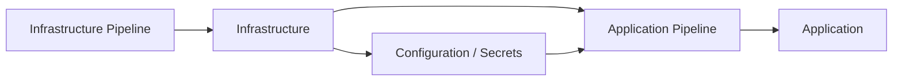

<br>

**記載しない内容**:

Application PipelineのBuild / Test / Artifact生成等の内部構造を再定義しない。


#### **16.11 Infrastructure Change and Delivery Rules**

Infrastructure変更を安全かつ再現可能に適用するための横断的なDelivery Ruleを定義する。

必要に応じて以下を扱う。

- Infrastructure変更は原則Code経由とする
- Console等による直接変更の許可 / 禁止
- Emergency Change
- Driftの扱い
- Apply前Review
- prod変更のApproval
- Environment間での変更Promotion
- Infrastructure Codeと実Resourceの整合
- Infrastructure変更とApplication変更を同時に行う場合の順序

<br>

**記載しない内容**:

個々のTrainにおける具体的な変更手順やRelease Scheduleは定義しない。


### **17. Environment Lifecycle and Dormancy Strategy**

本章では、各EnvironmentおよびInfrastructure Resourceについて、Provisioning後にどのようなLifecycleで維持・停止・削除・再生成するかを定義する。

Environmentを常時維持することを前提とせず、利用目的、利用頻度、停止許容性、State / Data保持要件、再生成可能性、復旧時間、Cost等をもとに、EnvironmentおよびResourceごとに適切なLifecycle Strategyを決定する。

dev / stg / prod等のEnvironment種別だけを理由としてLifecycle Strategyを固定せず、それぞれの要件を評価した結果として、Environment間で同一または異なるLifecycleを採用する。

障害によって意図せず失われたInfrastructureを復旧するRecoveryは **Availability, Recovery and Infrastructure Health** を正とし、本章では計画的な停止・縮退・削除およびその後の再開・再生成を扱う。

Infrastructureは常時稼働・維持することを前提とせず、Environmentを利用しない期間には、Cost、State保持要件、再生成可能性および復元時間等を考慮して、Resourceの停止・縮退・削除を選択できる構成とする。

Environmentを休眠または削除する場合は、Infrastructure Code、Kubernetes Configuration、Artifact、Configuration、Secret、Backupその他必要なPreserved Stateから、利用可能なEnvironmentを再生成できることをLifecycle Strategyの前提として設計する。


#### **17.1 Lifecycle Requirements**

各Environmentについて、Lifecycle Strategyを決定するための前提条件を整理する。

必要に応じて以下を評価する。

- Environmentの利用目的
- 利用頻度
- 常時利用の必要性
- 停止可能な期間
- 再利用までに許容される復元時間
- 保持すべきData / State
- Infrastructureの再生成可能性
- Artifactの再生成可能性
- External System / Serviceとの接続維持要件
- Cost
- Availability / Continuity Requirement

<br>

**example**:

| Environment | Usage Pattern | Suspension Allowed | State Preservation | Restore Requirement | Cost Priority |
| --- | --- | --- | --- | --- | --- |
| dev | [Pattern] | [Policy] | [Requirement] | [Requirement] | [Priority] |
| stg | [Pattern] | [Policy] | [Requirement] | [Requirement] | [Priority] |
| prod | [Pattern] | [Policy] | [Requirement] | [Requirement] | [Priority] |

<br>

本項目でEnvironmentごとのRequirementを整理したうえで、後続項目においてLifecycle Strategyを決定する。

<br>

**記載しない内容**:

dev / stg / prod等のEnvironment名だけを根拠としてLifecycle Strategyを決定しない。また、具体的な停止・削除方式は本項目ではまだ決定しない。


#### **17.2 Lifecycle Model**

Environment / Resourceへ適用可能なLifecycle Stateと、それぞれの意味を定義する。

必要に応じて以下のStateを使用する。

- **Provisioned**: 利用可能なInfrastructureが構築されている状態
- **Active**: Applicationを含めEnvironmentが利用されている状態
- **Suspended**: Resourceを保持しながら実行・課金を可能な範囲で停止・縮退した状態
- **Destroyed**: 再生成可能なInfrastructure Resourceを削除した状態
- **Preserved**: 再生成に必要なState / Data / Artifact等のみを保持した状態
- **Restoring**: Preserved Resource等からEnvironmentを再生成している状態

必要に応じてLifecycleをMermaidの`stateDiagram-v2`で表現する。

**example**:

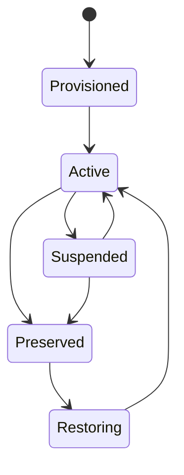

<br>

Projectに不要なStateは無理に採用しない。

<br>

**記載しない内容**:

すべてのEnvironment / Resourceが同一のLifecycle Stateを経由することを要求しない。また、Infrastructure障害によるRecovery Flowは本Lifecycle Modelへ混在させない。


#### **17.3 Lifecycle Strategy by Environment**

16.1で整理したRequirementをもとに、各Environmentへ適用するLifecycle Strategyを定義する。

**example**:

| Environment | Active Strategy | Inactive Strategy | Preservation Strategy | Restoration Strategy | Rationale |
| --- | --- | --- | --- | --- | --- |
| dev | [Strategy] | [Strategy] | [Strategy] | [Strategy] | [Reason] |
| stg | [Strategy] | [Strategy] | [Strategy] | [Strategy] | [Reason] |
| prod | [Strategy] | [Strategy] | [Strategy] | [Strategy] | [Reason] |

<br>

Environmentごとに異なるStrategyを採用してもよいが、Requirementが同じであれば同一Strategyを採用してもよい。

Production Environmentについても常時維持を前提とせず、そのSystemの公開期間、利用形態、Data保持、復元時間等のRequirementに基づいてStrategyを決定する。

<br>

**記載しない内容**:

Environment種別に対する一般的な慣習のみを理由としてStrategyを決定しない。


#### **17.4 Resource Lifecycle Classification**

Environment内の各Infrastructure Resourceについて、Environment休眠時にどのLifecycle Actionを適用するかを定義する。

主なActionとして、必要に応じて以下を使用する。

- Keep
- Stop
- Scale Down
- Scale to Zero
- Snapshot / Preserve
- Destroy
- Recreate

<br>

**example**:

| Resource | Lifecycle Action | Preserve | Recreate From | Reason |
| --- | --- | --- | --- | --- |
| Container Platform | [Action] | [State] | IaC | [Reason] |
| NAT Gateway | [Action] | - | IaC | [Reason] |
| Load Balancer | [Action] | - | IaC | [Reason] |
| Database | [Action] | Snapshot / Data | IaC + Backup | [Reason] |
| Bastion | [Action] | - | IaC | [Reason] |
| Registry | [Action] | Image / None | Build / Push | [Reason] |

<br>

Environment全体を単純に「維持 / 削除」と分類するのではなく、ResourceごとのStatefulness、再生成Cost、再生成時間および保持要件を考慮する。

<br>

**記載しない内容**:

Resource自体の通常時構成は対応するInfrastructure Sectionを正とする。本項目ではLifecycle Actionのみを定義する。


#### **17.5 Preservation Strategy**

Environmentを停止・削除しても維持しなければならないState、Data、ArtifactおよびInfrastructure Metadataを定義する。

必要に応じて以下を対象とする。

- Business / Test Data
- Database Snapshot
- Object Data
- Terraform State
- Container Image
- Artifact
- Configuration
- Secret
- Certificate
- DNS等の継続保持が必要なResource
- Infrastructure Code
- Kubernetes Configuration

<br>

**example**:

| Preservation Target | Preserve | Source of Truth | Required for Restore |
| --- | --- | --- | --- |
| Terraform State | Yes | Remote State | Yes |
| Database Data | [Policy] | Snapshot / Backup | Yes |
| Container Image | [Policy] | Registry / Rebuild | [Policy] |
| Kubernetes Resources | No / Definition Only | Git Repository | Yes |
| Configuration | Yes | Configuration Store | Yes |

<br>

再生成可能なものと、失うとEnvironmentを復元できないものを明確に区別する。

<br>

**記載しない内容**:

Backup / Retention等について別途Data Strategyが存在する場合、その方針を再定義しない。本章ではEnvironment Lifecycle上、何をPreserveする必要があるかを扱う。


#### **17.6 Destroy and Suspension Procedure**

Environment / ResourceをActive状態からSuspended / Preserved / Destroyed状態へ移行する際のInfrastructure上の順序とDependencyを定義する。

必要に応じて以下を扱う。

- Application停止
- Traffic停止
- Stateful ResourceのPreservation
- Kubernetes Resource削除
- Compute / Cluster削除
- Load Balancer / NAT等の削除
- Data Resourceの停止 / Snapshot / 削除
- Configuration / Stateの維持
- Destroy後のVerification

<br>

**example**:

```text
Stop Application Traffic
        ↓
Stop Workloads
        ↓
Preserve Required State / Data
        ↓
Destroy Re-creatable Resources
        ↓
Verify Preserved Assets
```

<br>

実際の順序はResource Dependencyに基づいて定義する。

<br>

**記載しない内容**:

障害発生時の緊急Recovery Procedureは本項目では扱わない。


#### **17.7 Restoration Architecture**

Suspended / Destroyed Environmentを再び利用可能な状態へ戻すため、復元元、Provisioning順序、Application再配置およびVerificationを定義する。

必要に応じて以下を扱う。

- Terraform State
- Infrastructure Code
- Backup / Snapshot
- Configuration / Secret
- Container Artifact
- Kubernetes Configuration
- Infrastructure Provisioning
- Application Deployment
- Traffic再開
- Restore後Verification

<br>

**example**:

```text
Preserved State / Code
        ↓
Network / Infrastructure
        ↓
Compute / Container Platform
        ↓
Data / Messaging
        ↓
Configuration / Secrets
        ↓
Kubernetes Resources
        ↓
Application Deployment
        ↓
Verification
        ↓
Traffic Resume
```

<br>

Infrastructure ProvisioningそのもののPipelineは **Infrastructure Provisioning and Delivery** を正とし、本項目ではEnvironment Restoreに必要な適用順序と利用対象を定義する。

<br>

**記載しない内容**:

各Terraform / Kubernetes Pipelineの内部Stageを再定義しない。


#### **17.8 Restoration Verification**

Environment再生成後に、休眠前と同等の利用可能状態へ戻ったことを確認するためのVerificationを定義する。

必要に応じて以下を確認する。

- Required Infrastructure Resourceの存在
- Infrastructure Health
- Network Connectivity
- Configuration / Secret供給
- Data Restore
- Application Deployment
- External Connectivity
- Observability
- Application-ready状態
- Traffic再開可否

<br>

**example**:

| Verification | Target | Success Condition |
| --- | --- | --- |
| Infrastructure | Required Resources | 必要Resourceが正常に存在する |
| Connectivity | Required Paths | 必要な通信が成立する |
| Application Readiness | Workloads | Applicationを利用可能である |
| Data | Restored State | 必要なDataが利用可能である |

<br>

具体的なApplication機能のTest CaseはTest Designを正とする。


#### **17.9 Cost and Restoration Trade-offs**

Environment / ResourceのLifecycle Strategyについて、維持Costと再生成Cost / TimeのTrade-offを整理する。

**example**:

| Resource / Environment | Keep Cost | Restore Cost / Time | Selected Strategy | Reason |
| --- | --- | --- | --- | --- |
| Resource A | [Cost] | [Cost / Time] | Destroy | [Reason] |
| Resource B | [Cost] | [Cost / Time] | Keep | [Reason] |

<br>

単純にCostを最小化するだけでなく、以下を考慮する。

- 再生成時間
- Developer / Operatorの作業Cost
- Data Loss Risk
- External Dependency
- Restore Failure Risk
- Environment利用頻度
- Availability Requirement

<br>

**記載しない内容**:

Costだけを基準としてLifecycle Strategyを決定しない。


### **18. Application and Deployment Handoff**

本章では、Infrastructure ArchitectureおよびInfrastructure構築の結果として、Applicationの実装・実行およびDeploymentに必要となるInfrastructure由来の情報を整理し、Application / Deployment担当へ引き渡すContractを定義する。

Environment固有のEndpoint、Resource Identifier、Configuration、Secret等については、可能な限りInfrastructureの実値そのものをApplicationへ固定的に引き渡さず、Parameter Store、Secret Storeその他のConfiguration Sourceを介して参照できる構造とする。

これにより、Infrastructureの再構築やResource置換によって実値が変更された場合でも、安定したConfiguration / Secret Referenceを維持することで、Application側への変更影響を最小化する。

Secret / Credential等の機密値そのものは本章に記載せず、その参照先、取得方法およびApplication側で利用するConfiguration Key等を引き渡す。


#### **18.1 Handoff Scope and Consumers**

Infrastructureから情報を受け取るApplication / Service / Deployment Pipeline等のConsumerを特定し、それぞれに必要となるHandoffの範囲を整理する。

**example**:

| Consumer | Type | Required Handoff |
| --- | --- | --- |
| Backend Service A | Application | Database / Queue / External Service Configuration |
| Web Frontend | Application | Public Endpoint / Environment Configuration |
| Application Pipeline A | Deployment | Deployment Target / Identity / Registry |
| Batch A | Application / Deployment | Data / Messaging / Execution Configuration |

<br>

Handoff対象は、InfrastructureとConsumerの境界を越えて共有する必要がある情報に限定する。

<br>

**記載しない内容**:

Application内部だけで完結するConfigurationや実装仕様を本章で定義しない。また、Infrastructure担当内部だけで利用するResource情報を網羅的に引き渡さない。


#### **18.2 Application Configuration Contract**

Application / ServiceがInfrastructureを利用するために必要なConfigurationを定義する。

実値ではなく、Application側で使用するConfiguration Key、意味、Configuration SourceおよびEnvironment ScopeをContractとして明確にする。

**example**:

| Configuration Key | Consumer | Purpose | Source | Environment | Sensitive |
| --- | --- | --- | --- | --- | --- |
| `DB_HOST` | Backend A | Database接続先 | Parameter Store | dev / stg / prod | No |
| `QUEUE_URL` | Backend B | Queue接続先 | Parameter Store | dev / stg / prod | No |
| `BUCKET_NAME` | Backend A | Object Storage参照 | Parameter Store | dev / stg / prod | No |
| `EXTERNAL_API_ENDPOINT` | Backend A | External Service接続先 | Parameter Store | stg / prod | No |

<br>

Application側ではInfrastructure Resourceの実値ではなく、本Contractで定義されたConfigurationを利用する。

<br>

**記載しない内容**:

Endpoint、Host、Resource Name等のEnvironment固有の実値をpersistentなContractとして固定しない。実値のSource of TruthはInfrastructure / Configuration Storeとする。


#### **18.3 Configuration Reference Contract**

Parameter Store等を利用する場合、ApplicationがConfigurationを安定して参照できるよう、Parameter NamingおよびReferenceのContractを定義する。

**example**:

| Configuration | Reference | Consumer | Value Producer |
| --- | --- | --- | --- |
| `DB_HOST` | `/[project]/[env]/backend-a/db/host` | Backend A | Infrastructure |
| `QUEUE_URL` | `/[project]/[env]/backend-b/queue/url` | Backend B | Infrastructure |
| `BUCKET_NAME` | `/[project]/[env]/backend-a/storage/bucket` | Backend A | Infrastructure |

<br>

Reference NameはEnvironmentやResourceの再構築後も可能な限り維持し、Infrastructure側で実値を更新することでApplicationとのContractを安定させる。

必要に応じて以下を定義する。

- Parameter Naming Convention
- Environment識別方式
- Application / Service Scope
- Configuration KeyとParameterの対応
- Infrastructure OutputからParameter Store等への登録方式
- Parameter変更時のApplicationへの反映方式

<br>

**記載しない内容**:

Parameterへ格納されるEnvironment固有値そのものを本章へ転記しない。


#### **18.4 Secret and Credential Reference Contract**

Applicationが利用するSecret / Credentialについて、Secret値そのものではなく、その参照先およびApplication側の利用Contractを定義する。

**example**:

| Secret / Credential | Consumer | Secret Reference | Usage | Environment |
| --- | --- | --- | --- | --- |
| Database Credential | Backend A | `[Secret Reference]` | Database Authentication | prod |
| External Service Credential | Backend A | `[Secret Reference]` | External Service Authentication | prod |

<br>

必要に応じて以下を定義する。

- Secret Reference
- Consumer
- Environment
- Application側Configuration Key
- Runtime取得 / Injection等の供給方式
- Rotation時にApplication側で必要となる対応

<br>

**記載しない内容**:

Password、API Key、Token、Private Key等のSecret値そのものを記載しない。また、Secret StoreおよびInjection ArchitectureそのものはConfiguration, Secrets and Certificatesを正とする。


#### **18.5 Infrastructure Endpoint and Resource Contract**

ApplicationがInfrastructure Resourceを利用する際に必要となるEndpoint、Host、Port、URL、Resource Name等について、Application側から見た利用Contractを整理する。

**example**:

| Resource | Consumer | Required Information | Configuration Source |
| --- | --- | --- | --- |
| Database A | Backend A | Host / Port / Database Name | Parameter Store |
| Queue A | Backend B | Queue URL | Parameter Store |
| Object Storage A | Backend A | Bucket Name | Parameter Store |
| External Service Endpoint | Backend A | Endpoint | Parameter Store / Infrastructure Configuration |

<br>

可能なものについては、実値を直接Handoffするのではなく17.2〜17.4で定義されたReferenceを介して利用する。

<br>

**記載しない内容**:

Infrastructure Resource自体の構成・設定を再定義しない。


#### **18.6 Certificate and Trust Handoff**

ApplicationまたはDeployment側でCertificate、CA、Trust Store等のInfrastructure由来情報を利用する必要がある場合、そのReferenceおよび利用Contractを定義する。

**example**:

| Certificate / Trust Asset | Consumer | Reference / Source | Purpose |
| --- | --- | --- | --- |
| Internal CA | Service A | [Reference] | Internal TLS Trust |
| Client Certificate | Service B | [Reference] | External System Authentication |

<br>

Certificate / Private Key等の実体をHandoff文書へ埋め込まず、管理元と参照方法を明確にする。

<br>

**記載しない内容**:

Certificateの発行、配置、更新方式はConfiguration, Secrets and Certificatesを正とする。


#### **18.7 Application Deployment Target Contract**

Application Deployment PipelineがApplication / Workloadを配置するために必要となるInfrastructure Targetを定義する。

**example**:

| Deployment Unit | Environment | Platform / Cluster | Namespace / Target | Deployment Resource |
| --- | --- | --- | --- | --- |
| Service A | dev | Non-prod Cluster | dev | Deployment |
| Service A | stg | Non-prod Cluster | stg | Deployment |
| Service A | prod | Prod Cluster | prod | Deployment |
| Batch A | prod | Prod Cluster | prod | CronJob |

<br>

System Architectureで定義されたDeployment Unitと、Infrastructure Architectureで定義されたApplication / Workload Placementを接続するContractとする。

<br>

**記載しない内容**:

Application Deployment StrategyやPipeline内部のBuild / Test / Artifact生成処理はSystem Architectureを正とする。


#### **18.8 Application Pipeline Infrastructure Contract**

Application Delivery PipelineがInfrastructureへ接続し、Artifactを配置するために必要となるInfrastructure側の情報・権限・前提条件を定義する。

必要に応じて以下を扱う。

- Deployment Target
- Artifact / Container Registry
- Deployment Identity
- Cluster / Namespace Access
- Required Role / ServiceAccount
- Configuration / Secret Reference
- Infrastructure Ready Condition
- Environmentごとの接続先
- Application Deployment前に存在すべきResource

<br>

**example**:

| Pipeline | Environment | Target | Identity | Required Infrastructure |
| --- | --- | --- | --- | --- |
| Service A Pipeline | prod | Prod Cluster / Namespace | Deployment Identity A | Cluster, Namespace, Registry, Configuration |

<br>

**記載しない内容**:

PipelineのBuild / Unit Test / Artifact生成等のApplication Delivery処理は再定義しない。また、IAM / Kubernetes RBAC等の権限そのものはInfrastructure Security and Identityを正とする。


#### **18.9 Environment-specific Handoff Matrix**

Application / Deployment担当がEnvironmentごとの差異を一箇所で確認できるよう、Environment固有のHandoffを整理する。

**example**:

| Handoff Item | Consumer | dev | stg | prod | Source |
| --- | --- | --- | --- | --- | --- |
| DB Configuration | Backend A | dev Reference | stg Reference | prod Reference | Parameter Store |
| External AI | Backend A | Stub Configuration | Real Service Reference | Real Service Reference | Configuration |
| Deployment Target | Service A Pipeline | dev Target | stg Target | prod Target | Infrastructure |
| Secret | Backend A | dev Secret Ref | stg Secret Ref | prod Secret Ref | Secret Store |

<br>

Environment間で同じContractを維持し、Reference先だけをEnvironmentごとに分離できる場合は、その構造を優先する。

<br>

**記載しない内容**:

Environment固有値を一覧として複製することを目的としない。Environment差異をApplication / Deployment担当が認識するために必要なContractのみを記載する。


#### **18.10 Handoff Completeness and Change Rules**

Infrastructure変更によってApplication / Deployment Contractへ影響が生じる場合の管理Ruleを定義する。

必要に応じて以下を確認する。

- すべてのApplication / Workloadに必要なConfigurationが定義されている
- Infrastructure OutputとConfiguration Sourceの対応が存在する
- Secret値を直接Handoffしていない
- Deployment UnitごとにDeployment Targetが確定している
- Application Pipelineに必要なIdentity / Access前提が確定している
- Environmentごとの差異が明確である
- Infrastructure再構築後もReference Contractを維持できる
- Contract変更時に影響を受けるConsumerを特定できる

Infrastructure Resourceの再生成によってEndpoint等の実値が変化しても、Parameter / Secret Reference等のContractが維持される限り、Application側の設計変更を必要としない構造を基本とする。

Configuration Key、Reference Name、Deployment Target等のContract自体を変更する場合は、Application / Deployment側への影響を伴うInfrastructure Architecture Changeとして扱う。

<br>

**記載しない内容**:

個々のTrainにおける具体的なHandoff作業手順や担当者間の連絡方法は定義しない。

### **19. Infrastructure Architecture Diagrams**

本章では、各Sectionで定義されたInfrastructure Architectureを統合し、Environment、Network、Traffic Entry、Compute / Container Platform、Application / Workload、Data Infrastructure、External Connectivity等の主要な構造と関係を可視化する。

本章では新たなArchitecture Decisionを行わず、各Sectionで確定した設計内容を正として構成図へ反映する。

詳細な設定値やすべてのInfrastructure Resourceを図へ網羅することを目的とせず、Infrastructure全体の構造、Boundary、Placementおよび主要なConnectivityを理解するために必要な要素のみを表現する。


#### **19.1 Infrastructure Architecture Overview**

Infrastructure全体について、主要なInfrastructure Resource / Environment / Network BoundaryとApplication / Workloadの配置、および主要なConnectivityを俯瞰できる論理構成図を記載する。

本図では、Infrastructure全体の主要なBoundaryおよびResource間の関係を表現する。

Infrastructure Architectureを構成するResourceについては、全体構成を把握できるよう、**Architecture上独立した役割を持つ主要Resourceを原則として網羅する**。一方で、各Resourceの設定値や内部構成の詳細は図へ展開せず、対応するSectionを正とする。

ACM、WAF等のSecurity / Certificate Resourceを含め、Traffic、Security、Configuration、Observability、Management等を成立させるResourceについても、Infrastructure全体の構成要素として必要なものは図に含める。

後続の工程で作成する**Cloud Architecture Diagram**とは別途で下記のようなMermaid形式の構成図を作成する。※この構成図は、**Cloud Architecture Diagram**作成時の重要な参考となる。

**example**:

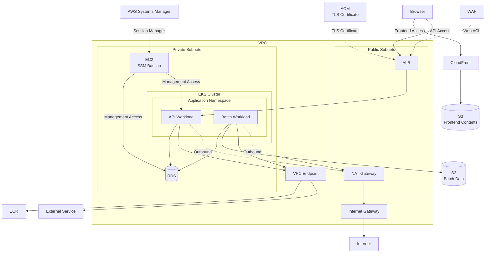

<br>

本図では、Application / WorkloadがInfrastructure上のどのBoundaryへ配置され、主要なTraffic / Data / External Connectivityがどのように成立するかを表現する。

EnvironmentやApplicationの種類(ApiやBatchなど)によって構成が大きく異なる場合は、一つの図へ過度に集約せず、図を分けて記載する。

<br>

**記載しない内容**:

各Sectionですでに定義されたCIDR、Route、Security Group Rule、IAM Policy、Resource Size、Scaling値等の詳細仕様を図へ重複して記載しない。また、Architecture上独立した構成要素ではない補助的・内部的なResourceまで網羅することで、図の視認性を損なわない


#### **19.2 Multi-AZ Infrastructure Topology**

Infrastructure Architecture Overviewから個別のApplication / Resourceを抽象化し、Multi-AZ構成を採用する場合のVPC、Availability Zone、Public / Private Subnetおよび主要なNetwork Connectivityの配置関係を示す。

EnvironmentによってMulti-AZ構成が異なる場合は、必要に応じてEnvironmentごとに記載する。

**example**:

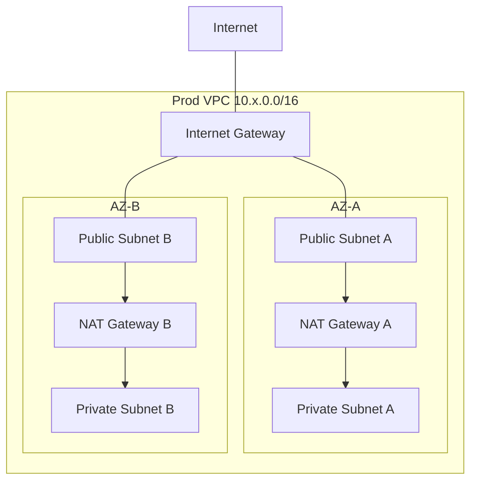

<br>

**記載しない内容**:

個別Resourceの詳細構成や設定値を再定義しない。本項目では、Multi-AZ構成におけるAvailability Zone、Subnetおよび主要なNetwork Componentの配置・接続関係の可視化に限定する。
