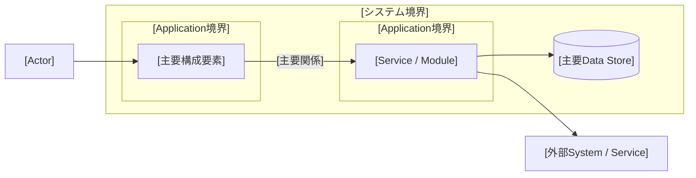
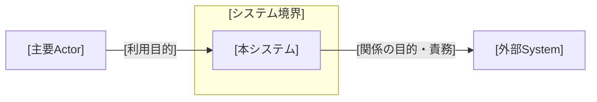
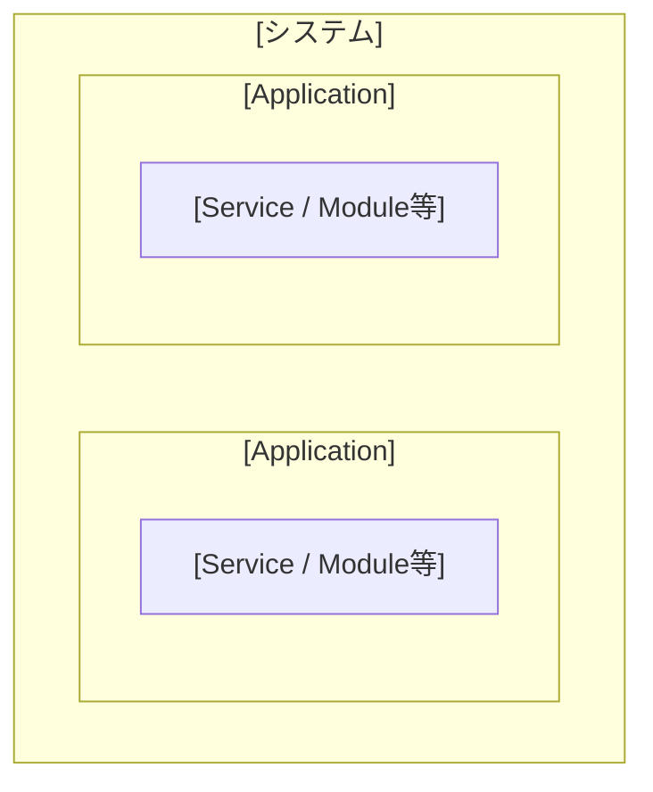
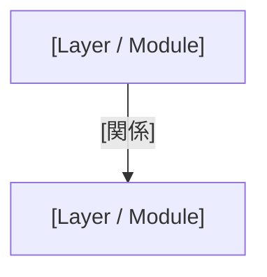
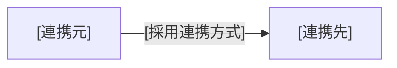
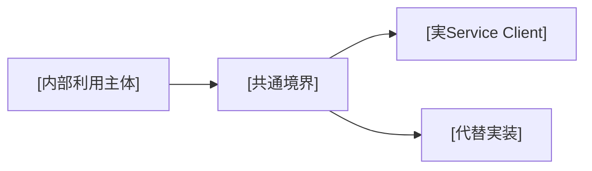
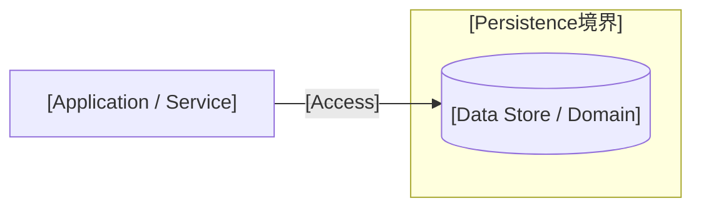
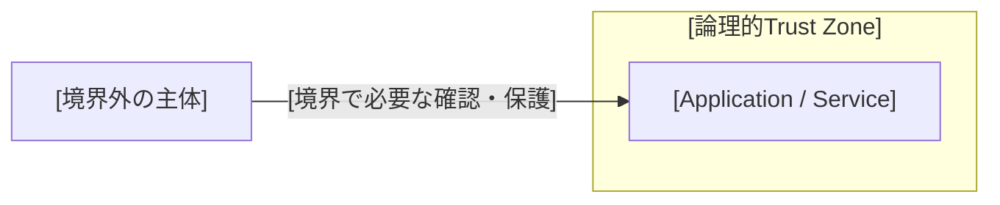
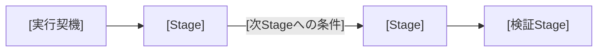

# システムアーキテクチャ設計書（System Architecture Design Document）

<!--
System Architecture OutlineとFunction Designを入力とし、正式なSystem / Application Architectureへ統合・具体化する。
各Section / Subsectionは、要求・先行設計・本書で確定した内容から該当するArchitecture Concernを確認して記入する。
該当事項がない項目は省略し、一般論・推測・根拠のない将来拡張で埋めない。
表の行、繰返し欄、図の要素・境界・矢印は対象に合わせて増減する。記入例の構造や技術を決定事項として引き継がない。
Function Designの機能仕様・Business Ruleは再定義せず参照する。Architectureとして判断可能な事項は必要な粒度までここで決定する。
同一Decisionは主担当Sectionを正とし、他Sectionでは参照する。全章作成後、境界・責務・依存・制約の整合性を再確認する。
API・Data・UI・Batch内部の詳細仕様は各Detail Designへ、Cloud Resource・Network・Cluster等の実現構成はInfrastructure Architectureへ委ねる。
Migration・Replication・Backup / Restore・Retention等はData Strategy、個別Test Scenario / CaseはTest Designへ委ねる。
-->

## 0. Change History

<!-- 初回履歴はレビュー・再レビューを含む設計工程が完了し、文書が確定した時点で1件記録する。
確定前の修正は個別履歴にしない。確定後の正式変更・後続Trainでの変更は行を追加する。 -->

| Change | Date | Train | Summary |
| --- | --- | --- | --- |
| [初回設計／正式変更の識別子] | [YYYY-MM-DD HH:mm] | [Train] | [初回設計／変更概要] |

## 1. Architecture Overview

### 1.1 Architecture Purpose

[Function Designの機能仕様を成立させるシステム・Application構造と技術方式を確定する目的、および後続設計へ提供する基準・制約]

### 1.2 Architecture Summary

[主要Application / Service、Frontend / Backend構成、基本構造、主要関係・Pattern、Persistence、外部依存、Deployment Unitのうち、該当する事項を要約]

<!-- 詳細は各章を正とし、選定理由・個別Rule・技術仕様を網羅的に再掲しない。 -->

### 1.3 Key Architectural Characteristics

| Characteristic | Description |
| --- | --- |
| [Architectureを特徴付ける性質・方針] | [システム構造・後続設計へ与える意味と定義元参照] |

<!-- 品質特性の一般的な列挙ではなく、本システムの構造に結び付く特徴を記す。 -->

### 1.4 System Architecture Diagram

<!-- Mermaid flowchartでシステム境界、主要Application / Service境界、主要Data Store、外部System / Serviceと関係を示す。
全体理解に重要な確定済み通信方式は補足可。Infrastructure物理配置、個々のAPI / Event、処理順序は描かない。
下記の要素・境界・接続は実際の構成に置き換える。 -->



## 2. System Boundary and Context

### 2.1 System Scope and Responsibility

| Domain / Functional Area | Responsibility | Scope |
| --- | --- | --- |
| [業務・機能領域] | [担当する責務。一部の場合は範囲を明示] | [対象内／一部／対象外] |

<!-- Outlineの境界を反映する。機能仕様、Applicationへの割当、技術方式はここで定義しない。 -->

### 2.2 External Responsibility Boundaries

<!-- 外部Systemと領域を分担する場合に記載する。通信契約・接続方式は扱わない。 -->

| Domain / Functional Area | This System Responsibility | External System | External Responsibility |
| --- | --- | --- | --- |
| [分担する領域] | [本システムの担当範囲] | [外部System] | [外部側へ委ねる範囲] |

### 2.3 Existing System Positioning

<!-- 関係する既存Systemがある場合に記載する。段階的置換・併存では現在と目標を区別する。Migration・Cutover手順や時期は扱わない。 -->

| Existing System | Positioning | Relationship to This System |
| --- | --- | --- |
| [既存System] | [取込み／併存／置換等の位置づけ] | [現在・目標の関係] |

### 2.4 System Context

<!-- Mermaid flowchartで本システムを一つの単位として示す。Actor・直接関係する外部Systemとの関係には意味的な目的・責務を付す。
内部Application構造、Protocol、Interface、処理Sequence、Infrastructureは描かない。 -->



## 3. Application and Service Structure

### 3.1 Application Structure

| Application | Type | Target / Usage | Role |
| --- | --- | --- | --- |
| [Application] | [種類] | [対象利用者・用途] | [大まかな役割・担当範囲] |

<!-- 同種Applicationを分割する場合は分割単位を明確にする。内部Layer・技術・実行基盤はここでは扱わない。 -->

### 3.2 Application Boundaries

| Boundary | Decision | Responsibility Separation |
| --- | --- | --- |
| [Application間境界] | [一体型／分離型等の決定] | [同一単位に置く責務・分離する責務] |

<!-- 該当するFrontend / Backend境界も明示する。通信方式・個別Interfaceは8章以降またはDetail Designで扱う。 -->

### 3.3 Backend Structure

<!-- Backendがある場合、Applicationごとに記載する。 -->

| Backend | Structure | Description |
| --- | --- | --- |
| [Backend Application] | [採用する基本構造] | [適用範囲・構造の説明] |

### 3.4 Service and Module Boundaries

| Service / Module | Parent Application | Boundary | High-Level Role |
| --- | --- | --- | --- |
| [Service / Module] | [所属Application] | [構造上の境界] | [大まかな役割] |

<!-- 担当・非担当範囲、重複責務の分担、Data Ownershipは4章を正とする。 -->

### 3.5 Application and Service Structure Diagram

<!-- Mermaid flowchartのsubgraph等で包含関係と境界を示す。処理順序・Data Flow・Infrastructure配置は描かない。 -->



## 4. Responsibility, Ownership and Architecture Evolution

### 4.1 Responsibility Allocation

| Application / Service / Module | Responsible Areas | Excluded Areas |
| --- | --- | --- |
| [3章の構造単位] | [Function Designの機能領域・参照] | [境界明確化に必要な場合の非担当領域] |

<!-- 構造上の分割や個別API・Batch・Screenの責務を再定義しない。 -->

### 4.2 Overlapping Responsibility Boundaries

<!-- 複数単位が関係する領域について記載する。担当要素の列は増減可。 -->

| Functional Area | Element A Responsibility | Element B Responsibility | Boundary |
| --- | --- | --- | --- |
| [領域] | [要素名と担当責務] | [要素名と担当責務] | [集約先または分担の区切り] |

### 4.3 Data Ownership

| Data Domain | Owner | Ownership Responsibility | Other Consumers |
| --- | --- | --- | --- |
| [主要Data領域] | [管理責任を持つ構造単位] | [生成・変更・整合性に対する責任] | [他の利用主体] |

<!-- 論理的Ownershipを定義する。物理配置、Schema・Column、Access技術はここでは扱わない。 -->

### 4.4 Current Architecture

| Logical Boundary | Current Structure | Separation Level |
| --- | --- | --- |
| [論理境界] | [現在の構造・3章参照] | [独立構造／同一構造内の論理分離等] |

<!-- Infrastructure上の物理配置は含めない。 -->

### 4.5 Architecture Evolution

| Target Area | Current Structure | Evolution Direction | Target Structure / Intent |
| --- | --- | --- | --- |
| [対象領域] | [現在の構造参照] | [分割／統合／維持等] | [想定する構造・意図] |

<!-- 現在の境界を判断するための方向性であり、実装計画ではない。実施時期・Train・Migration・Release手順や根拠のない将来機能は定義しない。 -->

### 4.6 Evolution Boundaries

<!-- 将来の変更に備えて現在から維持すべき境界がある場合に記載する。 -->

| Target Area | Current Placement | Boundary to Preserve | Reason |
| --- | --- | --- | --- |
| [機能・Data領域] | [現在の配置先] | [維持する責務・Ownership境界] | [4.5との対応・理由] |

## 5. Technology Stack

<!-- 採用技術を確定する。Architecture上必要なVersion・Version方針は対象技術に併記する。
Infrastructureの実行基盤・Managed Service構成、個別設定値は扱わない。 -->

### 5.1 Application Platform and Language

| Application / Service | Platform | Language | Runtime |
| --- | --- | --- | --- |
| [対象] | [対象Platform] | [言語] | [Application実行Runtime] |

### 5.2 Framework and Application Runtime

| Application / Service | Framework | Application Server / Runtime | Purpose |
| --- | --- | --- | --- |
| [対象] | [主要Framework] | [Application Server / Runtime] | [用途] |

- [Architecture全体へ影響する選定理由がある場合、その対象・理由]

### 5.3 Middleware and Data Technologies

| Category | Technology | Used By | Purpose |
| --- | --- | --- | --- |
| [種類] | [採用Middleware / Data技術。Databaseの場合は種類・Engine] | [利用主体] | [用途] |

### 5.4 Application Core Technologies

<!-- Application基盤として横断利用する主要技術のみ。局所的Utility等の網羅一覧は作らない。 -->

| Application / Service | Category | Technology | Purpose |
| --- | --- | --- | --- |
| [対象] | [ORM・Logging・Serialization・Validation・Client等の該当分類] | [採用技術] | [用途] |

### 5.5 Development and Delivery Technologies

| Category | Technology / Platform | Used By | Purpose |
| --- | --- | --- | --- |
| [Packaging・Build・SCM・Repository管理・CI/CD・Artifact Build等] | [採用技術・Platform] | [適用対象] | [用途] |

<!-- 利用方式・Stage・Artifact生成方式は13章、Software Dependency・Version統制は7章。Build Command・Pipeline YAML・Infrastructure Pipelineは記載しない。 -->

## 6. Application Architecture

<!-- Application / Serviceごとに異なる場合は各項目の記入枠を対象別に繰り返す。 -->

### 6.1 Architecture Pattern

| Application / Service | Architecture Pattern | Applied Scope | Purpose |
| --- | --- | --- | --- |
| [対象] | [採用Pattern] | [適用範囲] | [採用目的] |

- 解釈・適用方法：[Patternを本システムでどう適用するか。組合せ時は各Patternの役割]

### 6.2 Layer and Module Structure

- 対象：[Application / Service]

| Layer / Module | Role | Contains |
| --- | --- | --- |
| [主要Layer / Module] | [役割] | [含める要素の種類] |

<!-- 構造の理解に有効な場合はMermaid flowchartを使用する。矢印の意味を明記し、依存を示す場合は6.4と一致させる。 -->



<!-- Class・Method・Source Fileの実装構造は定義しない。 -->

### 6.3 Layer and Module Responsibilities

| Layer / Module | Responsibilities | Excluded Responsibilities |
| --- | --- | --- |
| [対象Application内の単位] | [担当する責務・責務の正本となる範囲] | [担当しない責務] |

### 6.4 Dependency Direction and Rules

- 許可する依存：[構造上の依存元・依存先と条件]
- 禁止する依存：[構造上の依存元・依存先]
- Technologyへの直接依存：[必要な場合のLayer / Module別の許可・禁止]

<!-- 必要に応じてDependency Matrixを使用する。対象に合わせて行・列を増減する。 -->

| From / To | [Layer / Module A] | [Layer / Module B] |
| --- | --- | --- |
| [Layer / Module A] | [許可・禁止・条件] | [許可・禁止・条件] |
| [Layer / Module B] | [許可・禁止・条件] | [許可・禁止・条件] |

<!-- Software DependencyのVersion・BOM等は7章で扱う。 -->

### 6.5 Cross-Cutting Concern Placement

| Concern | Placement | Responsibility / Rule |
| --- | --- | --- |
| [該当する共通処理] | [Layer / Module] | [配置・責務・境界Rule] |

<!-- Validation・Logging・認証認可境界・Transaction・Error変換・外部Client・Persistence・Serialization・Telemetry等から該当するものを記載する。製品選定や個別実装はここで扱わない。 -->

### 6.6 Package and Module Organization Policy

- 構成方針：[Layer・Feature・Domain等の単位と構成基準]
- 境界を越えた参照：[許可・禁止・公開範囲のRule]

<!-- 具体構成がArchitecture上重要な場合、主要Directory / Packageを示す。個別Class / Fileの網羅一覧やRepository分割方針は含めない。 -->

```text
[Application / Service]/
├── [主要Directory / Package]/
└── [主要Directory / Package]/
```

## 7. Dependency Management

### 7.1 Dependency Management Policy

- 追加・採用基準：[必要性の判断、標準機能・既存Dependencyで代替できる場合の扱い]
- 管理主体・統一範囲：[対象Application / Serviceと管理責任]
- 更新・廃止の基本方針：[不要になったDependencyを含む扱い]

### 7.2 Dependency Inventory

| Dependency | Category | Used By | Purpose | Selection Rationale |
| --- | --- | --- | --- | --- |
| [採用Library / SDK / Extension等] | [分類] | [利用主体] | [用途・必要性の根拠となる設計参照] | [選定理由] |

<!-- 現時点で必要性を判断できる主要Dependencyは採用可否を確定する。可能性だけのLibraryや全Transitive Dependencyは列挙しない。 -->

### 7.3 Version and Compatibility Management

- Version選定・固定・更新：[方針]
- Version統制：[必要なBOM・Platform Dependency・Lock File等の利用方針]

| Dependency | Version / Range | Compatibility Target | Constraint |
| --- | --- | --- | --- |
| [互換性が重要なDependency] | [採用Version／許容範囲] | [Framework・Runtime・他Dependency等] | [互換性条件] |

<!-- Technology StackそのもののVersion方針は5章を正とする。 -->

### 7.4 Direct and Transitive Dependency Management

- Direct Dependency：[明示的な管理方針]
- Transitive Dependency：[暗黙の直接依存を避ける方針]
- 競合・意図しない導入・Riskへの統制：[必要なExclusion、Override、BOM / Constraint、Tree確認方針]
- 維持する制約：[判明しているArchitecture上のExclusion・Version Constraint]

<!-- Build Configurationそのものは作成しない。 -->

### 7.5 Shared Dependency Policy

<!-- 共通Library / Componentがある場合に記載する。 -->

| Shared Dependency | Used By | Shared Responsibility | Restrictions |
| --- | --- | --- | --- |
| [共有対象] | [利用主体] | [共有する責務] | [不要なCouplingやOwnership侵害を避ける制約] |

- 共有時の変更管理：[Versioning・Compatibility・影響範囲の方針]

### 7.6 Dependency Lifecycle and Risk Management

- 更新・Major Version変更：[更新と互換性・Architecture影響の確認方針]
- Security対応：[脆弱性への対応方針]
- Support終了・陳腐化：[EOL・Deprecated・長期未更新Dependencyの置換方針]
- 削除：[不要Dependency削除時の確認方針]

<!-- 該当事項のみ記載する。Scan基盤・Automation Tool・CI Jobはここで定義しない。必要な管理要件は記載可。 -->

## 8. Integration Architecture

<!-- Function DesignのInterfaceの目的・Provider / Consumer・情報の意味は参照し、通信・連携方式と共通Ruleを確定する。
個別Endpoint・Schema・Payload・Network経路は扱わない。 -->

### 8.1 Integration Landscape

| Source | Target | Integration Purpose | Interaction | Integration Style |
| --- | --- | --- | --- | --- |
| [連携元] | [連携先] | [Function Designの参照・目的の要約] | [同期／非同期] | [採用連携方式] |

<!-- 必要に応じてMermaid flowchartで主要関係を可視化する。矢印の方式は上表と一致させる。 -->



### 8.2 Synchronous and Asynchronous Integration Strategy

| Integration Scenario | Strategy | Rationale |
| --- | --- | --- |
| [連携場面] | [同期／非同期] | [即時結果・完了待ち・時間的分離・複数Consumer・障害隔離・整合性等に基づく理由] |

### 8.3 API Integration Architecture

<!-- API連携がある場合に記載する。 -->

| Integration Scope | Technology / Style | Architectural Rule |
| --- | --- | --- |
| [連携範囲] | [採用通信方式] | [API境界の利用・内部実装への直接依存等の共通Rule] |

- APIの区別・利用原則：[Internal / External、Request / Response、Ownershipを越える呼出しの扱い]
- 共通制御方針：[Architecture全体で統一すべきTimeout・Retry・Idempotency方針]

### 8.4 Event and Message Integration Architecture

<!-- Event / Message連携がある場合に、以下から該当事項を記載する。 -->

- 対象・使い分け：[Event / Messageの適用範囲と採用Messaging Pattern]
- Coupling：[Producer / Consumerの依存方針]
- Delivery・Ordering：[配信保証の基本方針と順序保証の範囲]
- 重複・失敗：[Duplicate、Retry、Dead Letterの共通方針]
- Versioning：[8.6の定義参照]

<!-- 個別Payload・Field・Topic / Queue名・Broker Clusterは扱わない。 -->

### 8.5 External System Integration Principles

<!-- 外部System連携がある場合に記載する。特定External Serviceへの適用は9章。 -->

- Inbound / Outbound：[基本方式とAPI・Event・Message・File等の使い分け]
- 依存境界：[外部固有の依存・Interface変更から内部を保護するRule]
- 障害影響：[外部障害の内部への影響を制御する基本方針]

### 8.6 Interface Versioning and Compatibility

| Interface Type | Compatibility Policy | Versioning Policy |
| --- | --- | --- |
| [対象Interface種別] | [維持する互換性範囲・Breaking Changeの扱い] | [Versioning方針] |

- 更新・併存：[Provider / Consumerの更新順序へ依存しないRule、必要な旧Version併存方針]

<!-- 個別Version番号・廃止時期等の変更計画は扱わない。 -->

### 8.7 Interface Evolution Principles

<!-- 4章の将来構造に関係する場合に記載する。将来の分割計画自体を再決定しない。 -->

- 対象境界：[4.5・4.6の参照]
- 維持・発展方針：[内部Interface Boundaryの維持、Consumerへの影響を抑えるRule]

## 9. External Service Integration

<!-- ApplicationがExternal Serviceへ依存する場合に記載する。8章の共通方式を各Serviceへ適用する。
Network・Endpoint・Credential供給等のInfrastructure接続構成は扱わない。 -->

### 9.1 External Service Inventory

| External Service | Category | Used By | Purpose |
| --- | --- | --- | --- |
| [採用External Service] | [分類] | [利用Application / Service] | [用途] |

### 9.2 External Dependency Boundaries

| External Service | Dependency Boundary | Internal Consumer | Dependency Rule |
| --- | --- | --- | --- |
| [外部Service] | [依存を隔離する境界] | [内部利用主体] | [6章と整合する依存Rule] |

### 9.3 Client and Adapter Responsibilities

| Boundary Component | Responsibilities | Excluded Responsibilities |
| --- | --- | --- |
| [Client / Adapter等] | [変換・Error変換・認証処理境界・変更隔離・代替切替等の担当範囲] | [担当しない責務] |

<!-- Business Rule・Use Case Logicを境界Componentへ持たせない。個別SchemaやClass / Methodは記載しない。 -->

### 9.4 External Service Failure Strategy

| External Service | Failure Impact | Architecture Strategy |
| --- | --- | --- |
| [外部Service] | [影響する機能範囲] | [伝播境界、縮退・Fallback・Retry・障害隔離等の該当方針] |

<!-- Function Designの異常時仕様と8章の共通方針を維持する。具体的なTimeout値・Retry回数等はArchitecture全体で固定する必要があるものだけを記載する。 -->

### 9.5 Environment-specific External Service Usage

- 対象External Service：[対象。Serviceごとに異なる場合は表を繰り返す]

| Environment | External Service Usage | Purpose / Constraint |
| --- | --- | --- |
| [Environment] | [実Service／代替実装等の利用方針] | [Cost・Rate Limit・副作用・利用可能性等の理由・制約] |

### 9.6 Substitute Implementation Strategy

<!-- 代替実装が必要な場合、Mermaid flowchartでApplication Logic、共通境界、実Client・代替実装の関係を示す。 -->



- 切替単位・Environment：[切替可能な範囲]
- 再現する振る舞い：[代替実装が担保する範囲]
- 実Serviceによる確認：[必須とするEnvironment / Test Level]

<!-- Stub Response・Test Data・Mock Setupは定義しない。具体的な切替設定はArchitecture上固定する必要がある場合のみ。 -->

### 9.7 External AI Integration

<!-- External AI Serviceを利用する場合のみ記載する。9.1〜9.6の共通内容は参照し、AI固有のDecisionを具体化する。 -->

- AI Service / Modelの役割：[採用Serviceと必要なModelの役割]
- 利用主体・境界：[内部利用主体、AI固有依存の隔離方針・参照]
- Environment別利用：[実Service・代替実装の方針・参照]
- AI固有の障害対策：[該当するFallback・Failure Isolation等]

<!-- Prompt本文、Model Parameter、個別Schema、Infrastructure構成は含めない。 -->

## 10. Data Persistence Architecture

<!-- ApplicationとPersistenceの構造的関係を定義する。Data Lifecycle、物理構成、Table / Column内部仕様は扱わない。 -->

### 10.1 Persistence Model and Technology Usage

| Data / Usage | Persistence Model | Technology | Purpose |
| --- | --- | --- | --- |
| [Data領域・用途] | [Persistence Model] | [5章の採用技術参照] | [適用目的] |

### 10.2 Persistence Boundaries and Data Ownership

| Data Domain | Owner | Persistence Boundary | Access by Other Services |
| --- | --- | --- | --- |
| [Data領域] | [4.3のOwner] | [必要ならDatabase / Schema等まで含む論理分離単位] | [他Serviceが利用できる範囲] |

### 10.3 Application and Data Store Relationships

| Application / Service | Data Store / Domain | Access | Responsibility |
| --- | --- | --- | --- |
| [利用主体] | [Persistence領域] | [Read / Write等の許可範囲] | [所有・利用上の責務] |

- 共有・直接Access：[許可する場合の対象範囲とRule]

<!-- 必要に応じてMermaid flowchartで利用関係とPersistence境界を可視化する。接続は実際の許可範囲に置換する。 -->



<!-- Query・ORM Mapping・Connection設定・Infrastructure接続構成は含めない。 -->

### 10.4 Transaction Strategy

- 管理単位・境界：[Use Case / Application Service等との対応]
- 単一Service内：[基本方針]
- 複数Persistence・Service境界：[Transactionの扱い、Distributed Transactionの許可・禁止]
- 失敗時の保証：[Atomicityを維持する範囲]

<!-- 個別API・Annotation・Isolation Level・Timeout等はArchitecture共通Ruleとして必要な場合のみ。Data Recovery方式はData Strategyへ委ねる。 -->

### 10.5 Consistency Strategy

<!-- Data・Service・処理をまたぐ整合性が必要な場合に記載する。 -->

| Scope / Relationship | Consistency Requirement | Strategy |
| --- | --- | --- |
| [整合性境界・関係] | [必要な整合性] | [維持する基本方針] |

- Ownershipとの関係：[4.3・10.2との対応]
- 一時的に許容する状態：[該当する場合の不整合の許容範囲]

<!-- Replication・CDC・Replica構成、具体的なEvent Payload・処理手順は対応する後続設計へ委ねる。 -->

## 11. Security Architecture

<!-- Function DesignのAccess RequirementやBusiness Ruleを実現する共通方式・境界を定義する。
個別操作の利用可否を再定義しない。Firewall・WAF・IAM Resource・KMS等のInfrastructure実現構成は扱わない。 -->

### 11.1 Trust Boundaries and Security Zones

| Boundary | Source | Target | Trust Assumption | Required Security Control |
| --- | --- | --- | --- | --- |
| [Trust境界] | [起点] | [終点] | [信頼に関する前提] | [必要なIdentity確認・Access制御・保護] |

<!-- 必要に応じてMermaid flowchartで論理的Trust Boundaryを示す。Network Security Zoneを設計する図ではない。 -->



### 11.2 Authentication Architecture

| Actor / Client | Authentication Required | Authentication Method | Identity Provider |
| --- | --- | --- | --- |
| [認証主体] | [要否] | [認証方式] | [Providerとの関係] |

- Authentication Boundary：[確認する境界]
- Identity Context：[認証結果の伝達方式、Session / Token等の扱い]
- Anonymous Access：[許容する場合の範囲]

### 11.3 Authorization Architecture

| Authorization Scope | Decision Point | Model / Strategy |
| --- | --- | --- |
| [認可範囲] | [認可判断を担う境界・責務] | [共通Model・方式] |

- Role / Permission：[Architecture上の扱い]
- 情報共有・多層確認：[複数Application間の共有方式、必要な複数Boundaryでの確認範囲]

### 11.4 Service-to-Service Identity and Authorization

<!-- Service間連携がある場合、8章の方式を前提として記載する。 -->

- Service Identity：[識別の考え方・Authentication方式]
- Service間Authorization：[Access制御方式・確認境界]
- User Context：[伝播の要否・範囲、Service Identityとの区別]
- 信頼しない内部境界：[該当する境界と確認方針]

### 11.5 Data Protection and Encryption

| Data / Scope | Protection Requirement | Architectural Strategy |
| --- | --- | --- |
| [Data・境界・状態] | [保護要求の参照] | [通信中・保存時の保護、暗号化・Masking等の適用方針] |

- 機密情報の取扱い：[Application・Log・外部送信等の該当制約]

<!-- Key・Certificate配置やStorage暗号化設定はInfrastructure Architecture、個別Column分類はData側設計へ委ねる。 -->

### 11.6 Input Validation and Boundary Protection

- 対象と境界：[外部Inputを信頼しない原則、Validationを行う境界]
- 責務分離：[Syntax / StructureとBusiness Validationの分担]
- 再確認：[Service間で再Validationする範囲、External Serviceの受信Dataへの方針]

<!-- Fieldの桁数・必須条件・許容値やBusiness Rule自体は再定義しない。 -->

### 11.7 Secrets and Credential Usage

| Credential | Used By | Usage Boundary | Application Rule |
| --- | --- | --- | --- |
| [Credentialの種類・用途。秘密値は記載しない] | [利用主体] | [取得・利用境界] | [Code埋込み禁止・保持・伝播範囲等] |

- Environment分離：[分離の必要性・範囲]
- Rotation対応：[Application側で求める構造]

<!-- Secret Store、配置・Injection方式、Rotation基盤はInfrastructure Architectureへ委ねる。 -->

## 12. Performance and Scalability Architecture

<!-- Function Designの要求値を再定義せず、Application側の実現方針へ具体化する。Resource割当値・Replica数・Autoscaling設定は扱わない。 -->

### 12.1 Performance Architecture

| Target | Performance Requirement | Architectural Strategy |
| --- | --- | --- |
| [重要な機能・Component・処理] | [Function Designの要求参照] | [実現方針] |

### 12.2 Caching Strategy

<!-- Cacheを利用する場合のみ記載する。 -->

| Cache Target | Purpose | Owner | Source of Truth | Consistency Requirement |
| --- | --- | --- | --- | --- |
| [Data / Processing] | [目的] | [Owner] | [正本] | [Stale Data等の許容範囲] |

- 利用形態・境界：[Application内／共有等]
- Hit / Miss時：[Applicationの振る舞い]
- Invalidation：[無効化の責務・方針]

<!-- Cache Cluster・容量・具体Key構造は扱わない。 -->

### 12.3 Parallel and Asynchronous Processing Strategy

<!-- 並列・非同期処理を利用する範囲がある場合に記載する。 -->

- 処理単位：[対象と並列化・非同期化の方針]
- 完了待ち・独立性：[呼出元が待つ範囲、並列処理の独立性]
- 共有Resourceへの影響：[負荷制御の方針]
- Consistency：[許容範囲と8章・10章の参照]

<!-- Thread・Worker・Queue Resource・Pod等の具体数・構成やEvent Contractは定義しない。 -->

### 12.4 Resource Usage Principles

- 処理特性：[CPU-bound / I/O-bound等の該当特性]
- 有限Resource：[Memory・Connection等の利用方針]
- 長時間占有・大量Data：[保持量や占有を制御・分離するRule]
- 外部依存先への負荷：[External Service / Databaseへの負荷を制御するApplication側方針]

### 12.5 Application Scalability Strategy

| Application / Service | Scaling Unit | State Model | Scaling Consideration |
| --- | --- | --- | --- |
| [対象] | [Scale単位] | [Stateless / Stateful等] | [Horizontal / Verticalへの適合、独立Scalingの方針] |

- 状態の扱い：[Session / Local State等への対応]
- 共有Resource：[Scale時のBottleneckを避けるRule]

### 12.6 Data Growth Strategy

- 影響する処理：[Data量増加の影響]
- 取得・処理方式：[必要なPagination・Streaming・Chunk等のApplication側方式]
- 処理分割・Access：[Batch分割、Data StoreへのAccess Pattern方針]

<!-- Storage Capacity、物理Partition、Retention / Archivingは対応するInfrastructure / Data Strategyで扱う。 -->

### 12.7 Functional Growth and Extensibility

- 追加・分離基準：[既存責務へ追加する基準、新Module / Serviceへ分離する判断基準]
- Extension Point：[必要な拡張点、共通処理への責務集中を避ける方針]
- 外部依存追加：[必要な拡張可能性と4章のEvolutionとの対応]

<!-- 未定の将来機能を推測して追加しない。将来の分割・統合の方向性は4章を正とする。 -->

### 12.8 Bottleneck Management

| Potential Bottleneck | Affected Scope | Architectural Strategy |
| --- | --- | --- |
| [根拠のある潜在Bottleneck] | [影響範囲] | [局所化・回避方針と関連章の参照] |

<!-- Alert閾値やResource増強手順は扱わない。 -->

## 13. Deployment Architecture and Strategy

<!-- Application Deliveryを設計する。Infrastructure Resource・Provisioning Pipeline・Target固有の接続認証設定はInfrastructure Architectureへ委ねる。 -->

### 13.1 Deployment and Release Units

| Application / Service | Build Unit | Release Unit | Deployment Unit | Independent Deployment |
| --- | --- | --- | --- | --- |
| [対象] | [Build単位] | [Release単位] | [Deploy単位] | [独立Deployの可否] |

- 独立Deployの成立条件：[他Serviceの同時Releaseを不要にする条件・関連節参照]

### 13.2 Artifact Strategy

| Application / Service | Artifact | Artifact Unit | Versioning |
| --- | --- | --- | --- |
| [対象] | [Artifactの種類・形式] | [生成単位] | [Versioning方針] |

- Ownership：[Artifactの管理責任]
- Immutable性・Promotion：[不変性、Environment間で同一Artifactを利用する方針・13.5参照]
- Version対応：[Source・Artifact・Releaseの対応]

### 13.3 Application Delivery Pipeline

| Target | Pipeline Stages | Trigger | Deployment Scope |
| --- | --- | --- | --- |
| [Application / Service] | [Stageと順序] | [実行条件] | [Deploy範囲] |

| Target | Artifact | Build / Package Method | Tool |
| --- | --- | --- | --- |
| [対象] | [13.2のArtifact] | [採用Build / Package方式] | [5.5の採用Tool参照] |

<!-- Artifact形式と生成方式・Toolを区別する。Pipelineが対象別に異なる場合はそれぞれ記載する。
複雑なPipelineはMermaid flowchartでStage・条件を可視化する。下記は実際のStage・分岐へ置換する。 -->



- Pipelineの構成・共有：[単位ごとの分離、共通Template、変更対象に応じた実行方針]

### 13.4 Environment Deployment Strategy

- 適用対象：[Application / Service。異なる場合は表を繰り返す]

| Environment | Deployment Method | Execution | Purpose / Rationale |
| --- | --- | --- | --- |
| [Environment] | [CI/CD・手動等の採用方式] | [自動／手動／承認Trigger、実行主体] | [目的・統制・再現性等の理由] |

<!-- 具体Command、EnvironmentのAccount / Cluster / Namespace構成は扱わない。 -->

### 13.5 Environment Promotion Strategy

| From | To | Artifact | Promotion Condition | Approval |
| --- | --- | --- | --- | --- |
| [移行元Environment] | [移行先Environment] | [同一Artifact／再Build等の方針] | [条件・手動／自動の扱い] | [承認境界・方針] |

- Configuration分離：[Environment固有ConfigurationとArtifactの分離方針]

### 13.6 Deployment Dependencies and Ordering

<!-- 複数対象の変更にDeploy依存がある場合に記載する。 -->

| Change | Dependency | Required Order / Constraint |
| --- | --- | --- |
| [Application・Schema・Producer / Consumer・外部IF等の変更] | [依存関係] | [適用順序・独立Deployを維持する制約] |

<!-- Migration Script等のData変更詳細は定義しない。 -->

### 13.7 Deployment Compatibility Strategy

- 新旧Versionの共存：[可否・範囲・条件]
- 互換性：[Backward / Forward、API / Event・Schema変更との整合方針]
- 更新順序への依存：[Consumer / Provider等の順序制約を避けるRule・8.6参照]

<!-- 個別Version番号・Interface Contract・Release固有の移行手順は再定義しない。 -->

### 13.8 Deployment Strategy

| Application / Service | Deployment Strategy | Downtime | Coexistence Requirement | Reason |
| --- | --- | --- | --- | --- |
| [対象] | [要求するDeploy戦略] | [停止許容可否・条件] | [新旧共存要件] | [理由] |

- Traffic切替：[必要なApplication側成立条件]

<!-- Kubernetes設定・Replica数・Load Balancer等による実現構成は扱わない。 -->

### 13.9 Rollback and Recovery Strategy

- Artifactの復旧：[Rollback可否、Rollback / Roll-forward選択方針]
- 変更に伴う制約：[Schema・外部Interfaceとの互換性、Rollback不能な変更の扱い]
- 整合性の維持：[Rollback後もData整合性を保つApplication側条件]

<!-- Backup / RestoreはData Strategy、Infrastructure自体の復旧はInfrastructure Architectureへ委ねる。 -->

### 13.10 Post-deployment Verification

- 検証範囲：[起動・Health / Readiness・主要Interface・対象機能・環境別External Service接続等の該当対象]
- Pipelineとの対応：[Verification Boundary・13.3との対応]
- 判断への利用：[検証結果をRollback等の判断に利用する方針]

<!-- Test Data・操作手順・期待値等のTest CaseやInfrastructure Resource自体のHealth Check設計は扱わない。 -->

## 14. Test Architecture

<!-- 必要なTest Level・方式・Tool・Testabilityを確定する。個別Scenario / Case・Data・操作手順・期待結果はTest Designへ委ねる。 -->

### 14.1 Test Levels and Responsibilities

| Test Level | Primary Scope | Real Components | Isolated / Substituted Dependencies | Responsibility |
| --- | --- | --- | --- | --- |
| [必要なTest Level] | [対象範囲] | [実物として組み合わせる対象] | [分離・代替する依存] | [保証する境界・責務] |

<!-- 不要なLevelは採用しない。Pipeline上の実行は13章と対応させる。 -->

### 14.2 Test Boundaries

| Architecture Boundary | Test Boundary | Verification Responsibility |
| --- | --- | --- |
| [既定のApplication / Service / Module等の境界] | [独立検証する単位] | [検証責務] |

<!-- Test Class・Suite・Source DirectoryはArchitecture上統一が必要な場合のみ。 -->

### 14.3 Component and Integration Testing Strategy

- 対象境界：[Service間、Persistence、同期API、Event / Message、Transaction / Consistency、認証認可等の該当境界]
- 検証方式：[実物として組み合わせる範囲と連携の保証方法]

### 14.4 Contract Testing Strategy

<!-- 独立変更・Deployされる対象間でContract Testが必要な場合に記載する。 -->

- 対象Interface Boundary：[Provider / Consumer、API・Event・外部IF等の該当対象]
- Compatibility検証：[8.6・13.7との対応、Breaking Change検出の基本方針]

<!-- Contract本文や個別Request / Response / Payloadを再定義しない。 -->

### 14.5 External Dependency Testing Strategy

<!-- 外部依存がある場合に記載する。Test Level列は14.1の採用Levelへ置き換え、必要な列だけ残す。 -->

| External Dependency | [Test Level A] | [Test Level B] | [Test Level C] | Strategy |
| --- | --- | --- | --- | --- |
| [外部依存先] | [実物／代替等] | [実物／代替等] | [実物／代替等] | [9章と整合する使い分け・実Service確認範囲] |

- 制約と検証：[Cost・Rate Limit・副作用等の制約、固有Failureの検証方法、代替が再現する振る舞い]

### 14.6 Test Double Strategy

<!-- Test Doubleを利用する場合に記載する。 -->

- 利用対象・使い分け：[DependencyごとのMock / Stub / Fake / Emulator等の目的・適用境界]
- 共通Interface：[実実装と共有する境界]
- 構造上のRule：[Test専用実装をApplication Logicへ侵入させない方針]
- 実物による確認：[実DependencyとのIntegrationを省略しない方針]

### 14.7 Test Framework and Tooling

| Test Scope | Framework / Tool | Used By | Purpose |
| --- | --- | --- | --- |
| [Test範囲] | [採用Framework / Tool] | [対象Application / Service] | [用途] |

<!-- 必要性を判断できる主要Toolは本設計で選定する。Software Dependencyは7章へ反映する。Infrastructure Test基盤や具体設定Fileは扱わない。 -->

### 14.8 Testability Architecture

- 差替え境界：[External Dependency、Time / Randomness等の非決定的依存の分離]
- 独立性・再現性：[独立起動・Test、Data投入・初期化を可能にする構造]
- 観測可能性：[結果・状態を確認するための構造]
- Productionとの整合：[Testのために本番Logicを変更しないRule、Level間の責務分担]
- 関連章への反映：[必要なArchitecture変更の定義元参照]

## 15. Technical Constraints and Architecture Decisions

<!-- 各Concernの正本を参照し、横断的な制約・重要Decisionのみ集約する。既存Ruleの網羅的再掲や後続設計事項の先取りはしない。 -->

### 15.1 External and Existing System Constraints

| Constraint | Source | Affected Areas | Required Compliance |
| --- | --- | --- | --- |
| [外部・既存Systemからの技術制約] | [根拠] | [影響するConcern] | [遵守事項] |

<!-- 互換性、Protocol / Format、既存資産、移行・併存中の制約等から該当事項を記す。Interface本文・移行手順は再定義しない。 -->

### 15.2 Platform and Runtime Constraints

| Constraint | Source | Architectural Impact |
| --- | --- | --- |
| [Platform・Runtime・Support Version・Environment等による制約] | [根拠・5章参照] | [Architectureへの影響] |

### 15.3 Technology-induced Constraints

| Technology | Constraint | Affected Architecture |
| --- | --- | --- |
| [採用技術参照] | [互換性・利用方式・License・Support等による制約] | [影響範囲] |

<!-- 技術の一般的特徴・採用理由やDependency管理方針を再掲しない。 -->

### 15.4 Cross-cutting Architecture Decisions

| Decision | Rationale | Affected Areas | Constraint on Future Design |
| --- | --- | --- | --- |
| [横断的に重要なDecision・定義元参照] | [判断理由] | [影響するConcern・後続設計] | [維持すべき事項] |

### 15.5 Rejected Architectural Alternatives

<!-- 全体への影響や再検討可能性が大きい判断についてのみ記載する。別章に十分なContextがあれば重複させない。 -->

| Decision Topic | Selected | Rejected Alternative | Reason for Rejection |
| --- | --- | --- | --- |
| [重要な判断対象] | [採用案・参照] | [主要な不採用案] | [不採用理由] |

### 15.6 Constraints for Subsequent Design

| Constraint | Applies To | Required Compliance |
| --- | --- | --- |
| [横断的Architecture制約・定義元参照] | [Application Detail Design / Infrastructure Architecture / Data Strategy / Test Design等] | [遵守事項] |
