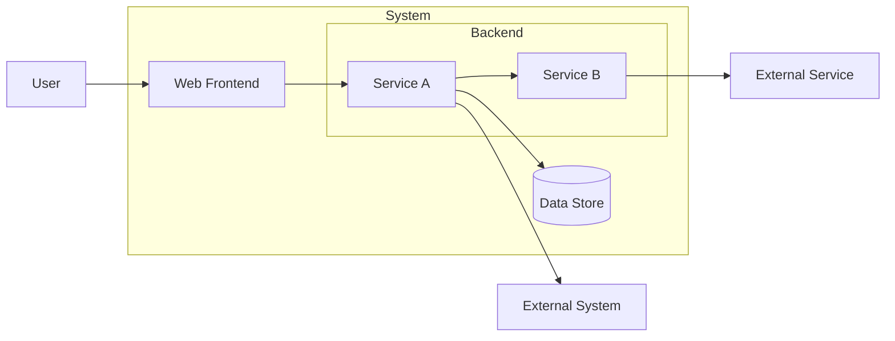
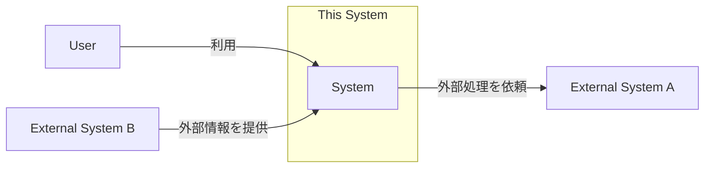
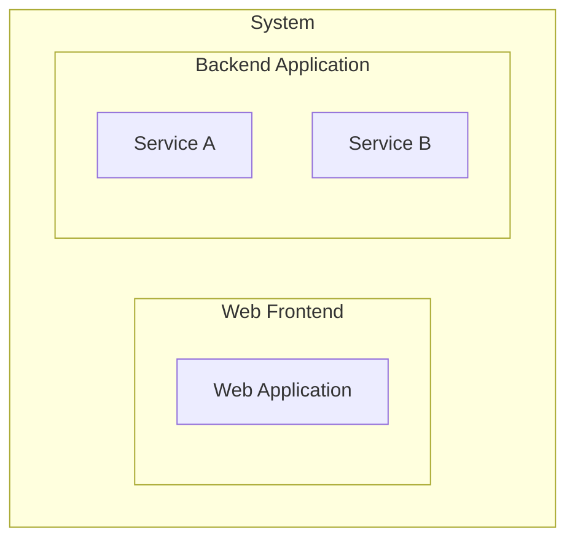
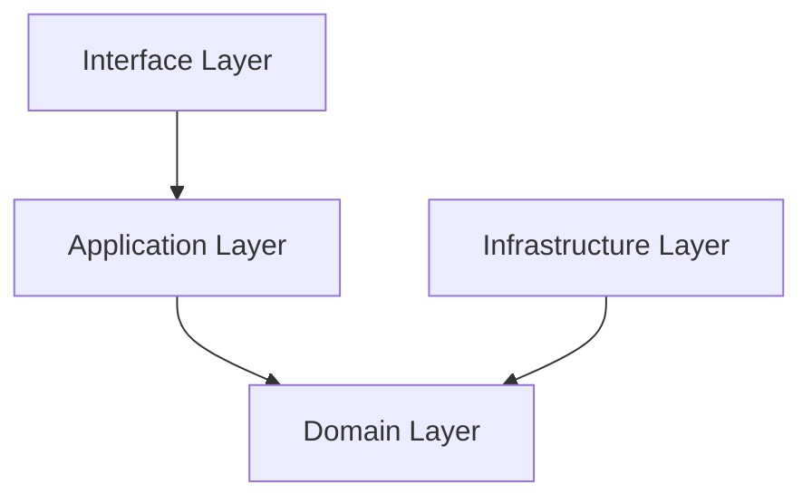
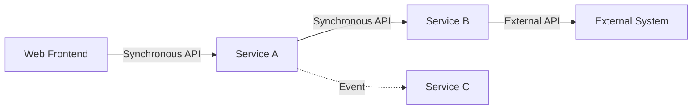
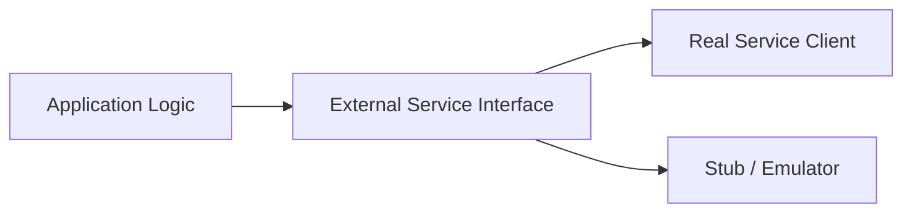
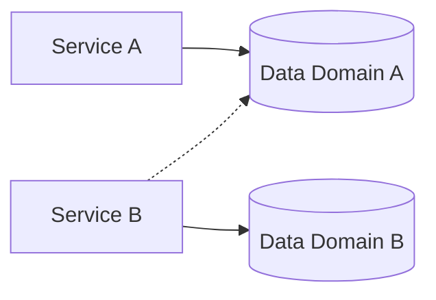
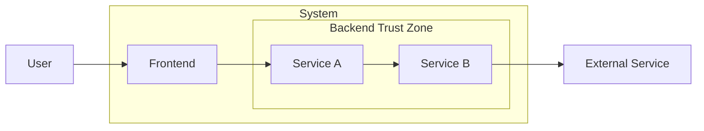
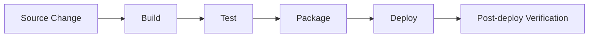

# Content Guide

## **Purpose for Design**

Function Designで確定した機能、責務、設計対象およびそれらの関係を、実現可能かつ一貫したSystem / Application Architectureへ具体化する。

System Boundary、Application / Service構造およびOwnershipを前提として、Technology、Application内部構造、Dependency、Integration、External Service、Data Persistence、Security、Performance / Scalability、Deployment、Testability等のArchitectureを確定する。

後続のApplication Detail Design、Infrastructure Architecture、Data Strategy、Test Design等が共通して参照できる技術構造、Architecture RuleおよびConstraintを確立し、後続設計がSystem Architectureと整合した状態で具体化できるようにする。


## **Out of Scope**

本設計では、Function Designで確定済みの機能仕様やBusiness Ruleを再設計しない。また、API、Data、UI、Batch等の個別設計対象内部の詳細仕様は、それぞれのDetail Designで定義する。

Cloud Resource、Network、Cluster、Compute等のInfrastructure構成およびInfrastructure固有の実現方式はInfrastructure Architectureで定義する。

Data Migration、Replication、Backup / Restore、Retention / Archiving等のData Lifecycleおよび運用戦略はData Strategyで定義する。

具体的なTest Scenario / Test Case等、Architectureを前提として後続工程で具体化すべき仕様についても、本設計の対象外とする。

## **Design Policy**

- System Architecture Outlineで事前に確定した方針を入力として受け取り、Function Designで確定した機能仕様および設計対象間の関係を成立させる正式なSystem Architectureへ統合・具体化する。
- System / Application Architectureとして判断可能な事項は、詳細度を理由に後続工程へ先送りせず、本設計で必要な粒度まで決定する。
- 同一のArchitecture Decisionを複数Sectionで重複して定義せず、そのDecisionを主として扱うSectionを正とし、関連Sectionでは必要に応じて参照する。
- System / Application ArchitectureとInfrastructure Architectureの責務を区別し、Application側で要求する構造・特性・Constraintを本設計で定義したうえで、そのInfrastructure上の実現を後続設計へ引き継ぐ。
- 各Section / Subsectionは対象Projectに該当するArchitecture Concernが存在する場合のみ記載し、該当事項がない内容を一般論や推測によって補完しない。

## **Key Points for Design**

- System BoundaryからApplication / Service、Application内部構造まで、Architecture上のBoundary、ResponsibilityおよびOwnershipを一貫させる。
- 各Architecture Concernを独立して設計するのではなく、一つのConcernで行ったDecisionが他のConcernのBoundary、Responsibility、DependencyおよびConstraintと矛盾しないことを確認する。
- Function Designで定義された機能・設計対象間の関係から、System Architecture上のTechnology、Structure、Integration、Persistence、Security、Deployment等へ追跡可能な形で具体化する。
- 全Sectionを設計した後に横断的な整合性を再確認し、後続Sectionで判明したConstraintやDecisionを関連Sectionへ反映してSystem Architecture全体を収束させる。

## **Overview**
 - Change History
 - Architecture Overview
 - System Boundary and Context
 - Application and Service Structure
 - Responsibility, Ownership and Architecture Evolution
 - Technology Stack
 - Application Architecture
 - Dependency Management
 - Integration Architecture
 - External Service Integration
 - Data Persistence Architecture
 - Security Architecture
 - Performance and Scalability Architecture
 - Deployment Architecture and Strategy
 - Test Architecture
 - Technical Constraints and Architecture Decisions

## **Section Guide**

### **0. Change History**
本項目では、本システムアーキテクチャ設計書の初回作成、およびシステムアーキテクチャ設計完了後に行われた正式なシステムアーキテクチャ設計変更の履歴を記録する。

初回作成時は、レビューおよび再レビューを含むシステムアーキテクチャ設計工程が完了し、システムアーキテクチャ設計書が確定した時点で1件の履歴として記録する。
同一設計工程内におけるレビュー指摘への対応、記載内容の修正、表現の改善、誤記修正など、システムアーキテクチャ設計書を確定するまでの変更は個別の履歴として記録しない。

システムアーキテクチャ設計完了後の工程でシステムアーキテクチャ設計変更が必要となった場合、または後続のTrainにおいて機能追加・変更等に伴い本設計を変更した場合は、新しい履歴として記録する。


**example**:
| Change | Date | Train | Summary |
| --- | --- | --- | --- |
| Initial Design | [YYYY-MM-DD HH:mm] | [Train] | 初回設計 |
| Change 1 | [YYYY-MM-DD HH:mm] | [Train] | [変更概要] |
| Change 2 | [YYYY-MM-DD HH:mm] | [Train] | [変更概要] |


### **1. Architecture Overview**
#### **1.1 Architecture Purpose**
本System Architectureが、Function Designで確定した機能仕様をどのようなシステム・Application構造および技術方式によって成立させるかを定義するものであることを記載する。

また、後続のApplication Detail DesignおよびInfrastructure Architectureが前提とする、システム全体のArchitecture上の基準・制約を確定することを目的として明示する。

**記載しない内容**:

個々の機能要件やBusiness Rule等のFunction Designで確定済みの仕様を再定義しない。また、個別のApplication / Serviceの詳細仕様やInfrastructureの具体構成についてもここでは記載しない。


#### **1.2 Architecture Summary**
システム全体がどのようなArchitectureとして構成されるかを、後続Sectionを読まずとも大枠を理解できる粒度で要約する。

以下のようなArchitecture上の主要事項を、該当するものに絞って記載する。

- システムを構成する主要なApplication / Service
- Frontend / Backend等の大きな構成
- Monolith / Modular Monolith / Microservices等の基本構造
- Application / Service間の主要な関係
- 主要なArchitecture Pattern
- Data Persistenceの基本構造
- External System / External Serviceとの主要な関係
- Deployment Unit等のArchitecture上重要な構造

<br>


各事項の詳細は後続Sectionを正とし、本項目ではArchitecture全体を理解するために必要な要約のみを記載する。

**記載しない内容**:

各Architecture Decisionの詳細な理由、個々のLayer / Dependency Rule、具体的なInterface方式、Library、Security方式等を個別に詳述しない。また、後続Sectionの内容を網羅的に再掲しない。


#### **1.3 Key Architectural Characteristics**
本システムのArchitectureを特徴付ける重要な設計上の性質・方針を整理する。

一般的な技術要素を列挙するのではなく、システム全体の構造や後続設計へ大きな影響を与えるArchitecture上の特徴に限定する。

**example**:
| Characteristic | Description |
| --- | --- |
| Independent Application Boundaries | FrontendとBackendを独立したApplicationとして構成する |
| Service Independence | 各Serviceが明確な責務境界を持ち、独立して変更可能な構造とする |
| External Dependency Isolation | External Serviceへの依存をApplication内部の境界で分離する |
| Independent Deployability | 所定のApplication / Serviceを独立してDeploy可能な単位として構成する |

<br>


**記載しない内容**:

Performance、Security、Scalability等の一般的な品質特性を、Architecture上の具体的な特徴と結び付けずに列挙しない。また、各特徴を実現する具体的な技術仕様は対応する後続Sectionで定義する。


#### **1.4 System Architecture Diagram**
本System Architectureで確定した主要なApplication / Service、External System / Serviceおよび主要なData Store等を配置し、システム全体のArchitecture構造と主要な関係を俯瞰できる構成図を記載する。

Mermaidの`flowchart`を基本とし、システム境界と主要なApplication / Serviceの境界が識別できる構造とする。

**example**:


<br>


図では、Architecture全体を理解するために必要な主要構成要素と関係のみを表現する。具体的な通信方式等がArchitecture上確定済みであり、全体構造を理解するために重要な場合は、その関係を補足してもよい。

**記載しない内容**:

Subnet、VPC、Load Balancer、Cluster、Node等のInfrastructure構成や物理配置は記載しない。また、個々のAPI / Event、Request / Response、処理順序等のFunction FlowやInterface Detailも表現しない。

### **2. System Boundary and Context**

#### **2.1 System Scope and Responsibility**

本システムが責務を持つ業務・機能領域を定義し、System Architecture上の設計対象となる範囲を明確にする。

System Architecture Outlineで決定したSystem Boundaryを前提として、本システムに含める領域と含めない領域を整理する。領域の一部のみを本システムが担う場合は、その責務範囲が判別できるように記載する。

**example**:
| Domain / Functional Area | Responsibility | Scope |
| --- | --- | --- |
| 領域A | 本システムが領域全体を担当する | In Scope |
| 領域B | 本システムが一部の責務を担当する | Partial |
| 領域C | 本システムでは担当しない | Out of Scope |

<br>


部分的に担当する領域については、必要に応じて責務の範囲を補足する。

<br>


**記載しない内容**:

各領域に含まれる個々の機能やBusiness Ruleを再定義しない。また、Application / Serviceへの機能割当、具体的なInterface、技術的な実現方式についてもここでは定義しない。


#### **2.2 External Responsibility Boundaries**

本システムと外部Systemが同一または関連する業務・機能領域を分担する場合、それぞれがどこまで責務を持つかを定義する。

外部Systemとの境界を越えて連携する機能について、本システムが担う責務と外部Systemへ委ねる責務を明確にする。

**example**:
| Domain / Functional Area | This System Responsibility | External System | External Responsibility |
| --- | --- | --- | --- |
| 領域A | 要求受付と結果利用を担当する | External System A | 外部処理を担当する |
| 領域B | 情報の管理を担当する | External System B | 情報の提供を担当する |

<br>


複数System間の責務境界を成立させるために必要な事項については、詳細度にかかわらずここで明確にする。

<br>


**記載しない内容**:

外部SystemとのAPI、Event、File等の具体的なInterface Contractや、REST / Messaging等の通信方式は定義しない。また、Network接続、Private接続、Firewall等のInfrastructure上の境界・接続方式についても記載しない。


#### **2.3 Existing System Positioning**
本システムと関係する既存Systemについて、本Architectureにおける位置づけを定義する。

既存Systemを本システムへ取り込む、外部Systemとして併存させる、または本システムによって置き換える等、System Architecture Outlineで決定した関係を明確にする。

**example**:
| Existing System | Positioning | Relationship to This System |
| --- | --- | --- |
| Existing System A | Integrated | 本システムへ機能を取り込む |
| Existing System B | Coexisting | 外部Systemとして継続利用する |
| Existing System C | Replaced | 本システムへの移行後に置き換える |

<br>


段階的な置換や一時的な併存が必要な場合は、現在および目標とする位置づけが区別できるように記載する。

<br>


**記載しない内容**:

既存Systemからの具体的なData Migration、Cutover手順、移行Schedule、Deployment手順等は定義しない。また、既存System内部のArchitectureについて、本システムとの境界を理解するために必要な範囲を超えて記載しない。


#### **2.4 System Context**
本システム、主要なActor、および本システムと直接関係する外部Systemを配置し、System Boundaryと周辺Systemとの関係を俯瞰できるSystem Contextを記載する。

Mermaidの`flowchart`を使用し、本システムを一つのSystem Boundaryとして表現する。外部Systemとの関係には、具体的な通信方式ではなく、関係の目的または責務が理解できる意味的な説明を付与する。

**example**:


<br>


System Contextは、Application / Service等の内部構造ではなく、**本システムを一つの単位として外部との関係を表現する**。

**記載しない内容**:

Frontend、Backend、Service、Module等のSystem内部構造は記載しない。また、Infrastructure Resource、Network構成、具体的なProtocol、API / Event等のInterfaceや処理Sequenceも表現しない。

### **3. Application and Service Structure**

#### **3.1 Application Structure**

システムを構成するApplicationを特定し、それぞれの種類、対象となる利用者・用途、および大まかな役割を定義する。

同じ種類のApplicationを利用者・用途等によって分割する場合は、その分割単位を明確にする。

**example**:
| Application | Type | Target / Usage | Role |
| --- | --- | --- | --- |
| Web Application A | Web Frontend | End User | User向け機能を提供する |
| Web Application B | Web Frontend | Administrator | 管理機能を提供する |
| Backend Application | Backend | Frontend / External Consumer | Backend機能を提供する |

<br>


Application一覧から、システム全体がどのApplicationによって構成され、それぞれがどの範囲を担うかを把握できる状態にする。

<br>


**記載しない内容**:

Application内部のService / Module構造、Layer構造、Architecture Pattern、使用技術はここでは定義しない。また、Applicationを稼働させるCompute、Container、Cluster等のInfrastructure構成も記載しない。


#### **3.2 Application Boundaries**

Application間の境界を定義し、どの責務を同一Application内に置き、どの責務を独立したApplicationとして分離するかを明確にする。

特にFrontend / Backendについて、一体型Applicationとして構成するか、独立したApplicationとして分離するかを明示する。

**example**:
| Boundary | Decision | Responsibility Separation |
| --- | --- | --- |
| Web Frontend / Backend | Separate Applications | UI提供とBackend処理を独立したApplicationとして扱う |
| User Web / Admin Web | Separate Applications | User向け機能と管理機能を独立して扱う |

<br>


System Architecture Outlineで決定したApplication境界を正式なArchitectureとして反映し、Function Designおよび後続設計が前提とするApplication単位を確定する。

<br>


**記載しない内容**:

Application間をREST、gRPC、Messaging等のどの方式で接続するかは定義しない。また、具体的なAPI / Event、Request / Response等のInterface仕様も記載しない。


#### **3.3 Backend Structure**

Backend Applicationについて、内部をどのような構造単位で構成するかを定義する。

Monolith、Modular Monolith、Microservices等の基本構造を明示し、その構造を採用する範囲を明確にする。

**example**:
| Backend | Structure | Description |
| --- | --- | --- |
| Backend | Microservices | Backend機能を複数の独立したServiceへ分割する |

<br>


複数のBackend Applicationが存在し、それぞれ異なる構造を採用する場合は、Applicationごとに定義する。

<br>


**記載しない内容**:

各Service / Module内部のLayer構造、Class / Package構造、Architecture Pattern、Dependency Rule等は定義しない。また、ServiceをContainerやPod等としてどのように実行・配置するかも記載しない。


#### **3.4 Service and Module Boundaries**

Backend Structureで定めた基本構造に基づき、Backendを構成するService / Moduleを特定し、それぞれの境界と大まかな役割を定義する。

関連する機能領域をどの単位にまとめ、どの単位を独立したService / Moduleとして分離するかを明確にする。

**example**:
| Service / Module | Parent Application | Boundary | High-Level Role |
| --- | --- | --- | --- |
| Service A | Backend | 機能領域A | 機能領域Aに関するBackend処理を担う |
| Service B | Backend | 機能領域B | 機能領域Bに関するBackend処理を担う |

<br>


ここではService / Moduleの**構造上の境界と大まかな役割**を確定する。

<br>


**記載しない内容**:

各Service / Moduleが担当する機能の詳細、担当する範囲・担当しない範囲、責務が重なる領域の具体的な分担、Data Ownershipについてはここで重複して定義せず、**Responsibility, Ownership and Architecture Evolution**で扱う。また、Service間の具体的な連携方式はIntegration Architectureで定義する。


#### **3.5 Application and Service Structure Diagram**

Application、Backend、およびService / Moduleの構造上の包含関係と境界を俯瞰できる構成図を記載する。

Mermaidの`flowchart`を使用し、Application境界と、その内部に存在するService / Module境界を`subgraph`等によって明示する。

**example**:


<br>


本図では、**システムがどのApplication / Service / Moduleから構成されるかという構造そのもの**を表現する。

<br>


**記載しない内容**:

Component間の処理順序、Request / Response、Data Flow、具体的なAPI / Event等は表現しない。また、Server、Container、Cluster、Network、Database等のInfrastructure構成や物理的なDeployment配置も記載しない。

### **4. Responsibility, Ownership and Architecture Evolution**

#### **4.1 Responsibility Allocation**
Function Designで定義された機能領域について、どのApplication / Service / Moduleが責務を持つかを定義する。

各Application / Service / Moduleについて、担当する機能領域だけでなく、境界を明確にするために必要な場合は担当しない領域も明示する。

**example**:
| Application / Service / Module | Responsible Areas | Excluded Areas |
| --- | --- | --- |
| Service A | 機能領域A、機能領域B | 機能領域C |
| Service B | 機能領域C | 機能領域A、機能領域B |

<br>


3章で定義した構造上の境界に対して、Function Designで具体化された機能を割り当て、各構造単位の責務を確定する。

<br>


**記載しない内容**:

Application / Service / Moduleの構造上の分割そのものをここで再定義しない。また、個々のAPI、Batch、Screen等の責務や、Application内部のClass / Layer等への機能割当は記載しない。


#### **4.2 Overlapping Responsibility Boundaries**

複数のApplication / Service / Moduleが関係する機能領域について、責務の重複や曖昧さが生じないよう、それぞれが担当する範囲と境界を定義する。

一つの担当先へ責務を集約する場合はその所有先を明示し、複数の担当先で分担する場合は、それぞれが担う役割を区別する。

**example**:
| Functional Area | Element A Responsibility | Element B Responsibility | Boundary |
| --- | --- | --- | --- |
| 領域A | 情報の管理を担当する | 情報を利用した処理を担当する | 管理責任はA、利用責任はB |
| 領域B | 処理要求を生成する | 実際の処理を担当する | 処理実行責任はB |

<br>


複数の設計対象間の責務境界を成立させるために必要な仕様は、詳細度にかかわらずここで明確にする。

<br>


**記載しない内容**:

責務境界を実現する具体的なAPI / Event、通信方式、Request / Response等は定義しない。また、各Application / Service内部での実装上の責務分担についても記載しない。


#### **4.3 Data Ownership**

Function Designで特定された主要なData領域について、どのApplication / Service / Moduleが管理責任を持つかを定義する。

Data Ownershipは物理的なData Storeの配置ではなく、Dataの生成、変更および整合性に対してどの構造単位が責任を持つかという論理的なOwnershipとして定義する。

**example**:
| Data Domain | Owner | Ownership Responsibility | Other Consumers |
| --- | --- | --- | --- |
| Data A | Service A | Data Aの生成・変更・整合性を管理する | Service B |
| Data B | Service B | Data Bの管理責任を持つ | Service A, Service C |

<br>


他のApplication / ServiceがDataを利用する場合でも、Ownership自体は明確な単位へ割り当てる。

<br>


**記載しない内容**:

Table / Column単位の詳細なData設計、Database Schema、Data Storeの物理的な分割・配置、Replication等は記載しない。また、他ServiceがOwnerのDataへどの技術方式でAccessするかはIntegration ArchitectureおよびData Persistence Architectureで定義する。


#### **4.4 Current Architecture**

System Architecture Outlineで検討した論理境界について、現在のArchitectureでどこまでを実際に独立したApplication / Service / Moduleとして分離し、どこを同一構造内に配置するかを整理する。

**example**:
| Logical Boundary | Current Structure | Separation Level |
| --- | --- | --- |
| 領域A / 領域B | 別Serviceとして構成する | Physical / Structural Separation |
| 領域C / 領域D | 同一Service内に配置する | Logical Separation Only |

<br>


現在は同一Application / Service内に配置する場合でも、将来の構造変更に備えて論理的に区別する領域については、その境界を明示する。

<br>


**記載しない内容**:

Application / ServiceのInfrastructure上の配置、Container / Pod / Cluster等の物理的なDeployment構成は記載しない。また、将来構造そのものは本項目では定義せず、Architecture Evolutionで扱う。


#### **4.5 Architecture Evolution**

各Application / Service / Moduleおよび機能領域について、将来的に想定する構造上の分割、統合または現状維持の方向性を定義する。

現在のArchitectureと将来想定するArchitectureを区別し、構造変更が想定される場合は、どの領域をどの単位へ分割・統合する可能性があるかを明示する。

**example**:
| Target Area | Current Structure | Evolution Direction | Target Structure / Intent |
| --- | --- | --- | --- |
| 領域A | Service A内 | Split | 将来的に独立Serviceとして分離する |
| 領域B / C | 別Module | Merge | 同一責務として統合する |
| 領域D | 独立Service | Maintain | 現在の構造を維持する |

<br>


ここで定義する将来構造は、確定した実装計画ではなく、現在のArchitectureで維持すべき境界を判断するためのArchitecture上の方向性として扱う。

<br>


**記載しない内容**:

将来変更の具体的な実施時期、Train、Migration手順、Infrastructure変更、Release Plan等は定義しない。また、根拠のない将来拡張を想定して不要な構造を追加しない。


#### **4.6 Evolution Boundaries**

Architecture Evolutionで想定した将来の分割・統合に備え、現在のArchitectureでも維持する必要がある責務およびOwnershipの論理境界を定義する。

現在は同一Application / Service / Module内に存在していても、将来的な分離単位として扱う領域について、責務およびData Ownershipが不用意に混在しないよう境界を明示する。

**example**:
| Target Area | Current Placement | Boundary to Preserve | Reason |
| --- | --- | --- | --- |
| 領域A | Service X内 | 領域Aの責務を独立して維持する | 将来的なService分離を想定 |
| Data Domain B | Service X内 | Data Bの管理責任を他領域と分離する | 将来的なOwnership分離を想定 |

<br>


**記載しない内容**:

将来分離に備えた具体的なClass / Package構造、Database分割、API化、Messaging化等の実装方式はここでは定義しない。必要なArchitecture上の構造・依存ルールは後続のApplication Architecture等で具体化する。

### **5. Technology Stack**

#### **5.1 Application Platform and Language**

各Application / Serviceについて、対象Platform、実装言語、およびApplicationの実行に必要となるRuntimeを定義する。

Frontendについては、Web / iOS / Android等の対象Platformを明示する。

**example**:
| Application / Service | Platform | Language | Runtime |
| --- | --- | --- | --- |
| Web Frontend | Web | TypeScript | Node.js |
| Backend Service A | Backend | Java | JVM |
| Mobile Application A | iOS | Swift | iOS |

<br>

複数のApplication / Serviceで異なるTechnologyを採用する場合は、それぞれについて明示する。

<br>

**記載しない内容**:

Applicationを稼働させるEC2、ECS、EKS、Fargate等のInfrastructure上の実行基盤は定義しない。また、OS、Node、Cluster等のInfrastructure RuntimeについてもInfrastructure Architectureで扱う。


#### **5.2 Framework and Application Runtime**

各Application / Serviceを構築・実行するための主要Framework、Application ServerおよびApplication Runtimeを定義する。


**example**:
| Application / Service | Framework | Application Server / Runtime | Purpose |
| --- | --- | --- | --- |
| Web Frontend | Framework A | Runtime A | Web Applicationを構築する |
| Backend Service A | Framework B | Application Server A | Backend Applicationを実行する |

<br>

FrameworkやRuntimeについて、Architecture全体に影響する選定理由がある場合はその理由を明示する。

<br>

**記載しない内容**:

Framework上で利用する個別Library、Plugin、Extension等は網羅的に記載しない。それらのうちArchitecture上管理すべきDependencyはDependency Managementで扱う。また、Framework内部の具体的な設定値や実装方法は記載しない。


#### **5.3 Middleware and Data Technologies**

Application Architectureとして利用するMiddlewareおよびData Technologyを定義する。

Databaseについては、Applicationが必要とするDatabaseの種類とEngineを定義する。

**example**:
| Category | Technology | Used By | Purpose |
| --- | --- | --- | --- |
| RDBMS | PostgreSQL | Service A | 永続データを管理する |
| Cache | Technology A | Service A / B | Application Cacheとして利用する |
| Messaging | Technology B | Service A / B | 非同期連携を実現する |

<br>

Middlewareについても、Application Architectureを成立させるために採用するTechnologyを対象とする。

<br>

**記載しない内容**:

RDS等のManaged Service、Database Instance、Cluster、Replica、Storage等のInfrastructure上の実現方式・構成は定義しない。また、Database Schema、Table、Index等のData Detail Designも扱わない。

#### **5.4 Application Core Technologies**

各Application / Serviceの内部で、特定の機能に限定されず、Applicationの実装基盤として横断的に利用する主要Technologyを定義する。

必要に応じて以下のようなTechnologyを対象とする。

- Persistence / ORM
- Logging
- Serialization / Deserialization
- Validation
- HTTP Client
- Messaging Client
- Mapping
- Resilience
- その他Application全体で利用する基盤Technology

<br>

**example**:
| Application / Service | Category | Technology | Purpose |
| --- | --- | --- | --- |
| Backend | Persistence / ORM | Hibernate | Relational DatabaseとのObject Mappingを行う |
| Backend | Logging | Logback | Application Logを出力する |
| Backend | HTTP Client | [Technology] | External / Internal APIを利用する |

<br>

Frameworkに標準的に含まれるTechnologyについても、Architecture上選択可能であり、採用Technologyを明確にする必要がある場合は記載する。

<br>

**記載しない内容**:

個々の機能だけで利用するLibraryや補助的なUtility Libraryを網羅的に列挙しない。また、具体的なLibrary Dependency、Version、BOM、Compatibility等はDependency Managementで管理する。

#### **5.5 Development and Delivery Technologies**

Application / ServiceのSource Code管理、Build、Artifact生成およびDeliveryを実現するために採用する主要Technology / Platformを定義する。

各Technologyについて、本設計で採用するTechnologyとその適用対象を明確にする。

必要に応じて以下を対象とする。
- Application Packaging / Build Output
  - JAR / WAR等
  - Native Executable
  - Static Web Artifact
  - Mobile Application Package
  - その他Runtime / Platformに応じたPackage形式
- Build Tool
  - Maven
  - Gradle
  - npm / pnpm等
- SCM
  - Git
- Repository Hosting / Management Platform
  - GitHub
  - GitLab等
- CI/CD Platform
  - GitHub Actions
  - GitLab CI/CD等
- Artifact Build Tool
  - Docker / BuildKit
  - Jib
  - Buildpacks等
- その他ApplicationのBuild / Deliveryを成立させる主要Technology

**example**:

| Category | Technology / Platform | Used By | Purpose |
| --- | --- | --- | --- |
| SCM | Git | All Applications | Source CodeをVersion管理する |
| Repository Platform | GitHub | All Applications | Repositoryを管理する |
| Application Packaging | Executable JAR | Backend Service A | Application Runtimeで実行可能な形式としてPackageする |
| Build Tool | Maven | Backend Services | Java ApplicationをBuildする |
| CI/CD Platform | GitHub Actions | All Applications | Application Delivery Pipelineを実行する |
| Container Image Build | BuildKit | Backend Services | OCI Container Imageを生成する |

Technologyの具体的な利用方式、Pipeline Stage、Artifact生成方式等は **Deployment Architecture and Strategy** で定義する。

**記載しない内容**:

Build Command、Pipeline YAML、Job / Step等の具体的なCI/CD実装は記載しない。また、Terraform / Kubernetes等のInfrastructure Provisioning / Delivery TechnologyおよびInfrastructure PipelineはInfrastructure Architectureで定義する。

### **6. Application Architecture**

#### **6.1 Architecture Pattern**

各Application / Serviceに適用するArchitecture Patternを定義する。

Clean Architecture、Hexagonal Architecture、Onion Architecture、MVC、CQRS等について、Application / Serviceの性質や責務を踏まえて採用するPatternを決定する。複数のPatternを組み合わせる場合は、それぞれを適用する範囲と役割を明確にする。

**example**:
| Application / Service | Architecture Pattern | Applied Scope | Purpose |
| --- | --- | --- | --- |
| Backend Service A | Clean Architecture | Application全体 | Domainと外部技術への依存を分離する |
| Web Frontend | [Pattern] | Application全体 | [目的] |

<br>

Pattern名を指定するだけでなく、そのPatternを本システムでどのように解釈・適用するかを明確にする。

<br>

**記載しない内容**:

Monolith / Modular Monolith / Microservices等のSystem / Service分割構造は定義しない。また、FrameworkやLibraryの選定、Infrastructure構成についてもここでは扱わない。


#### **6.2 Layer and Module Structure**

採用したArchitecture Patternに基づき、各Application / Service内部を構成する主要なLayer / Moduleとその構造を定義する。

**example**:
| Layer / Module | Role | Contains |
| --- | --- | --- |
| Domain | Business Logicを表現する | Domain Model、Domain Service等 |
| Application | Use Caseを実現する | Application Service等 |
| Interface | 外部からの入出力を受け持つ | Controller等 |
| Infrastructure | 外部技術との接続を担う | Persistence、External Service Adapter等 |

<br>

複数のApplication / Serviceで異なる内部構造を採用する場合は、それぞれについて定義する。

構造の理解に有効な場合は、Mermaidの`flowchart`を使用してLayer / Moduleの構造を表現する。

<br>

**example**:


<br>
<br>

**記載しない内容**:

具体的なClass、Method、Source File等の実装単位までは定義しない。また、Application / Serviceそのものの分割境界は3. Application and Service Structureを正とする。


#### **6.3 Layer and Module Responsibilities**

各Layer / Moduleが担う責務と、担わない責務を定義する。

採用したArchitecture Patternから導かれる責務境界を、本システムに適用可能な形まで具体化する。

**example**:
| Layer / Module | Responsibilities | Excluded Responsibilities |
| --- | --- | --- |
| Domain | Domain RuleおよびDomain Modelを保持する | PersistenceやExternal Serviceとの技術的接続 |
| Application | Use Caseを調整・実行する | Infrastructure固有処理 |
| Infrastructure | PersistenceやExternal Serviceとの接続を実現する | Business Ruleの決定 |

<br>

責務が複数Layer / Moduleにまたがり得る場合は、どのLayer / Moduleを責務の正本とするかを明確にする。

<br>

**記載しない内容**:

Function Designで定義済みのApplication / Service間の機能責務を再定義しない。また、個々のUse CaseやBusiness Ruleそのものも再記載しない。


#### **6.4 Dependency Direction and Rules**

Layer / Module間で許可する依存方向と禁止する依存方向を定義し、Application Architectureを維持するためのDependency Ruleを明確にする。

また、採用したFramework / Library等のTechnologyについて、特定のLayer / Moduleからの直接依存を許可または禁止する必要がある場合は、そのDependency Ruleも定義する。

例えば以下のような構造上のRuleを定義する。

- Domain LayerはInfrastructure Layerへ依存しない。
- Domain LayerはHibernateへ依存しない。
- Application LayerはInfrastructure固有の実装へ直接依存しない。
- Infrastructure Layerは、Application / Domain側で定義された境界を実装する。
- Interface LayerからDomain内部の実装へ直接依存しない。

必要に応じてDependency Matrixを使用する。

**example**:
| From / To | Domain | Application | Interface | Infrastructure |
| --- | --- | --- | --- | --- |
| Domain | Allowed | [Rule] | Prohibited | Prohibited |
| Application | Allowed | Allowed | Prohibited | [Rule] |
| Interface | [Rule] | Allowed | Allowed | [Rule] |
| Infrastructure | Allowed | [Rule] | Prohibited | Allowed |

<br>

ここでいうDependencyは、Layer / Module間の**構造上の依存方向**を指す。

<br>

**記載しない内容**:

具体的に採用するLibraryやそのVersion、推移的Dependency、BOM等のSoftware Dependency管理は定義しない。これらはDependency Managementで扱う。


#### **6.5 Cross-Cutting Concern Placement**

複数のUse CaseやModuleから利用される共通処理について、Application Architecture上どのLayer / Moduleへ配置し、どの責務として扱うかを定義する。

対象には、必要に応じて以下のようなCross-cutting Concernを含める。

- Validation
- Logging
- Authentication / AuthorizationとのApplication側境界
- Transaction Boundary
- Error Translation
- External Service Client Boundary
- Common Utility
- Persistence / ORMとの境界
- Serialization / Deserialization
- Observability / Telemetry

<br>

**example**:
| Concern | Placement | Responsibility / Rule |
| --- | --- | --- |
| Validation | [Layer / Module] | [配置・責務方針] |
| External Service Client | Infrastructure | External Service固有の依存をApplication / Domainから隔離する |
| Transaction Boundary | Application | Use Case単位でTransaction境界を管理する |

<br>

**記載しない内容**:

Logging製品、認証基盤、Secret Store等の具体的TechnologyやInfrastructure構成はここでは定義しない。また、それぞれのConcernの個別実装仕様ではなく、Application Architecture上の配置・責務に限定する。


#### **6.6 Package and Module Organization Policy**

Application Architectureで定義したLayer / Module境界をSource Code上でも維持できるよう、Package / Module構成の基本方針を定義する。

例えば、Layer単位、Feature単位、Domain単位等の構成方針と、境界を越えた参照に関するRuleを定める。

**example**:

```text
application/
├── domain/
├── application/
├── interface/
└── infrastructure/
```

具体的な構成がArchitecture上重要な場合は、主要Directory / Packageまで確定する。

<br>

**記載しない内容**:

個々のClassやSource Fileの配置を網羅的に定義しない。また、RepositoryをMonorepo / Multi-repoのどちらにするか、Application / ServiceをどのRepositoryへ配置するかは、本項目のPackage / Module構造とは区別して扱う。

### **7. Dependency Management**

#### **7.1 Dependency Management Policy**

Application / Serviceが利用するSoftware Dependencyについて、追加、管理、更新および廃止に関する基本方針を定義する。

Dependencyは必要性が確認されたもののみ追加し、Application / Serviceが直接利用するDependencyを明示的に管理する。
Function DesignおよびSystem Architectureから必要性が判明したDependencyは、本章で洗い出し、採用可否を確定する。

必要に応じて、以下のような基本方針を定義する。

- Dependency追加時の選定基準
- 標準機能 / 既存Dependencyで代替可能な場合の扱い
- Dependencyの管理主体
- 不要となったDependencyの削除方針
- Application / Service間でDependency管理を統一する範囲

<br>

**記載しない内容**:

Layer / Module間で許可・禁止する依存方向は定義しない。構造上のDependency RuleはApplication Architectureを正とする。また、Infrastructure構築用ToolやInfrastructure Component間のDependencyはInfrastructure Architectureで扱う。


#### **7.2 Dependency Inventory**

Function Design、Technology Stack、Application Architecture、Integration Architecture等から必要性が判明した主要なLibrary / SDK / Framework Extension等を洗い出し、採用するDependencyとその用途を確定する。

**example**:
| Dependency | Category | Used By | Purpose | Selection Rationale |
| --- | --- | --- | --- | --- |
| Library A | Library | Service A | 機能Aの実現 | [選定理由] |
| SDK A | SDK | Service B | External Serviceとの連携 | [選定理由] |
| Library B | Test Library | Service A / B | Application Test | [選定理由] |

<br>

本章の作成時点で必要性が明らかなDependencyについては、後続実装へ判断を先送りせず、可能な範囲で採用対象を確定する。

<br>

**記載しない内容**:

使用する可能性があるだけのLibraryを網羅的に列挙しない。また、推移的に導入されるすべてのDependencyをInventoryとして手作業で列挙しない。実装中に初めて必要性が判明する局所的なDependencyまで事前に推測して追加しない。


#### **7.3 Version and Compatibility Management**

採用するDependencyについて、Versionの選定・固定・更新方法、およびTechnology Stackや他DependencyとのCompatibilityを維持する方針を定義する。

Architecture上Compatibilityが重要なDependencyについては、採用Versionまたは許容Version Rangeと、その制約を明示する。

**example**:
| Dependency | Version / Range | Compatibility Target | Constraint |
| --- | --- | --- | --- |
| Library A | [Version] | Framework A | [Compatibility条件] |
| SDK A | [Version] | Runtime A | [Compatibility条件] |

<br>

必要に応じて、BOM、Platform Dependency、Lock File等を利用したVersion統制方針も定義する。

<br>

**記載しない内容**:

Language、Runtime、主要Framework等のTechnology StackそのもののVersion方針をここで再定義しない。それらはTechnology Stackを正とし、本項目ではDependency側から必要となるCompatibility条件を扱う。

#### **7.4 Direct and Transitive Dependency Management**

Application / Serviceが直接利用するDependencyと、それらから導入されるTransitive Dependencyの管理方針を定義する。

直接利用するDependencyは原則として明示的に管理し、Transitive Dependencyへの暗黙的な依存を避けるための方針を定める。

また、Transitive DependencyによってVersion Conflict、意図しないTechnologyの導入、Security Risk等が生じる場合の統制方法を定義する。

必要に応じて以下を扱う。

- Direct Dependencyの明示
- Transitive Dependencyへの直接依存の禁止・制限
- Dependency Exclusion
- Version Override
- BOM / Dependency Constraints
- Dependency Treeの確認方針

<br>

**記載しない内容**:

個々のDependency Conflictについて、実際のBuild Configurationや設定記述をここで作成しない。ただし、Architectureとして継続的に維持すべきExclusionやVersion Constraintが判明している場合は、その制約自体を記載する。


#### **7.5 Shared Dependency Policy**

複数のApplication / Serviceで利用するLibraryや共通Componentについて、共有する範囲と管理方針を定義する。

共通Library化によってApplication / Service間の不要なCouplingを生じさせないよう、共有対象とすべき責務を明確にする。

**example**:
| Shared Dependency | Used By | Shared Responsibility | Restrictions |
| --- | --- | --- | --- |
| Common Library A | Service A / B | 技術的な共通処理 | Domain固有Logicを含めない |

<br>

共通化する場合は、Versioning、Compatibilityおよび変更時の影響範囲についても方針を定める。

<br>

**記載しない内容**:

単にCode重複を避けることだけを理由として共通Library化しない。また、複数ServiceのDomain Responsibilityを一つのShared Libraryへ集約することで、3章・4章で定義したService BoundaryやOwnershipを崩さない。


#### **7.6 Dependency Lifecycle and Risk Management**

Dependencyの導入後について、更新、Security対応、陳腐化、廃止等を継続的に管理する方針を定義する。

必要に応じて以下を扱う。

- Dependency Updateの基本方針
- Security Vulnerabilityへの対応方針
- EOL / Support終了への対応
- Deprecated Dependencyの置換
- Major Version Update時のCompatibility確認
- 長期間更新されていないDependencyの扱い
- Dependency削除時の確認方針

Architecture上重要なDependencyについて、更新によってApplication ArchitectureやInterface Compatibilityへ影響する場合は、その影響を確認する方針も定義する。

<br>

**記載しない内容**:

具体的な脆弱性Scan基盤、Renovate / Dependabot等のAutomation Tool、CI Job等のInfrastructure / Delivery上の実現方式はここでは定義しない。ただし、そのような仕組みに求める管理要件は記載してよい。

### **8. Integration Architecture**

本章では、Function Designで特定されたApplication / Service / Component間および外部SystemとのInterfaceについて、それらを成立させる通信・連携方式と共通的なArchitecture Ruleを定義する。

Function Designで確定したInterfaceの目的、Provider / Consumer、意味的な入出力等は再定義せず、それらをどの技術方式によって接続するかを決定する。


#### **8.1 Integration Landscape**

Function Designで特定された主要なInterfaceをもとに、Application / Service / Component間および外部Systemとの連携関係と、採用するIntegration方式を俯瞰的に整理する。

**example**:
| Source | Target | Integration Purpose | Interaction | Integration Style |
| --- | --- | --- | --- | --- |
| Web Frontend | Service A | 機能Aの利用 | Synchronous | API |
| Service A | Service B | 処理要求 | Synchronous | API |
| Service A | Service C | 状態変化の通知 | Asynchronous | Event |
| Service B | External System A | 外部機能の利用 | Synchronous | External API |

<br>

複数の連携方式が存在する場合、どの境界でどの方式を利用するかが把握できる状態にする。

必要に応じてMermaidの`flowchart`を使用し、主要なIntegration関係を可視化する。

<br>

**example**:


<br>

**記載しない内容**:

Function Designで定義済みのInterfaceそのものの目的や意味的な入出力を再定義しない。また、Endpoint、Request / Response Schema、Event Payload等の個別Interface仕様や、Network経路等のInfrastructure構成は記載しない。


#### **8.2 Synchronous and Asynchronous Integration Strategy**

各連携について、Synchronous / Asynchronousのどちらを採用するか、およびその使い分けのArchitecture Ruleを定義する。

以下のような観点をもとに、適用基準を明確にする。

- 呼出元が処理結果を即時に必要とするか
- 処理完了を待つ必要があるか
- Producer / Consumerを時間的に分離する必要があるか
- 一つの処理から複数のConsumerへ通知する必要があるか
- 連携先の一時的な利用不能から呼出元を分離する必要があるか
- Consistency Strategyとの関係

<br>

**example**:
| Integration Scenario | Strategy | Rationale |
| --- | --- | --- |
| 即時結果を必要とする機能呼出 | Synchronous | 呼出元が結果を利用して処理を継続するため |
| 状態変化の通知 | Asynchronous | ProducerとConsumerを分離するため |

<br>

**記載しない内容**:

個々のAPIやEventのPayload、Timeout値、Retry回数等は定義しない。また、Queue / Broker等をどのInfrastructure Resourceとして配置するかはInfrastructure Architectureで扱う。


#### **8.3 API Integration Architecture**

Synchronous API等によるComponent / Service間連携について、採用する通信方式と共通Architecture Ruleを定義する。

必要に応じて以下を決定する。

- REST / gRPC等の通信方式
- Request / Response型連携の基本原則
- Service間APIの利用方針
- Internal / External APIのArchitecture上の区別
- Service Ownershipを越えた直接呼出のRule
- Timeout / Retry / Idempotency等についてArchitecture全体で統一すべき方針

<br>

**example**:
| Integration Scope | Technology / Style | Architectural Rule |
| --- | --- | --- |
| Frontend → Backend | REST API | Backend機能は公開されたAPI境界を介して利用する |
| Service → Service | [Style] | 他Service内部の実装へ直接依存しない |

<br>

**記載しない内容**:

Endpoint、HTTP Method、Header、Request / Response Schema、Status Code等の個別API Contractは定義しない。


#### **8.4 Event and Message Integration Architecture**

Event / MessageによるAsynchronous Integrationについて、採用する連携方式と共通Architecture Ruleを定義する。

必要に応じて以下を決定する。

- Event / Messageの使い分け
- Publish / Subscribe、Queue等のMessaging Pattern
- Producer / Consumer間のCoupling方針
- Delivery Semanticsの基本方針
- Orderingを保証する必要がある範囲
- Duplicate Messageに対する基本方針
- Retry / Dead Letter等についてArchitecture全体で統一すべき方針
- Event / MessageのVersioning方針

<br>

**記載しない内容**:

個々のEvent / MessageのPayload Schema、Field、Topic / Queue名等のInterface固有仕様は定義しない。また、Broker Cluster等のInfrastructure構成も扱わない。


#### **8.5 External System Integration Principles**

外部SystemとのInterfaceについて、System Architecture全体で共通する連携方式および境界Ruleを定義する。

必要に応じて以下を扱う。

- Inbound / Outbound連携の基本方式
- API / Event / Message / File等の使い分け
- External System固有の依存を内部Applicationから分離する方針
- 外部System障害が内部Systemへ与える影響を制御する基本方針
- 外部Interfaceの変更から内部Componentを保護する境界方針

<br>

**記載しない内容**:

特定のExternal Service固有のClient構造、Stub利用、Environment別利用方式等は **External Service Integration** で定義する。また、VPN、PrivateLink、Firewall、Routing等のNetwork接続方式はInfrastructure Architectureで扱う。


#### **8.6 Interface Versioning and Compatibility**

Application / Serviceを独立して変更・Deployできるよう、Interface変更時のVersioningおよびCompatibility方針を定義する。

必要に応じて以下を決定する。

- Backward Compatibilityを維持する範囲
- Breaking Changeの扱い
- API Versioningの基本方針
- Event / Message SchemaのVersioning方針
- Provider / Consumerの更新順序に依存しないためのRule
- 旧Versionを併存させる場合の基本方針

<br>

**example**:
| Interface Type | Compatibility Policy | Versioning Policy |
| --- | --- | --- |
| API | Backward Compatibilityを原則維持する | [Versioning方針] |
| Event | 既存Consumerが処理可能な変更を原則とする | [Schema Version方針] |

<br>

**記載しない内容**:

個々のInterfaceについて具体的にどのVersionを付与するか、旧Versionをいつ廃止するか等の個別変更計画は記載しない。


#### **8.7 Interface Evolution Principles**

System ArchitectureおよびArchitecture Evolutionで想定されるApplication / Service境界の変更に対して、Interfaceをどのように発展させるかの基本方針を定義する。

現在は同一Application / Service内に存在する論理境界でも、将来独立したServiceへ分離する可能性がある場合、必要に応じて内部依存を明確なInterface Boundaryとして維持する。

また、将来の統合・分割によってConsumerへ不要な影響を与えないためのArchitecture Ruleを定義する。

<br>

**記載しない内容**:

将来のService分割そのものや実施時期はここでは決定しない。将来構造の方向性はResponsibility, Ownership and Architecture Evolutionを正とする。また、将来変更時の具体的なMigration / Release手順も扱わない。

### **9. External Service Integration**

本章では、Application / Serviceが依存するExternal Serviceを特定し、それぞれについて利用主体、責務境界、依存の隔離方法、障害時のArchitecture方針、およびEnvironmentごとの利用方針を定義する。

External Serviceとの同期 / 非同期、API / Event / Message等の共通的なIntegration方式およびVersion Compatibility等については **Integration Architecture** で定義された方針を前提とし、本章ではそれらを各External Serviceへ適用したArchitectureを具体化する。

Network経路、Private接続、Firewall、Endpoint等、External ServiceへのInfrastructure上の接続方式は **Infrastructure Architecture** で定義する。


#### **9.1 External Service Inventory**

システムが利用するExternal Serviceを特定し、それぞれの利用目的および利用するApplication / Serviceを整理する。


**example**:
| External Service | Category | Used By | Purpose |
| --- | --- | --- | --- |
| External Service A | AI Service | Service A | 生成処理を提供する |
| External Service B | Payment Service | Service B | 外部決済機能を利用する |
| External Service C | Notification Service | Service C | 外部通知機能を利用する |

<br>

External Serviceの利用がSystem Architecture上のDependencyとなるものについて、後続の設計・実装で利用関係を一意に判断できる状態にする。

<br>

**記載しない内容**:

本システムと業務上連携するだけで、ApplicationがExternal Serviceとして依存しない外部Systemを網羅的に再掲しない。それらを含むSystem Integration全体はIntegration Architectureを正とする。


#### **9.2 External Dependency Boundaries**

External Service固有のTechnology、API、SDK、Data Model等への依存をApplication内部のどの境界へ隔離するかを定義する。

External Service固有の依存がDomain / Application Logicへ直接波及しないよう、Client、Adapter、Gateway等のArchitecture Boundaryを必要に応じて設ける。


**example**:
| External Service | Dependency Boundary | Internal Consumer | Dependency Rule |
| --- | --- | --- | --- |
| External Service A | Client A | Application Service A | External Service固有の依存はClient A内部に限定する |
| External Service B | Adapter B | Application Service B | Application側は内部Interfaceを介して利用する |

<br>

Application Architectureで定義したLayer / Dependency Ruleと整合する形でExternal Dependency Boundaryを確定する。

<br>

**記載しない内容**:

External Service固有SDKのVersion等のSoftware Dependency管理はDependency Managementを正とする。また、Client内部のMethodやClass等の実装詳細は記載しない。


#### **9.3 Client and Adapter Responsibilities**

External Serviceとの境界を担うClient / Adapter等について、そのArchitecture上の責務を定義する。

必要に応じて以下の責務を明確にする。

- External ServiceへのRequest / Responseの変換
- External Service固有Data Modelと内部Data Modelの分離
- External Service固有Errorの内部表現への変換
- External Service固有のAuthentication / Request処理の境界
- External Service変更のApplication内部への波及防止
- 実Serviceと代替実装を切り替えるための共通境界

<br>

**example**:
| Boundary Component | Responsibilities | Excluded Responsibilities |
| --- | --- | --- |
| Client A | External Service A固有の通信・変換を担当する | Business Ruleを決定しない |
| Adapter B | External Modelと内部Modelを変換する | Use Caseを制御しない |

<br>

**記載しない内容**:

個々のRequest / Response SchemaやExternal API Contractそのものを再定義しない。また、Business RuleやUse Case LogicをClient / Adapterの責務として持たせない。


#### **9.4 External Service Failure Strategy**

External ServiceがTimeout、Unavailable、Rate Limit等によって正常に利用できない場合に、Application Architectureとしてどのように依存の影響を制御するかを定義する。

External Serviceごとに、必要に応じて以下を決定する。

- External Service障害時に影響を受ける機能範囲
- Failureを内部へ伝播させる境界
- Degraded Operationを許容するか
- Fallbackを利用するか
- Retryを許容するか
- Circuit Breaker等の障害隔離方針
- External Service障害によって他の機能まで連鎖的に停止させないための方針

<br>

**example**:
| External Service | Failure Impact | Architecture Strategy |
| --- | --- | --- |
| External Service A | 機能Aのみ利用不能 | 他機能から障害を隔離する |
| External Service B | 機能Bの一部を制限 | Fallback可能な範囲では処理を継続する |

<br>

**記載しない内容**:

具体的なTimeout値、Retry回数、Circuit BreakerのThreshold等の設定値は、Architecture全体として固定する必要があるものを除き記載しない。また、Network障害対策等のInfrastructure上の実現方式はInfrastructure Architectureで扱う。


#### **9.5 Environment-specific External Service Usage**

EnvironmentごとにExternal Serviceをどのように利用するかを定義する。

Production相当Environmentでは実Serviceを利用し、Development / Test EnvironmentではExternal ServiceへのCost、Rate Limit、副作用、利用可能性等を考慮して代替実装を利用するなど、Environmentごとの利用方針を明確にする。

**example**:
| Environment | External Service Usage | Purpose / Constraint |
| --- | --- | --- |
| dev | Stub / Emulator | 開発時の外部依存およびCostを抑制する |
| stg | Real Service | 実ServiceとのIntegrationを検証する |
| prod | Real Service | Production機能を提供する |

<br>

External Serviceごとに異なる方針が必要な場合は、それぞれについて定義する。

<br>

**記載しない内容**:

EnvironmentをInfrastructure上でどのAccount / VPC / Cluster等へ配置するかは定義しない。また、Credential / Secretの具体的な配置・供給方法もInfrastructure Architectureで扱う。


#### **9.6 Substitute Implementation Strategy**

External Serviceを利用できない、または利用すべきでないEnvironmentやTestにおいて、Stub / Mock / Emulator等の代替実装へ切り替えるArchitectureを定義する。

実Serviceと代替実装がApplication Logicから同一の境界を介して利用できるよう、切替可能な構造と責務を明確にする。

<br>

**example**:


<br>

必要に応じて以下を定義する。

- Real ClientとSubstitute Implementationが共有する境界
- 切替単位
- 切替可能なEnvironment
- Substituteが再現すべきExternal Serviceの振る舞いの範囲
- 実ServiceによるIntegration確認を必須とするEnvironment / Test Level

<br>

**記載しない内容**:

個々のStub Response、Test Data、Mock Setup等のTest Case固有仕様は定義しない。また、切替を実現する具体的なEnvironment VariableやDI設定等の実装設定は、Architecture上固定する必要があるものを除き記載しない。


#### **9.7 External AI Integration**

生成AI等のExternal AI Serviceを利用する場合、そのService固有のArchitecture Decisionを定義する。
External AI Serviceを利用しない場合は本項目を省略する。

**example**:

以下のような事項を、本章の共通方針をExternal AI Serviceへ適用した形で記載する。

```markdown
- Amazon Bedrockを生成AI基盤として利用する。
- ApplicationからExternal AI Serviceへの依存はAI Client境界で分離する。
- Application LogicはAmazon Bedrock固有のAPI / Data Modelへ直接依存しない。
- devではAI ClientのStub Implementationを利用可能とする。
- stg / prodでは実Serviceを利用する。
```

必要に応じて、利用するAI Service / Modelの役割、Application内の利用主体、AI固有のFallbackやFailure Isolation等も定義する。

<br>

**記載しない内容**:

Prompt本文、Model Parameter、個々のRequest / Response Schema等のAI機能固有の詳細仕様はここでは定義しない。また、Amazon BedrockのVPC Endpoint、IAM、Network等のInfrastructure構成もInfrastructure Architectureで扱う。


### **10. Data Persistence Architecture**

本章では、Application / Serviceが扱う永続データについて、Data OwnershipをどのようなPersistence境界として反映し、各DataをどのPersistence Model / Technologyによって保持・利用するかを定義する。また、Application Architectureとして成立させる必要があるTransactionおよびConsistencyの基本方針を定義する。

本章は、**Application / ServiceとPersistenceの構造的な関係を設計すること**を対象とする。

本章では、MigrationやBackup等のDataのライフサイクル・運用戦略、Persistenceを実現するInfrastructureの具体構成、およびTable / Column等の個々のData Store内部の詳細仕様は定義しない。

#### **10.1 Persistence Model and Technology Usage**

Function Designで特定されたDataの性質および利用方法に基づき、各Data領域で使用するPersistence ModelとTechnologyを定義する。

RDB、Key-Value Store、Document Store、Object Store等について、それぞれをどのData・用途へ適用するかを明確にする。

**example**:
| Data / Usage | Persistence Model | Technology | Purpose |
| --- | --- | --- | --- |
| Data A | Relational | Technology A | 構造化された永続データを管理する |
| Data B | Key-Value | Technology B | Keyによる高速な参照を提供する |
| File Data | Object | Technology C | File / Objectを永続化する |

<br>

Technologyそのものの採用についてはTechnology Stackと整合させ、本項目では**Data / UsageとPersistence Technologyの対応関係**を正とする。

<br>

**記載しない内容**:

Database Engineを稼働させる具体的なManaged Service、Instance / Cluster構成、Storage構成等は定義しない。また、Table / Column等の内部Data Structureも記載しない。


#### **10.2 Persistence Boundaries and Data Ownership**

Responsibility & Ownershipで定義されたData Ownershipを、Persistence Architecture上の境界へどのように反映するかを定義する。

Application / Serviceごとに、どのPersistence領域を所有し、他のApplication / ServiceがそのDataへどの範囲でAccess可能かを明確にする。

**example**:
| Data Domain | Owner | Persistence Boundary | Access by Other Services |
| --- | --- | --- | --- |
| Data Domain A | Service A | Persistence Area A | Ownerを介した利用のみ |
| Data Domain B | Service B | Persistence Area B | [Access Policy] |

<br>

必要に応じて、Database / Schema等のどの論理単位でOwnershipを分離するかまで確定する。

<br>

**記載しない内容**:

Database / SchemaのInfrastructure上の物理配置やInstance構成は定義しない。また、他ServiceがOwnerへAccessする具体的なAPI / Event方式はIntegration Architectureを正とする。


#### **10.3 Application and Data Store Relationships**

各Application / ServiceとPersistence領域との利用関係を定義し、どのApplication / ServiceがどのData StoreをRead / Writeするかを明確にする。

**example**:
| Application / Service | Data Store / Domain | Access | Responsibility |
| --- | --- | --- | --- |
| Service A | Data Domain A | Read / Write | Ownerとして管理する |
| Service B | Data Domain A | [Access] | [利用上の責務] |
| Service B | Data Domain B | Read / Write | Ownerとして管理する |

<br>

複数ServiceによるData Store共有や他Service所有Dataへの直接Accessを許可する場合は、その範囲とArchitecture上のRuleを明示する。

必要に応じてMermaidの`flowchart`を使用し、Application / ServiceとPersistence境界の関係を可視化する。

<br>

**example**:


<br>

**記載しない内容**:

具体的なQuery、Repository実装、ORM Mapping、Connection設定等は記載しない。また、Network EndpointやSecurity Group等のInfrastructure上の接続構成も扱わない。


#### **10.4 Transaction Strategy**

Application / ServiceがDataを更新する際のTransaction Boundaryと、Transactionを成立させる基本方針を定義する。

以下のような事項について、System Architectureとして必要なRuleを確定する。

- Transactionを管理する基本単位
- Use Case / Application Service等とのTransaction Boundaryの対応
- 単一Service内でのTransaction方針
- 複数PersistenceをまたぐTransactionの扱い
- Service境界をまたぐDistributed Transactionの許可・禁止
- Transaction失敗時に維持すべきAtomicityの範囲

<br>

**記載しない内容**:

具体的なTransaction API、Annotation、Isolation Level、Timeout値等の個別設定は、Architecture上共通Ruleとして確定する必要があるものを除き、実装固有の仕様として扱う。また、障害時のData Recovery方式はData Strategyへ委ねる。


#### **10.5 Consistency Strategy**

複数のData、Application / Serviceまたは処理をまたいでDataの整合性を維持する必要がある場合、そのConsistency Boundaryと基本方針を定義する。

以下のような事項を対象とする。

- Strong Consistencyを必要とする範囲
- Eventual Consistencyを許容する範囲
- Service境界をまたぐData整合性の基本方針
- Data OwnershipとConsistency Boundaryの関係
- Consistencyが一時的に崩れる場合に許容される状態

<br>

**example**:
| Scope / Relationship | Consistency Requirement | Strategy |
| --- | --- | --- |
| Data A / Data B | Strong | 同一Transaction Boundaryで整合性を維持する |
| Service A / Service B | Eventual | Service間では最終的整合性を許容する |

<br>

**記載しない内容**:

Replication Technology、CDC、Replica構成等のData同期・複製方式はData Strategy / Infrastructure Architectureで扱う。また、Consistencyを実現する具体的なEvent Payloadや処理手順はInterface / Application側の対応する設計を正とする。

### **11. Security Architecture**

本章では、Function Designで定義されたSecurity Requirementを満たすために、System / Application全体へ適用するAuthentication、Authorization、Identity、Data Protection、Input Validation、Secrets / Credential利用等のSecurity Architectureを定義する。

個々の機能における「誰が何を実行できるか」というBusiness RuleやAccess Requirementは再定義せず、それらをSystem ArchitectureとしてどのようなSecurity Boundaryと共通方式によって成立させるかを決定する。

Firewall、WAF、Security Group、Network Segmentation、KMS等のInfrastructure上のSecurity構成は **Infrastructure Architecture** で定義する。


#### **11.1 Trust Boundaries and Security Zones**

System内外のTrust Boundaryを特定し、どの境界を越える際にIdentityの確認、Access Control、Data Protection等を必要とするかを定義する。

対象には、必要に応じて以下を含める。

- User / ClientとSystemの境界
- Frontend / Backend間
- Application / Service間
- External System / External Serviceとの境界
- 信頼レベルの異なるApplication / Service間

<br>

**example**:
| Boundary | Source | Target | Trust Assumption | Required Security Control |
| --- | --- | --- | --- | --- |
| Boundary A | User | Backend | Clientを信頼しない | Authentication / Authorizationを要求する |
| Boundary B | Service A | Service B | Service Identityを確認する | Service間Authorizationを要求する |
| Boundary C | Service A | External Service | 外部境界として扱う | External Credentialを利用する |

<br>

必要に応じてMermaidの`flowchart`を使用し、主要なTrust Boundaryを可視化する。

<br>

**example**:


<br>

**記載しない内容**:

VPC、Subnet、Security Group、Firewall等によるNetwork上のSecurity Zoneや物理的なNetwork Boundaryは定義しない。また、Application / Service自体の構造境界もここで再定義しない。


#### **11.2 Authentication Architecture**

User、Client、System等のIdentityをどのように確認し、AuthenticationをSystem全体として成立させるかを定義する。

必要に応じて以下を決定する。

- Authenticationを必要とする主体
- Authentication Provider / Identity Providerとの関係
- Authentication方式
- Authentication結果をApplicationへ伝達する方式
- Session / Token等のIdentity Contextの基本的な扱い
- Authentication Boundary
- Anonymous Accessを許容する範囲

<br>

**example**:
| Actor / Client | Authentication Required | Authentication Method | Identity Provider |
| --- | --- | --- | --- |
| End User | Yes | [方式] | [Provider] |
| Administrator | Yes | [方式] | [Provider] |

<br>

**記載しない内容**:

個々の機能に対する利用可否は定義しない。また、Identity ProviderをInfrastructureとしてどこへ配置するか、Credential等をどこへ保存するかといったInfrastructure構成は扱わない。


#### **11.3 Authorization Architecture**

AuthenticationされたIdentityに対して、Application / ServiceがAuthorizationをどのような共通方式で実施するかを定義する。

必要に応じて以下を決定する。

- RBAC / ABAC等のAuthorization Model
- Role / PermissionのArchitecture上の扱い
- Authorizationを実施するBoundary
- Authorization Decisionの責務
- 複数Application / ServiceでAuthorization情報を共有する方式
- Defense in Depthとして複数Boundaryで確認する必要がある範囲

<br>

**example**:
| Authorization Scope | Decision Point | Model / Strategy |
| --- | --- | --- |
| User → Backend | Backend Boundary | [RBAC / ABAC等] |
| Service A内部 | Application Boundary | [Strategy] |

<br>

**記載しない内容**:

「Role Aは機能Xを実行できる」等の個別Business Ruleをここで新たに定義しない。また、個々のEndpoint / Screen単位のAuthorization仕様は対応するFunction / Detail Designを正とする。Kubernetes RBAC、IAM Policy、ServiceAccount、Infrastructure ResourceへのAccess Control等、Infrastructure上のAuthorization構成は定義しない。これらはInfrastructure Architectureで扱う。

ただし、Application / Service間のIdentityやAuthorization Requirementなど、Application ArchitectureとInfrastructure Architectureの双方に影響する事項については、本章でApplication側の要求・責務・Boundaryを定義する。


#### **11.4 Service-to-Service Identity and Authorization**

Application / Service間の連携について、呼出元ServiceのIdentityをどのように識別し、Service間Accessをどのように制御するかを定義する。

Integration Architectureで定義されたService間連携方式を前提として、必要に応じて以下を決定する。

- Service Identityの考え方
- Service Authenticationの方式
- Service間Authorizationの方式
- User Identity / Contextを後続Serviceへ伝播するか
- Service IdentityとUser Identityをどのように区別するか
- Internal ServiceであってもTrustしない境界

<br>

**記載しない内容**:

Service間のAPI / Event等の連携方式そのものは再定義しない。また、Certificate、IAM Resource、Network Policy等のInfrastructure上の実現構成はInfrastructure Architectureで扱う。


#### **11.5 Data Protection and Encryption**

Systemが扱うDataについて、Application ArchitectureとしてどのDataを保護対象とし、どの境界・状態でProtection / Encryptionを必要とするかを定義する。

必要に応じて以下を扱う。

- Data in Transitの保護
- Data at Restに求める保護
- Sensitive DataのApplication上の取扱い
- Log等へのSensitive Data出力制限
- External Serviceへ送信可能なDataの制約
- Encryption / Masking等を適用する範囲

<br>

**example**:
| Data / Scope | Protection Requirement | Architectural Strategy |
| --- | --- | --- |
| Sensitive Data A | Transit中の保護 | 暗号化された通信を要求する |
| Sensitive Data B | 不要な露出を防止 | Logへ平文出力しない |
| External Transfer A | 外部送信を制限 | 必要な情報のみ送信する |

<br>

**記載しない内容**:

具体的なKMS Key、Certificate配置、Storage Encryption設定等のInfrastructure構成は定義しない。また、個々のTable / ColumnのData ClassificationそのものはData側の対応する設計を正とする。


#### **11.6 Input Validation and Boundary Protection**

System / Applicationの境界を越えて受け取るInputについて、どのBoundaryでどの種類のValidationを行うかという横断的なArchitecture方針を定義する。

必要に応じて以下を決定する。

- External Inputを信頼しない原則
- Input Validationを実施するBoundary
- Syntax / Structure ValidationとBusiness Validationの責務分離
- Service間でValidationを再実施する範囲
- External Serviceから受信したDataのValidation方針

<br>

**記載しない内容**:

個々のFieldの桁数、必須条件、許容値等の具体的なValidation Ruleは定義しない。また、Business RuleそのものはFunction Designを正とする。


#### **11.7 Secrets and Credential Usage**

Applicationが利用するSecrets / Credentialsについて、Application側での取得・利用・保持に関するArchitecture Ruleを定義する。

必要に応じて以下を決定する。

- Application CodeへSecretを埋め込まない
- Secret / CredentialをApplicationへ供給する境界
- External Service Credentialの利用主体
- CredentialをApplication内部で保持・伝播する範囲
- EnvironmentごとにCredentialを分離する必要性
- Credential Rotationに対応可能なApplication構造

<br>

**example**:
| Credential | Used By | Usage Boundary | Application Rule |
| --- | --- | --- | --- |
| External Service Credential | Client A | Client Boundary | Application Logicへ露出させない |
| Database Credential | Service A | Persistence Boundary | Persistence接続以外では利用しない |

<br>

**記載しない内容**:

Secrets Manager、Vault、Kubernetes Secret等の具体的なSecret Store、IAM Role、Secretの配置・Injection方式、Rotation InfrastructureはInfrastructure Architectureで定義する。

### **12. Performance and Scalability Architecture**

本章では、Function Designで定義されたPerformance / Capacity Requirementを満たし、負荷・Data量・利用量・機能の増加に対応できるよう、Application / System ArchitectureとしてのPerformanceおよびScalabilityの実現方針を定義する。

本章では、処理方式、Cache、並列・非同期処理、ApplicationのStateless性やScaling特性、Bottleneckの分離等、Application Architectureとして決定すべき事項を扱う。

CPU / Memoryの具体的な割当、Pod / Node数、Kubernetes HPA、Auto Scaling Group、Instance Type等、Infrastructure ResourceおよびそのScaling構成は **Infrastructure Architecture** で定義する。


#### **12.1 Performance Architecture**

Function Designで定義されたPerformance Requirementについて、どのApplication / Service / ComponentがPerformance上重要となるかを特定し、それぞれの要求を成立させるArchitecture方針を定義する。

**example**:
| Target | Performance Requirement | Architectural Strategy |
| --- | --- | --- |
| Function A | [Function Designで定義された要求] | [実現方針] |
| Batch A | [処理時間・件数等の要求] | [実現方針] |
| Service A | [Throughput等の要求] | [実現方針] |

<br>

Performance RequirementそのものはFunction Designを正とし、本項目ではその実現方式を定義する。

<br>

**記載しない内容**:

Function Designで定義済みのResponse Time、Throughput、処理件数等の要求値を再定義しない。また、具体的なCPU / Memory、Instance Size、Replica数等のInfrastructure Resource設計は行わない。


#### **12.2 Caching Strategy**

Performance Requirementを満たすためにCacheを利用する場合、Cache対象、Cache Boundary、利用目的およびApplication Architecture上の基本方針を定義する。

必要に応じて以下を決定する。

- Cacheを適用するData / Processing
- Application内Cache / Shared Cache等の利用形態
- CacheのOwner
- Cache Hit / Miss時のApplication Behavior
- Source of Truthとの関係
- Cache Invalidationの責務
- Stale Dataを許容できる範囲

<br>

**example**:
| Cache Target | Purpose | Owner | Source of Truth | Consistency Requirement |
| --- | --- | --- | --- | --- |
| Data A | Read負荷の削減 | Service A | Data Store A | [許容範囲] |

<br>

**記載しない内容**:

Cache Instance / Cluster、Node数、Memory Size等のInfrastructure構成は定義しない。また、具体的なKey構造等の単一Cache内部の実装仕様は扱わない。


#### **12.3 Parallel and Asynchronous Processing Strategy**

Performance、Throughputまたは処理時間の要求を満たすために、並列処理または非同期処理を利用する範囲とArchitecture方針を定義する。

必要に応じて以下を決定する。

- 並列化する処理単位
- 非同期化する処理単位
- 呼出元が処理完了を待つ必要がある範囲
- 並列処理時の独立性
- 並列度増加によって共有Resourceへ与える影響
- 非同期処理によって許容されるConsistency

Integration Architectureで定義された同期 / 非同期連携方式と整合させる。

<br>

**記載しない内容**:

Thread数、Worker数、Queue Resource、Pod数等の具体的な実行Resourceは定義しない。また、Event / MessageのContractはInterface側の設計を正とする。


#### **12.4 Resource Usage Principles**

ApplicationがInfrastructure Resourceを効率的かつ予測可能に利用できるよう、Application Architectureとして必要となるResource利用方針を定義する。

必要に応じて以下を扱う。

- CPU-bound / I/O-bound等の主要な処理特性
- Memoryを大量に保持する処理の扱い
- Connection等の有限Resourceの利用方針
- 大量Dataを一括してMemoryへ保持しない等の基本Rule
- Resourceを長時間占有する処理の分離
- External Service / Database等への負荷を制御するApplication側方針

<br>

**記載しない内容**:

CPU / Memory Requests・Limits、Connection上限値、Node Capacity等の具体的なInfrastructure Resource値は定義しない。


#### **12.5 Application Scalability Strategy**

負荷や利用量の増加に対して、Application / Serviceをどの単位でScale可能な構造とするかを定義する。

必要に応じて以下を決定する。

- Scale UnitとなるApplication / Service
- Horizontal / Vertical ScalingへのApplication側の適合方針
- Stateless / Statefulの基本方針
- Session / Local State等、Horizontal Scalingを妨げる状態の扱い
- Serviceごとの独立Scaling可能性
- Scaling時に共有ResourceがBottleneckにならないためのArchitecture Rule

<br>

**example**:
| Application / Service | Scaling Unit | State Model | Scaling Consideration |
| --- | --- | --- | --- |
| Service A | Service単位 | Stateless | 独立してHorizontal Scale可能とする |
| Service B | Service単位 | [State] | [方針] |

<br>

**記載しない内容**:

Replica数、Autoscaling Threshold、HPA、ECS Service Auto Scaling等の具体的なInfrastructure Scaling設定は定義しない。


#### **12.6 Data Growth Strategy**

Data量の増加がApplication Architectureへ与える影響を整理し、継続的に処理可能な構造を維持するための方針を定義する。

必要に応じて以下を扱う。

- Data量増加によって影響を受ける処理
- 大量Dataの取得・処理を避ける基本方針
- Pagination / Streaming / Chunk Processing等のApplication側方式
- Data量増加に伴うBatch等の処理分割
- Data StoreへのAccess Pattern上の方針

<br>

**記載しない内容**:

Storage Capacity、Database Instance Scaling、PartitionのInfrastructure構成、Retention / Archiving等のData Lifecycle Strategyは定義しない。Retention等はData Strategyで扱う。


#### **12.7 Functional Growth and Extensibility**

機能追加・変更によって特定のApplication / Serviceへ責務や負荷が集中しないよう、Architecture上の拡張方針を定義する。

必要に応じて以下を扱う。

- 新機能を既存責務境界へ追加する基準
- 新たなModule / Serviceへ分離する判断基準
- Extension Point
- 共通処理への機能集中を避ける方針
- External Service追加時の拡張可能性
- Architecture Evolutionとの整合

<br>

**記載しない内容**:

具体的な将来機能を推測して設計しない。また、将来のService分割・統合そのものはResponsibility, Ownership and Architecture Evolutionを正とする。


#### **12.8 Bottleneck Management**

System全体のPerformance / Scalabilityを阻害する可能性がある共有Resource、同期処理、集中Component等について、Architecture上のBottleneckを特定し、その影響を局所化・回避する方針を定義する。

<br>

**example**:
| Potential Bottleneck | Affected Scope | Architectural Strategy |
| --- | --- | --- |
| Shared Data Store | Service A / B | [負荷集中を回避する方針] |
| External Service | Function A | [依存・負荷を隔離する方針] |
| Synchronous Processing A | Service A | [非同期化等の方針] |

<br>

External ServiceがBottleneckとなる場合はExternal Service Integration、Data Storeが関係する場合はData Persistence Architecture等の決定と整合させる。

<br>

**記載しない内容**:

Monitoring Alertの具体的なThresholdやInfrastructure Resource増強手順等の運用・Infrastructure設定は定義しない。

### **13. Deployment Architecture and Strategy**

本章では、Application / ServiceをBuild、Package、Releaseし、各EnvironmentへDeployするためのApplication Delivery Architectureを定義する。

Application / ServiceごとのDeployment Unit、Artifact、Pipeline、Environment Promotion、Compatibility、Deployment Strategy、Rollback等を決定し、Frontend / Backendや各ServiceでDelivery方式が異なる場合は、それぞれについて具体化する。

Compute、Cluster、Namespace、Registry等のInfrastructure Resourceそのもの、およびTerraform / Kubernetes等によるInfrastructure Provisioning / Configuration Pipelineは **Infrastructure Architecture** で定義する。


#### **13.1 Deployment and Release Units**

Application / Serviceごとに、独立してBuild、Release、Deploy可能とする単位を定義する。

**example**:
| Application / Service | Build Unit | Release Unit | Deployment Unit | Independent Deployment |
| --- | --- | --- | --- | --- |
| Web Frontend | Web Frontend | Web Frontend | Web Frontend | Yes |
| Backend Service A | Service A | Service A | Service A | Yes |
| Backend Service B | Service B | Service B | Service B | Yes |

<br>

Service間で独立Deployabilityを持たせる場合は、他Serviceの同時Releaseを必要としないためのArchitecture上の条件も明確にする。

<br>

**記載しない内容**:

Deployment Unitを配置する具体的なCluster / Namespace / Compute Resource等は定義しない。


#### **13.2 Artifact Strategy**

各Build / Deployment Unitから生成するArtifactと、そのOwnershipおよびVersioningの基本方針を定義する。

**example**:
| Application / Service | Artifact | Artifact Unit | Versioning |
| --- | --- | --- | --- |
| Web Frontend | Web Build Artifact | Frontend単位 | [方針] |
| Backend Service A | Container Image | Service単位 | [方針] |

<br>
<br>

必要に応じて以下を決定する。

- Artifactの種類
- Artifact生成単位
- Immutable Artifactとするか
- Environment間で同一ArtifactをPromotionするか
- Source VersionとArtifact Versionの対応
- ArtifactとRelease Versionの関係

<br>

**記載しない内容**:

Registry / Object Storage等の具体的なInfrastructure Resourceや、その配置・冗長化構成は定義しない。


#### **13.3 Application Delivery Pipeline**

Application / ServiceをBuild、Test、Package、Release、DeployするPipelineを定義する。

Frontend / Backendおよび各Backend ServiceでPipelineが異なる場合は、それぞれについてPipeline Stageと実行条件を明確にする。

**example**:
| Target | Pipeline Stages | Trigger | Deployment Scope |
| --- | --- | --- | --- |
| Web Frontend | Build → Test → Package → Deploy → Verify | [Trigger] | Frontend |
| Service A | Build → Test → Image Build → Deploy → Verify | [Trigger] | Service A |
| Service B | Build → Test → Image Build → Deploy → Verify | [Trigger] | Service B |

<br>

Application / Serviceごとに、13.2 Artifact Strategyで定義されたArtifactを生成するためのBuild / Package方式を定義する。

特にContainer ImageをArtifactとする場合は、OCI Image等のArtifact形式と、Docker / BuildKit / Jib / Buildpacks等のImage Build方式を区別し、採用するBuild Tool / Methodを明確にする。


**example**:
| Target | Artifact | Build / Package Method | Tool |
| --- | --- | --- | --- |
| Web Frontend | Static Web Build Artifact | Frontend Build | [Tool] |
| Service A | OCI Container Image | Dockerfile-based Image Build | Docker / BuildKit |
| Service B | OCI Container Image | Direct Image Build | Jib |

<br>

Pipeline構造が複雑な場合は、Mermaidの`flowchart`を使用する。

<br>

**example**:


<br>

Application / Service単位のPipeline分離、共通Pipeline Template、変更対象に応じたPipeline実行等についても、Application Delivery Architectureとして必要な範囲で決定する。

<br>

**記載しない内容**:

Terraform Plan / Apply、Cluster構築、Kubernetes基盤構成等のInfrastructure Pipelineは定義しない。また、Infrastructure側で確定するDeployment Target固有の接続・認証設定は扱わない。

#### **13.4 Environment Deployment Strategy**

各Environmentについて、Application / Serviceをどの方式でDeployするかを定義する。

Development、Staging、Production等のEnvironmentごとに、CI/CD Pipelineによる自動または手動TriggerでのDeploymentを行うか、開発者によるManual Deploymentを許容するかを明確にする。

Environmentの目的、変更頻度、検証段階、再現性、統制の必要性等を踏まえ、Environmentごとに適切なDeployment方式を決定する。

**example**:

| Environment | Deployment Method | Execution | Purpose / Rationale |
| --- | --- | --- | --- |
| dev | Manual Deployment | Developer | 開発中の迅速な試行・確認を優先する |
| stg | CI/CD Pipeline | Manual Trigger | Release候補を再現可能な手順でDeployする |
| prod | CI/CD Pipeline | Approved Trigger | 承認されたArtifactのみを統制された手順でDeployする |

<br>

Application / ServiceによってDeployment方式が異なる場合は、それぞれについて定義する。

<br>

**記載しない内容**:

Manual Deploymentで使用する具体的なCommandや、PipelineからDeployment Targetへ接続する具体的な認証・Infrastructure設定は定義しない。また、各EnvironmentのCluster / Namespace等のInfrastructure構成はInfrastructure Architectureで扱う。

#### **13.5 Environment Promotion Strategy**

Application Artifactをdev / stg / prod等のEnvironmentへどのようにPromotionするかを定義する。

必要に応じて以下を決定する。

- Environment間のPromotion順序
- Environmentごとに再Buildするか、同一ArtifactをPromotionするか
- Promotion条件
- Manual / Automatic Promotionの使い分け
- Release Approvalが必要な境界
- Environment固有ConfigurationとArtifactの分離

<br>

**example**:
| From | To | Artifact | Promotion Condition | Approval |
| --- | --- | --- | --- | --- |
| dev | stg | Same Artifact | [Condition] | [Policy] |
| stg | prod | Same Artifact | [Condition] | [Policy] |

<br>

**記載しない内容**:

各EnvironmentをどのAWS Account / VPC / Cluster / Namespaceへ配置するかはInfrastructure Architectureで定義する。


#### **13.6 Deployment Dependencies and Ordering**

複数のApplication / Service、Data Schema、External Dependency等を変更する場合に、Deployment上必要となる依存関係と適用順序を定義する。

必要に応じて以下を扱う。

- Service間のDeploy依存
- Frontend / Backend間のDeploy依存
- ApplicationとSchema変更の適用順序
- Producer / Consumer変更時の順序
- External Interface変更時の順序
- 独立Deployabilityを維持するための制約

<br>

**example**:
| Change | Dependency | Required Order / Constraint |
| --- | --- | --- |
| Frontend + Backend | Interface Compatibility | Backend互換性確保後にFrontendをDeploy可能とする |
| Application + Schema | Schema Compatibility | [適用方針] |
| Producer + Consumer | Message Compatibility | [適用方針] |

<br>

**記載しない内容**:

Migration Script等のData変更そのものの詳細はData側の設計を正とする。


#### **13.7 Deployment Compatibility Strategy**

Application / Serviceを独立してDeploy可能にするため、新旧Versionが一時的に共存する場合のCompatibility方針を定義する。

必要に応じて以下を決定する。

- Backward Compatibility
- Forward Compatibility
- API / Event変更との整合
- 新旧Application Versionの共存可否
- Schema変更とのCompatibility
- Consumer / Provider更新順序への依存を避けるRule

Integration ArchitectureのInterface Versioning / Compatibility方針と整合させる。

<br>

**記載しない内容**:

Interface Contractそのものを再定義しない。また、具体的なVersion番号や個別Release固有の移行手順は記載しない。


#### **13.8 Deployment Strategy**

Application / Serviceごとに、Release時にどのようなDeployment Strategyを要求するかを定義する。

必要に応じて以下を検討する。

- Recreate
- Rolling Deployment
- Blue / Green
- Canary
- その他段階的Deployment
- Downtime許容可否
- 新旧Version共存要件
- Traffic切替に求めるApplication側条件

<br>

**example**:
| Application / Service | Deployment Strategy | Downtime | Coexistence Requirement | Reason |
| --- | --- | --- | --- | --- |
| Web Frontend | [Strategy] | [Allowed / Not Allowed] | [Requirement] | [Reason] |
| Service A | [Strategy] | [Allowed / Not Allowed] | [Requirement] | [Reason] |

<br>

ここではApplication Architectureとして必要なStrategyと成立条件を確定する。

<br>

**記載しない内容**:

Kubernetes Deployment Strategyの具体設定、Replica数、Load BalancerによるTraffic Routing等、Strategyを実現するInfrastructure構成はInfrastructure Architectureで定義する。


#### **13.9 Rollback and Recovery Strategy**

Application Deploymentに失敗した場合、またはDeploy後に問題が判明した場合のRollback / Roll-forward方針を定義する。

必要に応じて以下を決定する。

- Application ArtifactのRollback可能性
- Rollback / Roll-forwardの選択方針
- Schema変更を伴う場合のCompatibility
- External Interface変更を伴う場合の制約
- Rollback不能な変更の扱い
- Rollback後もData整合性を維持するためのApplication側条件

<br>

**記載しない内容**:

Backup / Restore等のData Recovery StrategyはData Strategyで扱う。また、Infrastructure Resource自体のRollback / RecoveryはInfrastructure Architectureで定義する。


#### **13.10 Post-deployment Verification**

Deploy完了後に、Application / Serviceが正常にReleaseされたことを確認するためのVerification方針を定義する。

必要に応じて以下を扱う。

- Application起動確認
- Health / Readinessの確認
- 主要Interfaceの疎通確認
- Deployment対象機能のSmoke Verification
- Environment固有External Serviceとの接続確認
- Rollback判断へ利用するVerification結果

具体的なTest CaseはTest Designへ委ね、本項目ではDeployment Pipelineに組み込むVerification Boundaryを定義する。

<br>

**記載しない内容**:

具体的なTest Data、操作手順、期待値等のTest Caseは定義しない。また、Infrastructure Resource自体のHealth Check設計はInfrastructure Architectureで扱う。

### **14. Test Architecture**

本章では、System ArchitectureおよびFunction Designで定義された仕様を検証可能にするため、Test Levelごとの技術的な役割、Test Boundary、Component間およびExternal Dependencyを含むTest方式、Test Doubleの利用方針、Test Framework / Tool、およびTestabilityを確保するArchitectureを定義する。

具体的なTest Scenario、Test Case、Test Data、操作手順および期待結果は **Test Design / Test Specification** で定義する。本章では、それらのTestを成立させるためのArchitectureと技術的なTest Strategyを対象とする。


#### **14.1 Test Levels and Responsibilities**

Unit、Integration、Contract、E2E等のTest Levelについて、それぞれがSystem Architecture上どの範囲・責務を検証するかを定義する。

Test Levelは名称だけを列挙せず、各Levelで何を実物として組み合わせ、何を分離・代替し、どのArchitecture Boundaryを保証するかを明確にする。

**example**:
| Test Level | Primary Scope | Real Components | Isolated / Substituted Dependencies | Responsibility |
| --- | --- | --- | --- | --- |
| Unit Test | 単一のLogic / Component | Test対象 | 外部Dependency | 内部Logicを検証する |
| Integration Test | Component間Integration | 対象Component群 | 必要に応じて外部Dependency | Component間の連携を検証する |
| Contract Test | Interface Boundary | Provider / ConsumerのContract | 相手Componentを必要に応じて分離 | Interface Compatibilityを検証する |
| E2E Test | System全体 | Systemを構成する主要Component | 原則として最小限 | User起点の機能成立を検証する |

<br>

Projectに不要なTest Levelは無理に採用しない。

<br>

**記載しない内容**:

各Test Levelで実施する具体的なTest Case、Test Data、操作手順、期待結果は定義しない。また、Test Levelごとの実行PipelineについてはDeployment Architecture and Strategyと整合させる。


#### **14.2 Test Boundaries**

Application / Service / Module等について、どのArchitecture Boundaryを独立したTest Boundaryとして扱うかを定義する。

前章で定義されたApplication / Service / Module境界を前提として、Testによって独立して検証する単位を明確にする。

**example**:
| Architecture Boundary | Test Boundary | Verification Responsibility |
| --- | --- | --- |
| Service A | Service A | Service A内部のArchitectureと機能を独立して検証する |
| Service A / Service B | Integration Boundary | Service間連携を検証する |
| Frontend / Backend | Application Boundary | Application間の連携を検証する |

<br>

Test Boundaryを定義することで、一つのTestへSystem全体の責務を過度に集中させない。

<br>

**記載しない内容**:

具体的なTest Class / Test Suite構成やTest Source Directory等の実装構造は、Architecture上統一する必要があるものを除き記載しない。


#### **14.3 Component and Integration Testing Strategy**

複数のApplication / Service / Componentが協調するArchitectureについて、Component間Integrationをどのように検証するかを定義する。

Integration Architecture、Data Persistence Architecture、Security Architecture等で定義された境界を踏まえ、必要に応じて以下を決定する。

- Service間Integrationの検証方針
- ApplicationとData Store間のIntegration
- 同期API連携の検証
- Event / Message連携の検証
- Transaction / Consistency Boundaryの検証
- Authentication / Authorizationを含むIntegrationの検証
- Componentを実物として組み合わせる範囲

<br>

**記載しない内容**:

個々のAPI Request、Event Payload、Data値等を使用した具体的なTest Scenarioは定義しない。


#### **14.4 Contract Testing Strategy**

独立して変更・DeployされるApplication / Service間について、Interface Compatibilityを保証するためのContract Test方針を定義する。

Integration ArchitectureおよびDeployment Architectureで定義されたVersion Compatibility / Independent Deployabilityを踏まえ、必要に応じて以下を決定する。

- Contract Testを必要とするInterface Boundary
- Provider / Consumer Contractの検証方針
- API ContractのCompatibility検証
- Event / Message SchemaのCompatibility検証
- External Interface Contractの検証
- Breaking Changeを検出する仕組みの基本方針

<br>

**記載しない内容**:

個々のContract内容そのものや具体的なRequest / Response / Payloadは再定義しない。また、Interface Versioning RuleはIntegration Architectureを正とする。


#### **14.5 External Dependency Testing Strategy**

External Service / External Systemへの依存について、実Serviceを利用するTestと、Stub / Mock / Emulator等によって代替するTestの使い分けを定義する。

External Service Integrationで定義されたDependency BoundaryおよびEnvironment-specific Usageを前提として、以下を必要に応じて決定する。

- External Dependencyを代替するTest Level
- 実External ServiceとのIntegrationを必須とするTest Level / Environment
- Cost、Rate Limit、副作用等を考慮した実Service利用範囲
- External Service固有のFailureを検証する方法
- Substitute Implementationが再現すべきArchitecture上の振る舞い

<br>

**example**:
| External Dependency | Unit | Integration | E2E | Strategy |
| --- | --- | --- | --- | --- |
| External Service A | Stub | Stub / Real | Real | Integrationの一部で実Serviceとの互換性を確認する |

<br>

**記載しない内容**:

Stub Responseの具体値、Mock Setup、Test Data等のTest Case固有仕様は定義しない。


#### **14.6 Test Double Strategy**

Mock、Stub、Fake、Emulator等のTest Doubleについて、それぞれを利用する目的、適用Boundaryおよび使い分けを定義する。

Test DoubleがApplication Architectureを歪めないよう、Production Architecture上のDependency Boundaryと整合した形で差し替え可能にする。

必要に応じて以下を決定する。

- Test Doubleを許可するDependency
- Mock / Stub / Fake / Emulatorの使い分け
- Test DoubleとReal Implementationが共有するInterface
- Test専用実装をApplication Logicへ侵入させないRule
- Real DependencyとのIntegration Testを省略しないためのRule

<br>

**記載しない内容**:

個々のTestでどのMock Behaviorを設定するか、何をReturnさせるか等は定義しない。


#### **14.7 Test Framework and Tooling**

各Test Levelを実現するために採用する主要なTest Framework / Toolを確定する。

**example**:
| Test Scope | Framework / Tool | Used By | Purpose |
| --- | --- | --- | --- |
| Unit / Integration | Framework A | Backend | Application Testを実行する |
| Frontend Test | Framework B | Web Frontend | UI / Component Testを実行する |
| Contract Test | Tool C | Service間 | Interface Compatibilityを検証する |

<br>

System ArchitectureにDetail Designを別途設けないため、本設計時点で必要性を判断できる主要なTest Framework / Toolはここで選定する。

Software Dependencyとして導入するFramework / ToolについてはDependency Managementにも反映する。

<br>

**記載しない内容**:

Infrastructureを検証するToolやInfrastructure Test基盤そのものはInfrastructure Architectureで扱う。また、具体的なTool設定File等の実装内容は記載しない。


#### **14.8 Testability Architecture**

Application / Serviceを独立して、再現可能かつ安定してTestできるよう、Architectureとして確保すべきTestabilityを定義する。

必要に応じて以下を決定する。

- External Dependencyを差し替え可能にするBoundary
- Time / Randomness等の非決定的Dependencyの分離
- Application / Serviceの独立起動・Test可能性
- Test Dataを投入・初期化可能にする構造
- ObservableなResult / Stateを確認可能にする構造
- TestのためにProduction Logicを変更しないためのRule
- Test Level間で責務が過度に重複しないための方針
- Development / Test Environmentにおいて、実行中のApplication / Serviceを診断・Debug可能にする構造

TestabilityのためにApplication Architecture自体の変更が必要な場合は、Application ArchitectureおよびExternal Service Integration等の関連章へその決定を反映する。

<br>

**記載しない内容**:

具体的なTest CaseやFixture、Test Data Set、Test実行手順は定義しない。

### **15. Technical Constraints and Architecture Decisions**

本章では、System Architectureの設計・変更・詳細化において無視できない技術的制約、およびArchitecture全体を拘束する重要なDecisionを集約する。

各Architecture Concernに固有の設計内容やRuleは対応する章を正とし、本章ではそれらを重複して再定義しない。本章では、既存System、External System、Platform / Runtime、採用Technology等から与えられる制約や、複数のArchitecture Concernおよび後続設計へ横断的な影響を持つDecisionを対象とする。


#### **15.1 External and Existing System Constraints**

既存System、External System、既存資産等との関係によって、本System Architectureが遵守しなければならない技術的制約を定義する。

**example**:
| Constraint | Source | Affected Areas | Required Compliance |
| --- | --- | --- | --- |
| Constraint A | Existing System A | Integration, Deployment | [遵守事項] |
| Constraint B | External System B | Interface, Security | [遵守事項] |

<br>

必要に応じて以下を扱う。

- 既存SystemとのCompatibility制約
- External Systemが要求するProtocol / Format等の制約
- 既存資産を継続利用することによる制約
- 移行・併存期間中に維持する必要がある技術的制約

<br>

**記載しない内容**:

既存SystemやExternal SystemとのInterface仕様そのもの、Migration / Cutover手順等を再定義しない。それらからSystem Architectureへ課される制約のみを記載する。


#### **15.2 Platform and Runtime Constraints**

対象Platform、Language Runtime、Application Runtime等によってSystem Architectureへ課される制約を定義する。

**example**:
| Constraint | Source | Architectural Impact |
| --- | --- | --- |
| Constraint A | Runtime A | [Architecture上の影響] |
| Constraint B | Platform B | [Architecture上の影響] |

<br>

必要に応じて以下を扱う。

- 対象Platform固有の制約
- Runtime Compatibility
- Support Versionによる制約
- Application Server / Runtimeによる制約
- 対応Environmentによる制約

<br>

**記載しない内容**:

Technology Stackで定義済みのTechnology / Versionを単純に再掲しない。それらから生じるArchitecture上の制約のみを記載する。


#### **15.3 Technology-induced Constraints**

採用したFramework、Library、Database、Middleware、External Service等によって生じるArchitecture上の制約を定義する。

**example**:
| Technology | Constraint | Affected Architecture |
| --- | --- | --- |
| Technology A | [制約] | Application Architecture |
| Technology B | [制約] | Integration Architecture |

<br>

必要に応じて、Technology固有のCompatibility、利用方式、License、Support等によってArchitecture上選択可能な方式が制限される場合、その制約を明示する。

<br>

**記載しない内容**:

Technologyの採用理由や一般的な特徴を再記載しない。また、DependencyのVersion管理等はDependency Managementを正とする。


#### **15.4 Cross-cutting Architecture Decisions**

複数のArchitecture Concernまたは後続設計へ横断的な影響を持ち、Architectureを変更・詳細化する際に維持する必要がある重要なDecisionを整理する。

**example**:
| Decision | Rationale | Affected Areas | Constraint on Future Design |
| --- | --- | --- | --- |
| Decision A | [判断理由] | Integration, Deployment, Test | [将来設計で維持すべき事項] |
| Decision B | [判断理由] | Security, External Service | [将来設計で維持すべき事項] |

<br>

各章に閉じるDecisionは対応する章を正とし、本項目にはArchitecture全体を横断して認識する必要があるDecisionのみを記載する。

<br>

**記載しない内容**:

各章で定義済みのArchitecture Decisionを網羅的に再掲しない。単一のArchitecture Concern内で完結するDecisionは、その章のみで管理する。


#### **15.5 Rejected Architectural Alternatives**

Architecture全体へ大きな影響を与えるDecisionについて、将来同じ選択肢を再検討する際に判断Contextを失わないよう、検討した主要な代替案と採用しなかった理由を記録する。

**example**:
| Decision Topic | Selected | Rejected Alternative | Reason for Rejection |
| --- | --- | --- | --- |
| Topic A | Approach A | Approach B | [不採用理由] |
| Topic B | Approach C | Approach D | [不採用理由] |

<br>

すべての小さな設計判断について代替案を記録するのではなく、Architecture全体への影響が大きいもの、または将来再検討される可能性が高いものに限定する。

<br>

**記載しない内容**:

設計時に検討したすべての案や議論過程を議事録として残さない。また、対応する章ですでに十分な判断Contextが保持されている場合は重複して記載しない。


#### **15.6 Constraints for Subsequent Design**

System Architectureを入力として行われるApplication Detail Design、Infrastructure Architecture、Data Strategy、Test Design等が遵守しなければならない横断的なArchitecture Constraintを整理する。

**example**:
| Constraint | Applies To | Required Compliance |
| --- | --- | --- |
| Constraint A | Infrastructure Architecture | [遵守事項] |
| Constraint B | API / Data Design | [遵守事項] |
| Constraint C | Test Design | [遵守事項] |

<br>

本項目では、後続設計がSystem Architectureと矛盾しないために必要な**横断的Constraint**のみを対象とする。

<br>

**記載しない内容**:

各章ですでに明確に定義されており、その章を参照すれば十分なRuleをすべて再掲しない。また、後続設計で新たに決定すべき内容を先取りして定義しない。
