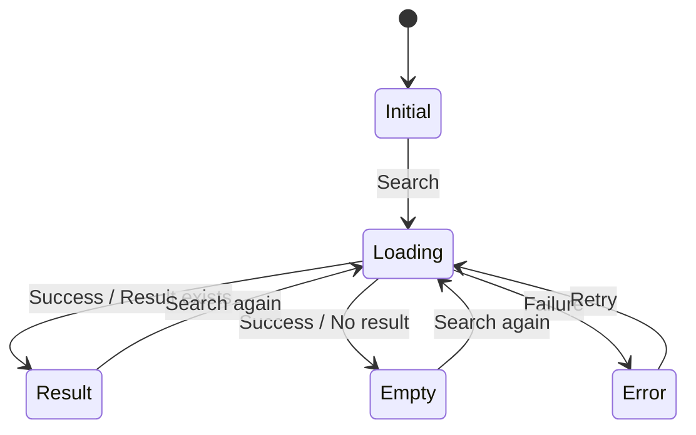
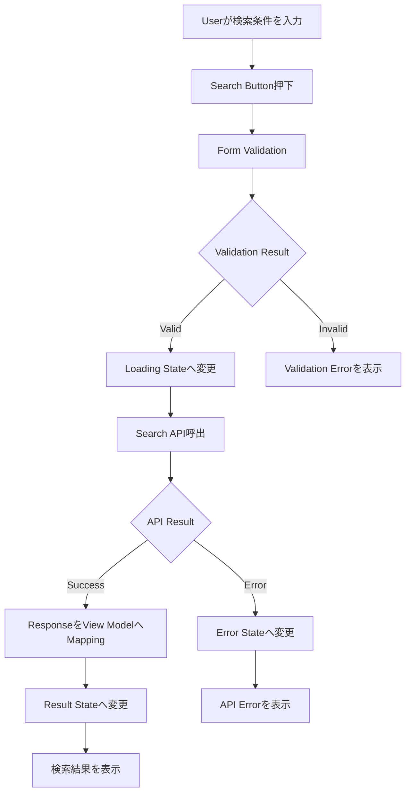
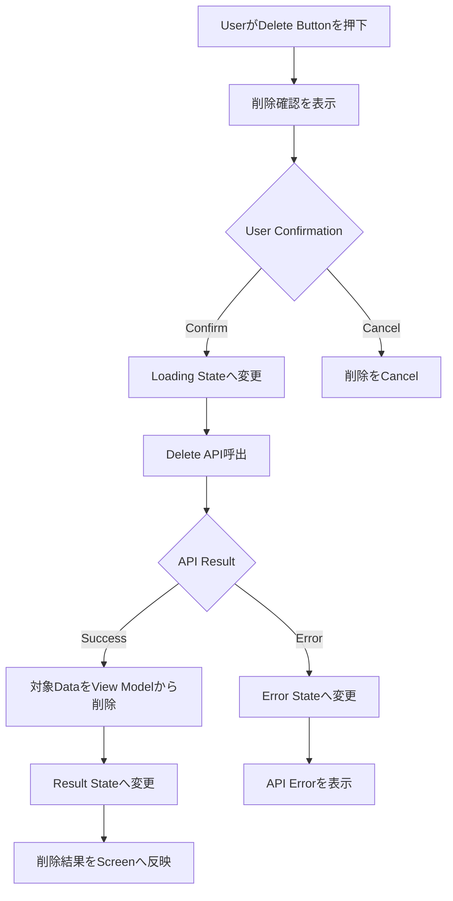
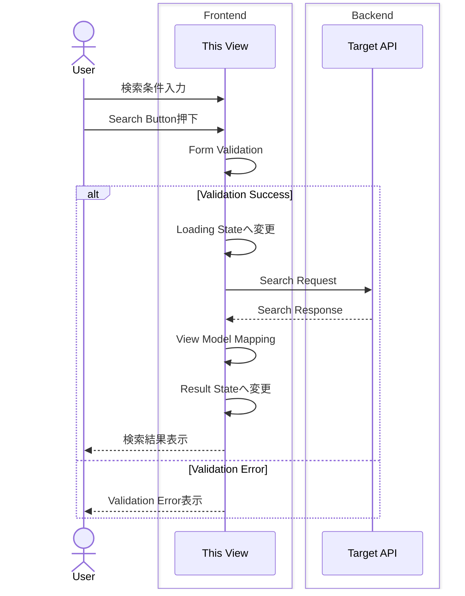
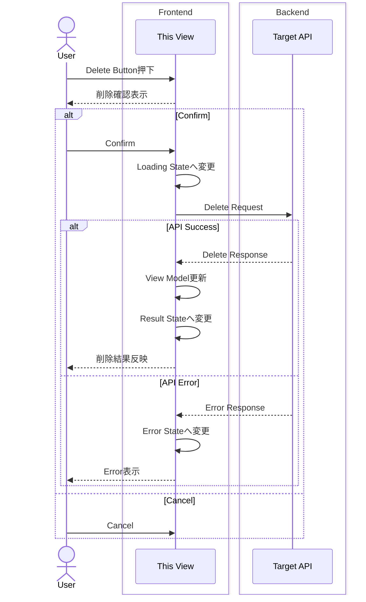

# Content Guide

## **Definition Policy**
- 本UI Specificationは、1 Screenにつき1 Artifactとして作成し、対象Screenを実装可能な粒度まで具体化する。
- Function DesignおよびSystem Architecture等の上位設計で確定したScreenの目的、画面間関係、User Interaction、Business Rule、Application BoundaryおよびArchitecture上のDecisionを前提とし、それらを本Specificationで再定義しない。
- 本Screenが所属するFrontend Applicationを基準として、Screen CompositionおよびUser OperationからScreen UpdateまでのScreen Behaviorを定義する。
- 本SpecificationではScreen固有の仕様を定義し、Color、Typography、Icon、共通Component、Frontend Framework、State Management、Logging等のApplication横断的なRuleは、対応するGuideline等を正とする。
- Error Codeを利用する場合は、共通Error Code定義を参照し、用途および意味が一致する既存の定義を使用する。UI SpecificationでError Codeそのものを再定義せず、本ScreenにおけるPresentationおよびUser Actionを定義する。
- Backend API等の他の設計対象を利用する場合、そのContractや内部仕様を再定義せず、対応するSpecificationを正とする。本Specificationでは、本Screenからの利用方法およびその結果をScreenへ反映するために必要な仕様を定義する。
- Backendから取得したDataをScreen表示に使用する場合は、必要に応じてView ModelへMappingし、BackendのData StructureとUI Componentを直接結合しない。
- 独立した主要User Interactionが複数存在する場合は、Interaction単位で仕様を分割して記載し、一つの巨大なFlowや処理定義へ統合しない。
- 各仕様は、追加の設計判断を行わず実装へ移行できる粒度まで具体化するとともに、同一仕様を複数Sectionで重複して定義せず、その仕様を担当するSectionを正とする。
- 各Sectionは原則としてTableで構造化し、Tree、Mermaid、疑似Code、Code Block等、情報の性質に適した表現を使用する。
- Format and Exampleは記載粒度および構造の基準として扱い、実際のScreenおよびInteractionの特性に応じて、不要な要素の省略および必要な構造の追加・調整を行う。

## **Overview**
- Change History
- Summary

── Screen Composition ──
- Screen Structure
- Component Definition
- Screen State
- Form Definition
- Validation / Display Rules

── Screen Behavior ──
- Interaction Flow
- Sequence
- Processing Details
- Error Presentation

## **Section Guide**
### **0. Change History**
本項目では、本UI仕様書の初回作成、および初回確定後に行われた正式なUI仕様変更の履歴を記録する。

初回作成時は、レビューおよび再レビューを含む作成・確認が完了し、UI仕様書が確定した時点で1件の履歴として記録する。
初回確定前に行われるレビュー指摘への対応、記載内容の修正、表現の改善、誤記修正などは、個別の変更履歴として記録しない。

初回確定後にUI仕様の変更が必要となった場合、または後続のTrainにおいて機能追加・変更等に伴い本UI仕様を変更した場合は、新しい履歴として記録する。

**example**:
| Change | Date | Train | Summary |
| --- | --- | --- | --- |
| Initial Design | [YYYY-MM-DD HH:mm] | [Train] | 初回設計 |
| Change 1 | [YYYY-MM-DD HH:mm] | [Train] | [変更概要] |
| Change 2 | [YYYY-MM-DD HH:mm] | [Train] | [変更概要] |

### **1. Summary**

対象Screenを識別し、その所属Application、画面種別、アクセスPathおよび目的を定義する。

#### **Format and Example**

※以下は記載形式で、内容はあくまで例

| Item | Value |
| --- | --- |
| Physical Name | `contentSearchView` |
| Logical Name | コンテンツ検索画面 |
| Application | `web-frontend` |
| Screen Type | `Page` |
| Route / Path | `/contents/search` |
| Description | 検索条件を指定してコンテンツを検索し、検索結果を確認するための画面。 |

#### **Summary Definition Notes**

- `Physical Name`には、対象Screenを識別する物理名を記載する。
- `Logical Name`には、対象Screenの論理名を記載する。
- `Application`には、対象Screenが所属するFrontend Applicationの物理名を記載する。
- `Screen Type`には、UI上のScreenの性質を表す分類を記載する。`Page`、`Modal`、`Dialog`等を基本とし、対象UIに応じて同等の粒度で追加する。
- `Route / Path`には、対象Screenを識別するRoute / Pathが存在する場合に記載し、独立したRouteを持たない場合は`-`とする。
- `Description`には、対象Screenがユーザーに提供する目的を簡潔に記載する。

<br>
<br>

────────────────────── **Screen Composition** ──────────────────────

### **2. Screen Structure**

対象Screenを構成する領域およびUI Componentについて、包含関係、基本的な表示順序、および画面構造を理解するために必要な位置関係を定義する。

本SectionではScreen全体の論理的な構造を定義し、個々のUI Componentの詳細仕様はComponent Definitionで定義する。

#### **Format and Example**

※以下は記載形式で、内容はあくまで例

```text
Search View
├─ Header [Top]
├─ Sidebar [Left]
│  ├─ Navigation
│  │  ├─ Home Link
│  │  ├─ Search Link
│  │  └─ Favorites Link
│  └─ User Menu
└─ Main Content [Right]
   ├─ Search Header
   │  ├─ Keyword Input [Left]
   │  └─ Category Select [Right]
   ├─ Search Action
   │  └─ Search Button [Right]
   └─ Search Result
      ├─ Result Summary
      └─ Result List
         └─ Result Item
```

#### **Screen Structure Definition Notes**

- ScreenをRootとして、画面を構成する領域およびUI ComponentをTree形式で記載する。
- 親子関係によって、Container / Section等と、その内部に配置されるUI Componentの包含関係を表現する。
- 同一階層の要素は、原則として画面上の基本的な表示順序に従って記載する。
- Tree構造だけでは判別できない重要な位置関係がある場合は、`[Top]`、`[Bottom]`、`[Left]`、`[Right]`、`[Center]`等のAnnotationを付与する。
- Annotationは位置関係の理解に必要な場合のみ使用し、Pixel、Margin、Padding、Width等の具体的なLayout値は記載しない。
- 繰り返し表示されるComponentは、`Result List > Result Item`のように構造として1つだけ記載し、表示件数分を列挙しない。
- 条件によってのみ表示されるComponentもScreen Structureには含め、その表示条件や状態ごとのVisible / HiddenはScreen StateまたはValidation / Display Rulesで定義する。
- 個々のComponentのType、Label、Value、Editable、Required等の内部仕様は記載せず、Component Definitionを正とする。


### **3. Component Definition**

Screen Structureで定義した各UI Componentについて、Componentの種類、表示内容、保持・参照する値、入力・操作特性、および役割を定義する。

本SectionではComponent単体の基本仕様を定義し、状態によって変化する表示・操作可否等はScreen StateまたはValidation / Display Rulesで定義する。

#### **Format and Example**

※以下は記載形式で、内容はあくまで例

| No. | Component | Type | Label / Text | Model / Value | Required | Editable | Description | Note |
| ---: | --- | --- | --- | --- | :---: | :---: | --- | --- |
| 1 | `keywordInput` | Text Input | キーワード | `searchCondition.keyword` | - | ● | 検索Keywordを入力する | - |
| 2 | `categorySelect` | Select | カテゴリ | `searchCondition.category` | - | ● | 検索Categoryを選択する | 選択肢はCategory Masterを使用 |
| 3 | `searchButton` | Button | 検索 | - | - | ● | 検索処理を実行する | - |
| 4 | `resultSummary` | Text | - | `searchResult.totalCount` | - | - | 検索結果件数を表示する | 表示FormatはDisplay Rulesを参照 |
| 5 | `resultList` | List | - | `searchResult.items` | - | - | 検索結果を一覧表示する | - |
| 6 | `resultItem` | List Item | - | `searchResult.items[]` | - | - | 検索結果1件を表示する | Result List内で繰り返し表示 |

##### **Optional: Component Detail**
###### **resultList**

**Column / Item Definition**

| No. | Component / Field | Label | Value | Description |
| ---: | --- | --- | --- | --- |
| 1 | `contentName` | コンテンツ名 | `item.name` | コンテンツ名称を表示する |
| 2 | `category` | カテゴリ | `item.categoryName` | Category名称を表示する |
| 3 | `score` | Score | `item.score` | Scoreを表示する |

#### **Component Definition Notes**

- `Component`には、Screen Structureで定義したUI Componentを識別する物理名を記載する。
- `Type`には、`Text Input`、`Select`、`Button`、`Text`、`List`、`List Item`等、ComponentのUI上の役割を表す種類を記載する。特定FrameworkのComponent Class名には依存させない。
- `Label / Text`には、Componentに固定的に表示するLabel、Button Text、Heading等を記載する。値によって動的に変化する内容は`Model / Value`または後続のDisplay Rulesで定義する。
- `Model / Value`には、Componentが入力・表示する値、または対応するView Model / Form Model等を記載する。固定値のみを表示する場合は必要に応じて`-`とする。
- `Required`は、ユーザー入力として必須の場合は`●`、それ以外は`-`とする。
- `Editable`は、ユーザーが値を入力・変更・選択可能なComponentの場合は`●`、表示専用の場合は`-`とする。
- Componentの表示・非表示、Enabled / Disabled等がScreen Stateや条件によって変化する場合、その条件を本Sectionで重複して定義せず、Screen StateまたはValidation / Display Rulesを正とする。
- Componentに対するUser Actionと、それによって開始される処理はInteraction FlowおよびProcessing Detailsで定義する。
- List、Table、Composite Component等、内部に複数の表示項目・操作要素を持ち、Component Definitionの1行だけでは内部仕様を十分に表現できない場合は、対象Componentの個別Definitionを追加してよい。
- 個別Definitionは必要なComponentにのみ作成し、Component Definitionの記載のみで仕様が明確な場合は作成しない。
- 個別Definitionでは、対象Component内部の項目、表示値、Label、役割等、親Componentの内部構造を具体化する。Component Definitionですでに定義された内容は重複して記載しない。


### **4. Screen State**

対象Screenが取り得る主要なStateと、各StateにおけるUI Componentの表示・操作状態を定義する。

Component自体の基本仕様はComponent Definitionを正とし、本SectionではStateによって変化するComponentの状態のみを定義する。

#### **Format and Example**

※以下は記載形式で、内容はあくまで例

| State | Condition | Component | Visibility | Enabled | Display / Behavior | Note |
| --- | --- | --- | :---: | :---: | --- | --- |
| `Initial` | Screen初期表示時 | `searchButton` | ● | ● | 通常表示 | - |
| `Initial` | Screen初期表示時 | `searchResult` | - | - | 表示しない | - |
| `Loading` | Search API実行中 | `searchButton` | ● | - | 操作不可 | - |
| `Loading` | Search API実行中 | `loadingIndicator` | ● | - | Loading状態を表示 | - |
| `Result` | Search API正常終了かつ検索結果あり | `searchResult` | ● | - | 検索結果を表示 | - |
| `Empty` | Search API正常終了かつ検索結果0件 | `emptyMessage` | ● | - | 検索結果が存在しないことを表示 | - |
| `Error` | Search APIがError終了 | `errorMessage` | ● | - | Error内容を表示 | - |




#### **Screen State Definition Notes**

- `State`には、Screenの表示・操作状態を区別するための論理的なState名を記載する。
- `Condition`には、そのStateが成立する条件または契機を記載する。
- `Component`には、対象Stateによって表示・操作状態が変化するComponentのみを記載する。
- `Visibility`は表示する場合`●`、表示しない場合`-`とする。
- `Enabled`はユーザー操作可能な場合`●`、操作不可の場合`-`とする。操作対象ではないComponentでは`-`とする。
- `Display / Behavior`には、そのStateで適用される表示内容、表示形式またはComponentの振る舞いを記載する。
- Stateによって変化しないComponentは本Sectionに重複して記載せず、Component Definitionを正とする。
- Stateの成立条件にBusiness Ruleが関係する場合、そのBusiness Rule自体を再定義せず、上位設計を前提としてUI上のStateのみを定義する。
- Screen State間の遷移関係が複雑で、Tableだけでは把握しにくい場合は、Mermaidの`stateDiagram-v2`を使用してState Transition Diagramを追加してよい。

### **5. Form Definition**

対象ScreenにFormが存在する場合、Formを構成する入力Fieldについて、入力仕様、ValidationおよびValidation Error時のMessageを定義する。

Formが存在しない場合、本Sectionは省略する。

#### **Format and Example**

※以下は記載形式で、内容はあくまで例

| No. | Field | Component | Type | Required | Size | Min / Max | Pattern | Validation | Validation Message | Note |
| ---: | --- | --- | --- | :---: | --- | --- | --- | --- | --- | --- |
| 1 | `keyword` | `keywordInput` | String | - | 1-100 | - | - | - | - | - |
| 2 | `category` | `categorySelect` | String | ● | - | - | - | 定義済みCategoryであること | カテゴリを選択してください | - |
| 3 | `startDate` | `startDateInput` | Date | - | - | - | `yyyy-MM-dd` | `endDate`以前であること | 開始日は終了日以前の日付を指定してください | Cross-field Validation |
| 4 | `endDate` | `endDateInput` | Date | - | - | - | `yyyy-MM-dd` | `startDate`以降であること | 終了日は開始日以降の日付を指定してください | Cross-field Validation |

#### **Form Definition Notes**

- `Field`にはForm Model上のField名を記載する。
- `Component`には入力を受け付けるComponent Definition上のComponentを記載する。
- `Required`は入力必須の場合`●`、任意の場合`-`とする。
- `Size`、`Min / Max`、`Pattern`には、それぞれField単体に適用する入力制約を記載する。
- `Validation`には他の列だけでは表現できないValidation、および複数Field間のValidationを記載する。
- `Validation Message`にはValidation Error時にユーザーへ表示するMessageを記載する。
- Form Definitionで定義したValidationをValidation / Display Rulesで重複して定義しない。

### **6. Validation / Display Rules**

対象ScreenにおけるValidation Errorの表示方法、およびComponentの値・条件に応じて適用する表示・操作上のRuleを定義する。

Formの入力仕様、Validation条件およびValidation MessageはForm Definition、Componentの基本仕様はComponent Definition、Screen全体のStateによる表示・操作状態の変化はScreen Stateを正とし、本SectionではそれらをUI上でどのように表現・制御するかを定義する。

#### **Format and Example**

※以下は記載形式で、内容はあくまで例

##### **Validation Presentation Rules**

| No. | Target | Condition | Presentation | Description | Note |
| ---: | --- | --- | --- | --- | --- |
| 1 | Input Component | Validation Error | Component直下にValidation Messageを表示 | Error対象の入力ComponentとMessageを対応付けて表示する | - |
| 2 | Input Component | Validation Error | Error Stateとして表示 | Validation Errorが存在することを視覚的に示す | StyleはUI Guidelineを参照 |
| 3 | Form | Validation Errorあり | Submit不可 | Validation Errorが解消されるまでSubmitを許可しない | - |

##### **Display / Interaction Rules**

| No. | Component | Condition | Rule | Description | Note |
| ---: | --- | --- | --- | --- | --- |
| 1 | `resultSummary` | `totalCount > 0` | `{totalCount}件`として表示 | 検索結果件数の表示Format | - |
| 2 | `score` | `score >= 80` | 強調表示 | 高Scoreの結果を視覚的に強調する | Color等はUI Guidelineを参照 |
| 3 | `detailButton` | 対象Dataを参照可能 | Enabled | 詳細画面への操作を許可する | - |
| 4 | `detailButton` | 対象Dataを参照不可 | Disabled | 詳細画面への操作を許可しない | - |
| 5 | `optionalSection` | 表示対象Dataが存在しない | Hidden | 対象Sectionを表示しない | - |

#### **Validation / Display Rules Definition Notes**

- `Validation Presentation Rules`には、Form Definitionで定義されたValidation ErrorをScreen上でどのように表現するかを記載する。
- Validation条件およびValidation Messageそのものは再定義せず、Form Definitionを正とする。
- `Display / Interaction Rules`には、値や条件によって変化する表示Format、Visible / Hidden、Enabled / Disabled、強調表示等を記載する。
- Business Ruleそのものは再定義せず、そのRuleをUI上でどのように表示・操作制御へ反映するかを記載する。
- Screen全体のStateによってComponentの状態が変化する場合はScreen Stateを正とし、本Sectionでは個別条件に基づくRuleのみを定義する。
- Color、Typography、Icon等に共通Ruleが存在する場合は対応するUI Guidelineを正とし、本Sectionでは適用条件または意味のみを記載する。

────────────────────── **Screen Behavior** ──────────────────────

### **7. Interaction Flow**

対象Screenにおける主要なUser Operationを起点として、操作結果がScreenへ反映されるまでの処理Flowを定義する。

本Sectionでは、User Operation、Validation、Frontend内部処理、Backend API等との連携、View ModelへのMapping、およびScreen Updateを含む一連のInteractionを縦方向に俯瞰する。

各処理の具体的な実行内容はProcessing Detailsを正とする。

#### **Format and Example**

※以下は記載形式で、内容はあくまで例

##### **Pattern A: Search**


##### **Pattern B: Delete**



#### **Interaction Flow Definition Notes**
- Flowは、対象Screenにおける主要なUser Operationを起点として記載する。
- User Operationから最終的なScreen Updateまで、ユーザーから見た一連のInteractionを成立させる主要処理を記載する。
- Formを使用する場合は、必要に応じてForm ValidationおよびValidation Error時の分岐を含める。
- Backend API等との連携が存在する場合は、API呼出しとその結果に応じた主要な分岐を記載する。
- APIのEndpoint、Request / Response Field等の詳細仕様は再定義せず、対応するAPI Specificationを正とする。
- API Response等からView Model / Screen表示用DataへのMappingが必要な場合は、その処理の存在をFlow上に明示する。具体的なMappingはProcessing Detailsで定義する。
- Screen Stateが変化する場合は、Loading Stateへ変更、Result Stateへ変更等、Screen Stateで定義されたStateへの遷移を明示する。
- Validation条件、Display Rule、Screen Stateそのものは再定義せず、それぞれForm Definition、Validation / Display Rules、Screen Stateを正とする。
- 個々の処理の具体的なLogic、Mapping、Error処理等はProcessing Detailsで定義する。
- 対象Screenに独立した主要User Operationが複数存在する場合は、Interaction単位でFlowを分割して記載する。

### **8. Sequence**

対象Screenにおける主要なUser Interactionについて、User、This View、およびTarget API等の連携先とのInteractionを時系列で定義する。

本Sectionでは対象Screenから見える範囲のInteractionを対象とし、Backend API等の連携先内部の処理には展開しない。

#### **Format and Example**

※以下は記載形式で、内容はあくまで例

##### **Pattern A: Search**



##### **Pattern B: Delete**



#### **Sequence Definition Notes**

- Sequenceは、対象Screenにおける主要なUser Operationを起点として記載する。
- `Frontend`には、本Specificationで定義する`This View`を配置する。
- `This View`は本Specificationで定義するScreenを表す。
- Backend APIを利用する場合は、`Backend`内に`Target API`として表現し、具体的なAPIは対応するAPI Specificationを参照する。
- Frontend内部で完結するValidation、View Model Mapping、Screen State変更等は、必要に応じて`This View`から`This View`へのSelf Messageとして表現する。
- Backend API内部のApplication Service、Database、External Service等には展開せず、`Target API`へのRequestおよび`Target API`からのResponseまでを本Sequenceの範囲とする。
- Request / ResponseのField、Endpoint、HTTP Method等のAPI Contractは再定義せず、対応するAPI Specificationを正とする。
- Validation条件はForm Definition、Screen StateはScreen State、表示・操作RuleはValidation / Display Rulesを正とし、本SectionではInteraction上必要な適用箇所のみを表現する。
- 条件によってInteractionが分岐する場合は、Mermaidの`alt` / `else`等を使用して表現する。
- 対象Screenに独立した主要User Interactionが複数存在する場合は、Interaction単位でSequenceを分割する。
- Interaction FlowとSequenceは原則として対応する単位で作成し、Interaction Flowでは処理を縦方向、SequenceではUserおよび連携先とのInteractionを横方向から表現する。

### **9. Processing Details**

対象ScreenにおけるUser OperationからScreen Updateまでの具体的な処理を、Interaction単位かつStep単位で定義する。

Interaction FlowおよびSequenceで定義した処理を、条件分岐、API連携、Data Mapping、Screen State変更等を含め、追加の設計判断を行わず実装へ移行できる粒度まで具体化する。

#### **Format and Example**

※以下は記載形式で、内容はあくまで例

##### **Pattern A: Search**

###### **Step 1. User Operation**

**1.1.** Userが検索条件を入力する。

**1.2.** Userが`searchButton`を押下する。

**1.3.** **Step 2**へ進む。

**Note**: [必要な場合のみ記載]


###### **Step 2. Form Validation**

**2.1.** Form Definitionに基づいて検索条件をValidationする。

```text
if Validation Errorが存在する:
    Validation / Display Rulesに従ってValidation Errorを表示する。
    処理を終了する。
else:
    Step 3へ進む。
```

**Note**: Validation条件およびValidation MessageはForm Definitionを正とする。


###### **Step 3. API Request**

**3.1.** Screen Stateを`Loading`へ変更する。

**3.2.** Target APIへ送信するRequestを生成する。

**Request Target**

| Item | Value |
| --- | --- |
| API | `[Target API]` |

**Request Mapping**

| Target Field | Source |
| --- | --- |
| `keyword` | Form.`keyword` |
| `category` | Form.`category` |

**3.3.** Target APIへRequestを送信する。

**3.4.** Responseに応じて以下の処理を行う。

```text
if APIの処理が正常終了:
    Step 4へ進む。
else:
    Step 6へ進む。
```

**Note**: Endpoint、HTTP Method、Request / Response ContractおよびError ContractはTarget APIのSpecificationを正とする。


###### **Step 4. View Model Mapping**

**4.1.** Target APIから取得したResponseを、Screen表示用のView ModelへMappingする。

**View Model Mapping**

| View Model | Target Field | Source |
| --- | --- | --- |
| `searchResult` | `totalCount` | API Response.`result.totalCount` |
| `searchResult` | `items[].id` | API Response.`result.items[].id` |
| `searchResult` | `items[].name` | API Response.`result.items[].name` |
| `searchResult` | `items[].categoryName` | API Response.`result.items[].category.name` |
| `searchResult` | `items[].score` | API Response.`result.items[].score` |

**4.2.** Mappingが完了した場合は、**Step 5**へ進む。


###### **Step 5. Screen Update**

**5.1.** View Modelの内容に応じてScreen Stateを変更する。

```text
if searchResult.itemsが1件以上存在する:
    Screen StateをResultへ変更する。
else:
    Screen StateをEmptyへ変更する。
```

**5.2.** Component Definitionで定義された`Model / Value`に基づいて、View Modelの値を各Componentへ反映する。

**Display Mapping**

| Component | Model / Value |
| --- | --- |
| `resultSummary` | `searchResult.totalCount` |
| `resultList` | `searchResult.items` |
| `resultItem` | `searchResult.items[]` |

**5.3.** Validation / Display Rulesに基づいて表示Formatおよび表示状態を反映する。

**5.4.** Screen Updateを完了し、処理を終了する。


###### **Step 6. Error Handling**

**6.1.** Target APIから返却されたErrorを取得する。

**6.2.** Errorの内容に応じてScreen Stateを`Error`へ変更する。

**6.3.** Validation / Display RulesおよびError Presentationに基づいてErrorをScreenへ表示する。

**6.4.** 処理を終了する。

**Note**: [必要な場合のみ記載]


#### **Processing Details Definition Notes**

- 各Interactionの処理は`Step N`を単位として分割し、`###### **Step N. [Title]**`の形式で記載する。
- Step内の処理には親Stepの番号を引き継ぎ、`N.1`、`N.2`、`N.3`...の形式で連番を付与する。
- 各Stepは、追加の設計判断を行わず実装へ移行できる粒度まで具体化する。
- 条件分岐や繰り返し処理は、必要に応じて疑似コードを使用して構造を明確にする。
- 他Stepへ処理を遷移する場合は、遷移先を`Step N`として明示する。
- FormからAPI Request、API ResponseからView Model等、Data間のMappingが必要な場合はStep内にTableとして記載する。
- Backend APIを利用する場合、Endpoint、HTTP Method、Request / Response Contract等を再定義せず、対応するAPI Specificationを正とする。
- API Response等のBackend DataをScreen表示へ使用する場合は、必要に応じてView ModelへMappingし、Backend DataとUI Componentを直接結合しない。
- View ModelとUI Componentの対応はComponent Definitionの`Model / Value`を前提とし、Processing DetailsではMappingおよび更新処理に必要な関係のみを記載する。
- Screen Stateを変更する場合は、Screen Stateで定義されたStateを使用する。
- Validation条件およびValidation MessageはForm Definition、表示・操作上のRuleはValidation / Display Rulesを正とする。
- 補足事項が必要な場合のみ、Step末尾に`**Note**:`を記載する。
- Format and Exampleは記載粒度および構造の基準を示すものであり、実際のScreenおよびInteractionの特性に応じて、不要な要素の省略、必要な処理・Table・疑似コード等の追加、およびStep構成の調整を行う。


### **10. Error Presentation**

対象Screenで発生または受信したErrorについて、ユーザーに対する表示方法、表示内容、およびError発生後に可能とする操作を定義する。

Backend APIから返却されるErrorのCode、HTTP Status、Error Message等のContractは対応するAPI Specificationを正とし、本SectionではErrorをScreen上でどのように表現するかを定義する。

Form Validation Errorについては、Form DefinitionおよびValidation / Display Rulesを正とし、本Sectionでは主としてAPI連携やScreen処理によって発生するErrorを対象とする。

#### **Format and Example**

※以下は記載形式で、内容はあくまで例

| No. | Error Type | Error / Condition | Target | Presentation Type | Display Content | User Action | Note |
| ---: | --- | --- | --- | --- | --- | --- | --- |
| 1 | API Error | `E002` | `errorMessage` | Inline Message | API Response.`errorMessage` | 検索条件を変更して再実行可能 | - |
| 2 | API Error | `E003` | `errorDialog` | Dialog | API Response.`errorMessage` | Dialogを閉じて操作を継続可能 | - |
| 3 | API Error | `E999` | `errorDialog` | Dialog | システムエラーが発生したことを表示 | Retry可能 | 詳細な内部Errorは表示しない |
| 4 | Communication Error | API Responseを正常に取得できない | `errorDialog` | Dialog | 通信に失敗したことを表示 | Retry可能 | Timeout / Network Error等 |
| 5 | Unmapped Error | API Responseを受信したが、Error Codeを既知のErrorへMappingできない | `errorDialog` | Dialog | システムエラーが発生したことを表示 | Retryまたは画面再読込 | ResponseのError内容を直接表示しない |

#### **Error Presentation Definition Notes**

#### **Error Presentation Definition Notes**

- `Error Type`には、Frontendから見たErrorの種類を記載する。
  - `API Error`: Backend APIからResponseを正常に受信し、Frontendが認識可能なError Codeが返却された場合。
  - `Communication Error`: Network Error、Timeout等によりBackend APIからResponseを正常に取得できない場合。
  - `Unmapped Error`: Backend APIからResponseは正常に受信したが、返却されたError CodeをFrontendが認識可能なErrorへMappingできない場合。
- `Error / Condition`には、`API Error`の場合は対象Error Codeを、それ以外の場合はErrorを判定するConditionを記載する。
- `Unmapped Error`では、未知のError CodeやBackend内部のError情報をそのままユーザーへ表示せず、画面として定義されたFallback Presentationを使用する。
- `Error / Condition`には、Presentationを適用するError CodeまたはFrontend側で検知するError Conditionを記載する。
- Backend APIから返却されるError Code、HTTP Status、Error Message等は再定義せず、対応するAPI Specificationを正とする。
- `Target`には、Errorを表示するComponent Definition上のComponentを記載する。
- `Presentation Type`には、`Inline Message`、`Dialog`、`Toast`等、Errorをユーザーへ提示する方法を記載する。
- `Display Content`には、APIから返却されたMessageを使用する場合はその参照元を、Frontend側で表示内容を定義する場合はその内容を記載する。
- `User Action`には、Error表示後にユーザーが実行可能な操作を記載する。Retry、入力修正、画面遷移、Dialog Close等を必要に応じて定義する。
- Error発生時にScreen Stateを変更する場合は、Screen Stateで定義されたStateを使用する。
- Form Validation Errorの条件およびValidation MessageはForm Definition、Validation Errorの画面上の表示方法はValidation / Display Rulesを正とし、本Sectionで重複して定義しない。
- Color、Icon、Typography等の共通的なError表現はUI Guideline等の横断的なRuleを正とし、本Sectionでは適用するPresentation Typeおよび画面固有の振る舞いのみを定義する。
- Backend内部のException、Stack Trace、内部Error Detail等、ユーザーへ公開しない情報は本Sectionで表示仕様として定義しない。

